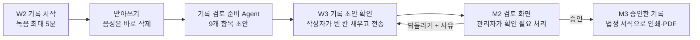
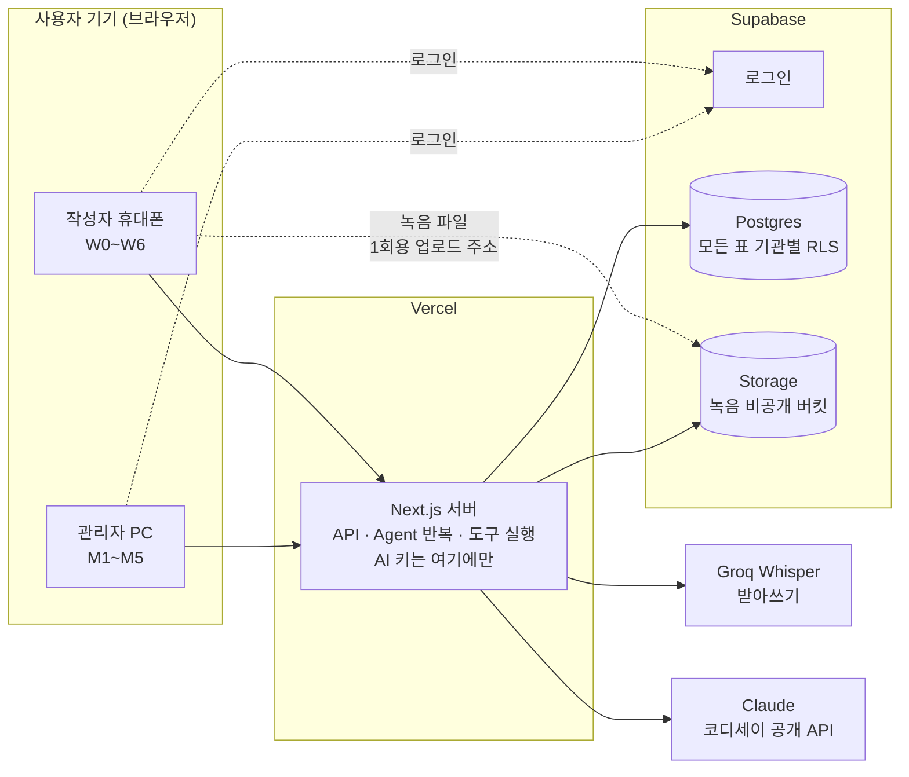

# 케어브릿지 CareBridge

**외국인 요양보호사가 녹음 하나로 한국어 돌봄 기록 초안을 만들고, 관리자가 확인해 승인하는 서비스입니다.**

화면은 한국어가 위, 모국어가 아래입니다. 최종 기록은 항상 한국어이고, AI 결과는 사람이 확인하기 전까지 초안입니다.

| 바로가기 | |
| --- | --- |
| 시연 사이트 | https://carebridge-codyssey.vercel.app (실제 AI 연결) |
| 시연 영상 | [2026-10-31 시연 영상](data/demo/2026-10-31-시연영상.mp4) |
| 기획안 | [기획안 v2.0.0](문서/기획/기획-v2.0.0.md) |
| 팀 | 돌봄잇 · 대전 코디세이 AI 네이티브 1기 Final-Project |

## 어떤 문제를 푸나

**1. 돌봄 인력이 늙고 줄어, 외국인 요양보호사가 늘고 있습니다.**
- 요양보호사 평균연령은 67.1세이고, 2027년 돌봄 인력이 약 7.9만 명 부족할 것으로 예상됩니다. 정부는 특정활동(E-7) '요양보호사' 직종을 시범으로 열었습니다.[1]
- 2025년부터 유학(D-2)·구직(D-10) 비자 외국인도 요양보호사 교육을 받고, 노인의료복지시설에 취업하면 E-7 비자를 받을 수 있습니다. 한국어 요건은 TOPIK 3급 수준입니다.[2]

**2. 말은 통해도, 한국어 기록 문장은 어렵습니다.**
- 외국인요양보호사교육원 교육원장 인터뷰: 가장 큰 벽은 장기요양 용어입니다. 기록은 "적게 드심"이 아니라 "세 숟갈 드심"처럼 객관적·구체적으로 써야 하고, 요양보호사 본인 책임입니다.[3]
- 간호사 인터뷰: 요양보호사는 식사·배설·피부 같은 관찰 사실을 쓸 수 있지만, 진단이나 정상/비정상 판단은 쓸 수 없습니다.[3]
- 멘토가 정리한 문제: 용어를 이해하기 어렵고, 무엇을 기록할지 판단하기 어렵고, 한국어 문장으로 쓰는 데 오래 걸립니다.[3]

**3. 그래서 케어브릿지는** 기록 문장 쓰기를 돕되 판단은 사람(작성자와 관리자)이 하게 만듭니다. 공단 앱 같은 기존 청구 시스템을 대체하지 않고, 법정 급여제공기록지(시설 별지 제16호, 재가 방문요양 별지 제12호)를 쓰는 일을 돕습니다.

## 핵심 기능



| 누가 | 화면 | 하는 일 |
| --- | --- | --- |
| 작성자 (휴대폰) | W1 오늘 · W2 기록 시작 · W3 기록 초안 확인 · W4 기록 | 녹음하거나 글로 쓰면 AI가 9개 항목으로 나눈 초안을 보여 줍니다. 항목마다 한국어 기록과 모국어 뜻, 🔊 듣기, 원문 근거가 있습니다. 빈 칸이나 애매한 곳만 '확인 필요'로 표시되어, 그 칸을 눌러 말하거나 써서 채웁니다. |
| 작성자 | W6 도우미 | 사투리 뜻, 어르신·가족에게 할 말, 표준교재 상황 대처를 묻습니다. 답에는 교재 장·쪽 출처가 붙고, 건강·안전 질문은 "관리자에게 먼저 보고"를 맨 위에 둡니다. 나눈 대화는 '이전 대화'에서 다시 열 수 있습니다. |
| 관리자 (PC) | M1 검토 대기 · M2 검토 화면 | 항목을 고치거나, '확인 필요' 항목마다 [확인함] 또는 [기록 안 함]을 고릅니다. 남은 항목이 있으면 **승인할 수 없고, 서버도 승인 요청 때 다시 검사합니다.** 되돌릴 때는 사유가 작성자 모국어로 번역되어 전달됩니다. |
| 관리자 | M3 승인한 기록 · M4 어르신·작성자 · M5 설정 | 승인한 기록을 법정 서식 칸에 맞춰 1건씩 인쇄·PDF로 남깁니다. 기간 인쇄로 어르신 한 분의 여러 날 승인 기록을 한 장(제12호 7일, 제16호 3일)에 모아 찍을 수도 있습니다. 가입 코드로 같은 기관 작성자를 받습니다. |
| 교육용 기관 | 같은 화면 | 교육생·강사가 합성 어르신으로 현장과 같은 흐름을 연습합니다. 모든 화면과 PDF에 '연습용'이 표시되고 승인 통계에서 빠집니다. |

화면별 자세한 내용은 [화면 설계 v2.3.3](문서/설계/화면-v2.3.3.md)에 있습니다.

## AI를 어떻게 썼나

AI가 할 일과 코드가 할 일을 나눴습니다. AI는 자연어를 기록 항목으로 정리하고, 승인·권한·상태처럼 틀리면 안 되는 일은 코드가 맡습니다.

| 부분 | 무엇을 쓰나 | 왜 |
| --- | --- | --- |
| 받아쓰기 | Groq Whisper `whisper-large-v3` | 합성 음성 비교에서 금액·숫자를 지어내지 않았습니다. 글자로 바뀌면 음성 파일은 바로 지웁니다. |
| 기록 검토 준비 Agent | Claude (코디세이 공개 API, tool use) | 한 번 호출로 끝내지 않고, Claude가 도구 4개를 골라 부르며 스스로 근거를 확인합니다(최대 4번). |
| 짧은 번역·항목 보태기·도우미 | Claude (한 번 호출, 가벼운 모델) | Agent가 필요 없는 일은 비용을 줄입니다. |

**Agent 도구 4개** (서버 코드가 실행하고, 호출은 모두 `agent_steps`에 남겨 M2의 'AI 작업 기록'으로 보여 줍니다)

| 도구 | 하는 일 |
| --- | --- |
| `get_form_spec` 서식 기준 조회 | 별지 제16호·제12호의 칸·선택지·작성 기준을 가져옵니다. |
| `search_glossary` 용어 검색 | 일상 표현을 교재 용어로 바꿀 때 팀이 만든 용어 목록 안에서만 찾습니다. |
| `validate_draft` 기록 검증 | 근거 없는 내용, 숫자·시간 오류, 실명, 짧은 근거를 서버 규칙으로 검사합니다. |
| `return_draft` 초안 반환 | 정해진 모양으로만 초안을 돌려줍니다. 사람이 고친 항목은 덮어쓰지 않습니다. |

**지어내지 않게 하는 규칙**
- 원문에 없으면 '언급 없음'(빈칸), 짐작했거나 애매하면 '확인 필요'로 둡니다. 진단·건강 판단은 하지 않습니다.
- 사람(작성자·관리자)이 쓴 항목은 AI가 덮어쓰지 않습니다.
- 승인 조건, 권한(RLS), 시간 합 계산, 상태 변화는 코드가 맡습니다.
- 어르신 실명·사진은 AI 입력에 넣지 않고, 시연·측정은 합성 사례만 씁니다.

**측정:** 팀이 만든 합성 사례 10건(시설 5, 재가 5)과 정답표로 잽니다. 11/04 코디세이 배포본에서 10건을 모두 돌린 결과, 10건 모두 초안이 나왔고 항목 상태가 정답표와 맞은 것은 90개 중 80개(88.9%), 지어낸 내용은 0건이었습니다. 맞지 않은 10개는 특이사항을 비운 3개, 조심스럽게 '확인 필요'로 남긴 4개, 지원·수면 판단 차이 3개입니다([data/README.md](data/README.md), [#275](https://github.com/2dion/CareBridge/issues/275)). 앞선 10/28 첫 측정(합성 사례 1건)에서는 받아쓰기가 "빨개요"를 "밝아요"로 잘못 들었을 때 Agent가 짐작하지 않고 '확인 필요'로 남겼고, 지어낸 내용은 0건이었습니다. 프롬프트 캐시로 건당 차감 토큰을 약 3.2만에서 1.7만으로 줄였습니다. 자세한 기준과 결과는 [AI 규칙 v2.0.5 '품질 확인 방법'](문서/설계/ai규칙-v2.0.6.md#품질-확인-방법)에 있습니다.

## 아키텍처



- 휴대폰과 PC는 서버만 부릅니다. Claude·받아쓰기 키는 서버 환경 변수에만 있고 브라우저 코드에는 없습니다.
- 녹음 파일은 1회용 주소로 Storage에 바로 올리고, 받아쓰기가 끝나면 지웁니다. 남은 파일은 정해진 시간마다 정리합니다.
- 모든 표는 기관별 RLS로 나눠, 다른 기관 기록은 읽을 수 없습니다.

| 부분 | 쓰는 것 |
| --- | --- |
| 화면 + 서버 | Next.js 16 (TypeScript), Tailwind CSS, 반응형 웹앱 하나 |
| 배포 | Vercel |
| DB·로그인·파일 | Supabase (Postgres + RLS + Storage) |
| AI | Claude (코디세이 공개 API), Groq Whisper |
| 녹음·듣기·인쇄 | 브라우저 MediaRecorder, 브라우저 TTS, 인쇄 CSS |

고른 이유와 대안은 [기술 선택 v2.0.0](문서/설계/기술선택-v2.0.0.md), 표·권한·API는 [데이터 구조 v2.3.7](문서/설계/데이터구조-v2.3.10.md)에 있습니다.

## 팀과 협업

| 역할 | 맡은 일 | 주요 산출물 |
| --- | --- | --- |
| 팀장 (PM) | 범위·일정·결정, 문서 체계와 AI 코딩 기준 | [기획안](문서/기획/기획-v2.0.0.md), [결정 기록](문서/결정/README.md), [AGENTS.md](AGENTS.md) |
| 기획 담당 | 사용자 흐름, 화면 구성, 발표 구성 | 기획안, [화면 설계](문서/설계/화면-v2.3.3.md) |
| 백엔드 담당 | DB 표·RLS, API, 받아쓰기·Agent 서버 | [supabase/](supabase/README.md), `web/` 서버 코드 |
| 프론트엔드 담당 | 디자인, 작성자·관리자·계정 화면 | `web/` 화면 코드 |
| QA 담당 | 테스트 계획과 실행, 교육원장 인터뷰, 백엔드 보조 | [시연·일정 '테스트 계획'](문서/설계/시연-일정-v2.0.0.md) |
| 데이터 담당 | 합성 사례·정답표, 용어 목록, 교재 매뉴얼, 법정 서식 원문 정리 | [data/](data/README.md) |

**어떻게 함께 일했나**
- **브랜치 → PR:** 기본 브랜치는 보호되어 있어 모든 변경이 PR로 들어가고, PR마다 "web 검사"(린트·형식·타입·테스트)가 돕니다. → [Pull requests](https://github.com/2dion/CareBridge/pulls?q=is%3Apr)
- **이슈:** 남은 문제와 두 담당 이상이 걸린 일은 이슈를 먼저 쓰고, 담당·기한 라벨을 붙입니다. → [Issues](https://github.com/2dion/CareBridge/issues?q=is%3Aissue)
- **결정 기록:** 공통 계약이나 결정표를 바꿀 때는 배경·대안·사유를 [문서/결정/](문서/결정/README.md)에 먼저 남깁니다.
- **회의록:** 멘토링과 기획 회의 결과는 [문서/회의록/](문서/회의록/)에 있습니다.
- **같은 기준으로 AI 코딩:** 팀원마다 AI 코딩 도구를 쓰기 때문에, 공통 원칙·문서 우선순위·검사 명령을 [AGENTS.md](AGENTS.md) 하나에 두고 모든 도구가 읽게 했습니다.

## 문서 안내

| 무엇을 알고 싶나 | 문서 |
| --- | --- |
| 무엇을 왜 만드나 | [기획안 v2.0.0](문서/기획/기획-v2.0.0.md) |
| 화면 W0~W6, M1~M5, A1~A2 | [화면 설계 v2.3.3](문서/설계/화면-v2.3.3.md) |
| 표·권한·공통 계약 | [데이터 구조 v2.3.7](문서/설계/데이터구조-v2.3.10.md) |
| AI가 지켜야 할 규칙과 품질 측정 | [AI 규칙 v2.0.6](문서/설계/ai규칙-v2.0.6.md) |
| 기술을 고른 이유 | [기술 선택 v2.0.0](문서/설계/기술선택-v2.0.0.md) |
| 시연 시나리오·일정·테스트 | [시연·일정 v2.0.0](문서/설계/시연-일정-v2.0.0.md) |
| 화면·코드·문서가 같이 쓰는 이름 | [용어집 v2.0.6](문서/설계/용어집-v2.0.6.md) |
| 무엇을 언제 왜 정했나 | [결정 기록](문서/결정/README.md) |

## 개발자 안내

```bash
cd web
npm ci
cp .env.example .env.local   # 키 없이도 Mock 모드로 돌아감
npm run dev                  # http://localhost:3000
npm run check                # 린트·형식·타입·테스트
```

Node.js 22 이상이 필요합니다. 환경 변수와 키, 검사 명령, 폴더 구조는 [web/README.md](web/README.md)에 있습니다. AI 코딩 도구로 작업한다면 먼저 [AGENTS.md](AGENTS.md)를 읽습니다.

| 용도 | 기준 브랜치 | 사이트 | Supabase |
| --- | --- | --- | --- |
| 코디세이 개발 | `main-codyssey` | https://carebridge-codyssey.vercel.app | `CareBridge-Codyssey` |
| 공모전 보존 | `main-contest` (11/04 전 이름 `main`) | (보존용, 변경하지 않음) | `CareBridge` |

**공모전 환경(`main-contest`, Vercel `care-bridge`, Supabase `CareBridge`)은 변경하지 않습니다.** 코디세이 작업 브랜치는 `main-codyssey`에서 만들고 PR도 `main-codyssey`로 올립니다. GitHub 기본 브랜치도 `main-codyssey`입니다. 자세한 기준은 [AGENTS.md](AGENTS.md#공모전-환경-변경-금지), [환경 분리 결정](문서/결정/2026-11-02-공모전코디세이분리.md), [기본 브랜치 전환 결정](문서/결정/2026-11-04-기본브랜치전환.md)에 있습니다.

| 폴더 | 넣는 것 |
| --- | --- |
| `web/` | 앱 코드 (Next.js) |
| `supabase/` | DB 표·권한(RLS) 설정 |
| `data/` | 합성 사례, 용어 목록, 교재 매뉴얼, 서식 기준 |
| `문서/` | 기획·설계 문서, 결정 기록, 회의록. 파일 이름 규칙은 [문서/README.md](문서/README.md) |
| `참고자료/` | 밖에서 받은 자료와 제출한 파일 |

## 참고 자료

1. [복지로, "요양보호 분야에 전문적인 외국인 근로자 활용을 늘립니다"](https://www.bokjiro.go.kr/ssis-tbu/cms/pc/news/promotion/1306914_1118.html) (법무부, 2024-07-08)
2. [법무부 출입국·외국인정책본부, "외국인 유학생의 요양보호사 자격취득과 E-7 비자변경 제도 안내"](https://immigration.go.kr/bbs/immigration/220/593873/artclView.do) (2025-04-04)
3. [기획안 v2.0.0 '문제와 배경'](문서/기획/기획-v2.0.0.md#문제와-배경)과 [회의록](문서/회의록/) (교육원장·간호사 인터뷰, 10/15 멘토링)
