# 케어브릿지 유스케이스 명세 — 개요

> **쉽게 말하면** — 케어브릿지를 쓰는 사람(요양보호사, 담당자)이 시스템으로 무엇을 하는지 다섯 가지 장면으로 나눈 목록입니다. 각 장면의 상세 흐름은 UC_01~UC_05 문서에 있습니다.

## 1. 원천과 범위

| 항목 | 값 |
|---|---|
| 대상 시스템 | 케어브릿지 (외국인 요양보호사 관찰 메모 → 한국어 기록지 초안 → 담당자 승인) |
| 원천 | ① 「케어브릿지 비즈니스 모델 캔버스」(2026-10-06) ② 「(기획 담당) PM용 기획서」 ③ 「(기획 담당) 구현 명세서」 |
| 범위 | 구현 명세서 1장의 필수 기능 F1~F5. 선택 기능 S1(응급 보고)·S2(음성 입력)는 미결정(구현 명세서 OPEN-05·06)이라 제외 |
| 작성 형식 | 2단계 유스케이스 생성 프롬프트. `references/format-spec.md` B절은 받지 못해 14속성 구성은 [추론] (§6 참고) |

원천 표기 약어: `BMC-<블록>` = 비즈니스 모델 캔버스 블록, `PM용 기획서 <절>` = (기획 담당) PM용 기획서, `구현 명세서 <장>` = (기획 담당) 구현 명세서.

## 2. 액터

| 액터 | 유형 | 설명 | 원천 |
|---|---|---|---|
| 요양보호사 | 주 액터(사람) | 베트남어로 관찰 메모를 쓰고 초안을 확인·제출 | 구현 명세서 3장 caregiver, BMC-가치제안 |
| 담당자 | 주 액터(사람) | 사회복지사·팀장. 제출된 초안을 검토·수정·승인·반려 | 구현 명세서 3장 reviewer, BMC-가치제안 |
| 외부 AI 서비스 | 부 액터(외부 시스템) | 가명처리된 메모로 칸 채우기(P3)와 모국어 설명(P5) 수행. 제공사는 미정 | 구현 명세서 8장, 구현 명세서 OPEN-04 |

관리자(admin)는 이번 범위에서 화면·API가 없고 시드 스크립트로 대신하므로 액터에서 뺐습니다(구현 명세서 3장).

## 3. 유스케이스 목록

| ID | 유스케이스명 | 주 액터 | 부 액터 | 우선순위 | 원천 근거 | 상태 |
|---|---|---|---|---|---|---|
| UC1 | 관찰 메모 작성 및 초안 생성 | 요양보호사 | 외부 AI 서비스 | 필수 | 구현 명세서 F1·F5, 8장 / BMC-핵심활동·이네이블러 | 작성 완료 |
| UC2 | 초안 확인 및 제출 | 요양보호사 | 외부 AI 서비스 | 필수 | 구현 명세서 F2·F3 / BMC-가치제안 | 작성 완료 |
| UC3 | 기록 검토 및 승인 | 담당자 | — | 필수 | 구현 명세서 F4 / BMC-핵심장벽(책임 소재) | 작성 완료 |
| UC4 | 반려된 초안 보완 및 재제출 | 요양보호사 | 외부 AI 서비스 | 필수 | 구현 명세서 AC3-6, POST /notes, TC-15·19·20 / PM용 기획서 서비스 흐름 | 작성 완료 |
| UC5 | 승인 기록 조회 및 PDF 내보내기 | 담당자 | — | 필수 | 구현 명세서 AC4-6, 10장, TC-16 | 작성 완료 |

포함(include) 관계로 묶은 내부 기능: **개인정보 가명처리**(UC1·UC2·UC4가 포함), **모국어 설명 생성**(UC1·UC2·UC4가 포함). UC4의 보완 방법은 **추가 메모로 초안 재생성**(기본)과 **확인 요청에 답변**(대체) 두 가지입니다. 반려는 UC3의 확장(extend)이며, 반려 이후의 행동은 UC4로 분리했습니다.

## 4. 전체 유스케이스 다이어그램

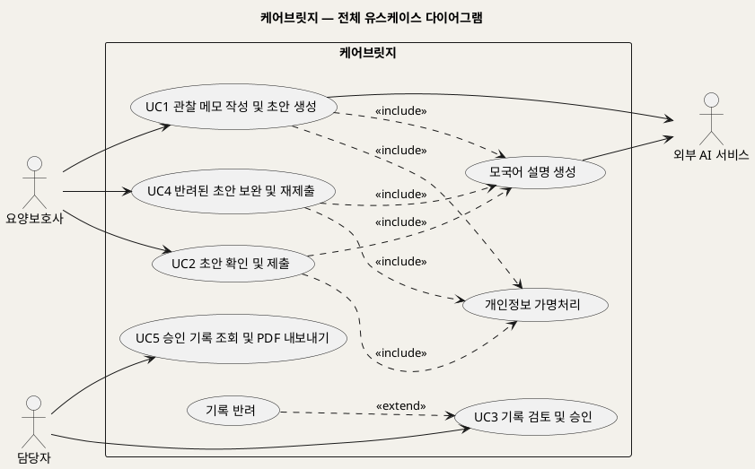

**[「케어브릿지 전체 유스케이스」 PlantUML 뷰어로 열기](https://plantuml.sumzip.com/plantuml/svg/eNp1U11L22AUvs-vOHTXivbjZkjR1Va8K26T3UlMYg3GZCQpG4xBcN0QK0yhLa2kJUJxKg6yLnMpDPZfdpn39D_s5KPajPUmHN7n4zzvOW9WDZPXzfqhAnVhR-B1aVeXxZq0s7TEGQey-prX-UPY5YWDmq7VVbGkKZoOTyq5ynL52QzD2OdF7Y2s1mCPVwyJU6Q9E0wNdLm2b4Io65JgyprKmbKpSIC_LOx4zD9lV7_xiwV_rBag08CRB2g7eDIMCX2PCmDNYVh1vOCnzwbXHC-YFCCDFy3snLPv3qTr49FdBngDShtTlDU91hzj4Cw639p-UPV8dm_B2iZgw2bjBjWIGGubXBiQV2sULvNPugy84wDqhiTwBqEvS8sQeBa6LrCbFru9BhycY-MbMPczoHeM7WPAD306iayJnlZnp6RJr419P5Y5Nt7bCT-b5ucg8F122YdgZE0-OTH_ZEzShJ9L8_PE6DJnyM7saScaE_YasXJwl2qWT4sLifW0J166k4vTSFldrwA78siLvgQnBoVZg8C1SYxOm1gQuBa7_YijLruK91N9Xp4l0-iCH19p0rSMITFnp1Z-VU35xmnii8U7Lb_g3nOlDVhYKEYzfiizj2We29pOytxjWeDCFS4uFsNA8BRWVmRVUOqiVCxy4XrmIfm5SOxGmee4_Q_Jz0HoYhESLj5EpLempIpJm_AC9FZDVVKuEkg_71-1B5Kl)** — 클릭 시 브라우저로 연결됩니다.

주의: 렌더 검증 미수행 (사내 렌더 서버에 접속할 수 없는 환경). 로컬 PlantUML 1.2019.06으로 문법 검증 통과.

## 5. 업무규칙 도메인 약어

| 약어 | 도메인 | 예 |
|---|---|---|
| REC | 기록 작성 | 메모 길이, 요양보호사의 직접 수정 금지 |
| PRV | 개인정보 | 외부 전송 전 가명처리, 로그 본문 금지 |
| AI | AI 처리 | 근거 없는 값 금지, 스키마 재시도 |
| REV | 검토·승인 | 확인 필요 칸이 남으면 승인 불가, 승인 기록 수정 불가 |

같은 규칙이 여러 UC에 나오면 같은 ID를 씁니다.

## 6. 작성 가정과 미해결 사항

**작성 가정**

- 14속성 구성: ① ID ② 유스케이스명 ③ 개요 ④ 주 액터 ⑤ 부 액터 ⑥ 우선순위 ⑦ 트리거 ⑧ 사전조건 ⑨ 사후조건 ⑩ 기본흐름 ⑪ 대체흐름 ⑫ 예외흐름 ⑬ 업무규칙 ⑭ 비고. format-spec B절을 받으면 맞춰 고칩니다. [추론]
- 문서 절 구성: §1 유스케이스 기술 / §2 기본흐름 / §3 대체흐름 / §4 예외흐름 / §5 다이어그램 / §6 업무규칙. [추론]

**미해결 사항**

| # | 내용 | 영향 UC | 원천 |
|---|---|---|---|
| 1 | 외부 AI 서비스의 제공사·모델이 정해지지 않음 | UC1, UC2, UC4 | 구현 명세서 OPEN-04 |
| 2 | 기록지 칸 목록이 법정 서식과 대조되지 않은 임시안 | UC1~UC5 | 구현 명세서 OPEN-01 |
| 3 | 응급 보고(S1)·음성 입력(S2) 포함 여부 미정. 포함되면 UC 추가 필요 | 신규 | 구현 명세서 OPEN-05·06 |
| 4 | 반려 후 메모 없이 그대로 재제출할 수 있는지 원천에 명시 없음 | UC4 | 자료 없음 — 확인 필요 |
| 5 | 사내 렌더 서버(plantuml.sumzip.com) 접속 불가로 렌더 링크 검증 미수행 | 전체 | — |

---

# UC_01 관찰 메모 작성 및 초안 생성

### 5.1 UC1 관찰 메모 작성 및 초안 생성

> **쉽게 말하면** — 요양보호사가 어르신을 고르고 베트남어로 관찰 메모를 쓰면, 시스템이 이름을 가린 뒤 외부 AI에 보내 한국어 기록지 초안을 만듭니다. AI가 만든 칸은 프로그램이 다시 검사하고, 실명은 화면에 보여 줄 때만 되돌립니다.

## §1 유스케이스 기술

| 속성 | 내용 |
|---|---|
| ① ID | UC1 |
| ② 유스케이스명 | 관찰 메모 작성 및 초안 생성 |
| ③ 개요 | 요양보호사가 모국어 관찰 메모를 제출하면 시스템이 가명처리·칸 채우기·검증·모국어 설명을 거쳐 기록지 초안(status=ready)을 만든다 |
| ④ 주 액터 | 요양보호사 |
| ⑤ 부 액터 | 외부 AI 서비스 |
| ⑥ 우선순위 | 필수 (구현 명세서 F1·F5) |
| ⑦ 트리거 | 요양보호사가 어르신을 관찰한 뒤 기록을 남기려고 화면 ①에서 어르신을 고른다 |
| ⑧ 사전조건 | (1) 요양보호사 계정으로 로그인되어 있다 (2) 선택할 어르신이 본인에게 배정(assignment)되어 있다 (3) 외부 AI 서비스 설정(모델·키)이 되어 있다 |
| ⑨ 사후조건 | 성공: draft가 status=ready로 저장되고, note에는 가명처리된 메모(text_pseudo)만 저장되며, 화면 ③에 초안이 표시된다. 실패: draft가 status=error이고 작성한 메모는 보존된다 |
| ⑩ 기본흐름 | §2 (8단계) |
| ⑪ 대체흐름 | §3 (A1~A2) |
| ⑫ 예외흐름 | §4 (E1~E6) |
| ⑬ 업무규칙 | §6 (BR-REC-01·02·03, BR-PRV-01·02, BR-AI-01·02·03) |
| ⑭ 비고 | 원천 추적: 구현 명세서 F1 AC1-1~AC1-5, F5 AC5-1~AC5-4, 8장 P0~P6, 2장 R1·R3·R5·R8·R9 / BMC-핵심활동(모국어 메모 → 기록지 초안), BMC-이네이블러(LLM 구조화, 가명처리), BMC-핵심장벽(민감정보, 국외 전송) / PM용 기획서 'AI는 어떻게 일하나' |

## §2 기본흐름

| 단계 | 액터 행위 | 시스템 행위 |
|---|---|---|
| 1 | 요양보호사가 화면 ①에서 어르신 카드를 누른다 | 배정 여부를 확인하고 화면 ②를 연다. 관찰 일시 기본값은 현재 시각이다 (AC1-2) |
| 2 | 베트남어로 관찰 메모를 입력한다 | 글자 수를 표시하고 1~1,000자 범위를 검사한다 (AC1-1) |
| 3 | '초안 만들기'를 누른다 | draft를 status=generating으로 만들고 진행 상태 "초안을 만드는 중"을 즉시 표시한다 (AC1-3) |
| 4 | 진행 상태를 보며 기다린다 | 메모를 정리하고 언어를 확인한 뒤(P0), 이름·호실·연락처를 토큰으로 바꾼다(P1) |
| 5 | 진행 상태를 보며 기다린다 | 용어집에서 관련 용어를 찾고(P2), 가명처리된 메모로 외부 AI에 칸 채우기를 요청해 JSON 초안을 받는다(P3) |
| 6 | 진행 상태를 보며 기다린다 | 근거·숫자·애매어·허용 범위·스키마를 코드로 검사하고, 통과하지 못한 칸은 확인 필요로 강등한다(P4, V1~V6) |
| 7 | 진행 상태를 보며 기다린다 | 칸 표시 이름과 한국어 값만 외부 AI에 보내 베트남어 설명을 받는다(P5) |
| 8 | 화면 ③에서 초안을 보기 시작한다 | status=ready로 저장하고, 토큰을 실명으로 바꿔(P6) 'AI가 만든 초안' 배지와 함께 표시한다 (R7) |

## §3 대체흐름

**A1. 관찰 일시 수정** — 단계 2에서 요양보호사가 관찰 일시를 현재 시각이 아닌 값으로 바꾼다. 시스템은 바꾼 값을 draft.observed_at에 저장하고 단계 3으로 이어 간다. (AC1-2)

**A2. 한국어가 섞인 메모** — 단계 4에서 언어 확인 결과가 베트남어·한국어 혼용이면 지원 언어로 보고 정상 처리한다. (구현 명세서 1장 고정 조건)

## §4 예외흐름

**E1. 지원하지 않는 언어** — 단계 4에서 베트남어·한국어가 아닌 메모로 판정되면 초안을 만들지 않고 UNSUPPORTED_LANG 오류를 한국어·베트남어로 보여 준다. 메모는 입력창에 남는다. (AC1-4, TC-14)

**E2. 가명처리 후 식별정보가 남음** — 단계 4에서 명단 이름이나 전화번호 패턴이 남아 있으면 외부 AI 호출을 막고 "이름·연락처를 빼고 적어 주세요"를 안내한다(PII_REMAINING). 명단 밖 이름은 감지하지 못하는 알려진 한계다. (AC5-4, R5, 구현 명세서 8장 P1)

**E3. AI 응답 실패 또는 스키마 불통과** — 단계 5에서 응답이 7장 스키마를 통과하지 못하면 1회 재시도한다. 다시 실패하면 status=error로 바꾸고 '다시 시도' 버튼을 보여 준다. 메모는 보존된다. (R9, AC1-5, TC-07)

**E4. 처리 시간 초과** — 단계 5~7에서 각 AI 호출이 20초, 전체 처리가 50초를 넘으면 status=error로 바꾸고 E3과 같이 안내한다. (AC1-3, 구현 명세서 8장 호출 제한, TC-17)

**E5. 메모 길이 범위 밖** — 단계 2에서 빈 메모이거나 1,000자를 넘으면 '초안 만들기' 버튼을 비활성화하고 안내 문구를 보여 준다. 화면을 거치지 않고 API로 들어오면 빈 메모는 NOTE_EMPTY, 초과는 NOTE_TOO_LONG을 반환한다. (AC1-1, TC-21)

**E6. 배정되지 않은 어르신** — 단계 1에서 본인에게 배정되지 않은 어르신이면 403을 반환한다. (구현 명세서 3장, TC-08 계열)

## §5 다이어그램

**유스케이스 다이어그램**

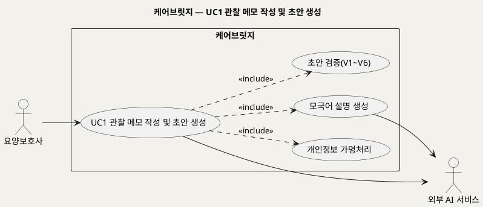

**[「UC1 유스케이스」 PlantUML 뷰어로 열기](https://plantuml.sumzip.com/plantuml/svg/eNqNksFKw0AURff5ikfc6EIxCC5EijVUEVwIYnEnYzKNoWkiyQQXogStICKIUEuVVlxI1aIQa5QIgv_iMvP8BydRJIiCu2HuefcdhpnyGHGZX7PA11Y04tJV19QNujKqSF7VtNeJS2qwSrSq4Tq-rauO5bgwMDM2o5Smc4S3RnRnw7QNqBDLo5JFKwyYA65prDHQTZdqzHRsiZnMooAvATYjHh_y7iteBfAWNGBJVSCJAgxD4DcN3rsGPD_G-j3w8Agw2seTfcDdjriRiMaEhIxnDWwe84fovRXjzq0MxAN19js9jflTAMU5wHqbP9fx4DIjinNSKkNsQ4jIP0xk2JQAfI9qxBPp_52yaoHnp5OwjZ0YL06EIiRhwHt72G_x7qfpwmIpD4vy5PFOuAjdS0Hme0vLC3n0a3HSD7DbGSwr2-XxoYwrF-elLUmdheHhQiaT-o-MFNJdMAGTk6atWb5OC4XvRIz8kYilvyRps3jBNPw6TlFbF9_nA4ns-M0=)** — 클릭 시 브라우저로 연결됩니다.

주의: 렌더 검증 미수행 (사내 렌더 서버에 접속할 수 없는 환경). 로컬 PlantUML 1.2019.06으로 문법 검증 통과.

**시퀀스 다이어그램**

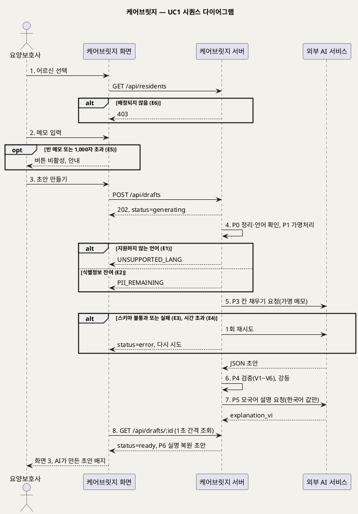

**[「UC1 시퀀스」 PlantUML 뷰어로 열기](https://plantuml.sumzip.com/plantuml/svg/eNp9VF1P2mAUvu-vOHE3kDCkomwx2SJzaFg2JSLekgrVNWJhbd3HzdK4uhggGZvg1IFhCX5GkwqomJgs2U_ZZd-3_2HnLWUysuy25znnPM9znrcTqiYo2tpqBtZSyZSgiIuKlF4WkwE-qYqvOHVFknOCIqzCopBaWVaya3J6MpvJKnBvKjjFR570IdSXQjr7RpKXYUnIqCKnSVpGBHqr0-026RTJ4Q96pMMvvQyJSR5ooWrrOs03gBQatNZGkHXdIfvHnJDScP4Q3SvT7c-k1bZ3OnT9bAgEFSanOdylSSkpJ8gaYgaG27tlctJ2oIno_6HUqJKm4UDjCwPQ3Q650iEcdUA3BpJ0cOEoNzkN9x_jbBgH3g9s4EGbFuoIrNsfahwWsBxfwPJ0ZB6GhZw0rIiqlBZlTeWEjAbENGm9Qko7DodKntaK4ImEvBywtvu94aOBICfK6f59I34gJ2Vyegx0f4PUD7hsDsfdbPa-kp0SyZeB9wUCAbpfAtretFq3OHyMDWfMcBLOGwfUbedvsdewd6vUuPAhkU2y3h7cGPSzIVgDclQkWw2rY_YrjM3GXYlpRVhCff0CRgIjPsBsaWvqo2VRFhVBw2Q4ELd91A-xADAzDs9-XtPtDrqJB6zQWscHMR4sUyenG7S5g3XHOnSMfivZlZ51TK3b5onwgw4mZuKJWGx2bj7yNPk8PDPNiZhJTF2NtAy2tNVGH8v06xk2jww2x6LR5FzkRTg6E2WdaEuXeJgVx5B4EOhNB-iFQfdMtAVYWJvnni5n9yLeLut8w15vkCM08WrT_njJbuKeihYadvEY9we9PvYeLNO4u9poj5O7lbf3isj4DHHkkzHA1zVaVJSs4nMeVKEKLpKxD3ev7_j-LD474961_xwhVDUKVlOnhzXPAv9-IYSkLLNCti76xT9A2BigOuvynDlPjQZT7Oq3K1X3u2V-wdB4_9osvs1lBBmDkJWTr6X-KD30372XbpiGx6U0eHjkiaMMq3kC9LuJFni5f-hWRCH9DkMTYpY6B2hdYlR6Kvuz3_1DQNCHcvBa3WTX_-QcX-eRzk2gZ_hL_A1DwTm2)** — 클릭 시 브라우저로 연결됩니다.

주의: 렌더 검증 미수행 (사내 렌더 서버에 접속할 수 없는 환경). 로컬 PlantUML 1.2019.06으로 문법 검증 통과.

## §6 업무규칙

| ID | 규칙 | 근거 |
|---|---|---|
| BR-REC-01 | 메모는 1~1,000자다 | 구현 명세서 AC1-1 |
| BR-REC-02 | 날짜·시간·기록자는 입력값과 로그인 정보로 채우며 AI가 만들지 않는다 | 구현 명세서 AC1-2, 7장 규칙 |
| BR-REC-03 | 전체 처리가 50초를 넘으면 error로 전환한다 | 구현 명세서 AC1-3, 8장 |
| BR-PRV-01 | 외부 AI로 나가는 텍스트는 반드시 가명처리를 거친다 | 구현 명세서 R5, AC5-1 |
| BR-PRV-02 | 로그·에러 리포트에 메모 본문·이름·AI 응답 본문을 남기지 않는다 | 구현 명세서 R8 |
| BR-AI-01 | 스키마를 통과하지 못한 응답은 1회 재시도 후 error로 둔다 | 구현 명세서 R9 |
| BR-AI-02 | 값이 있는 칸은 원문에 그대로 있는 근거가 있어야 한다 | 구현 명세서 R1, 9장 V1 |
| BR-AI-03 | 원문에 없는 칸은 비워 둔다(missing). 기본 문구로 채우지 않는다 | 구현 명세서 R3 |

---

# UC_02 초안 확인 및 제출

### 5.2 UC2 초안 확인 및 제출

> **쉽게 말하면** — 요양보호사가 AI가 만든 한국어 초안을 베트남어 설명과 함께 보고, 시스템이 물어보는 칸에 답한 뒤 담당자에게 제출합니다. 값을 직접 고치지는 못하고, 답변을 통해서만 바뀝니다.

## §1 유스케이스 기술

| 속성 | 내용 |
|---|---|
| ① ID | UC2 |
| ② 유스케이스명 | 초안 확인 및 제출 |
| ③ 개요 | 요양보호사가 초안의 칸별 값·근거·상태를 확인하고, 확인 필요 칸에 답변해 해당 칸을 재처리한 뒤 제출(status=submitted)한다 |
| ④ 주 액터 | 요양보호사 |
| ⑤ 부 액터 | 외부 AI 서비스 (답변 재처리 시) |
| ⑥ 우선순위 | 필수 (구현 명세서 F2·F3) |
| ⑦ 트리거 | UC1이 끝나 화면 ③에 status=ready 초안이 표시된다 |
| ⑧ 사전조건 | (1) 요양보호사 계정으로 로그인되어 있다 (2) 대상 draft의 작성자 본인이다 (3) draft가 status=ready다 |
| ⑨ 사후조건 | 성공: draft가 status=submitted가 되고 담당자의 승인 대기 목록에 나타난다. 답변은 note(kind=answer)로 저장된다. 실패: draft 상태와 칸 값이 바뀌지 않는다 |
| ⑩ 기본흐름 | §2 (5단계) |
| ⑪ 대체흐름 | §3 (A1~A2) |
| ⑫ 예외흐름 | §4 (E1~E4) |
| ⑬ 업무규칙 | §6 (BR-REC-04·05, BR-PRV-01, BR-AI-04·05) |
| ⑭ 비고 | 원천 추적: 구현 명세서 F2 AC2-1~AC2-4, F3 AC3-1~AC3-5, 8장 '확인 답변 처리', 5장 화면 ③ / BMC-가치제안(모국어로 말하면 근거가 남는 초안), BMC-부정적영향(오역 → 근거 표시·미기재 처리) / PM용 기획서 서비스 흐름 3~4단계 |

## §2 기본흐름

| 단계 | 액터 행위 | 시스템 행위 |
|---|---|---|
| 1 | 화면 ③에서 칸 목록을 훑어본다 | 칸마다 한국어 값, 베트남어 설명, 상태(기재·미기재·확인 필요)를 색과 글자로 함께 표시한다 (AC2-1, AC3-1) |
| 2 | 값이 있는 칸을 누른다 | 원문 메모에서 그 칸의 근거 부분을 강조해 보여 준다 (AC2-2) |
| 3 | 확인 필요 칸의 질문(한·베)에 짧게 답한다 | 답변을 note(kind=answer)로 저장하고, 가명처리 후 그 칸만 외부 AI로 다시 처리·검증하고 베트남어 설명을 갱신한다 (AC3-2) |
| 4 | '제출'을 누른다 | 남은 확인 필요 칸이 있으면 "확인되지 않은 칸 N개" 경고를 보여 준다 (AC3-3) |
| 5 | 경고를 확인하고 제출을 확정한다 | draft를 status=submitted로 바꾸고 submitted_at을 저장한다 (AC3-5) |

## §3 대체흐름

**A1. 확인 필요 칸이 없음** — 단계 1에서 확인 필요 칸이 0개면 단계 3을 건너뛰고, 단계 4에서 경고 없이 단계 5로 간다.

**A2. 확인 필요 칸을 남긴 채 제출** — 단계 4의 경고를 보고도 제출을 확정하면 그대로 submitted가 된다. 남은 칸은 담당자가 UC3에서 해결한다. (AC3-3, AC4-4)

## §4 예외흐름

**E1. 답변 재처리 실패** — 단계 3에서 외부 AI 호출이 실패하거나 스키마를 통과하지 못하면 해당 칸의 이전 값과 상태를 유지하고 다시 시도를 안내한다. 답변은 보존한다. [추론: 구현 명세서 R9를 칸 단위 재처리에 적용]

**E2. 답변에 식별정보가 남음** — 단계 3에서 가명처리 후에도 명단 이름·전화번호가 남으면 외부 호출을 막고 다시 쓰도록 안내한다. (AC5-4, R5)

**E3. 제출할 수 없는 상태** — 단계 5에서 draft가 이미 submitted·approved이면 409(INVALID_TRANSITION)를 반환한다. (구현 명세서 6장 상태 전환)

**E4. 다른 사람의 초안** — 단계 1에서 작성자가 아닌 요양보호사가 접근하면 403을 반환한다. (구현 명세서 3장)

## §5 다이어그램

**유스케이스 다이어그램**

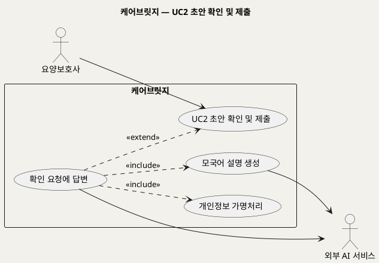

**[「UC2 유스케이스」 PlantUML 뷰어로 열기](https://plantuml.sumzip.com/plantuml/svg/eNp9ksFKw0AURff5ikddV7TuREpraMWNFERwV6bJGEPTRCYTFEQIWkFUUKGtVlJwISrFQtUqEQT_xWXn9R-cpFKCiLuBc7j3zjA5lxPGvZoFnlbWCKMVZuoGLc9kFLdq2luEkRpUiFY1mOPZuupYDoOp4lxxtrCYMNxNojvbpm3ABrFcqlh0gwN3gJnGJgfdZFTjpmMr3OQWBfzwsTUQ4am4-8R7H778BqypGcDBETaPYNRuYicE0T8DvAnwLVCIxmVtCq8b2LoQL4PRVYj7jykgLqhLE9oOxZsP-WXAeiDe63h8Gxv5ZSWqJ7Yhq1O_ulOwqwB4LtWIK-l_K-IwKST9Hyka9tzDy3MQJ6_ixR_3rqwm1WE_kCreNOV-GPZ90T3E5ytxN75GabWQlEX3Yfjak0PlXW6lCXjQwfpTrBbWS8qeoi5BOp2N98gimJ6OzzAPCwt0h1Nbz2YnQIbHwLQ1y9NpgsisP0gULF8tgj_HnAyUn-QbuJ7sMw==)** — 클릭 시 브라우저로 연결됩니다.

주의: 렌더 검증 미수행 (사내 렌더 서버에 접속할 수 없는 환경). 로컬 PlantUML 1.2019.06으로 문법 검증 통과.

**시퀀스 다이어그램**

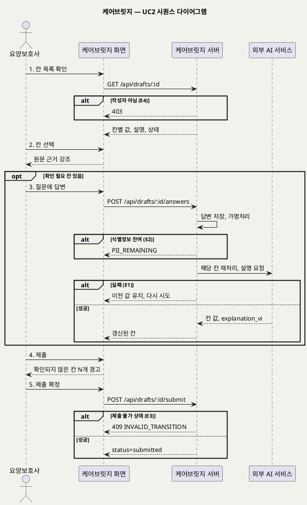

**[「UC2 시퀀스」 PlantUML 뷰어로 열기](https://plantuml.sumzip.com/plantuml/svg/eNqFVF1L22AUvs-vOLibDXTV1l1M2LDraglsVax6W17b6II17ZJ07jKbGYgVVkejdUtLhM4vOuiXWsGx_7LLvG_-w06SdkQL20Ua6HnO85zznIfMKiqR1eJmDoqZdIbIwqosZteF9GQ4rQhvOWVDlApEJpuwSjIb63K-KGVj-Vxehgdzkbmp-IsAQnlDsvktUVqHNZJTBE4V1ZwA7FZjBz3a36Mnv9ipBr-1CizHwsBKpqNpbLcBtNRgtR6C7Os-rZ9xJKMi_xj7WmEH-7Tbc6p99rE5BkSBWIJDLVXMiAUiqYi5R-4cVeh5z4Mu8_-GMt2kHd2DplbuQY_69EqDKO-BbnQc0sNFeS6WgInnyA0zMPUY2E0f6MU5Pa6hssFqfQ4rWE-tYD0RX4IQKYihrEzWVCU0I2Y5klOB1feZ3mb1MjBDp6UqPIxPP-LAbZoYck9PRjhBynLB_1CMdnWwW1_Gca4GvfiE7-0PzrYZnCrsT8V0y9mueeNgBevY_61Mm32wr2_tdgtpDHbc4vIFdTA6OIaOlvvd9R1W28OZAsQRJD7dQQZ2WMaTXdKuhoDAvgvzqZGFQ0RStgRZGaw3QPrdwCyN1b-P4ygaLsM6VXrSRKDnUamGuzLLwPPjNBV22ESbwq5Nd41a4Pn0Yvx1lE_yyQRWXdOGWlEX4Bg9WroZbNX0RYb-gRuxzo-_mg1n7wxlpkZl3HxanvfATAvjM-6ltmS6MaafdVcZI4-8bbt76bVHfeu9hV11727C-0KOSEQV81L6nTgiY7farGTRsul2DLZxn8AZpvEMlsmuzDu39U9Iy1Uv2cYuq2meaNJumWB3ftpdK0jyZEjiNVoG978zKsXVTVH14-s30qsdvNsggGhaZDTCT4FPrkRf8S_TS4vRZIpf4ueT3F2bgg34IVKLyjNfShX8zWfxBz9OfwAV4Prh)** — 클릭 시 브라우저로 연결됩니다.

주의: 렌더 검증 미수행 (사내 렌더 서버에 접속할 수 없는 환경). 로컬 PlantUML 1.2019.06으로 문법 검증 통과.

## §6 업무규칙

| ID | 규칙 | 근거 |
|---|---|---|
| BR-REC-04 | 요양보호사는 칸 값을 직접 고치지 못하고, 답변·메모 추가로만 바꾼다 | 구현 명세서 AC3-4 |
| BR-REC-05 | 확인 필요 칸이 남아 있어도 제출은 가능하되, 제출 전 남은 칸 수를 경고한다 | 구현 명세서 AC3-3 |
| BR-PRV-01 | 외부 AI로 나가는 텍스트는 반드시 가명처리를 거친다 | 구현 명세서 R5 |
| BR-AI-04 | 답변은 해당 칸만 다시 처리하고 다른 칸은 바꾸지 않는다 | 구현 명세서 8장, TC-13 |
| BR-AI-05 | 모국어 설명은 원문 없이 한국어 값만으로 만든다(역번역) | 구현 명세서 8장 P5 |

---

# UC_03 기록 검토 및 승인

### 5.3 UC3 기록 검토 및 승인

> **쉽게 말하면** — 담당자가 제출된 초안을 원문 근거와 나란히 보며 칸별로 확인하고, 필요하면 고친 뒤 승인합니다. 확인 필요 칸이 하나라도 남으면 승인할 수 없고, 승인된 기록은 더 고칠 수 없습니다.

## §1 유스케이스 기술

| 속성 | 내용 |
|---|---|
| ① ID | UC3 |
| ② 유스케이스명 | 기록 검토 및 승인 |
| ③ 개요 | 담당자가 승인 대기 목록에서 초안을 골라 원문 근거를 확인하고, 확인 필요 칸을 해결한 뒤 승인(status=approved)한다. 내용이 부족하면 반려할 수 있다(확장) |
| ④ 주 액터 | 담당자 |
| ⑤ 부 액터 | 없음 |
| ⑥ 우선순위 | 필수 (구현 명세서 F4) |
| ⑦ 트리거 | 요양보호사가 UC2·UC4에서 초안을 제출해 status=submitted가 된다 |
| ⑧ 사전조건 | (1) 담당자 계정으로 로그인되어 있다 (2) 같은 기관의 draft가 status=submitted다 |
| ⑨ 사후조건 | 승인: status=approved, approved_by·approved_at 저장, ai_generated=true 유지, 수정한 칸은 field_edit에 이전 값과 함께 기록, 이후 수정 불가. 반려: status=returned, return_reason 저장 |
| ⑩ 기본흐름 | §2 (5단계) |
| ⑪ 대체흐름 | §3 (A1~A3) |
| ⑫ 예외흐름 | §4 (E1~E4) |
| ⑬ 업무규칙 | §6 (BR-REV-01~05) |
| ⑭ 비고 | 원천 추적: 구현 명세서 F4 AC4-1~AC4-8, 5장 화면 ④⑤, 6장 상태 전환, 2장 R6 / BMC-핵심장벽(AI 기록의 책임 소재 → 작성자 확인·담당자 승인), BMC-부정적영향(자동화 편향 → 확인 필요 칸 해결 후 승인), BMC-가치제안(검토자는 다시 쓰지 않고 확인만) / PM용 기획서 서비스 흐름 5~6단계 |

## §2 기본흐름

| 단계 | 액터 행위 | 시스템 행위 |
|---|---|---|
| 1 | 화면 ④ 승인 대기 목록을 연다 | submitted 초안을 확인 필요 칸 수가 많은 순, 같으면 제출 시각이 이른 순으로 보여 준다 (AC4-1) |
| 2 | 목록에서 기록 하나를 고른다 | 화면 ⑤를 열어 왼쪽에 원문(실명 복원)과 한국어 참고 번역, 오른쪽에 칸별 값·상태를 표시하고, 처음 연 시각(review_opened_at)을 저장한다 (AC4-2, AC4-7) |
| 3 | 칸을 하나씩 눌러 확인한다 | 선택한 칸의 근거를 원문에서 강조한다 (AC2-2) |
| 4 | 확인 필요 칸에 값을 넣거나 '미기재로 확정'을 누른다 | 수정 전 값을 보존하며 field_edit에 기록하고 edited_by_reviewer=true로 표시한다 (AC4-3, AC4-8) |
| 5 | '승인'을 누른다 | 확인 필요 칸이 0개인지 검사한 뒤 status=approved, approved_by, approved_at을 저장한다 (AC4-4, AC4-5) |

## §3 대체흐름

**A1. 확인 필요 칸이 없음** — 단계 2에서 확인 필요 칸이 0개면 단계 4를 건너뛰고 단계 5로 간다.

**A2. 값이 있는 칸을 고침** — 단계 4에서 담당자가 filled 칸의 값도 고칠 수 있다. 같은 방식으로 field_edit에 기록되고 '담당자 수정'으로 표시된다. (AC4-3)

**A3. 반려(확장)** — 단계 3~5 중 내용이 부족하다고 판단하면 '반려'를 누르고 사유(1~200자)를 입력한다. 시스템은 status=returned, return_reason을 저장하고 요양보호사 화면 ①에 반려 알림을 띄운다. 이후 흐름은 UC4다. (AC4-5, AC3-6)

## §4 예외흐름

**E1. 확인 필요 칸이 남은 채 승인** — 단계 5에서 확인 필요 칸이 1개 이상이면 승인 버튼이 잠겨 있고, API 요청이 오더라도 409를 반환한다. (AC4-4, TC-10)

**E2. 다른 기관의 기록** — 단계 2에서 다른 기관 draft ID로 요청하면 404를 반환한다. (구현 명세서 11장 기관 분리, TC-09)

**E3. 이미 승인된 기록 수정** — 단계 4에서 approved 기록의 칸 수정을 요청하면 409를 반환한다. (AC4-6, TC-11)

**E4. 반려 사유 누락 또는 초과** — A3에서 사유가 비어 있거나 200자를 넘으면 반려를 처리하지 않고 입력을 요청한다. (AC4-5)

## §5 다이어그램

**유스케이스 다이어그램**

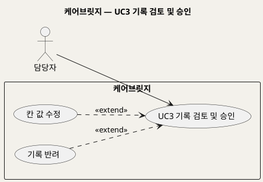

**[「UC3 유스케이스」 PlantUML 뷰어로 열기](https://plantuml.sumzip.com/plantuml/svg/eNp9kcFKw0AQhu_7FD_x3KLkJqUUa_sApfZatsk2XZomsrtBQYScRKygiEovlQpFr0F6SEHwXTxm13dwjR6KiKcZ-L_5ZmAaUlGhkkmIxOt7VLCB4H7A-tsukWMeHVJBJxhQbxyIOIn8ZhzGAlttt73T2tsg5Ij68RGPAgxpKBkJ2VBBxRA8GCn4XDBP8TgiiquQwbym5n6l80v99GaeU7yntzhouijyTD_OUbykH2cL6OwK5mJt5jmhnrJrHT1d6enaPFw7oBKdHvnS0iiwSueX08EJARLJPCpt-p-9lFlgkzfrHEV2A3M-M4u7kmjtdzeJH5vOZnqx_L6n1SWnpNNDpVIvfXYC1WrZYxe1GjtWLPLrdWLJv4OGLfYXn5a3qJU=)** — 클릭 시 브라우저로 연결됩니다.

주의: 렌더 검증 미수행 (사내 렌더 서버에 접속할 수 없는 환경). 로컬 PlantUML 1.2019.06으로 문법 검증 통과.

**시퀀스 다이어그램**

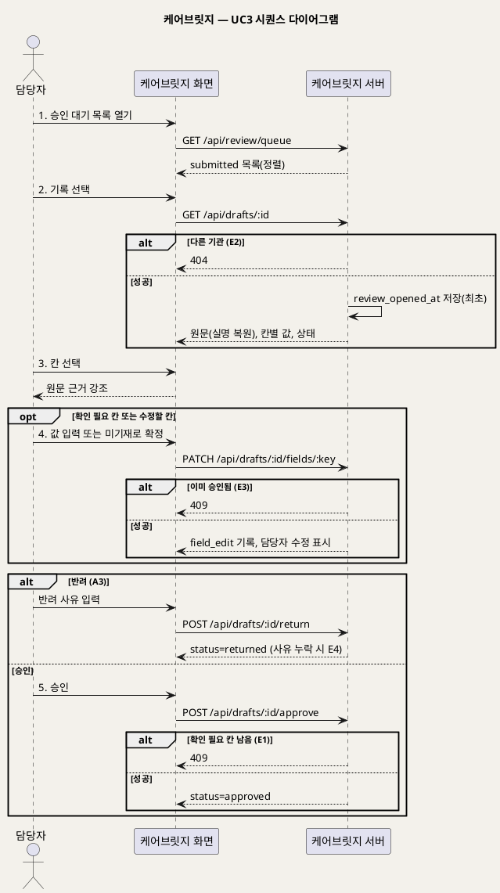

**[「UC3 시퀀스」 PlantUML 뷰어로 열기](https://plantuml.sumzip.com/plantuml/svg/eNqdVFFP01AUfu-vOMGXLYEN2HyQRAOSoT5pGOx1uawXbBhtaW8hvlUYCWE8TMMUtVtKAgpkiUNKKAnG_-Jj791_8LQULJNo4kOb23u--33nfOfcjpuMGMxaqoJVKVeIQecMRV6g5eFc2aTLkrmoqDoxyBLMkcrigqFZqjypVTUD7k3lpkYKjxMI8yWRtVVFXYB5UjWpxBRWpSAubfHO4_42__xDfLHhp70Ds5M5EHWnZ9tiax94fV-0PAQF5z5vH0qkwpB_gNc9Xr8Q7cYAEBOmSxKqMKWi6ERlMNBP2_uww4-8CDr77O9QUXP4t1oELZak6RIMPcIzMAYjGRBbF6LlA9-2A78L_PiI77VAvPfwS0IMIoslRD4pzECW6ErWoCsKXc0uW9SiEoaGrrlMa25JYYzKMUlKuE3udtJJvdEMIG-kUHN76607FWSDzDMzO6bIEqmy0Cx-4IfnAs-GVGE0LQEkhfPDeYmi_ch5EpyexdGY9SrdsqZTlcplwkC4tmgfpMSZI7zNfirxqcE7fkqg5PEG8NMz3EgPgrjw-WkNgu5bXK-_7q07ElXlZGG5TAhKVoWR6dINJQTnl8FJFymaYq8raTrD_jVD43vNmvi4E53muw2-hcvNXbSu13TDTUwwIZPPhEmAaG9w9-Aaz7_6aI5od_ieE7G6TTyVcPbFxMzk035vs_MKrcq4XKSvEB46jTOJXPFE8MYhmp0LHeq3-wHu3Tb8NiJiLlNZYXG3B-FmtOPqoPfGwfsQEqGR4RO1urvL3X1ITUSyibrjgFjrCMeNy--r8Xnxj_HBWWWWofb1GK8_s8yHVzGc1lTMyjdrvPU9vKVQyKfjiYqsuJ3L_czv7X8lQHTd0FZo7O8dHV87FK1t9Hnkf3yOK4lF5ISZ4_jCP9wv5TMR_A==)** — 클릭 시 브라우저로 연결됩니다.

주의: 렌더 검증 미수행 (사내 렌더 서버에 접속할 수 없는 환경). 로컬 PlantUML 1.2019.06으로 문법 검증 통과.

## §6 업무규칙

| ID | 규칙 | 근거 |
|---|---|---|
| BR-REV-01 | 확인 필요 칸이 하나라도 남아 있으면 승인할 수 없다 | 구현 명세서 AC4-4 |
| BR-REV-02 | 승인된 기록은 수정할 수 없다 | 구현 명세서 AC4-6 |
| BR-REV-03 | 담당자가 고친 칸은 수정 전 값을 보존하고 '담당자 수정'으로 표시한다 | 구현 명세서 AC4-3 |
| BR-REV-04 | 반려 사유는 필수이며 1~200자다 | 구현 명세서 AC4-5, 10장 |
| BR-REV-05 | AI 응답은 담당자 승인 전에는 확정 기록이 아니며, approved 전환은 담당자만 할 수 있다 | 구현 명세서 R6 |

---

# UC_04 반려된 초안 보완 및 재제출

### 5.4 UC4 반려된 초안 보완 및 재제출

> **쉽게 말하면** — 담당자가 기록을 돌려보내면 요양보호사 화면에 알림이 뜹니다. 요양보호사는 반려 사유를 보고 확인 질문에 답하거나, 처음 메모에 없던 내용을 추가 메모로 더해 다시 제출합니다. 추가 메모를 쓰면 초안이 다시 만들어지고 달라진 칸이 표시됩니다.

## §1 유스케이스 기술

| 속성 | 내용 |
|---|---|
| ① ID | UC4 |
| ② 유스케이스명 | 반려된 초안 보완 및 재제출 |
| ③ 개요 | 요양보호사가 반려된 초안(status=returned)의 사유를 확인하고, 추가 메모(초안 전체 재생성) 또는 확인 질문 답변(해당 칸 재처리)으로 보완한 뒤 다시 제출(status=submitted)한다 |
| ④ 주 액터 | 요양보호사 |
| ⑤ 부 액터 | 외부 AI 서비스 (재생성·재처리 시) |
| ⑥ 우선순위 | 필수 (구현 명세서 AC3-6) |
| ⑦ 트리거 | 담당자가 UC3에서 기록을 반려한다 |
| ⑧ 사전조건 | (1) 요양보호사 계정으로 로그인되어 있다 (2) 대상 draft의 작성자 본인이다 (3) draft가 status=returned이고 return_reason과 payload_at_return이 저장되어 있다 |
| ⑨ 사후조건 | 성공: status=submitted로 돌아가고, 반려 사유·추가 메모(kind=addition)·답변이 보존되며, 반려 시점과 달라진 칸이 '변경됨'으로 표시된다. 실패: status=returned와 기존 칸 값이 유지된다 |
| ⑩ 기본흐름 | §2 (5단계) |
| ⑪ 대체흐름 | §3 (A1) |
| ⑫ 예외흐름 | §4 (E1~E4) |
| ⑬ 업무규칙 | §6 (BR-REV-06·08, BR-REC-04·06, BR-PRV-01, BR-AI-07) |
| ⑭ 비고 | 원천 추적: 구현 명세서 AC3-6, 6장(note.kind=addition, draft.payload_at_return), 8장 '확인 답변 처리'의 추가 메모 예외, 10장 POST /api/drafts/:id/notes·GET /api/drafts?mine=1, TC-15·TC-19·TC-20 / PM용 기획서 서비스 흐름 및 화면 목록 아래 반려 설명 / BMC-미션(누가 돌보든 정확한 기록), BMC-가치제안(모국어로 말하면 근거가 남는 초안) |

## §2 기본흐름

| 단계 | 액터 행위 | 시스템 행위 |
|---|---|---|
| 1 | 화면 ①에서 '반려 N건' 알림을 누른다 | 본인의 returned 초안 목록을 보여 준다 (GET /api/drafts?mine=1) |
| 2 | 반려된 초안 하나를 고른다 | 화면 ③ 상단에 반려 사유를, 아래에 칸별 값·설명·상태를 표시한다 (AC3-6) |
| 3 | 반려 사유에 맞춰 처음 메모에 없던 내용을 추가 메모로 쓴다 | 추가 메모를 note(kind=addition)로 저장하고 진행 상태를 표시한다 (POST /api/drafts/:id/notes) |
| 4 | 진행 상태를 보며 기다린 뒤 다시 만들어진 초안을 확인한다 | 이어 붙인 원문 전체로 가명처리·칸 채우기·검증·모국어 설명(P1~P5)을 다시 실행하고, 반려 시점(payload_at_return)과 달라진 칸을 '변경됨'으로 표시한다. 담당자가 고친 칸은 유지한다 (구현 명세서 8장) |
| 5 | '다시 제출'을 누른다 | status를 returned에서 submitted로 바꾸고 반려 사유를 보존한다. 담당자 승인 대기 목록에 다시 나타난다 (TC-15) |

## §3 대체흐름

**A1. 답변만으로 보완** — 단계 3~4 대신, 반려 사유가 기존 확인 질문으로 해결되면 질문에 답한다. 시스템은 답변을 note(kind=answer)로 저장하고 해당 칸만 다시 처리한다(UC2 단계 3과 같음). 그 뒤 단계 5로 간다. (AC3-2)

메모·답변을 전혀 추가하지 않고 그대로 다시 제출할 수 있는지는 원천에 명시되어 있지 않다. 자료 없음 — 확인 필요 (개요 §6 미해결 4).

## §4 예외흐름

**E1. 재생성 실패** — 단계 4에서 외부 AI 호출이 실패하거나 50초를 넘으면 반려 시점의 칸 값을 그대로 두고 다시 시도를 안내한다. 추가 메모는 보존한다. [추론: 구현 명세서 R9·8장 호출 제한을 재생성에 적용]

**E2. 추가 메모에 식별정보가 남음** — 단계 3~4에서 가명처리 후 명단 이름·전화번호가 남으면 외부 호출을 막고 다시 쓰도록 안내한다(PII_REMAINING). (AC5-4, R5)

**E3. 추가 메모 길이 범위 밖** — 단계 3에서 빈 메모이거나 1,000자를 넘으면 저장하지 않는다(NOTE_EMPTY, NOTE_TOO_LONG). (구현 명세서 10장, AC1-1)

**E4. 반려 상태가 아님** — 단계 3 또는 5에서 draft가 returned가 아니면 409(INVALID_TRANSITION)를 반환한다. (구현 명세서 10장, TC-20)

## §5 다이어그램

**유스케이스 다이어그램**

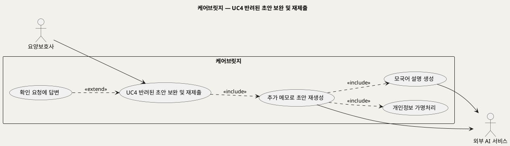

**[「UC4 유스케이스」 PlantUML 뷰어로 열기](https://plantuml.sumzip.com/plantuml/svg/eNqNks1Kw0AURvfzFJe6VhRdiRS1reJGBBHcyZiMMRgTSSYoiBC0gqigQqutRKlQ6g8KVWupIPguLjvXd_BOKxLEhbuQ73xzz51kNJDcl-GqA6GxYHBfLPq2aYmF_iEWrNjuGvf5KixyY8XyvdA1M57j-dAzMTgxkBtPEMEyN71127VgiTuBYI5YkiA98G1rWYJp-8KQtucyaUtHAL5FeNpQrUNVe8frCD6iAsxlhkDVS6pSVccxYGMPi3ugnhtYztP7I8DLe6zE2IwZNyQ5pPC8gKcnRHyWWrh9nwIeQGbyJy23VDOCsSnAfKxe87hf7RBjU0y7cNcij9QvkRRsMoAwEAYPKP23UudkopNlbBba9QjUbUHd3airn74u7Vxg_rGrk80mS5_lIl60QK_29IBnx6AOXtRz1EWnZ5Noux4TipUiCQFNUne7-FRSte5FzMzmkjAptF8eaFW6jSqRkFDIzc-wLZaZhN7edGcJvXZfX1q7wTCMjNiu4YSmSKcZKXQSTehEbEjhmjogVAc09nflO6EpfyR6JH0RHX4_jtKB9Dd-AfSPH68=)** — 클릭 시 브라우저로 연결됩니다.

주의: 렌더 검증 미수행 (사내 렌더 서버에 접속할 수 없는 환경). 로컬 PlantUML 1.2019.06으로 문법 검증 통과.

**시퀀스 다이어그램**

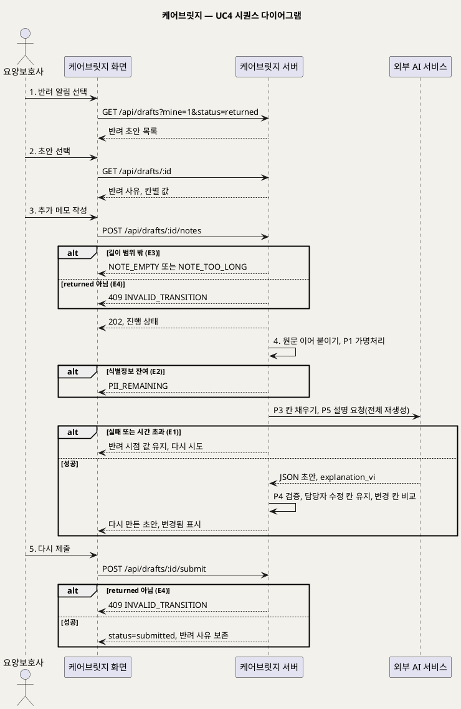

**[「UC4 시퀀스」 PlantUML 뷰어로 열기](https://plantuml.sumzip.com/plantuml/svg/eNqlVF9v0nAUfe-nuNHEaML-wNiDJs7hxKVGgQhb4hPpoJuNUGZb1Mc6ajJliUwZslkWlpD9CyYIOLtkxu_iY3-X7-BtoQtD4x58IU3v6Tn3nnsus6omKFo-m4F8KpkSFHFJkdIrYnIymFTF55z6TJJXBUXIwpKQerai5PJyei6XySlw9f7UfX_47hBCfSqkcy8leQWWhYwqcpqkZUTAMx0rXWZtsP2feKDDL70MC3NBwKLZ03V81wBWbGCtSyD7u8V2DzkhpRH_FdwpY2WTdbq9qoVrzSsgqDA3z5GWJqWkVUHWCDNC3tsus6OuC13g_w1Fw2Rtw4XGF0eg2xY70SHEu6BTg5p0cSGem5uHsRnihlvgHwfWqrJ6A3CLSM8IXO8VahwVCRJfJMh8OAETwqo0kVaEZU29k5Vk8bb_Glmu5dXbiqjlFVlMc4Qd81g9yu46bq0DOz5ie7Vh1cC4V7tUbuKW9HfutSaadR_gqcU6BtitD8MCUyRwUrZbOrCjMjs-BNzdROPrsE4sGv9DaELOaaLKCRkNbMuifQJrl9E0SLQC18NTNziA4V4i0UQ4GX4USzwBVi2xd-X-m0Q0mnwYjcxzIiUIPIfIYYMVq8QTHOUJTt4EPrIYesjfSyYehyJxPsFHI5woXxw9MBmggQ-MXuUtYOF1r2C65cFAQZr5c4k1LegHEdjJNj3ZVssHMT85pLPjN9iusv2mOyEWa-Qc1rconeRPGT81qbfAaG8xnk8-Dj8K8RHemWjQ0owTLCpOOQsA_GrgTquvNE07bZASONFvf7mOdQPbjkATCzXawY2BeKO3cei5RmdktwwnE3bnjJrwjzbhLb1oYr3kLBto-XQAPvfuiqZTYe-NvuEkYne-EQO1OOa58yAejQxC5wPx1WpGkAVNysnJF9JAy8tFEOy2jvs1h7vLiqe4WwJcr5JR_Vk94Y5ut3-4r-i67G-l0Zb7jbGDDfaxfq7c_4qVDqG3aVLdNXQouNPj5xPVTTwxL02sml_KSprr6X8E7YJtwx8Mrryvoolp38X7o3m6uNd1p5ilH_oL_g0aM2UL)** — 클릭 시 브라우저로 연결됩니다.

주의: 렌더 검증 미수행 (사내 렌더 서버에 접속할 수 없는 환경). 로컬 PlantUML 1.2019.06으로 문법 검증 통과.

## §6 업무규칙

| ID | 규칙 | 근거 |
|---|---|---|
| BR-REV-06 | 재제출해도 반려 사유는 지우지 않고 보존한다 | 구현 명세서 TC-15 |
| BR-REV-08 | 추가 메모로 초안을 다시 만들어도 담당자가 반려 전에 고친 칸(edited_by_reviewer=true)은 덮어쓰지 않는다 | 구현 명세서 AC3-6, 8장 |
| BR-REC-04 | 요양보호사는 칸 값을 직접 고치지 못하고, 답변·메모 추가로만 바꾼다 | 구현 명세서 AC3-4 |
| BR-REC-06 | 추가 메모는 반려된 초안(returned)에서만 쓸 수 있고 길이는 1~1,000자다 | 구현 명세서 10장, TC-20 |
| BR-PRV-01 | 외부 AI로 나가는 텍스트는 반드시 가명처리를 거친다 | 구현 명세서 R5 |
| BR-AI-07 | 추가 메모는 어느 칸에 들어갈지 미리 알 수 없으므로 이어 붙인 원문 전체로 초안을 다시 만들고, 반려 시점과 달라진 칸을 표시한다 | 구현 명세서 8장, TC-19 |

---

# UC_05 승인 기록 조회 및 PDF 내보내기

### 5.5 UC5 승인 기록 조회 및 PDF 내보내기

> **쉽게 말하면** — 담당자가 어르신별로 승인된 기록을 날짜순으로 찾아보고 PDF로 내려받습니다. PDF에는 실명, 승인자, AI가 만든 초안이었다는 표시가 함께 들어가고, 승인되지 않은 초안은 내보낼 수 없습니다.

## §1 유스케이스 기술

| 속성 | 내용 |
|---|---|
| ① ID | UC5 |
| ② 유스케이스명 | 승인 기록 조회 및 PDF 내보내기 |
| ③ 개요 | 담당자가 어르신별 기록 이력에서 기간을 정해 승인 기록을 조회하고, 기록 하나를 PDF로 내보낸다 |
| ④ 주 액터 | 담당자 |
| ⑤ 부 액터 | 없음 |
| ⑥ 우선순위 | 필수 (구현 명세서 AC4-6) |
| ⑦ 트리거 | 담당자가 보호자 제공·평가 대비 등으로 특정 어르신의 승인 기록이 필요하다 [추론: 트리거 사유는 원천에 없음] |
| ⑧ 사전조건 | (1) 담당자 계정으로 로그인되어 있다 (2) 같은 기관 어르신의 기록이다 |
| ⑨ 사후조건 | 조회는 데이터를 바꾸지 않는다. PDF 내보내기 성공 시 실명·승인자·AI 생성 표시가 들어간 PDF 파일이 내려받아진다 |
| ⑩ 기본흐름 | §2 (3단계) |
| ⑪ 대체흐름 | §3 (A1) |
| ⑫ 예외흐름 | §4 (E1~E2) |
| ⑬ 업무규칙 | §6 (BR-REV-07, BR-PRV-03, BR-AI-06) |
| ⑭ 비고 | 원천 추적: 구현 명세서 AC4-6, 5장 화면 ⑥, 10장 GET /api/residents/:id/records·GET /api/drafts/:id/pdf, 2장 R7, 8장 P6, TC-16 / BMC-혜택(누가 돌보든 같은 품질의 기록) / PM용 기획서 화면 목록 ⑥. 3단계라 짧지만 조회와 내보내기는 같은 화면의 연속 행위라 하나로 묶었다 [추론] |

## §2 기본흐름

| 단계 | 액터 행위 | 시스템 행위 |
|---|---|---|
| 1 | 화면 ⑥에서 어르신을 고르고 기간(from~to)을 정한다 | 기간 안의 approved 기록을 날짜별 목록으로 보여 준다 (GET /api/residents/:id/records) |
| 2 | 목록에서 기록 하나를 연다 | 실명으로 복원된 기록 상세와 승인자·승인 시각·AI 생성 표시를 보여 준다 (P6, R7) |
| 3 | 'PDF 내보내기'를 누른다 | approved인지 확인한 뒤 실명·승인자·AI 생성 표시가 들어간 PDF를 만들어 내려준다 (TC-16) |

## §3 대체흐름

**A1. 기간 안에 기록이 없음** — 단계 1에서 결과가 0건이면 빈 상태 문구를 보여 주고 기간을 다시 고르게 한다. (구현 명세서 5장 공통 규칙: 빈 상태)

## §4 예외흐름

**E1. 승인되지 않은 초안의 PDF 요청** — 단계 3에서 submitted 등 approved가 아닌 draft의 PDF를 요청하면 409를 반환한다. (TC-16)

**E2. 권한 또는 기관 불일치** — 담당자·관리자가 아닌 계정이 기록 조회 API를 호출하면 403을, 담당자가 다른 기관 어르신 ID로 요청하면 404를 반환한다. (구현 명세서 10장 권한, 11장 기관 분리, TC-09)

## §5 다이어그램

**유스케이스 다이어그램**

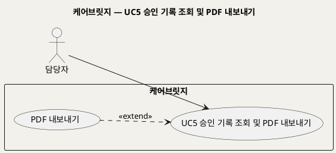

**[「UC5 유스케이스」 PlantUML 뷰어로 열기](https://plantuml.sumzip.com/plantuml/svg/eNqVUL1KA0EQ7vcpPs46QZE0Eo5g9GoJmDZs9jaXJZdb2d1DQYTD0gS0EAshQhptA7niAoLvYumu7-DmqiA2NjPDfH_DdLShyuTTFDkbMKr4UIk44YP9FtETkV1QRacYUjZJlMyzuCtTqbAXHUYHp8c7DD2msbwUWYIRTTUnKR8ZGAklkrFBLBRnRsiMGGFSDvdeuKfSVnP7-uHeCnwWjzjvtuDuNm5R4ata2eUCbrn6fp7Dru5xdhLB3pZ2XfrqYUKZ8XcEdlba2ca9PASgGr0-2ebQLPEZwa-QANcEyDVnVHv0X3G1u1fsGvzJ8UtyQ3p9NBphLdiyms16xhHabX5leBaHIen45r_-A5k9qKQ=)** — 클릭 시 브라우저로 연결됩니다.

주의: 렌더 검증 미수행 (사내 렌더 서버에 접속할 수 없는 환경). 로컬 PlantUML 1.2019.06으로 문법 검증 통과.

**시퀀스 다이어그램**

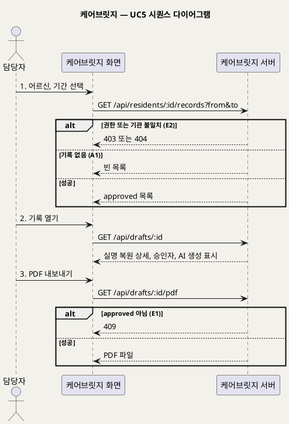

**[「UC5 시퀀스」 PlantUML 뷰어로 열기](https://plantuml.sumzip.com/plantuml/svg/eNqFk81u00AUhfd-iqsgoSKl-WnSBV1AS0lQd6il2UZTjxOsOrYZO7A11EVV7EWQUigirooUftpVIW5xpEq8C0vP9TswdtUSBVQ2o5nRd8-Ze65m2bIJs7sdDbpyUyZM2WIqbSvN0mLTUp5J1raqm4SRDmwRebvNjK5OVw3NYHCrXqmXaw-mCOspocYLVW9Di2iWItmqrSmAFw6-DXnk888_8YsDv5wBbK4uAnrDxHGwNwLujTAIBRT_iPjhV4nIttDPcS_k3gQP-zkgFqw3JOFiq7JqEt2G3Kxs8n7Aj8MM3Vy7GUV3yL-7GbrRkNYbMH9P1MASlAuQgp9C9I7yEEen8akr6KNkJ5AEILCNhsAe1Z5AkZhqkSmWShXdtopLKhUn2WDUut9iRue2bUhEsyE-95P9IfCDPu8NMsXQAX6-h8EFTg5grrZwR4JUdf7qDdVS5QqvlqqSIoJM6_jHAPDdawx8mFspzxbxyR7wk2MBXRag-y0en81AxDSZ8Vyh16ROp5tfKPzxCcXunx1TRlqX7UrT0uiN-Mku8PEZfugD7rxEN8oD9iYYRGKAeVhZE7eBeBYkb4Zi8tPGlQI8flgH_irk41Cs__cumrSVxXvdEu673EvzLP-d590bMkmNE98X48jiWBaL-Aq_AcdmTjE=)** — 클릭 시 브라우저로 연결됩니다.

주의: 렌더 검증 미수행 (사내 렌더 서버에 접속할 수 없는 환경). 로컬 PlantUML 1.2019.06으로 문법 검증 통과.

## §6 업무규칙

| ID | 규칙 | 근거 |
|---|---|---|
| BR-REV-07 | PDF는 approved 기록만 내보낼 수 있다 | 구현 명세서 TC-16, 10장 |
| BR-PRV-03 | 실명 복원은 화면과 PDF를 만들 때만 하고, 저장은 가명 상태로 한다 | 구현 명세서 8장 P6, 7장 규칙 |
| BR-AI-06 | 승인 기록과 PDF에도 AI가 만든 초안이었다는 표시와 승인자·시각을 남긴다 | 구현 명세서 R7 |

---

