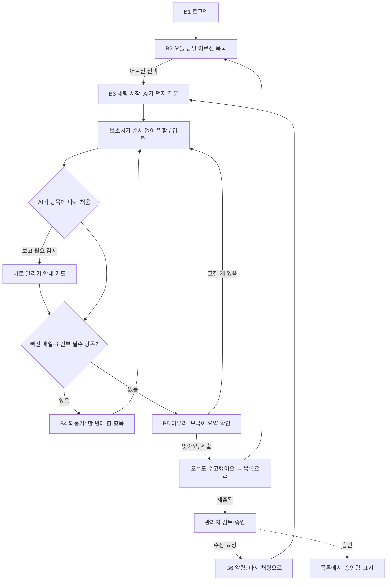
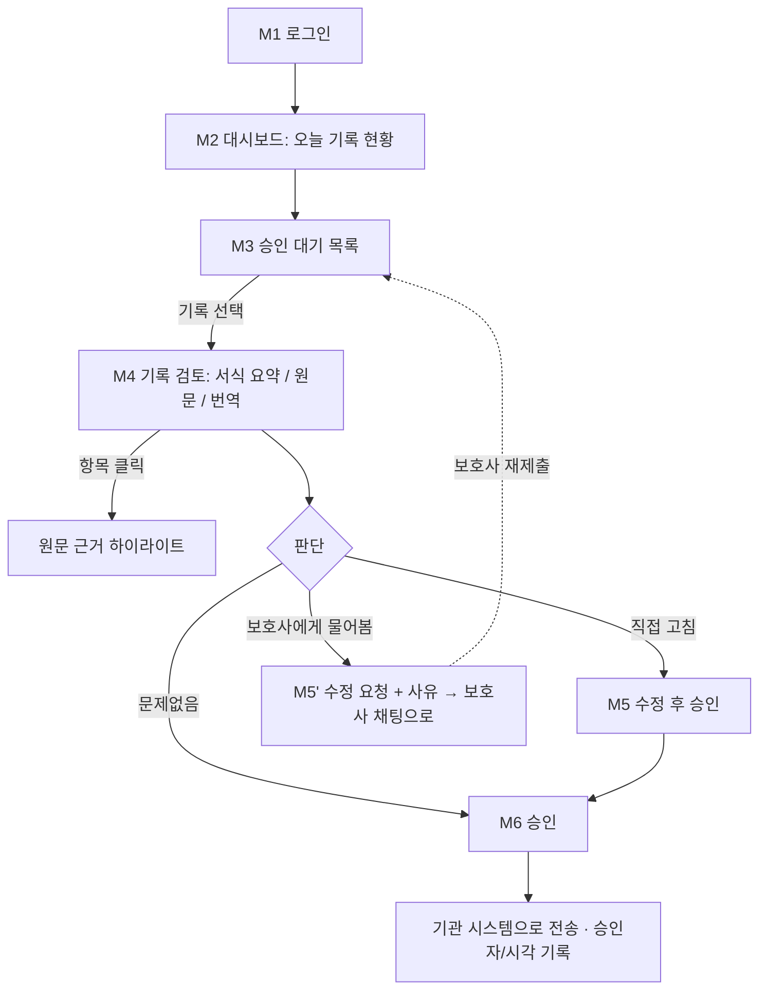

# 케어브릿지 최소 구조 설계 v0.1 (Figma 목업용)

2026-10-08 · 작성: 팀장 (AI 초안) · 받는 사람: 프론트엔드 담당 (Figma 목업 2종)

> **상태: 초안.** 1장의 업무 항목은 멘토 교수 멘토님의 요양보호사 인터뷰 정리본(디스코드)과 공모전 주최 측 답변(10/12 공지 예정)을 받은 뒤 확정합니다. 목업은 이 초안으로 먼저 그리고, 항목이 바뀌면 칩·라벨만 갈아 끼우면 되도록 구성했습니다.

## 이 문서 읽는 법

| 장 | 내용 | 목업에서 쓰는 곳 |
|---|---|---|
| 0 | 전제와 (기획 담당) PM용 기획서에서 바뀐 점 | 전체 |
| 1 | 요양보호사 업무 항목(채팅 필수 항목) 초안 | 채팅 속 "오늘 기록" 카드, 관리자 서식 요약 |
| 2 | 보호사 채팅 인터랙션 흐름 + 대화 예시 | 보호사용 화면 |
| 3 | 관리자 검토·승인 흐름 | 관리자용 화면 |
| 4 | 화면 목록(모바일·데스크탑) | Figma 프레임 목록 |
| 5 | 톤과 금지 사항 | 문구, 색, 아이콘 |
| 6 | 미정 사항 | 다음 멘토링 질문 |

---

## 0. 전제

- **방향(10/8 멘토링 결정):** 단순 번역 → 대화형(음성 + 채팅) 챗봇. 보호사가 순서 없이 말하면 AI가 서식을 채우고, 빠진 항목은 다독이듯 되묻는다. 관리자는 요약·원문·번역을 보고 검토 → 수정 → 승인한다.
- **기록 서식 기준:** 요양원(시설급여) 「장기요양급여 제공기록지(시설급여/단기보호)」 (노인장기요양보험법 시행규칙 별지 제16호서식, 표준교재 p.332~333). (기획 담당) PM용 기획서의 범위를 그대로 따릅니다.
- **언어:** 보호사 화면은 베트남어(목업은 한국어로 그리고 "실제 화면은 베트남어" 주석), 관리자 화면은 한국어.
- **기기:** 보호사는 휴대폰이 주 기기, 관리자는 PC가 주 기기. 둘 다 모바일·데스크탑 모두 대응.
- **데이터:** 모두 가상 어르신·가상 기록.

**(기획 담당) PM용 기획서에서 바뀐 점**

| (기획 담당) PM용 기획서 (10/6) | v0.1 (이 문서) |
|---|---|
| ② 메모 입력 화면: 보호사가 모국어 메모를 직접 작성 | **채팅 화면**: AI가 먼저 묻고, 보호사는 편하게 말하거나 입력 |
| ③ 초안 확인: 확인 요청 칸에 답하고 제출 | **되묻기**가 대화 안에서 일어나고, 마무리에서 모국어 요약을 확인 |
| 음성 입력은 선택 기능 | 음성·채팅 **둘 다 기본** |
| (없음) | 관리자 전용 **보호사 컨디션 알림**(부가 기능, 목업은 자리만) |

---

## 1. 요양보호사 업무 항목 정의 (채팅 필수 항목) — 초안

### 1-1. 항목 표

"구분"은 AI가 되묻는 기준입니다.
- **매일 필수**: 대화에서 안 나오면 반드시 되묻습니다.
- **조건부 필수**: 해당 어르신(예: 와상, 복약 대상)이나 해당 날(예: 목욕일)에만 되묻습니다. 조건은 어르신 정보에 미리 등록해 둔다고 가정합니다.
- **선택**: 말하면 기록하고, 안 나와도 묻지 않습니다.

| # | 항목 | 서식에 들어가는 값 (기록지 칸) | 구분 | AI가 되물을 때 (예시) | 근거 |
|---|---|---|---|---|---|
| 1 | **식사** | 종류 ①일반식 ②죽 ③유동식(경관식) / 섭취량 ①전량 ②1/2 이상 ③1/2 미만 (신체활동지원 > 식사) | 매일 필수 | "점심은 얼마나 드셨어요? 반쯤, 아니면 다 드셨어요?" | 교재 p.332 기록지, p.333 유의사항 3. 섭취량은 숫자로 객관적으로 (p.306) |
| 2 | **수분 섭취** | 마신 양(컵 수 등), 특이사항 | 선택 | — | 교재 p.316 상태기록지 항목 |
| 3 | **배설** | 화장실 이용 횟수 또는 기저귀 교환 횟수, 이상 여부(색·묽음·피 등) | 매일 필수 | "오늘 화장실은 몇 번 다녀오셨어요? 평소랑 다른 점은 없었어요?" | 교재 p.332, p.333 유의사항 5, 보고가 필요한 배설물 상태 p.367 |
| 4 | **수면** | 잠든 정도(잘 잠 / 자주 깸 / 잠들기 어려움 / 낮에 졸림), 특이사항 | 매일 필수 | "어젯밤에는 푹 주무셨대요?" | 제공기록지에는 칸이 없어 **특이사항 또는 기관 상태기록지**로 들어감. 수면 문제 관찰 항목 교재 p.257, 치매 대상자 수면상태 관찰 p.580. 멘토님이 예시로 직접 언급 |
| 5 | **신체 상태 관찰** | 안색·표정, 통증 호소, 피부(짓무름·욕창), 열감, 기능 변화(호전/유지/악화) | 매일 필수 | "오늘 어디 아프다고 하신 곳은 없었어요?" | 관찰 포인트 교재 p.306, 관찰자 역할(맥박·체온 등의 변화와 투약 여부, 심리 변화) p.81 |
| 6 | **정서·인지 상태** | 기분, 대화 반응, 행동 변화(배회·거부 등), 제공한 말벗·격려 | 매일 필수 | "오늘 기분은 어떠셨어요? 이야기 나눌 때 표정은요?" | 기록지 '인지관리 및 의사소통' 칸(인지관리 지원, 의사소통도움 등 말벗·격려) p.332 |
| 7 | **체위변경** | 2시간마다 제공 여부 | 조건부 필수 (와상·준와상 어르신) | "자세는 2시간마다 바꿔 드렸어요?" | 기록지 '체위변경(2시간마다)' p.332, 유의사항 4 p.333 |
| 8 | **투약(복약 도움)** | 먹는 약 복용 도움·확인 여부, 거부·부작용 의심 | 조건부 필수 (복약 대상 어르신) | "오늘 약은 잘 드셨어요?" | 기록지 '건강관리 > 투약관리' p.333. 요양보호사는 경구약·외용약 도움만 가능, 그 외 투약은 의료행위 (p.77) |
| 9 | **위생** | 세면·구강청결·머리감기·몸단장·옷 갈아입기 도움 | 선택 | — | 기록지 신체활동지원 첫 칸 p.332 |
| 10 | **목욕** | 제공 여부, 전·후 상태(이상무, 얼굴 창백, 오한 등) | 조건부 필수 (목욕일) | "오늘 목욕하고 나서 괜찮으셨어요?" | 기록지 '목욕', 유의사항 2 p.333 |
| 11 | **이동·산책·외출** | 이동 도움, 산책/외출 동행 여부 | 선택 | — | 기록지 '이동도움', '산책(외출) 동행' p.332 |
| 12 | **특이사항·조치** | 상태 변화와 그에 대한 조치 (예: "설사해서 엉덩이 짓물러 파우더 바름") | 매일 필수 ("없었음"도 답으로 인정) | "혹시 오늘 평소와 달랐던 일이 있었어요? 없었으면 '없었어요'라고 해 주셔도 돼요." | 유의사항 8 p.333, 육하원칙 p.316 |

**AI가 자동으로 채우고 묻지 않는 값:** 어르신 이름·생년월일·등급·호실(어르신 정보에서), 날짜, 작성자(로그인한 보호사), 기록 시각. 기록에는 정확한 시간과 기록자를 남겨야 합니다 (교재 p.316, p.317).

### 1-2. 항목 하나의 상태 (목업에서 칩·배지로 표현)

| 상태 | 뜻 | 보호사 화면 | 관리자 화면 |
|---|---|---|---|
| 채워짐 | 대화에서 값이 나옴 | 조용한 체크 | 값 + 원문 근거 링크 |
| 없었음 | 보호사가 "없었다/안 했다"고 명시 | 체크 + "없음" | "해당 없음(보호사 확인)" |
| 비어 있음 | 아직 안 나옴 → AI가 되물을 대상 | **표시하지 않음** (AI가 대화로 물음) | 승인 전 경고 |
| 확인 필요 | 애매한 표현 ("많이 드심", "조금 아프심") | 표시하지 않음, AI가 구체적으로 되물음 | 노란 배지 + 원문 |
| 보고 필요 | 넘어짐, 피 섞인 대변, 호흡 곤란 등 상태 급변 | "선생님께 바로 알려 주세요" 안내 카드 | 빨간 배지, 목록 맨 위 |

- "확인 필요"는 교재의 "애매한 표현은 피하고 구체적으로 기록한다"(p.318: 많이 → ○장·○잔)를 AI가 대신 해 주는 장치입니다.
- "보고 필요"는 교재 업무보고 시기("대상자의 상태에 변화가 있을 때", 급하면 구두보고 먼저, p.337~338)에 근거합니다. 앱이 보고를 대신하지 않고 **바로 알리라고 안내**만 합니다.

### 1-3. 확정할 때 바꿀 수 있는 것

멘토 인터뷰 결과에 따라 표의 행을 더하거나 빼고, "구분"만 바꾸면 됩니다. 화면 구조는 그대로입니다. 이것이 멘토님이 말한 확장성 포인트("채팅 필수 항목만 바꾸면 어떤 기관 서식에도 맞출 수 있다")와 같습니다.

---

## 2. 보호사 채팅 인터랙션 흐름

### 2-1. 흐름

### 2-2. 단계별 설명

| 단계 | 화면 | 일어나는 일 | 목업 포인트 |
|---|---|---|---|
| B1 | 로그인 | 기관 계정으로 로그인. 언어는 계정에 저장(베트남어) | 단순하게. 첫 로그인만 언어 선택 |
| B2 | 오늘 담당 어르신 목록 | 업무일지처럼 오늘 맡은 어르신이 쭉 보임. 각 카드에 호실, 이름(가명), 상태 배지: `기록 전` `작성 중` `제출됨` `승인됨` `다시 봐 주세요` | 카드 리스트. 상단에 "오늘 3명 중 1명 기록했어요" 정도의 부드러운 인사 |
| B3 | 채팅 | AI가 먼저 묻는다: "오늘 ○○ 어르신은 어떠셨어요? 생각나는 대로 편하게 다 얘기해 주세요." 입력은 **마이크 버튼(크게)** + 텍스트창 둘 다 | 겉은 채팅, 속은 업무일지. 상단 접이식 **"오늘 기록 미리보기"** (채워진 항목만 칩으로) |
| B4 | 되묻기 | 빠진 항목을 **한 번에 하나씩** 묻는다. 빠른 답 버튼: `없었어요` `잘 모르겠어요` `나중에` | 빠른 답 칩. 다그치지 않는 문장 |
| B5 | 마무리 | 채워진 내용을 **베트남어 요약 카드**로 보여 주고 "이렇게 정리했어요. 맞아요?" → `맞아요, 제출` / `고칠래요` | 요약 카드 1장 + 버튼 2개 |
| B5' | 수고 인사 | "오늘도 수고했어요. 다음 어르신으로 갈까요?" → 목록 | 따뜻한 일러스트·짧은 문장. 다음 어르신 바로가기 |
| B6 | 수정 요청 알림 | 관리자가 수정 요청하면 목록 배지 `다시 봐 주세요` + 채팅에 AI가 관리자 질문을 부드럽게 전달 | 알림 배너 1종 |

**예외 상황 (목업에 상태만 그려 두면 됨)**
- 중간에 나가도 자동 저장, 목록에 `작성 중`.
- 음성 인식 중 / 인식 실패("잘 못 들었어요, 한 번만 더 말해 줄래요?").
- 보호사가 너무 짧게 답하거나 말이 없을 때: 다그치지 않고 예시를 들어 독려 ("예를 들면 '아침 반 드셨어요'처럼 짧게 말해도 돼요").

### 2-3. 대화 예시 (다독이는 무드)

실제 화면은 베트남어입니다. 아래는 목업용 한국어 예시입니다.

> **AI** 응옥린 님, 오늘도 고생 많으셨어요. 305호 김○○ 어르신은 오늘 어떠셨어요? 생각나는 대로 편하게 얘기해 주세요.
>
> **보호사** 🎤 아침은 죽 조금 드시고 점심은 반 정도 드셨어요. 오후에 산책했는데 기분 좋아 보이셨어요. 기저귀 세 번 갈았어요.
>
> **AI** 산책하고 기분이 좋아지셨다니 다행이에요. 잘 챙겨 주셨네요. 하나만 더 여쭤볼게요. 어젯밤에는 잘 주무셨대요?
>
> **보호사** 밤에 두 번 깨셨대요.
>
> **AI** 알려 줘서 고마워요. 아침에 "조금" 드셨다고 했는데, 반보다 적었어요?
>
> **보호사** [1/2 미만] ← 빠른 답 칩
>
> **AI** 오늘 혹시 아프다고 하시거나 평소와 다른 일은 없었어요? 없었으면 '없었어요'라고 해 주셔도 돼요.
>
> **보호사** [없었어요]
>
> **AI** 이렇게 정리했어요. 맞는지 봐 줄래요? (요약 카드: 식사 아침 죽 1/2 미만·점심 일반식 1/2 이상 / 배설 기저귀 교환 3회 / 수면 밤중 2회 깸 / 정서 산책 후 기분 좋아짐 / 특이사항 없음)
>
> **보호사** [맞아요, 제출]
>
> **AI** 오늘도 정말 수고했어요. 김○○ 어르신 기록 끝! 다음은 307호 이○○ 어르신이에요. 🌿

---

## 3. 관리자 검토·승인 흐름

### 3-1. 흐름

### 3-2. 단계별 설명

| 단계 | 화면 | 일어나는 일 | 목업 포인트 |
|---|---|---|---|
| M1 | 로그인 | 관리자 계정 로그인 | 보호사 로그인과 같은 컴포넌트 |
| M2 | 대시보드 | 오늘 숫자 카드: `승인 대기` `확인 필요 포함` `보고 필요` `승인 완료`. 오른쪽에 **보호사 컨디션 알림**(부가 기능, 예: "응옥린 님 오늘 기록이 평소보다 짧아요") | 숫자 카드 4개 + 알림 패널. 컨디션 알림은 관리자에게만 |
| M3 | 승인 대기 목록 | 표: 어르신·호실, 보호사, 제출 시각, `확인 필요` 개수, `보고 필요` 여부. 기본 정렬은 보고 필요 → 확인 필요 많은 순 | 표 + 필터(날짜·보호사·상태) |
| M4 | 기록 검토 | **기본은 서식 요약만** 보임(관리자는 요약만 보고 싶어 함). 의심될 때 `원문 보기` `번역 보기` 탭/패널을 연다. 항목을 누르면 원문·번역의 해당 문장이 하이라이트 | 데스크탑: 왼쪽 서식, 오른쪽 원문/번역 패널(토글). 대화 전체·음성은 기본 숨김 |
| M5 | 수정 | 서식 칸을 직접 고침. 고친 칸은 "관리자 수정" 표시가 남음 | 인라인 편집 상태 |
| M5' | 수정 요청 | 사유를 적어 보호사에게 되돌림 → 보호사 채팅에 AI가 부드럽게 전달 | 사유 입력 모달 |
| M6 | 승인 | `확인 필요`·`비어 있음`이 남아 있으면 승인 버튼 비활성. 승인하면 승인자·시각이 남고 이후 수정 불가, 기관 시스템으로 전송(목업은 "전송됨" 상태만) | 승인 확인 모달, 완료 토스트 |

---

## 4. Figma 목업 화면 목록

우선순위: **보호사 = 모바일 먼저**, **관리자 = 데스크탑 먼저**. 다른 해상도는 반응형 변형으로 그립니다. 권장 프레임: 모바일 390 × 844, 데스크탑 1440 × 900.

### 4-1. 보호사용 채팅 화면

| ID | 화면 | 모바일 | 데스크탑 | 꼭 그릴 상태 |
|---|---|---|---|---|
| B1 | 로그인 | ● | ○ | 기본, 첫 로그인 언어 선택 |
| B2 | 오늘 담당 어르신 목록 | ● | ○ (왼쪽 목록 + 오른쪽 채팅 2단) | 배지 5종, 빈 목록 |
| B3 | 채팅 (첫 질문) | ● | ○ | 음성 녹음 중, 텍스트 입력, "오늘 기록 미리보기" 접힘/펼침 |
| B4 | 되묻기 | ● | ○ | 빠른 답 칩, 보고 필요 안내 카드 |
| B5 | 마무리 요약 확인 + 수고 인사 | ● | ○ | 요약 카드, 제출 완료 |
| B6 | 수정 요청 알림 | ● | ○ | 목록 배지 + 채팅 내 전달 메시지 |

### 4-2. 관리자용 검토·승인 화면

| ID | 화면 | 데스크탑 | 모바일 | 꼭 그릴 상태 |
|---|---|---|---|---|
| M1 | 로그인 | ● | ○ | 기본 |
| M2 | 대시보드 | ● | ○ (숫자 카드 세로 쌓기) | 컨디션 알림 있음/없음 |
| M3 | 승인 대기 목록 | ● | ○ (표 → 카드 리스트) | 보고 필요 행 강조 |
| M4 | 기록 검토 | ● | ○ (서식 / 원문 / 번역을 탭으로) | 요약만 / 원문 패널 열림 / 항목 하이라이트 |
| M5 | 수정 · 수정 요청 | ● | ○ | 인라인 편집, 사유 모달 |
| M6 | 승인 | ● | ○ | 승인 불가(남은 확인 필요), 승인 완료 |

● 먼저 그릴 것, ○ 반응형 변형

**다음 멘토링 리뷰용 최소 세트:** B2 → B3 → B4 → B5 (모바일) + M3 → M4 → M6 (데스크탑). 나머지는 시간 되면.

---

## 5. 톤과 금지 사항

- **무드:** "감성이 무드였지만, 업무였다." 감성 일기처럼 포근하게, 하루를 정리하고 "고생했다"고 다독이는 느낌.
- **말투:** 캐묻지 않기. 질문은 한 번에 하나. 칭찬·공감 한마디 → 질문 순서.
- **보호사 화면에 넣지 않을 것:**
  - 빨간 "누락" 표시, 점수, 진행률 %(감시·평가처럼 보임)
  - 보호사 컨디션 분석 결과 (관리자 전용)
  - "기록이 부족합니다" 같은 지적형 문구
- **관리자 화면 원칙:** 요약이 먼저, 원문·번역은 필요할 때 열기. 음성 파일과 대화 전체는 기본 노출하지 않음.
- **개인정보:** 목업의 이름은 모두 가명. 교재도 기록은 서비스 관련자만 열람하고 대상자 사생활과 무관한 정보는 기록하지 않도록 함 (p.318).

---

## 6. 미정 사항 (확정 대기)

| 항목 | 기다리는 것 | 영향 |
|---|---|---|
| 업무 항목 최종안 | 멘토 교수 멘토님 요양보호사 인터뷰 정리본 (디스코드) | 1장 표의 행·구분 |
| "비식별 관찰 메모"의 정확한 뜻 | 공모전 주최 측 답변 (10/12 공지) | 입력이 메모인지 대화인지, 가명처리 위치 |
| 시설(요양원) vs 재가(방문요양) | 팀 결정 (현재 (기획 담당) PM용 기획서 따라 시설) | 재가면 기록지 칸이 다름 (교재 p.324 방문요양 서식) |
| 보호사 컨디션 알림 범위 | 팀 결정 (부가 기능) | M2 패널 내용 |
| 실제 요양 기록 레퍼런스 | 데이터 담당 님 데이터 수집 | 대화 예시·가상 데이터 |

---

## 근거 자료

- 2026-10-08 멘토링 회의록 (`/mnt/project-files/meetings/2026-10-08_멘토링_회의록.md`)
- 요양보호사 양성 표준교재 2023년 개정판 (`/mnt/project-files/요양보호사+양성+표준교재(2023년+개정판).pdf`)
  - 9장 요양보호 기록과 업무보고: 기록의 종류 p.308~309, 제공기록지와 스마트 장기요양 p.310~315, 상태기록지 p.316, 기록 원칙 p.316~318, 제공기록지(방문요양) p.324~325, 제공기록지(시설급여) p.332~333, 업무보고 시기 p.337~338
  - 관찰과 보고 p.305~306, 요양보호사 역할(관찰자) p.81, 의료행위 금지 p.77, 수면 p.257, 배설물 보고 기준 p.367, 치매 수면장애 p.580
- 보건복지부 2026 요양보호사 양성지침: 교육과정에 '요양보호 기록과 업무보고'가 이론·실기 교과로 편성 (p.44), 현장실습평가 체크리스트(별첨) 평가내용에 '요양보호 업무기록 및 보고: 기록과 보고의 목적 및 중요성, 업무일지 기록 방법, 업무 보고 방법' 포함 (p.61)
- (기획 담당) PM용 기획서, `Final-Project/Reference/`
