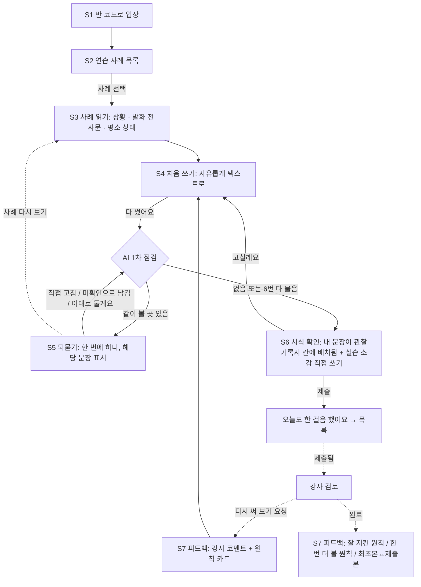
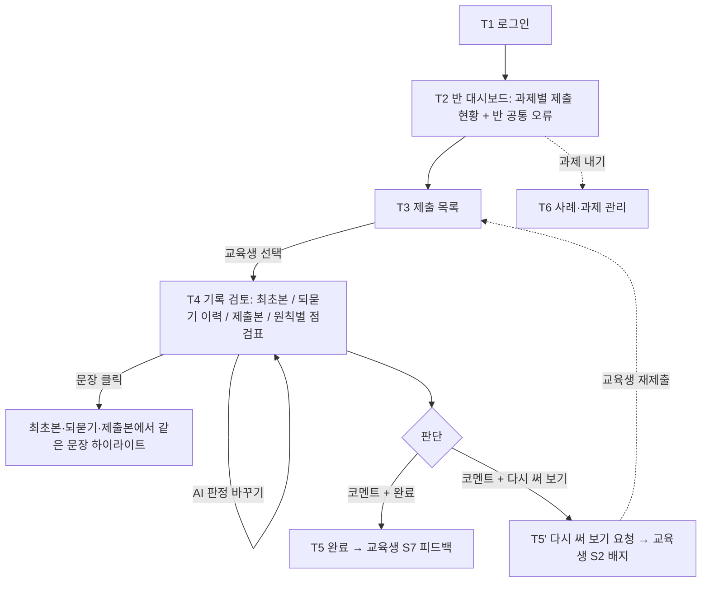

# 케어브릿지 최소 구조 설계 v0.2 (교육용 · 와이어프레임용)

2026-10-15 · 작성: 팀장 (AI 초안) · 기준: v0.1(10/8) + 교육용 기획 구체화 v0.2(10/14) + 요양 관찰기록지(교육용) v0.1

> **상태: 초안.** v0.1은 현장용(요양보호사 + 기관 관리자) 구조였습니다. 10/14에 범위를 **교육용**(외국인 요양보호사 교육생 + 강사, 합성 사례, 전사문만, 음성 없음)으로 좁혀서, 같은 장 구성으로 다시 설계했습니다. 10/15 교육원장 인터뷰 결과(기록 수업 양식·루브릭, 업무보고 구두 연습 여부, 기기 환경)에 따라 1장과 4장이 바뀔 수 있습니다.

## 이 문서 읽는 법

| 장 | 내용 | 와이어프레임에서 쓰는 곳 |
|---|---|---|
| 0 | 전제와 v0.1에서 바뀐 점 | 전체 |
| 1 | 기록 항목(관찰기록지 v0.1), AI 점검 기준(5원칙), 합성 사례 구조 | 교육생 서식 배치 화면, 강사 점검표 |
| 2 | 교육생 기록 연습 흐름 + 되묻기 예시 | 교육생 화면 (S) |
| 3 | 강사 검토 흐름 | 강사 화면 (T) |
| 4 | 화면 목록 | 와이어프레임 프레임 목록 |
| 5 | 톤과 금지 사항 | 문구, 색, 아이콘 |
| 6 | 미정 사항 | 다음 인터뷰·멘토링 질문 |

---

## 0. 전제

- **한 줄 정의:** 외국인 요양보호사 교육생이 가상 사례를 보고 **직접 쓴** 관찰기록을, AI가 되묻고 기록 원칙에 맞게 **스스로 고치도록** 돕고, 강사가 그 과정을 검토하는 기록 연습 도구.
- **AI의 역할:** 되묻기와 제안만 합니다. 교육생 문장을 대신 쓰거나 고쳐 넣지 않습니다. 용어 교정도 "이 말은 이렇게 바꿔 볼 수 있어요" 수준의 제안이고, 고치는 손은 교육생입니다. (슬로건 후보: "대신 써 주는 AI가 아니라, 제대로 쓰게 묻는 AI")
- **AI가 하는 유일한 '채우기':** 교육생이 쓴 문장을 **그대로** 관찰기록지 칸에 배치하는 것. 문장을 새로 만들지 않습니다.
- **기록 서식 기준:** 「요양 관찰기록지(교육용) v0.1」(케어브릿지 레퍼런스). v0.1이 쓰던 「장기요양급여 제공기록지(시설급여)」는 현장 서식이라 교육용에서는 참고만 합니다.
- **사례:** 시설(요양원) 기준 합성 사례. 실제 수급자 정보·질환명·건강 수치는 쓰지 않습니다.
- **입력:** 텍스트만. 서비스에 음성 녹음·저장·처리 기능이 없습니다. 사례 속 어르신 발화도 처음부터 전사문으로 줍니다. (휴대폰 키보드 받아쓰기를 막지는 않지만 남는 건 텍스트뿐)
- **언어:** 기록은 **한국어로 직접** 씁니다(학습 목표). 화면 문구와 AI 질문도 한국어가 기본이고, 이해가 안 될 때 **모국어 설명을 펼쳐 보는** 보조만 둡니다. 모국어로 쓴 걸 번역해 기록으로 만드는 기능은 없습니다.
- **기기:** 교육생은 휴대폰이 주 기기(실습실 PC도 대응), 강사는 PC가 주 기기.
- **데이터 열람:** 교육생 기록은 **본인과 담당 강사만** 봅니다. 취업처·기관 제공 없음.
- **데이터:** 모두 가상 사례·가명.

**v0.1에서 바뀐 점**

| v0.1 (10/8, 현장용) | v0.2 (이 문서, 교육용) |
|---|---|
| 사용자: 요양보호사 + 기관 관리자 | 사용자: **교육생 + 강사** |
| 오늘 담당 어르신 목록 | **연습 사례(과제) 목록** |
| 보호사가 말하면 AI가 서식을 채움 | **교육생이 먼저 직접 씀** → AI는 빠진 곳·원칙 어긋난 곳을 되물음 → 교육생이 고침 |
| 음성 + 채팅 둘 다 기본, 마이크 버튼 크게 | **텍스트만.** 마이크 버튼 없음 |
| 모국어로 말하고 한국어 기록으로 번역 | **한국어로 직접 씀.** 모국어는 설명 보조로만 |
| 항목 12개(제공기록지 기준) | 관찰기록지 v0.1 기준: **필수 3개(식사·배설·피부)** + 선택 + 지원 내용 + 마무리 |
| 항목 상태: 채워짐/없었음/비어 있음/확인 필요/보고 필요 | **문장 상태**: 5원칙 기준 "같이 볼 곳" + 미확인 표시 (1-3) |
| 관리자: 요약 → 원문·번역 → 수정 → 승인 → 기관 시스템 전송 | 강사: **최초본 / 되묻기 이력 / 수정본 / 원칙별 점검표** → 코멘트 → 완료 또는 다시 써 보기 요청. 전송·공유 없음 |
| 관리자가 직접 칸을 고침 | 강사는 **고치지 않고 코멘트**만. 고치는 건 교육생 |
| 보호사 컨디션 알림(관리자 전용) | **삭제** (교육생 감시로 읽힘) |
| "보고 필요" 안내 카드 | 실제 상황이 아니므로 삭제. 대신 사례에 상태 변화가 있으면 **"이건 기록과 함께 바로 보고할 일"**인지 묻는 연습 문항으로 (선택, 6장) |
| (없음) | **합성 사례 + 정답 사실 목록** (1-4), 반 전체 공통 오류 요약 |

그대로 가져온 것: 되묻는 대화형 흐름, 한 번에 하나씩 묻기, 다독이는 톤(꾸짖지 않음), 원문(최초본)과 결과 나란히 보기, 사람이 최종 확인.

---

## 1. 기록 항목과 AI 점검 기준

### 1-1. 기록 항목 (관찰기록지 교육용 v0.1)

"구분"은 AI가 되묻는 기준입니다.
- **필수**: 기록에 없으면 반드시 되묻습니다. 확인 못 했으면 "미확인"이라고 쓰면 통과입니다.
- **선택**: 사례에 해당 정보가 있는데 빠졌을 때만 가볍게 묻습니다(사례에 없으면 묻지 않음).
- **본인 작성**: AI가 묻지도 제안하지도 않습니다.

| 영역 | 항목 | 서식 칸 (관찰기록지 v0.1) | 구분 | AI가 되물을 때 (예시) |
|---|---|---|---|---|
| Ⅰ 관찰 | **식사** | 드신 양(전부·3/4·1/2·1/4·거의 안 드심·미확인), 메뉴, 평소 대비(비슷·적음·많음), 특이점(거부·편식·사레·삼키기 힘들어함) | 필수 | "평소 한 끼와 비교하면 어느 정도 드셨어요?" |
| Ⅰ 관찰 | **배설** | 화장실 이용 횟수, 평소 대비(비슷·줄어듦·늘어남·미확인), 특이점 | 필수 | "화장실은 몇 번 다녀오셨어요? 평소랑 비교하면요?" |
| Ⅰ 관찰 | **피부** | 본 곳(이상 없음·붉어짐·상처·축축함·부어 보임·미확인), 부위·내용 (씻겨 드릴 때 본 것) | 필수 | "씻겨 드릴 때 붉거나 축축한 곳은 없었나요?" |
| Ⅰ 관찰 | 기분·대화 상태 | 평소와 비슷·말수 적음·반응 느림·기분 좋음·불편해함 | 선택 | "오늘 이야기 나눌 때 평소와 달랐던 점이 있었어요?" |
| Ⅰ 관찰 | 어르신 말씀 | 따옴표 안에 바꾸지 않고 그대로 | 선택 (사례에 발화가 있으면 묻기) | "어르신이 실제로 하신 말을 그대로 적어 볼까요?" |
| Ⅰ 관찰 | 특이사항 | 위 항목에 없는, 평소와 다른 점 | 선택 | — |
| Ⅱ 지원 | 위생 · 식사 · 이동 · 정서 | 한 것만 체크 + 기타 | 선택 | (관찰 칸에 지원이 섞여 있을 때만) "이건 어르신 상태인가요, 내가 해 드린 일인가요?" |
| Ⅲ 마무리 | **다음 확인** | '미확인' 항목, 다시 볼 것 | 필수 (미확인이 하나라도 있으면) | "미확인으로 남긴 대변 상태는 다음에 누가, 언제 보면 좋을까요?" |
| Ⅲ 마무리 | 실습 소감 | 교육생 본인 작성 | 본인 작성 (AI 작성·제안 불가) | — |

**자동으로 채우고 묻지 않는 값:** 날짜, 사례 번호, 대상자 설정(연령대·성별·거동, 사례에서), 교육생 이름(로그인), 담당 강사, 작성·제출 시각.

**교육용에서 쓰지 않는 것:** 실제 수급자 정보, 질환명, 정상/비정상 판단, 체온·혈압 수치. (현장에서는 측정값과 측정 시각까지는 기록 가능하다는 점은 교안 설명으로만)

### 1-2. AI 점검 기준: 작성 5원칙

AI의 1차 점검 항목은 관찰기록지 v0.1 하단의 **작성 5원칙**과 같습니다. 원칙 하나가 곧 되묻기의 종류입니다.

| 원칙 | AI가 찾는 것 | 되묻기 (예시) | 판정 근거 |
|---|---|---|---|
| ① 본 것만 쓴다 | 추측·진단·판단 표현 ("체한 것 같다", "감기", "정상이다") | "무엇을 보고 그렇게 생각했어요? 본 것을 적어 볼까요?" | 표현 사전 + LLM |
| ② 평소와 비교한다 | 식사·배설·기분에 평소 대비 언급 없음 | "평소 점심과 비교하면 어느 정도 드셨어요?" | 사례의 평소 상태 정보 |
| ③ 어르신 말은 그대로 | 사례 전사문의 발화와 기록 속 인용이 다름(요약·바꿔 말하기) | "어르신이 실제로 하신 말을 그대로 적어 볼까요?" | 사례 전사문과 비교 |
| ④ 확인 못 한 건 '미확인' | 필수 항목 누락, 또는 사례에서 볼 수 없었던 걸 본 것처럼 씀 | "대변이 괜찮았던 건 직접 봤어요?" | 정답 사실 목록의 '관찰 불가' 표시 |
| ⑤ 관찰과 지원을 나눈다 | 한 문장에 상태와 내가 한 일이 섞임 ("식사 도와드려서 반 드심") | "이건 어르신 상태인가요, 내가 해 드린 일인가요?" | LLM |
| (추가) 사례에 없는 사실 | 정답 사실 목록에 없는 내용 ("열이 났다") | "사례에서 이 내용을 어디서 봤어요?" | 정답 사실 목록 |

**되묻는 순서:** 필수 항목 누락(④) → 사례에 없는 사실 → ① → ③ → ② → ⑤. 한 번에 하나씩, 한 사례에 **최대 6번**까지 묻고 나머지는 강사 검토로 넘깁니다(되묻기가 끝나지 않는 느낌을 막기 위해. 숫자는 사전 테스트 후 조정).

**AI가 하지 않는 것:** 문장 대신 쓰기, 정답 문장 보여 주기, 점수 매기기, 맞춤법 전체 교정. 맞춤법은 뜻이 바뀌는 경우에만 제안합니다.

### 1-3. 문장 하나의 상태 (와이어프레임에서 밑줄·배지로 표현)

v0.1의 "항목 상태" 대신, 교육생이 쓴 **문장 단위**로 상태를 둡니다.

| 상태 | 뜻 | 교육생 화면 | 강사 화면 |
|---|---|---|---|
| 그대로 좋음 | 원칙에 맞음 | 표시 없음 | 표시 없음 |
| 같이 볼 곳 | AI가 되물을 대상 (원칙 ①~⑤, 사례에 없는 사실) | **점선 밑줄** + AI 질문 말풍선. 빨간색 쓰지 않음 | 원칙 번호 배지 + 최초 문장 |
| 고쳐 씀 | 되묻기 후 교육생이 직접 고침 | 조용한 체크 | 최초 문장 → 고친 문장 (전후 비교) |
| 미확인으로 남김 | 교육생이 "미확인"을 선택 | "미확인" 칩 → 다음 확인 칸으로 자동 이동 | "미확인(교육생 선택)" — 원칙 ④ 통과 |
| 그대로 두기 | 교육생이 AI 질문에 "이대로 둘게요" | 표시 없음 | 노란 배지 "AI 질문 후 유지" → 강사가 판단 |
| 강사 코멘트 | 강사가 단 코멘트 | 피드백 화면에서 말풍선 | 코멘트 스레드 |

- 교육생 화면에는 원칙 위반 개수, 점수, 진행률을 보여 주지 않습니다.
- "그대로 두기"를 허용하는 이유: AI 판정이 틀릴 수 있고, 교육생 판단도 학습 기록이기 때문입니다.

### 1-4. 합성 사례 구조

AI가 누락과 '없는 사실'을 판정하려면 사례마다 정답이 미리 있어야 합니다. 사례 하나는 다섯 부분으로 만듭니다.

| 부분 | 내용 | 교육생에게 | AI·강사에게 |
|---|---|---|---|
| ① 상황 설명 | 시간, 장소, 내가 한 일 (3~5줄) | 보임 | 보임 |
| ② 어르신 발화 전사문 | 따옴표 발화 2~4개 | 보임 | 보임 (원칙 ③ 비교 기준) |
| ③ 평소 상태 | 평소 식사량·배설 횟수·성격 | 보임 | 보임 (원칙 ② 기준) |
| ④ 정답 사실 목록 | 관찰 가능한 사실, **관찰 불가 사실**(미확인이 정답) | 숨김 | 보임 |
| ⑤ 의도한 함정 | 이 사례에서 흔히 틀릴 곳 (예: 진단 표현 유도) | 숨김 | 강사에게만 보임 |

**예시 사례 S-01 (시설 · 점심 시간)**

- 대상자 설정: 80대 여성, 보행기 사용 · 가명 윤○희 어르신
- ① 상황: 오늘 점심 식사를 옆에서 도와 드렸다. 숟가락을 쥐여 드리고 몇 번 권했다. 식사 후 화장실까지 보행기로 함께 걸었고, 어르신은 화장실 안에는 혼자 들어가셨다. 오후에 옷을 갈아입혀 드릴 때 꼬리뼈 부근을 봤다.
- ② 발화: "입맛이 없어." / "속이 더부룩해." (배를 손으로 문지르시며) / "이따 또 갈래."
- ③ 평소: 점심은 보통 한 그릇의 3/4 정도 드심. 화장실은 하루 5~6회. 말씀이 많고 노래를 좋아하심.
- ④ 정답 사실: 밥·국 1/4 드심, 반찬 거의 안 드심 / 평소보다 적음 / 배를 문지르심 / 오후 3시까지 화장실 2회 / **대변 상태는 관찰 불가 → 미확인** / 꼬리뼈 부근 손바닥 반만 한 붉어짐 / 말수 적음 / 지원: 식사 보조·권유, 보행 보조, 옷 갈아입기
- ⑤ 함정: "체한 것 같다"(진단 유도), "속이 안 좋다고 하심"(발화 바꿔 말하기), "대변 괜찮음"(볼 수 없었던 것), "밥 조금"(평소 대비 없음), "열이 남"(사례에 없음)

목업 사례는 S-01(점심 식사), S-02(야간 수면·배회), S-03(목욕 중 피부) 3개를 가정합니다. 실제 사례 수와 감수는 6장.

---

## 2. 교육생 기록 연습 흐름

### 2-1. 흐름

### 2-2. 단계별 설명

| 단계 | 화면 | 일어나는 일 | 와이어프레임 포인트 |
|---|---|---|---|
| S1 | 입장 | 강사가 준 **반 코드** + 이름으로 입장. 첫 입장 때만 설명 보조 언어 선택(베트남어·네팔어·우즈베크어·영어 등) | 단순하게. "기록은 한국어로 써요. 모국어는 설명 볼 때만 써요" 한 줄 |
| S2 | 연습 사례 목록 | 강사가 낸 과제가 카드로. 상태 배지: `시작 전` `쓰는 중` `제출함` `피드백 왔어요` `다시 써 보기` | 카드 리스트. 마감일. 점수·순위 없음 |
| S3 | 사례 읽기 | 상황 설명 / 어르신 발화(말풍선 모양 전사문) / 평소 상태 3덩어리. 하단 `기록 쓰러 가기` | 쓰는 중에도 아래에서 끌어올려 다시 볼 수 있는 **사례 시트** |
| S4 | 처음 쓰기 | 큰 텍스트 칸 하나. 칸 채우기가 아니라 **자유 작성**. 위에 작은 힌트 "본 것, 들은 말, 내가 한 일을 생각나는 대로". 5원칙 카드는 접어 둠 | 마이크 버튼 없음. `다 썼어요` 버튼. 자동 저장 |
| S5 | 되묻기 | 내 글이 위에 보이고, 같이 볼 문장에 **점선 밑줄**. 아래 AI 말풍선이 한 번에 하나만 묻는다. 답 방법 3가지: `내 글 고치기`(해당 문장 편집) · `미확인으로 남길게요` · `이대로 둘게요`. 보조: `사례 다시 보기` `모국어로 설명 보기` | 상단에 "같이 볼 곳 1/5" 정도의 조용한 위치 표시(진행률 막대 아님) |
| S6 | 서식 확인 + 제출 | 내가 쓴 문장이 관찰기록지 Ⅰ관찰 / Ⅱ지원 / Ⅲ마무리 칸에 **그대로** 배치되어 보임. 미확인 항목은 다음 확인 칸에 자동으로. **실습 소감**은 여기서 직접 씀(AI 도움 없음) | 서식 카드 1장 + `고칠래요` / `제출` |
| S6' | 제출 인사 | "오늘도 한 걸음 했어요. 강사님 피드백이 오면 알려 드릴게요." | 짧은 문장 + 목록으로 |
| S7 | 피드백 | 강사가 완료하면: 원칙 카드 5장(`잘 지켰어요` / `한 번 더 보기` + 해당 문장), 강사 코멘트, **최초본 ↔ 제출본** 비교. 다시 써 보기 요청이면 코멘트 + `다시 쓰기` 버튼 | 카드 묶음. 빨간색·점수 없음 |

**예외 상황 (상태만 그려 두면 됨)**
- 중간에 나가도 자동 저장, 목록에 `쓰는 중`.
- 너무 짧게 쓴 경우(예: 한 줄): 다그치지 않고 사례의 세 덩어리를 짚어 줌 ("식사, 화장실, 씻겨 드릴 때 본 것 중에 생각나는 걸 하나씩 더 적어 볼까요?").
- 모국어로 쓴 문장: 번역하지 않고 "기록은 한국어로 써 볼까요? 어려운 단어는 `모국어로 설명 보기`를 눌러 보세요"로 안내.
- AI 질문을 이해 못 함: `모국어로 설명 보기`로 같은 질문의 모국어 설명을 펼침.

### 2-3. 되묻기 예시 (사례 S-01)

실제 화면도 한국어입니다. `[ ]`는 버튼, 「 」는 교육생이 고친 문장입니다.

> **교육생 처음 쓴 글**
> 점심 밥 조금 드셨어요. 체한 것 같아요. 속이 안 좋다고 하셨어요. 화장실 2번 갔어요. 대변 괜찮았어요. 엉덩이 빨개요. 식사 도와드렸어요.
>
> **AI** 끝까지 써 줘서 고마워요. 식사, 화장실, 피부를 다 챙겨 썼네요. 같이 볼 곳이 몇 군데 있어요. 하나씩 볼게요.
> "대변 괜찮았어요" — 대변을 직접 봤어요? 사례에서는 화장실 안에 혼자 들어가셨어요. ④
>
> **교육생** [미확인으로 남길게요]
>
> **AI** 좋아요. '대변 상태 미확인'은 마무리의 다음 확인 칸으로 옮겨 둘게요.
> "체한 것 같아요" — 무엇을 보고 그렇게 생각했어요? 본 것을 적어 볼까요? ①
>
> **교육생** [내 글 고치기] 「어르신이 배를 손으로 문지르셨어요.」
>
> **AI** 본 것으로 바꿨네요. 이렇게 쓰면 읽는 사람이 판단할 수 있어요.
> "속이 안 좋다고 하셨어요" — 어르신이 실제로 하신 말을 그대로 적어 볼까요? ③
>
> **교육생** [사례 다시 보기] → [내 글 고치기] 「"속이 더부룩해."라고 하셨어요.」
>
> **AI** 평소 점심과 비교하면 어느 정도 드셨어요? 1/2, 1/4처럼 적어도 돼요. ②
>
> **교육생** [내 글 고치기] 「점심 밥과 국 1/4 드셨어요. 평소(3/4)보다 적게 드셨어요.」
>
> **AI** "엉덩이 빨개요" — 어디쯤, 어느 정도 크기였어요? 씻겨 드리거나 옷 갈아입힐 때 본 걸 적어 주세요. ②
>
> **교육생** [내 글 고치기] 「옷 갈아입혀 드릴 때 꼬리뼈 쪽이 손바닥 반만큼 붉었어요.」
>
> **AI** "화장실 2번 갔어요" — 평소와 비교하면 어때요? 사례의 평소 상태를 보면 하루 5~6회예요. ②
>
> **교육생** [이대로 둘게요]
>
> **AI** 알겠어요. 강사님이 함께 볼 수 있게 표시해 둘게요. 같이 볼 곳을 다 봤어요. 이렇게 서식에 옮겨 봤어요. 내가 쓴 문장 그대로예요. 마지막으로 실습 소감은 직접 써 주세요.

- AI의 칭찬은 원칙을 지킨 행동에만 짧게 붙입니다("본 것으로 바꿨네요"). 막연한 칭찬은 하지 않습니다.
- 원칙 번호(①~⑤)는 교육생 화면에서 작은 태그로만 보여 주고, 누르면 원칙 설명 카드가 열립니다.

---

## 3. 강사 검토 흐름

### 3-1. 흐름

### 3-2. 단계별 설명

| 단계 | 화면 | 일어나는 일 | 와이어프레임 포인트 |
|---|---|---|---|
| T1 | 로그인 | 강사 계정 로그인 | 교육생 입장과 같은 컴포넌트 |
| T2 | 반 대시보드 | 과제 카드(사례 · 마감 · 제출 n/전체 · 검토 대기). **반 공통 오류 요약**: 원칙별로 "최초본에서 걸린 학생 수 → 제출본에서 남은 학생 수" (예: ② 평소 대비 누락 8명 → 2명) | 숫자 카드 + 원칙별 가로 막대 5개. 교육생 개인 순위는 없음 |
| T3 | 제출 목록 | 표: 교육생, 사례, 제출 시각, 되묻기 수, **"AI 질문 후 유지"** 수, 상태(`검토 대기` `완료` `다시 써 보기`). 기본 정렬: AI 질문 후 유지가 많은 순 → 제출 순 | 표 + 필터(과제·상태). 학생별 점수 열 없음 |
| T4 | 기록 검토 | 가운데 **최초본 ↔ 제출본** 나란히, 문장마다 원칙 배지. 그 사이 되묻기 이력(접힘). 오른쪽 **원칙별 점검표**(AI 1차 판정: 지킴 / 한 번 더 보기, 강사가 바꿀 수 있음) + **정답 사실 대조**(포함 / 미확인 처리 / 누락 / 사례에 없는 사실) | 데스크탑 3단. 사례 원문은 상단 탭으로 열기 |
| T5 | 코멘트 · 완료 | 문장에 코멘트를 달거나 전체 코멘트를 쓰고 `완료`. 강사는 교육생 글을 **고치지 않음** | 문장 옆 코멘트 핀, 하단 전체 코멘트 칸 |
| T5' | 다시 써 보기 요청 | 이유를 쓰고 되돌림 → 교육생 목록 배지 `다시 써 보기`, 다시 쓰기는 제출본에서 이어서 | 사유 입력 모달 |
| T6 | 사례·과제 관리 | 합성 사례 5부분(1-4) 입력·수정, 반에 과제로 내기 | 선택 화면 (시간 되면) |

**v0.1 관리자 화면과 같은 점:** 요약이 먼저, 근거는 필요할 때 열기 / 문장 클릭 → 근거 하이라이트 / 사람이 최종 판단.
**다른 점:** 승인·전송이 없고 결과물은 **피드백**입니다. 강사가 칸을 직접 고치지 않습니다(고치면 학습이 안 되므로).

---

## 4. 와이어프레임 화면 목록

우선순위: **교육생 = 모바일 먼저**, **강사 = 데스크탑 먼저**. 권장 프레임: 모바일 390 × 844, 데스크탑 1440 × 900.

### 4-1. 교육생 화면

| ID | 화면 | 모바일 | 데스크탑 | 꼭 그릴 상태 |
|---|---|---|---|---|
| S1 | 반 코드로 입장 | ● | ○ | 기본, 첫 입장 설명 언어 선택 |
| S2 | 연습 사례 목록 | ● | ○ (왼쪽 목록 + 오른쪽 사례) | 배지 5종, 빈 목록(과제 없음) |
| S3 | 사례 읽기 | ● | ○ | 발화 전사문 말풍선, 쓰는 중 끌어올린 시트 |
| S4 | 처음 쓰기 | ● | ○ (왼쪽 사례 고정 + 오른쪽 작성) | 빈 칸, 쓰는 중, 너무 짧게 씀 |
| S5 | 되묻기 | ● | ○ | 점선 밑줄 + 질문, 내 글 고치기(편집 중), 미확인으로 남김, 모국어 설명 펼침 |
| S6 | 서식 확인 + 실습 소감 + 제출 | ● | ○ | 서식 배치, 미확인 → 다음 확인, 제출 완료 |
| S7 | 피드백 | ● | ○ | 완료(원칙 카드 + 코멘트 + 전후 비교), 다시 써 보기 요청 |

### 4-2. 강사 화면

| ID | 화면 | 데스크탑 | 모바일 | 꼭 그릴 상태 |
|---|---|---|---|---|
| T1 | 로그인 | ● | ○ | 기본 |
| T2 | 반 대시보드 | ● | ○ (카드 세로 쌓기) | 반 공통 오류(최초본 → 제출본) |
| T3 | 제출 목록 | ● | ○ (표 → 카드) | AI 질문 후 유지 많은 행 강조 |
| T4 | 기록 검토 | ● | ○ (최초본 / 제출본 / 점검표를 탭으로) | 문장 하이라이트, 되묻기 이력 펼침, AI 판정 바꾸기 |
| T5 | 코멘트 · 완료 · 다시 써 보기 | ● | ○ | 문장 코멘트, 사유 모달, 완료 토스트 |
| T6 | 사례·과제 관리 | ○ | — | 5부분 입력 폼 |

● 먼저 그릴 것, ○ 반응형 변형

**다음 멘토링 리뷰용 최소 세트:** S3 → S4 → S5 → S6 (모바일) + T2 → T4 → T5 (데스크탑). v0.1 세트(B2~B5, M3~M6)와 짝이 맞아서 "현장용 → 교육용" 전환을 화면으로 바로 비교할 수 있습니다.

---

## 5. 톤과 금지 사항

- **무드:** v0.1의 "감성이 무드였지만, 업무였다"를 교육용으로 옮기면 **"선생님이 옆에서 같이 읽어 주는 느낌, 하지만 연필은 내 손에."**
- **말투:** 캐묻지 않기. 질문은 한 번에 하나. 원칙을 지킨 행동을 짧게 짚어 주고 → 다음 질문. "틀렸어요" 대신 "같이 볼 곳".
- **AI 문장 규칙:** 질문은 교육생 문장을 따옴표로 인용하고, 무엇을 보면 되는지(사례의 어디)를 알려 준다. 고쳐 쓴 예시 문장을 주지 않는다.
- **교육생 화면에 넣지 않을 것:**
  - 점수, 등급, 순위, 진행률 %, 빨간 "오류" 표시
  - AI가 만든 완성 문장, "정답 보기" 버튼
  - 음성 입력 버튼
  - 다른 교육생과의 비교
- **강사 화면 원칙:** 요약(반 공통 오류) 먼저, 개별 기록은 필요할 때 열기. 학생별 점수 열·순위표 없음. 교육생 글을 직접 고치는 기능 없음.
- **데이터 원칙:** 교육생 기록은 본인과 담당 강사만 열람, 취업처·기관 제공 없음. 화면 하단 고지 1줄.
- **사례 원칙:** 실제 수급자 정보·질환명·건강 수치 금지. 이름은 모두 가명.

---

## 6. 미정 사항 (확정 대기)

| 항목 | 기다리는 것 | 영향 |
|---|---|---|
| 기록 수업 양식·채점 기준 | 교육원장 인터뷰 (10/15) 질문 5, 9 | 1-1 항목, 1-2 원칙, T4 점검표 |
| 업무보고 구두 연습 여부 | 같은 인터뷰 질문 6 | 음성 기능을 다시 넣을지 (넣는다면 "STT로 받아 텍스트만 저장") |
| 한국어로 직접 쓰기 vs 모국어 허용 | 같은 인터뷰 질문 11 | 0장 언어 원칙, S4 모국어 문장 처리 |
| AI가 되묻기·제안만 하는 방식이 답답하지 않을지 | 같은 인터뷰 질문 12 + 사전 테스트 | 되묻기 최대 횟수(현재 6), "이대로 둘게요" 허용 범위 |
| 교육생 기기 환경 | 같은 인터뷰 질문 14 | 모바일 우선 유지 여부, 실습실 PC 변형 우선순위 |
| 합성 사례 수와 감수 | 팀 결정(제안: 시설 3~5개) + 간호사 인터뷰이 재검토 | 1-4, T6 |
| 학습 이력(약한 원칙 먼저 묻기) | 팀 결정 (MVP 이후 후보) | S5 되묻는 순서, T2 학생별 추이 |
| "바로 보고할 일" 연습 문항 | 팀 결정 | 사례에 상태 급변이 있을 때 S5에 질문 1개 추가 |
| 멘토에게 방향 전환 공유 | 다음 멘토링 | 관리자 → 강사 화면 전환 설명 |

---

## 근거 자료

- 케어브릿지 교육용 기획 구체화 v0.2 (`/mnt/project-files/planning/케어브릿지_교육용_기획구체화_v0.2.md`): 한 줄 정의(2-1), 대상(2-2), 검토 흐름(2-3), AI 판단 5원칙(2-4), 기록 범위(2-5), 텍스트만(2-6), 번역 위치(2-7), 빼는 것(2-8), 검증 계획(2-9), 제안서 수정점(4-2)
- 요양 관찰기록지(교육용) v0.1 (`CareBridge/Reference/Domain/요양관찰기록지_교육용_v0.1.pdf`): 항목 구성, 작성 5원칙, "실습 소감은 AI 작성 불가"
- 최소구조설계 v0.1 (`/mnt/project-files/design/케어브릿지_최소구조설계_v0.1.md`): 장 구성, 되묻기 흐름, 톤
- 교육원장 인터뷰 추가 질문 (`/mnt/project-files/planning/교육원장_인터뷰_추가질문_요약.md`)
- 공모전 질의 답변서 요약 (`/mnt/project-files/meetings/2026-10-12_공모전_질의답변서_요약.md`): 미확인 표시, 진단 금지, 합성 사례
- 보건복지부 2026 요양보호사 양성지침: 「요양보호 기록과 업무보고」 이론 6h·실기 8h
