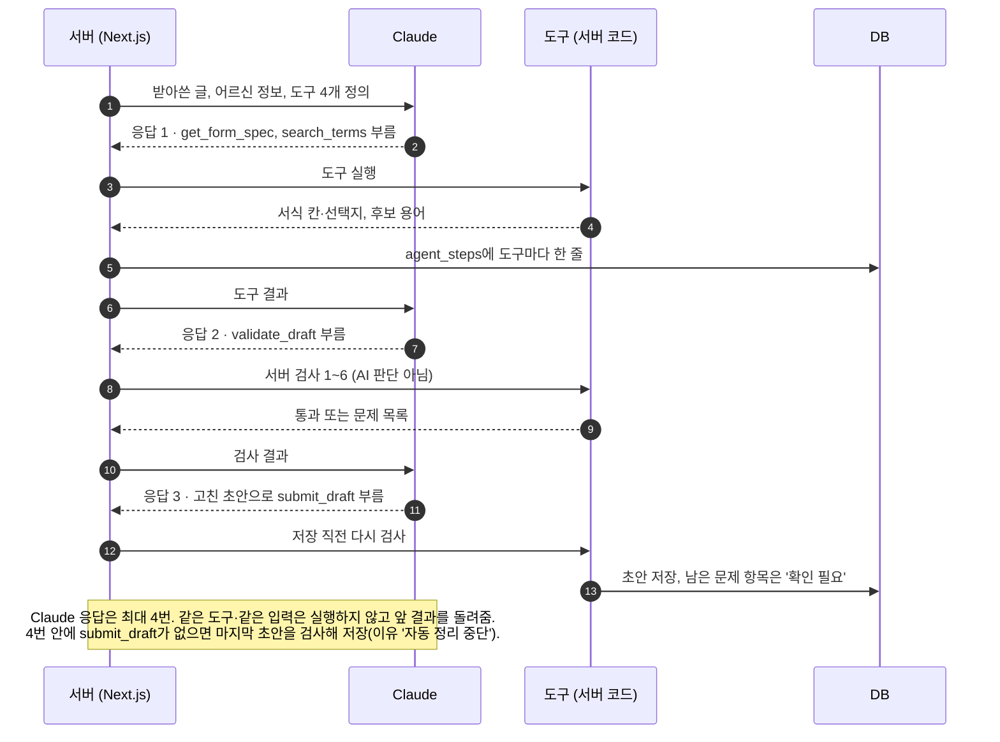

# 케어브릿지 AI 규칙 v1.1.1
2026-10-27 · @2dion (v1.1: 2026-10-18)

## 이 문서는 왜 있나

- **목적:** AI가 만든 돌봄 기록 초안이 사실만 담게 하고, 사람(작성자 확인, 담당자 승인)이 최종 기록을 정하게 하기 위한 규칙입니다.[1]
- **배경:** 돌봄 기록은 다음 근무자와 담당자가 어르신 상태를 판단하는 바탕입니다. AI가 원문에 없는 "약 드심", "잘 주무심"을 채우면, 실제로 빠진 복약이나 낙상·통증 신호가 기록에서 사라집니다. 그래서 처음부터 '지어내지 않음'과 '확인 필요'를 두었습니다.[2] v1.1에서는 외부 피드백에 따라 AI가 도구를 스스로 고르는 Agent가 들어가므로, 지어냄을 막는 규칙이 더 분명해야 합니다.[3]
- **근거:** 외부 피드백 검토 문서의 받아들일 점(A1, A5, A7, A9)과 2dion 10/18 팀 결정(확인 필요가 남으면 승인 막음, Agent 도구 4개)입니다.[3][4] 코디세이 평가의 'AI 적용의 합리성', '예외 처리·비용 효율' 항목도 이 규칙으로 답합니다.[5]
- **사유:** 판단이 필요한 일(용어 찾기, 칸 채우기)만 AI에 맡기고, 검사·승인·권한·계산은 서버 코드가 맡습니다. 그래야 AI가 틀려도 기록이 틀린 채로 승인되지 않습니다.[4][6]

## v1.0에서 바뀐 점

v1.0 원본은 보관합니다.[15] 바뀌지 않은 규칙(상태 판정, 쓰기 원칙, 도우미)은 그대로 살렸습니다.

| 무엇 | 바뀐 내용 | 사유 |
| --- | --- | --- |
| ② 항목 채우기 + 번역 | 한 번 호출 → '기록 검토 준비 Agent'(도구 4개, 최대 4번 응답) | 외부 피드백: Agent 필수(A1)[3] |
| 서버 검사 | 기록 검증을 Agent 도구로도 열고, 저장 직전에 한 번 더 돌림 | AI가 스스로 고치게 하되 최종 검사는 코드[3] |
| 덮어쓰기 | source가 ai가 아니면(worker, reviewer) AI가 덮어쓰지 않음 | v1.0은 worker만 적혀 있었음(A7)[3] |
| 재번역 | value_ko가 바뀌면 그 항목만 다시 번역 | 한국어와 모국어가 어긋나지 않게(A5)[3] |
| 승인 검사 | '확인 필요'가 남으면 서버가 승인을 거부 | 10/18 결정 1, 화면만 믿지 않음[4] |
| 서식 대응표 | verified(검증됨) / provisional(잠정) 표시. 잠정이면 R2(검토 화면)·인쇄에 표시 | 확인 안 된 서식을 확정처럼 보이지 않게(A6)[3] |
| 법정 서식 원문 반영 | 제16호·제12호 모두 검증됨. 서식 기준 조회가 원문 칸(제12호 배변 실수 2칸, 제16호 영역별 특이사항 4칸)을 돌려줌. form_fields에 stool_accidents·urine_accidents | 10/17 법정 서식 정리[16][17][18] |
| 품질 확인 | 도구 호출 수, 상한 도달 비율, 건당 시간·비용 추가. 테스트 계획은 시연·일정 v1.1 | B5, A9[3][14] |
| 번역 검증 | 베트남 교육생 1~2명 확인을 선택으로 추가 | B1[3] |
| 이유 번역 (v1.1.1, 10/27) | 초안 JSON에 `reason_native`(이유의 모국어 번역). 프롬프트 규칙 5에 한 줄. 코드가 쓰는 이유는 서버가 번역 문장을 정해 둠. v1.1 원본은 [보관](../보관/설계/2026-10-27-ai규칙-v1.1.md) | 확인필요이유병기 결정[19] |
| 입력 언어 (10/25) | 받아쓴 글이 한국어만·모국어만·섞인 말이어도 value_ko는 한국어, evidence는 원문 언어 그대로. 프롬프트 규칙 5에 한 줄 | 2dion 10/25 |

## AI가 하는 일

**왜:** AI의 일을 나눠 두어야 어디에 Agent를 쓰고 어디는 한 번 호출로 끝낼지 정할 수 있습니다(기획안 결정 6·17).[1]

AI는 **초안만** 만듭니다. 작성자가 확인하고 담당자가 승인해야 기록이 됩니다.[1] 모든 AI 호출은 서버에서 합니다.[6]

| 일 | 언제 | 모델 | 결과가 가는 곳 |
| --- | --- | --- | --- |
| ① 받아쓰기 | W2(음성 메모) [정지] 뒤 | 서버 STT | records.transcript |
| ② 기록 검토 준비 Agent | 받아쓰기 직후 (뒷배경) | Claude (중간 등급) + 도구 4개 | record_items 9행, transcript_ko, form_fields, agent_steps |
| ③ 항목 보태기 | W3(기록 초안 확인)에서 한 항목을 다시 말하거나 썼을 때 | Claude (중간 등급), 한 번 호출 | 그 항목 1행만 |
| ④ 짧은 번역 | 되돌린 사유(작성자 화면 쪽, 10/28 되돌림사유한국어 결정), 고친 항목 재번역 | Claude (가벼운 등급) | *_native 칸 |
| ⑤ 도우미 답 | W6(도우미)에서 질문할 때 | Claude (가벼운 등급) + 교재 검색 | 화면에만 (저장 안 함)[7] |

- ③ 항목 보태기, ④ 짧은 번역, ⑤ 도우미는 Agent 없이 한 번 호출 그대로 둡니다. 빠르게 답해야 하기 때문입니다.[4]
- 모델 이름은 코드의 설정 한 곳에만 두어 바꾸기 쉽게 합니다.[6]

## ② 기록 검토 준비 Agent

**왜:** 받아쓴 글을 한 번에 채우면 서식 기준·용어 확인·스스로 검사가 빠집니다. Agent가 필요한 도구를 골라 쓰고, 검사를 통과한 초안만 넘기게 합니다(A1).[3][4]

### 흐름

1. 받아쓰기가 끝나면 서버가 Agent를 시작합니다. 첫 메시지에 받아쓴 글, 어르신 정보(급여 종류, 조건), 작성자 모국어 코드(vi)를 넣습니다.
2. Claude가 쓸 도구를 고릅니다(Claude API의 도구 사용, tool use). 한 응답에서 도구 여러 개를 함께 부를 수 있습니다.
3. **서버가 도구를 실행**하고 결과를 Claude에 돌려줍니다. Claude는 도구를 직접 실행하지 않습니다.
4. 2~3을 되풀이합니다. Claude가 ④ 초안 반환(submit_draft)을 부르면 끝납니다.
5. 이 동안 작성자는 W2(음성 메모) 다음 W3(기록 초안 확인)에서 '정리 중'을 봅니다.[8]

흔한 순서(응답 3번):

| 응답 | Claude가 부르는 도구 | 서버가 돌려주는 것 |
| --- | --- | --- |
| 1 | get_form_spec, search_terms(애매한 표현마다) | 서식 칸·선택지, 후보 용어 |
| 2 | validate_draft | 통과 또는 문제 목록 |
| 3 | (문제를 고친 뒤) submit_draft | 저장 결과 |

**그림: Agent 한 번이 도는 순서 (흔한 3번 응답)** 그림은 위 내용을 옮긴 것입니다. 그림과 글이 다르면 글이 기준입니다.



### 도구 4개

| 이름 | 영문 이름 | 하는 일 | 입력 | 출력 | 누가 실행 |
| --- | --- | --- | --- | --- | --- |
| ① 서식 기준 조회 | get_form_spec | 급여 종류로 별지 제16호(시설) 또는 제12호(재가)의 칸·선택지·작성 기준을 가져옴[9][10] | care_type (facility / home), why | 칸 목록(제16호는 영역별 특이사항 4칸, 제12호는 배변 실수 2칸 포함), 선택지(예: 섭취량 전량 / 1/2 이상 / 1/2 미만), 대응표 verified 값(검증됨/잠정) | 서버 코드 |
| ② 용어 검색 | search_terms | 사투리·일상 표현·애매한 말을 교재 공식 용어와 고정 번역으로 찾음 | expression(표현), why | 후보 용어, 베트남어 고정 번역, 교재 장·쪽. 못 찾으면 빈 결과 | 서버 코드 |
| ③ 기록 검증 | validate_draft | 아래 '서버 검사' 중 초안 검사 항목을 코드로 돌림. AI 판단이 아님 | draft(transcript_ko, items 9개, form_fields), why | 통과 / 문제 목록 | 서버 코드 |
| ④ 초안 반환 | submit_draft | 9개 항목과 form_fields를 저장하고 끝냄. 저장 직전에 기록 검증을 한 번 더 돌리고, 남은 문제 항목은 '확인 필요'로 낮춤 | draft(transcript_ko, items 9개, form_fields), why | 저장 결과, 낮춘 항목 목록 | 서버 코드 |

- 용어 검색이 빈 결과이면, 짐작은 Agent가 '확인 필요'로 두고 reason에 짐작한 뜻을 씁니다.
- 서식 기준 조회 결과가 잠정(provisional)이면 R2(검토 화면)와 인쇄·PDF에 "잠정 서식"을 표시합니다. 지금은 별지 제16호(2019.9.27판)·제12호(2025.12.12판) 모두 검증됨입니다(10/17 법정 서식 정리).[3][16]

### 도구 정의 (초안)

Claude API 도구 사용 형식(name, description, input_schema)입니다. 모든 도구에 `why`(이 도구를 부르는 이유 한 줄)를 넣어 agent_steps에 남깁니다. care_type 값 이름과 초안 형식은 데이터 구조 v1.1 '공통 계약'을 따릅니다.[7]

```json
[
  {
    "name": "get_form_spec",
    "description": "어르신의 급여 종류에 맞는 서식(시설=별지 제16호, 재가=별지 제12호)의 칸, 선택지, 작성 기준을 가져온다. 칸을 채우기 전에 먼저 부른다.",
    "input_schema": {
      "type": "object",
      "properties": {
        "care_type": { "type": "string", "enum": ["facility", "home"], "description": "facility=시설, home=재가" },
        "why": { "type": "string", "description": "이 도구를 부르는 이유 한 줄" }
      },
      "required": ["care_type", "why"]
    }
  },
  {
    "name": "search_terms",
    "description": "사투리, 일상 표현, 애매한 말을 교재 공식 용어와 고정 베트남어 번역으로 찾는다. 결과가 비면 뜻을 짐작하지 말고 그 항목을 needs_check로 둔다.",
    "input_schema": {
      "type": "object",
      "properties": {
        "expression": { "type": "string", "description": "받아쓴 글에 나온 표현 그대로" },
        "why": { "type": "string", "description": "이 도구를 부르는 이유 한 줄" }
      },
      "required": ["expression", "why"]
    }
  },
  {
    "name": "validate_draft",
    "description": "초안을 서버 코드로 검사한다: 9개 항목과 JSON 형식, evidence가 원문에 있는지, observed인데 근거가 없는지, not_mentioned인데 내용이 있는지, 재가 제공시간 합이 방문 시간 이하인지, 실명이 있는지. 통과 여부와 문제 목록을 돌려준다.",
    "input_schema": {
      "type": "object",
      "properties": {
        "draft": { "$ref": "#/draft" },
        "why": { "type": "string", "description": "이 도구를 부르는 이유 한 줄" }
      },
      "required": ["draft", "why"]
    }
  },
  {
    "name": "submit_draft",
    "description": "완성한 초안을 저장하고 작업을 끝낸다. 서버가 저장 직전에 다시 검사하고, 남은 문제 항목은 needs_check로 낮춘다. 작업의 마지막에 꼭 한 번 부른다.",
    "input_schema": {
      "type": "object",
      "properties": {
        "draft": { "$ref": "#/draft" },
        "why": { "type": "string", "description": "이 도구를 부르는 이유 한 줄" }
      },
      "required": ["draft", "why"]
    }
  }
]
```

**`draft`의 스키마 (10/28 BE 확정):** 위 `"$ref": "#/draft"` 자리에는 아래 모양을 JSON Schema로 그대로 넣습니다(코드 `web/lib/agent/run-agent.ts`의 `DRAFT_SCHEMA`). `items`는 `minItems: 9, maxItems: 9`의 배열이고, 각 항목은 `item_key`(enum 9개)·`value_ko`·`value_native`·`status`(enum 3개)·`evidence`·`reason`·`reason_native`·`detail`을 모두 필수로 가집니다. 10/28 실제 시험에서 `draft`를 "객체"라고만 정의하니 Claude가 `items`를 배열이 아닌 객체로 보내 검증이 세 번 모두 형식 오류로 끝나 4번 상한에 닿았습니다. 서버는 형식 오류 때 `expected_shape`를 문제 목록과 함께 돌려줍니다.

초안(draft)의 모양은 v1.0과 같습니다.

```json
{
  "transcript_ko": "원문 전체의 한국어 번역",
  "items": [
    {
      "item_key": "meal",
      "value_ko": "점심 죽을 1/2 이상 드심.",
      "value_native": "Bà ăn hơn một nửa bát cháo buổi trưa.",
      "status": "observed",
      "evidence": "점심에 죽 반 넘게 드셨어요",
      "reason": "",
      "reason_native": "",
      "detail": { "intake": "half_or_more" }
    }
  ],
  "form_fields": { "meal_trend": "same" }
}
```

- `items`는 항상 9개, 순서도 고정(visit_time, support, meal, sleep, discomfort, medication, cognition, notes, next_check).[10]
- `form_fields`는 재가(별지 제12호)일 때만 채웁니다: total_minutes, body_trend·meal_trend·cognition_trend, stool_accidents·urine_accidents(대변·소변 실수 2칸). 시설(별지 제16호)에는 인지 변화 칸이 없어 cognition_trend를 쓰지 않습니다(데이터 구조 v1.0 '서식 칸 대응', v1.1 form_field_map).[7][10][17]
- 예시의 베트남어는 형식을 보여 주려는 것이고, 검수되지 않았습니다.

### 멈춤 규칙

1. **최대 4번:** Claude 응답은 기록 하나에 4번까지입니다.
2. **같은 입력 반복 금지:** 같은 도구에 같은 입력은 한 번만 실행합니다. 다시 부르면 서버가 실행하지 않고 앞 결과를 돌려줍니다.
3. **4번 안에 초안 반환이 없으면:** 서버가 마지막 초안을 검증해 저장합니다. 못 정한 항목은 모두 '확인 필요' + reason "자동 정리 중단". 초안이 아예 없으면 9개 모두 '확인 필요' + 원문을 그대로 보여 줍니다(v1.0 규칙).
4. **도구 실패(시간 초과 등):** 한 번 다시 실행합니다. 또 실패하면 audio_jobs.status = failed로 남기고 W3(기록 초안 확인)의 같은 자리에 [다시 시도]와 [글로 쓰기]를 보여 줍니다. 입력 방법·원문을 보존하며 [다시 시도]는 W3에서 재처리합니다(10/27 PR #67 상충점 3번 확인).
5. (제안) 3번째 응답의 도구 결과에 "다음 응답에서 submit_draft를 불러야 함"을 덧붙여, 상한에 닿기 전에 끝내도록 돕습니다.

### 코드가 계속 맡는 것 (AI에게 안 맡김)

| 일 | 맡는 곳 |
| --- | --- |
| 승인 조건(정하지 않은 '확인 필요'가 남으면 거부) | 서버 승인 API |
| 권한(내 기관·내 기록만) | Supabase RLS |
| 재가 제공시간 합 계산 | 서버 코드(validate_draft 안) |
| 상태 변화(기록 상태 값 바꾸기) | 서버 코드 |
| 덮어쓰기 금지(source가 ai가 아니면 건너뜀) | 서버 코드 |

### 작업 기록 (agent_steps)

도구 호출마다 agent_steps 표에 한 줄을 남깁니다: 순서, 도구, 입력 요약, 결과 요약, 고른 이유 한 줄(`why`), 걸린 시간, 토큰.[7] R2(검토 화면)에 접힌 'AI 작업 기록'으로 보여 줘, 담당자가 AI가 왜 그 도구를 썼는지 볼 수 있게 합니다.[8]

### 비용·지연 (B5)

- Claude 호출이 기록당 1번에서 **최대 4번**으로 늘어납니다. 응답마다 앞 대화를 다시 보내므로 토큰도 늘어납니다.
- 뒷배경 처리라 작성자는 기다리지 않고 W3(기록 초안 확인)에서 '정리 중'을 봅니다.[8]
- 건당 시간·비용을 '품질 확인 방법' 표에 같이 잽니다. 숫자는 팀이 재서 채웁니다.[3]

## 상태 판정 기준

**왜:** AI가 확실한 것과 짐작한 것을 나눠야 담당자가 볼 곳만 보고, 지어낸 내용이 '관찰'로 숨지 않습니다.[2]

| 상태 | 언제 | 내용(value_ko) | 근거(evidence) |
| --- | --- | --- | --- |
| 관찰 (observed) | 원문에 그 항목 내용이 분명히 있음 | 원문을 기록체로 정리 | 원문 문장 그대로 (필수) |
| 언급 없음 (not_mentioned) | 원문에 그 항목 내용이 없음 | **빈칸** (지어내지 않음) | 빈칸 |
| 확인 필요 (needs_check) | 아래 경우 중 하나 | 짐작한 내용 | 원문 문장 + reason 필수 |

**'확인 필요'로 두는 경우**

1. **양·정도가 모호함:** "조금 드셨어요"처럼 서식 칸(전량 / 1/2 이상 / 1/2 미만)을 고를 수 없을 때.[9]
2. **사투리·일상 표현:** 뜻을 짐작했을 때. reason에 "'걸신진다'를 '많이 먹는다'로 짐작"처럼 남김. search_terms가 빈 결과일 때도 같음.[2]
3. **말이 서로 맞지 않음:** 예) "잘 주무셨다"와 "밤에 세 번 깨셨다"가 함께 있을 때.
4. **건강·안전 신호:** 낙상, 상처, 호흡·의식 변화, 심한 통증, 약을 안 드시거나 두 번 드신 경우. 특이사항에도 넣고 W3(기록 초안 확인)에 "담당자에게 바로 알리세요"를 보여 줌.
5. **숫자·이름이 불확실:** 약 이름, 시간, 횟수를 잘못 들었을 수 있을 때.
6. **재가 시간이 안 맞음:** 지원별 제공시간(분)의 합이 방문 시간보다 클 때(서버가 계산).
7. **Agent가 끝내지 못함:** 4번 안에 정하지 못한 항목. reason "자동 정리 중단".

'언급 없음'은 실수가 아닙니다. W3(기록 초안 확인)에서 작성자가 말로 보태거나, 정말 없었으면 [맞아요]로 두면 됩니다.[2]

**승인 전에 남은 '확인 필요' 처리 (10/18 결정 1):** R2(검토 화면)에서 담당자가 남은 항목마다 [확인함](내용 유지, 담당자가 확인) 또는 [기록 안 함](내용을 비우고 needs_check 유지·resolution=omitted, 사유 이력)을 골라야 [승인]이 눌립니다. 서버도 승인 요청 때 다시 검사합니다.[4][8]

## 쓰기 원칙

**왜:** 기록은 한국어 공식 기록체로 남고, 사실만 담아야 합니다. Agent든 한 번 호출이든 같은 원칙을 따릅니다.[1]

1. **지어내지 않는다.** 원문에 없는 내용은 어떤 항목에도 넣지 않음.
2. **관찰만 쓴다, 진단하지 않는다.** "치매가 심해짐"이 아니라 "오늘 날짜를 두 번 물으심". 호전/유지/악화는 원문에 비교가 있을 때만, 없으면 '확인 필요'.[11]
3. **한국어 기록체.** "~하심", "~드심"처럼 짧고 존칭을 일관되게. 교재 용어를 쓰고(search_terms 결과), 작성자가 말한 사투리는 근거에만 남김.[9]
4. **특이사항은 200자 안쪽을 목표로.** 넘어도 자르지 않고 그대로 두며, 화면이 경고함.[12] 원문 서식에는 글자 수 제한이 없음(10/17 법정 서식 정리).[16] 경고는 유지합니다(10/18 팀 결정).
5. **사람을 이름으로 부르지 않는다.** 어르신은 '어르신', 가족은 '보호자'. 원문에 실명이 나오면 기록에는 옮기지 않음.
6. **다음 확인사항은 제안일 뿐.** "내일 아침 다시 체온 확인"처럼 원문에서 나온 할 일만.

## 도우미·번역 규칙

**왜:** 도우미와 번역은 작성자를 돕는 보조입니다. 기록을 대신 쓰거나 교재 밖 내용을 채우면 안 됩니다.[13]

**W6(도우미)**

1. 질문으로 교재 매뉴얼(manual_sections)을 검색해 상위 몇 절만 Claude에 건넵니다. 답은 **그 절에 있는 내용만**, 끝에 장·쪽 출처.[6][7]
2. 교재에서 찾지 못하면 "교재에서 찾지 못했어요. 담당자에게 물어보세요." 상식으로 채우지 않음.
3. 건강·안전 질문(낙상, 호흡 곤란 등)은 교재 답보다 먼저 "담당자에게 바로 보고하세요".
4. 사투리·일상 표현 풀이는 '짐작'이라고 밝힘. 여러 뜻이 가능하면 모두 보여 줌.
5. 기록을 고치거나 대신 쓰지 않음. 기록과 도우미는 별개.[13]
6. 답은 한국어 위, 모국어 아래. 쉬운 말로 짧게.

**번역**

1. 최종 기록은 한국어. 베트남어는 작성자가 이해하도록 돕는 보조입니다.[2]
2. 데모용 용어 목록(예: 체위변경, 와상, 투약)은 정해진 번역만 씁니다. v1.1에서는 Agent가 search_terms로 고정 번역을 찾습니다.
3. **재번역(A5):** value_ko가 바뀌면(작성자든 담당자든) 그 항목만 ④ 짧은 번역으로 다시 번역해 value_native를 갱신합니다. 작성자가 아닌 사람이 고치면 작성자 확인(confirmed)이 풀리고, 변경은 record_events(이력)에 남깁니다.[3][7]
4. 베트남어 검수자가 없으므로 팀이 직접 검증합니다.[12] 방법: 베트남어 번역을 다시 한국어로 되돌려(역번역) 뜻이 달라지는 곳을 표시하고, 용어 목록을 고칩니다.
5. **B1:** 팀 자체 검증(역번역 + 용어 목록)을 유지하고, 이 한계를 발표에 적습니다. 교육원을 통해 베트남 교육생 1~2명에게 화면을 보여 줄 수 있으면 테스트 기간(10/24~30)에 넣습니다(선택).[3][4]

## 서버 검사와 예외 처리

**왜:** AI 답을 그대로 믿지 않고 서버 코드가 검사한 뒤 DB에 넣습니다. 코디세이 평가의 '예외 처리' 항목에 해당합니다.[5]

검사 1~6은 validate_draft와 submit_draft 안에서 같은 코드로 돕니다.

| 검사 | 통과 못 하면 |
| --- | --- |
| 1. JSON 형식과 9개 항목이 다 있는지 | Agent에 문제 목록으로 돌려줌. 끝까지 맞는 초안이 없으면 9개 모두 '확인 필요' + 원문을 그대로 보여 줌 |
| 2. evidence가 원문에 실제로 있는 문장인지 (문자열 비교) | 그 항목을 '확인 필요'로 낮추고 reason에 "근거를 찾지 못함" |
| 3. '관찰'인데 evidence가 비었는지 | '확인 필요'로 낮춤 |
| 4. '언급 없음'인데 value_ko가 있는지 | value_ko를 비움 |
| 5. 재가: 제공시간 합 ≤ 방문 시간인지 | '제공 지원'을 '확인 필요'로 |
| 6. 실명이 들어 있는지 | 그 항목을 '확인 필요'로. 같은 기관 계정 이름(`profiles.name`)과 value_ko·value_native를 문자열 비교(가명 ○·한 글자 제외). 어르신·가족 실명은 쓰기 원칙 5로 막고, 검사로 다 잡지 못함(10/21 결정 '재가분칸-실명목록') |
| Agent 응답 4번 상한 도달 | 마지막 초안 검증 후 저장, 못 정한 항목은 '확인 필요' + "자동 정리 중단" |
| 같은 도구·같은 입력 다시 호출 | 실행하지 않고 앞 결과를 돌려줌 |
| STT·Claude·도구 시간 초과, 연결 오류 | 한 번 다시. 또 실패하면 audio_jobs.status = failed. 받아쓰기 전 오류는 W2, W3의 초안 처리 오류는 같은 W3 자리에 [다시 시도]와 [글로 쓰기]. W3 재시도는 원문·입력 방법을 보존 |
| 사람이 고친 항목 (A7) | source가 ai가 아니면(worker, reviewer) AI(Agent, 항목 보태기)가 덮어쓰지 않고 건너뜀 |
| value_ko가 바뀜 (A5) | 그 항목만 다시 번역해 value_native 갱신. 작성자가 아닌 사람이 고쳤으면 confirmed 풀림, record_events(이력)에 남김 |
| 승인 요청 (10/18 결정 1) | **코드가 검사:** resolution을 정하지 않은 'needs_check'([확인함]/[기록 안 함] 전)가 하나라도 남으면 승인 거부. 화면 버튼 상태만 믿지 않음 |

**비용 아끼기:** 같은 음성을 두 번 보내지 않음(audio_jobs로 확인), 같은 도구·같은 입력은 한 번만, Agent는 최대 4번, 항목 보태기는 한 항목만, 짧은 번역·도우미는 가벼운 모델.[6]

## 품질 확인 방법

**왜:** AI가 지어내지 않는지, Agent가 시간·비용 안에서 끝나는지를 숫자로 보여야 발표의 'AI 적용 근거'가 됩니다.[5]

팀이 직접 만든 **합성 사례와 정답표**로 AI 결과를 잽니다. 숫자는 팀이 재서 채웁니다(Data 데이터 담당).[4]

1. 합성 사례 10개를 만듭니다: 시설 5개, 재가 5개. 각 사례에 한국어만 / 베트남어 섞임 / 사투리 포함 / 건강 신호 포함을 고루 넣습니다.
2. 사례마다 정답표(9개 항목의 올바른 상태와 내용)를 팀이 작성합니다.
3. 팀원이 사례를 소리 내어 읽어 녹음하고, 케어브릿지에 넣습니다.
4. 세는 것:

| 재는 것 | 목표 |
| --- | --- |
| ① 상태가 정답과 같은 항목 수 | 팀이 재서 채움 |
| ② 지어낸 내용(원문에 없는데 채운 항목) 수 | 0 |
| ③ 건강 신호를 '확인 필요'로 잡은 비율 | 팀이 재서 채움 |
| ④ 처리 시간 | 팀이 재서 채움 |
| ⑤ Agent 도구 호출 수(건당, 도구별) | 팀이 재서 채움 |
| ⑥ 4번 상한 도달 비율 | 팀이 재서 채움 |
| ⑦ 건당 시간·비용(Claude 응답 수, 토큰) | 팀이 재서 채움 (B5) |

5. 프롬프트나 도구 설명을 바꿀 때마다 같은 10개로 다시 재고, 결과를 표에 남깁니다. 이 표가 발표의 'AI 적용 근거'가 됩니다.[5]
6. 도구 실패·반복 상한·같은 입력 반복, 승인 차단, 권한 같은 기능 테스트는 [시연 시나리오와 일정 v1.1의 테스트 계획](https://claude.ai/code/artifact/ada334bc-6605-4582-9e99-d69f5686d330)을 따릅니다.[14]

## 프롬프트 초안 (기록 검토 준비 Agent)

**왜:** 도구를 언제 부르고 어떻게 끝내는지 처음부터 정해 두어야 반복 상한 안에서 끝나고, 짐작을 '확인 필요'로 남깁니다.

개발 첫 버전에 그대로 넣고, '품질 확인 방법'으로 고쳐 갑니다. `{ }` 안은 서버가 채웁니다. 아래는 system 프롬프트이고, 받아쓴 글은 첫 user 메시지로 보냅니다.

```text
너는 요양기관의 돌봄 기록 초안을 준비하는 Agent다.
외국인 요양보호사가 돌봄을 마친 뒤 말한 메모를 받아쓴 글을 보고,
9개 항목 초안을 만든다. 너의 결과는 초안이며, 작성자가 확인하고 담당자가 승인한다.

[어르신] 급여 종류: {시설 | 재가}, 조건: {조건 목록}
[작성자 모국어] {vi}
[항목] visit_time, support, meal, sleep, discomfort, medication, cognition, notes, next_check

일하는 순서:
1. get_form_spec으로 서식 칸·선택지·작성 기준을 먼저 가져온다.
2. 사투리, 일상 표현, 애매한 말, 교재 용어가 필요한 말은 search_terms로 찾는다.
   한 번에 필요한 도구를 함께 부른다. 같은 도구에 같은 입력을 다시 넣지 않는다.
3. 초안을 만들고 validate_draft로 검사한다. 문제가 있으면 고친다.
4. 마지막에 submit_draft를 꼭 한 번 부른다. 응답은 최대 4번이다.
5. 도구를 부를 때마다 why에 이 도구를 부르는 이유를 한 줄로 쓴다.

규칙:
1. 원문에 없는 내용은 쓰지 않는다. 없으면 status=not_mentioned, value_ko="".
2. 내용을 쓴 항목은 evidence에 원문 문장을 한 글자도 바꾸지 않고 옮긴다.
3. 양·정도가 모호하거나, 사투리를 짐작했거나, search_terms 결과가 비었거나,
   말이 서로 맞지 않거나, 낙상·상처·호흡·의식·통증·복약 이상이 있으면
   status=needs_check이고 reason을 쓴다.
4. 진단하지 말고 본 것만 쓴다. 호전/유지/악화는 원문에 비교가 있을 때만.
5. value_ko는 한국어 기록체(~하심, ~드심), 교재 용어. value_native는 그 번역.
   reason을 쓰면 reason_native에 그 번역을 쓴다.
   용어 목록에 있는 말은 search_terms가 준 고정 번역만 쓴다.
   받아쓴 글은 한국어만, 모국어만, 둘이 섞인 말일 수 있다. 어느 경우든 value_ko는
   한국어로 쓰고, evidence는 원문 언어 그대로 옮긴다. transcript_ko는 원문 전체의 한국어 번역이다.
6. notes는 200자 안쪽을 목표로 한다.
7. 어르신·가족의 실명을 기록에 쓰지 않는다.
8. 재가면 form_fields도 채운다. 시설이면 form_fields는 빈 객체.
9. 서버 검사 결과를 이기려고 내용을 지어내지 않는다. 고칠 수 없으면 needs_check로 둔다.
10. 도구 결과 밖의 설명 문장은 쓰지 않는다. 초안은 submit_draft의 draft로만 낸다.
```

첫 user 메시지:

```text
[받아쓴 글]
{transcript}
```

## 참고 자료

1. [케어브릿지 기획안 v1.1](https://claude.ai/code/artifact/ae9bf73f-83b0-414b-9646-79c1f83b12de): 작성자 확인 + 담당자 승인, 결정 8 승인 규칙, 한국어 최종 기록.
2. [케어브릿지 기획안 v0.5](https://claude.ai/artifact/CkkvXkgi5bw4ekLAsUJpWj): 작성자 확인 + 담당자 승인, 한국어 최종 기록, 사투리 짐작 뜻과 '확인 필요'.
3. [외부 피드백 검토와 v1.1 수정 계획](https://claude.ai/code/artifact/bb7b4d75-9da2-41aa-be68-1ce50e5be073): A1 Agent, A5 재번역, A6 서식 대응표, A7 덮어쓰기, A9 테스트 계획, B1 베트남어, B5 비용·지연.
4. v1.1 변경 명세(design/v1.1/v1.1-변경-명세.md): 2dion 10/18 팀 결정(확인 필요 승인 차단, Agent 도구 4개, 10/23 기능 마감, 역할별 담당).
5. 코디세이 AI 네이티브 Final-Project 설명회 자료, 평가배점 세부(AI 적용의 합리성, 예외 처리·비용 효율).
6. [케어브릿지 기술 선택 v1.1](https://claude.ai/code/artifact/7c8d6c5e-c4ce-4eb9-8c85-e7fcffdcf8fc): 서버에서만 AI 호출, 모델 등급 나누기, Agent 구조(도구 사용 + 서버 반복), 교재 절 단위 검색.
7. [케어브릿지 데이터 구조 v1.1](https://claude.ai/code/artifact/1c84aaa0-d650-4f59-8ec7-9572acf9b1cb): manual_sections, W6 대화 미저장, agent_steps, form_field_map(verified), record_events(이력), 공통 계약(도구 입출력).
8. [케어브릿지 화면 설계 v1.1](https://claude.ai/code/artifact/eb2d58dc-8af3-4c8a-b889-1210175604e5): W3(기록 초안 확인) '정리 중', R2(검토 화면) 'AI 작업 기록'·[확인함]/[기록 안 함].
9. 2026년 요양보호사 양성 표준교재: 별지 제16호·제12호(섭취량 칸 등), 용어.
10. 데이터 구조 v1.0 '서식 칸 대응', '표별 칸'(record_items).
11. 2dion, 10/16 프로젝트 스레드 답변: 9번째 항목 '인지 변화'(호전/유지/악화).
12. 2dion, 10/16 프로젝트 스레드 답변: 특이사항 200자는 경고만, 베트남어 검수자 없음(팀 자체 검증).
13. 기획 담당, 2026-10-16 기능·화면 구성 PDF: 기록과 AI 도우미는 별개.
14. [케어브릿지 시연 시나리오와 일정 v1.1](https://claude.ai/code/artifact/ada334bc-6605-4582-9e99-d69f5686d330): 테스트 계획(음성, Agent, 승인 흐름, 권한, 운영).
15. [케어브릿지 AI 규칙 v1.0 (보관)](https://claude.ai/artifact/DYmXg4izf9T7xMg5SLzMAj).
16. 데이터 담당, 10/17 법정 서식 정리: `참고자료/도메인/서식/법정/README.md` (국가법령정보센터 확인. 별지 제12호 2025.12.12판·제16호 2019.9.27판 원문 확보, 특이사항 글자 수 제한 없음, 팀 문서와 달라지는 점).
17. 데이터 담당, 10/17 별지 제12호(방문요양) 정리: `참고자료/도메인/서식/법정/별지12호-방문요양.md` (칸 구성, 케어브릿지 9개 항목 대응, 배변 실수 2칸, 1장 = 7일).
18. 데이터 담당, 10/17 별지 제16호(시설급여) 정리: `참고자료/도메인/서식/법정/별지16호-시설급여.md` (영역별 특이사항 4칸·작성자 서명, 화장실 총 횟수, 1장 = 3일).
19. [‘확인 필요’ 이유도 모국어 번역을 함께 저장하고 보여 준다](../결정/2026-10-27-확인필요이유병기.md): 2dion 10/27.

## 10/28 기록 계약 보강

[기록 계약 보강](../결정/2026-10-28-기록계약보강.md)에 따라 기록 안 함은 needs_check + omitted로 통일합니다. 이유 번역은 검증·저장·재조회에서 보존하고, 작성 출처는 서버·DB가 실제 작업으로 결정합니다. 개인 정보·담당자 업무 명단·서버 이름 검사를 분리합니다. 전체 화면·서비스 용어 정리는 별도 후속 작업입니다.
