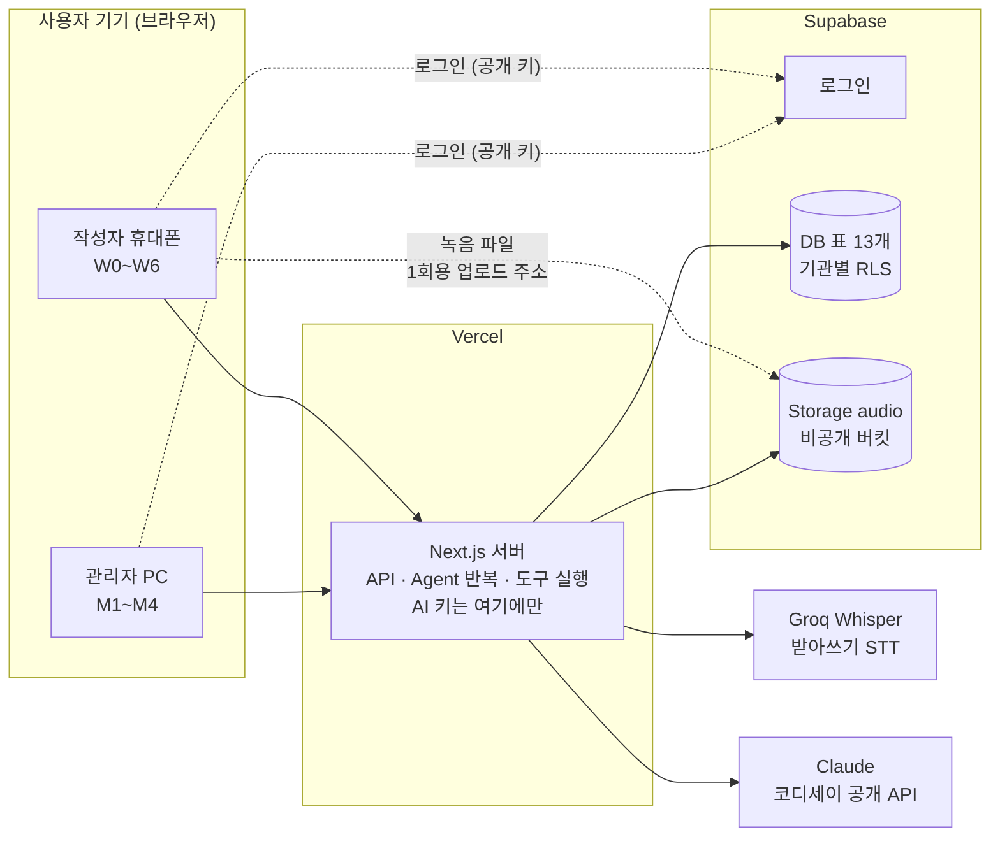
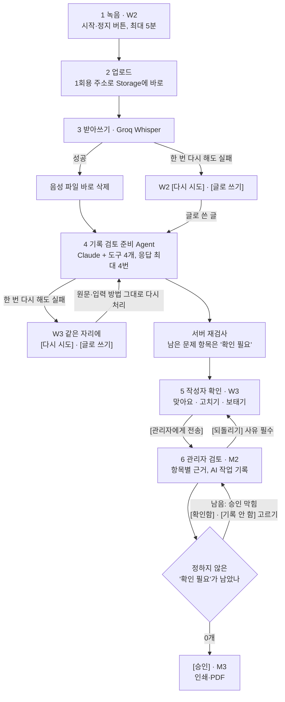

# 케어브릿지 기술 선택 v1.1

> [!NOTE]
> **10/29 용어 통일:** 이름만 [용어집 v1.0](용어집-v1.0.md)에 맞췄습니다(담당자 → 관리자, R → M 화면 번호, 기록함 → 기록, 음성 메모 → 녹음·W2 기록 시작, 보내기 → 전송). 동작·공통 계약은 그대로입니다. 결정 [2026-10-29-용어통일](../결정/2026-10-29-용어통일.md).

> [!NOTE]
> **10/30 한 녹음 한 언어:** §5의 "섞인 말도 한 번에 처리"는 맞지 않아 고쳤습니다. 녹음 하나는 한국어만 또는 베트남어만 받습니다. 결정 [2026-10-30-녹음한언어](../결정/2026-10-30-녹음한언어.md)(유효, #187).

2026-10-18 · @2dion

## 이 문서는 왜 있나

- **목적:** 1주 안에 돌아가는 시연본을 만들고, 코디세이 평가의 기술 완성도 항목을 채울 수 있는 기술 조합을 한 곳에 정해 두기 위한 문서입니다.[1][2]
- **배경:** 외부 피드백에서 Agent가 필수 조건이 되었고, 기능 추가 마감이 10/23으로 정해졌습니다. v1.0 조합 위에 Agent를 어떻게 얹을지 정해야 합니다.[3][4]
- **근거:** 기술 선택 v1.0(10/16 확정), 외부 피드백 검토 문서의 A1(Agent), B5(비용·지연), 2dion 10/18 결정(Agent 도구 4개)입니다.[3][4][5]
- **사유:** 도구가 4개뿐이고 팀이 작고 기간이 1주라서, 새 프레임워크를 배우지 않고 이미 고른 Claude API와 Next.js 서버 코드 안에서 반복을 직접 짭니다.[4][6]

## v1.0에서 바뀐 점

| 무엇 | 바뀐 내용 | 사유 |
| --- | --- | --- |
| 항목 채우기·번역 | 한 번 호출 → '기록 검토 준비 Agent'(Claude API 도구 사용 + 서버 반복) | 외부 피드백: Agent 필수(A1)[3] |
| Agent 프레임워크 | 따로 쓰지 않음 | 도구 4개, 작은 팀, 1주[4] |
| 처리 흐름 4단계 | Agent가 도구를 골라 쓰고 초안 반환으로 끝남. 뒷배경 처리 | A1, B5[3] |
| 비용·위험 | Claude 호출 기록당 최대 4번, 실행 시간 제한 위험 추가 | B5[3] |
| 일정 기준 | "10/31까지 약 2주 반" → 10/23 기능 마감, 10/24~30 테스트 | 10/18 결정 3[4] |
| 법정 서식 원문 반영 | 인쇄·PDF의 '잠정 서식' 문구는 잠정인 서식일 때만(지금은 두 서식 모두 검증됨). 인쇄는 기록 1건(하루) = 1장(10/18 팀 결정) | 10/17 법정 서식 정리[20] |

나머지 조합(Next.js, Vercel, Supabase, MediaRecorder, 서버 STT, Claude API, 브라우저 TTS, 인쇄 CSS)은 v1.0 그대로입니다.[5]

## 요약

**왜:** 기획안 결정 13(반응형 웹앱 하나)를 따라 **TypeScript 코드 한 벌로 화면·서버·배포를 끝냅니다.**[1][7]

10/16 팀(2dion)이 이 조합으로 확정했고, 10/18에 Agent 구조를 더했습니다.[4][5]

| 부분 | 추천 | 한 줄 이유 |
| --- | --- | --- |
| 화면+서버 | Next.js (TypeScript) 반응형 웹앱 | 작성자 폰과 관리자 PC를 한 코드로, 서버 API도 같은 프로젝트에 |
| 배포 | Vercel | GitHub에 올리면 자동 배포, 시연용 주소 바로 생김 |
| DB·로그인·파일 | Supabase (Postgres) | 기관별 데이터 분리(행 단위 권한, RLS)와 로그인이 포함됨 |
| 녹음 | 브라우저 MediaRecorder, 시작·정지 버튼, 5분에 자동 정지·남은 시간 표시 | 결정 4: 1회 최대 5분(10/19 결정)[8] |
| 음성→글자 (STT) | 서버 STT: Groq Whisper(`whisper-large-v3`, OpenAI 호환, 무료 요금제). 부족하면 주소만 바꿔 OpenAI 음성 인식으로(10/20 결정)[22] | 브라우저 내장 인식은 iOS·Firefox에서 불안정[9] |
| 기록 초안 (Agent) | Claude API의 도구 사용(tool use) + 서버 반복, 별도 프레임워크 없음. 코디세이 공개 API(Anthropic 규격)로 호출(10/20) | 도구 4개, 작은 팀, 1주[4][21] |
| 항목 보태기·번역·도우미 | Claude API (한 번 호출, 정해진 JSON 형식) | 빨리 답해야 하는 일은 Agent 없이 |
| 듣기 (TTS) | 브라우저 내장 음성 먼저, 부족하면 서버 TTS(코디세이 공개 API `/api/v1/audio/tts`) | 무료, 한국어·베트남어 지원 |
| 도우미 자료 찾기 | 교재 상황 대처 매뉴얼을 절 단위로 DB에 저장 → 검색 → Claude에 전달 | 교재 텍스트 사용 가능(사용자 10/16)[10] |
| 인쇄·PDF | 인쇄용 화면 + 브라우저 인쇄(PDF로 저장), 인쇄 CSS 1장 | MVP 포함(사용자 10/16), 별도 PDF 라이브러리 불필요[10] |

## 구성도

**왜:** 키와 검사를 서버 한 곳에 모아야 보안·예외 처리·비용을 한 곳에서 다룹니다. 평가의 '시스템 아키텍처 다이어그램' 초안으로도 씁니다.[2]

```text
[작성자 폰 (W0~W6)]   [관리자 PC (M1~M4)]
          \                 /
           \               /
        [Next.js 서버 (Vercel)]
          ├─ 받아쓰기 → 서버 STT
          ├─ 기록 검토 준비 Agent 반복 ⇄ Claude API (도구 사용)
          │     └─ 도구 실행: 서식 기준 조회 · 용어 검색 · 기록 검증 · 초안 반환
          ├─ 항목 보태기 · 짧은 번역 · 도우미 → Claude API (한 번 호출)
          └─ DB · 로그인 · 파일 → Supabase (RLS)
```

폰과 PC는 모두 서버만 부르고, STT·Claude·DB는 서버만 부릅니다. 그래서 API 키가 브라우저에 나가지 않고, 음성 삭제와 AI 답 검사를 한 곳에서 처리합니다. Agent의 도구도 모두 서버 코드가 실행합니다.[6]

**그림: 무엇이 어디에 연결되나** 그림은 위 내용을 옮긴 것입니다. 그림과 글이 다르면 글이 기준입니다.



## 부분별 선택과 이유

**왜:** 고르는 기준은 세 가지입니다. ① 10/23 기능 마감까지 돌아가는 시연본을 만들 수 있는가[4], ② 코디세이 평가의 기술 완성도 항목(아키텍처 다이어그램, 예외 처리, 비용 효율, "즉시 배포가 가능한 수준")을 채울 수 있는가[2], ③ 기획안의 결정(반응형 웹앱 하나, 수동 녹음, 한국어 최종 기록, 기관별 분리)과 맞는가.[1][7][8]

### 1. 화면+서버: Next.js (TypeScript)

- **이유:** 작성자 화면(폰), 관리자 화면(PC), 서버 API(음성 업로드, AI 호출, Agent 반복)를 한 프로젝트 한 언어로 만듭니다. AI API 키는 서버 쪽에만 두어 브라우저에 노출되지 않습니다.[11]
- **근거:** 결정 12가 "반응형 웹앱 하나"이고, 나중에 캡처 방지가 필요하면 같은 웹 코드를 Capacitor(안드로이드)·일렉트론(PC)으로 감쌉니다.[7] 웹 코드가 기본이어야 이 길이 열려 있습니다.
- **대안:** React 화면 + Python(FastAPI) 서버는 AI 라이브러리가 많지만, 코드 두 벌과 배포 두 곳을 관리해야 합니다. 이번 기능은 모두 외부 AI API 호출이라 Python이 꼭 필요하지 않습니다. Flutter·React Native는 v0.4.1에서 팀 학습 부담과 화면 두 벌 문제로 뒤로 밀렸습니다.[12]
- **확정:** 10/16 이 조합으로 확정(2dion).[5]

### 2. 배포: Vercel

- **이유:** GitHub 저장소에 올리면 자동으로 배포됩니다.[13] 무료 요금제 하루 배포 100번 한도 때문에 자동 배포는 main에 합칠 때만 합니다(브랜치 미리보기 끔, `web/vercel.json`, 결정 2026-10-28-vercel배포줄이기). 시연 화면을 주소 하나로 보여줄 수 있고, 평가의 "즉시 배포 가능" 항목에 바로 답이 됩니다.[2]
- **근거:** Next.js를 만든 회사의 서비스라 추가 설정이 거의 없습니다.
- **주의:** 서버 함수에 실행 시간 제한이 있습니다. 1분 넘는 음성은 STT를 나눠 보내거나 처리 중 화면을 보여 줍니다. Agent는 Claude 응답이 최대 4번이라 시간이 더 걸립니다. ⚠️ 받아쓰기 + Agent 4번이 제한 안에 끝나는지, 뒷배경 처리를 어떤 방식으로 할지 개발 첫 주에 재서 정함(확인 필요).

### 3. DB·로그인·파일: Supabase (Postgres)

- **이유:** 기록·어르신·계정은 관계가 분명한 데이터라 표(SQL) DB가 맞고, 로그인과 파일 저장이 같이 제공됩니다.
- **근거:** '행 단위 권한(RLS)'으로 "내 기관 데이터만 보기"를 DB 안에서 강제합니다.[14] 이것이 교육용 기관 분리(사용자 결정 10/16)와 실제 어르신 개인정보 보호를 가장 적은 코드로 지키는 방법입니다.[15] Agent가 권한을 판단하지 않고, RLS가 계속 맡습니다.[6]
- **대안:** Firebase는 문서형 DB라 '기록-항목-검토' 같은 연결 조회가 불편합니다.
- **주의:** 무료 요금제는 일주일 동안 쓰지 않으면 일시 중지됩니다. 시연 전날 한 번 열어 둡니다.[14]

### 4. 녹음: MediaRecorder, 시작·정지 버튼

- **이유:** 브라우저 표준 녹음 기능이라 추가 설치가 없고, 작성자가 시작·끝을 직접 누르는 결정 4와 맞습니다.[8]
- **근거:** 크롬·삼성 인터넷·사파리(iOS 포함)에서 모두 지원됩니다. 다만 파일 형식이 브라우저마다 달라(크롬 webm, 사파리 mp4) 둘 다 STT가 받는지 확인해야 합니다.[16]

### 5. 음성→글자: 서버 STT (Groq Whisper 무료 API, 대안 OpenAI 음성 인식)

- **이유:** 녹음 파일을 서버로 보내 글자로 바꾸면, 브라우저 종류와 상관없이 결과가 같습니다. 한국어만 또는 베트남어만 말한 녹음을 받습니다. 한 녹음 안에서 두 언어를 섞으면 한쪽 문장이 빠지거나 잘못 적혀서 받지 않습니다(10/30 확인, 결정 [녹음한언어](../결정/2026-10-30-녹음한언어.md)).
- **근거:** 브라우저 내장 인식(Web Speech API)은 파이어폭스가 지원하지 않고 iOS 사파리에서 자주 끊깁니다.[9] v0.5 문서 코멘트에서 같은 이유로 서버 STT를 추천했습니다.
- **대안:** Google STT는 언어 코드를 미리 지정해야 하고 설정이 더 복잡합니다. 두 서비스 모두 호출 부분만 바꾸면 교체할 수 있게 만듭니다.
- **확인:** 사투리·외국인 발음 한국어 인식 품질은 문서로 알 수 없어, 팀원이 직접 샘플 5개를 녹음해 비교합니다.
- **10/20 결정:** 코디세이 공개 API에는 STT가 없고, 채팅 모델에 음성을 넣는 방법도 400 `unsupported_feature`로 막혔습니다. 그래서 Groq의 OpenAI 호환 음성 인식(`whisper-large-v3`, `language=ko`)을 무료 요금제로 씁니다. 호출 형식이 OpenAI와 같아, 한도·품질이 부족하면 주소·키·모델만 바꿔 OpenAI 음성 인식으로 옮깁니다. 무료 한도와 데이터 정책은 결정 기록에 있습니다.[21][22]
- **10/25 덧붙임:** 베트남어 입력을 받기 위해, 작성자 언어가 vi면 `language`를 비워 자동 감지에 맡기고 ko면 `language=ko`로 둡니다. QA 사람 목소리 재시험으로 확정합니다(결정 기록 덧붙임).[22] **10/30:** 섞인 말은 자동 감지로도 받지 못해 받지 않기로 함(녹음한언어 유효).

### 6. 기록 초안: Claude API 도구 사용 + 서버 반복 (Agent)

- **이유:** 받아쓴 글을 한 번에 채우면 서식 기준 확인, 용어 찾기, 스스로 검사가 빠집니다. Claude가 도구를 골라 부르고, 서버가 도구를 실행해 결과를 돌려주는 반복으로 '기록 검토 준비 Agent'를 만듭니다.[3][6]
- **구조:**
  1. 서버가 받아쓴 글, 어르신 정보, 도구 4개 정의를 Claude API에 보냅니다.
  2. Claude가 도구 호출을 돌려주면, 서버 코드가 그 도구를 실행하고 결과를 다음 요청에 붙여 보냅니다.
  3. 초안 반환(return_draft)이 오거나 Claude 응답이 4번이 되면 서버가 반복을 끝냅니다.
- **도구 4개:** ① 서식 기준 조회(get_form_spec) ② 용어 검색(search_glossary) ③ 기록 검증(validate_draft) ④ 초안 반환(return_draft). 모두 서버 코드가 실행합니다. 입출력과 멈춤 규칙은 AI 규칙 v1.1.1에, 도구 입출력 계약은 데이터 구조 v1.1 '공통 계약'에 둡니다.[4][6][17]
- **왜 별도 Agent 프레임워크를 쓰지 않나:**
  - 도구가 4개뿐이고, 반복도 최대 4번이라 서버 코드 수십 줄로 짤 수 있습니다.
  - 팀이 작고(BE 1명 + QA 보조) 기능 마감까지 1주라 새 도구를 배울 시간이 없습니다.[4]
  - 반복 상한, 같은 입력 막기, 도구 실패 재시도, agent_steps 기록을 우리 코드가 직접 쥐어야 테스트하기 쉽습니다.[6][17]
  - 나중에 도구가 늘거나 여러 Agent가 필요해지면 그때 다시 검토합니다.
- **코드가 계속 맡는 것:** 승인 조건, 권한(RLS), 시간 합 계산, 상태 변화, 덮어쓰기 금지는 AI에 맡기지 않습니다.[3][6]
- **근거:** 평가 기준은 "AI API를 그대로 가져다 쓴 수준을 넘어"서는지를 봅니다.[2] 케어브릿지는 서식 규칙, 확인 필요 판정, 항목별 근거, 코드 검증, 관리자 검토를 팀이 직접 설계한 흐름 안에서 AI를 씁니다.
- **대안:** OpenAI GPT도 같은 일을 할 수 있습니다. 팀이 이미 쓰는 API 키가 있으면 그쪽으로 가도 구조는 같습니다.
- **호출 경로 (10/20):** Anthropic에 직접 부르지 않고 코디세이 공개 API의 Anthropic 규격(`/v1/messages`)으로 부릅니다. 주소·키만 환경 변수로 바꾸고 구조는 그대로입니다. 설정과 오류 처리는 [코디세이 API 사용 방법 v1.0](코디세이api-v1.0.md)에 있습니다.[21]

### 7. 항목 보태기·번역·도우미: Claude API 한 번 호출

- **이유:** W3(기록 초안 확인)의 항목 보태기, 짧은 번역(재번역 포함), W6(도우미)는 빨리 답해야 해서 Agent 없이 한 번 호출로 둡니다. 정해진 JSON 형식으로 받아 형식이 틀리면 한 번 다시 요청합니다.[6]
- **비용:** 기록 초안·항목 보태기는 정확도가 중요해 중간 등급 모델, 번역·도우미는 가벼운 모델로 나눠 비용을 줄입니다.
- **모델 이름:** 코드의 설정 한 곳에만 둡니다. 이 문서는 등급만 적고 모델 이름을 고정하지 않습니다.[6] 10/20 기준 설정값은 중간 등급 `claude-sonnet-4`, 가벼운 등급 `claude-haiku-4`입니다(코디세이 모델 ID).[21]

### 8. 듣기(TTS): 브라우저 내장 음성 먼저

- **이유:** 한국어·베트남어 문장을 읽어 주는 기능(speechSynthesis)은 무료이고 서버가 필요 없습니다.
- **주의:** 목소리 종류와 품질이 기기마다 다릅니다. 시연 기기에서 베트남어 목소리가 없으면 서버 TTS로 바꿉니다. 서버 TTS는 코디세이 공개 API `/api/v1/audio/tts`(tts-1 등)를 쓸 수 있습니다.[21]

### 9. 도우미 자료 찾기: 교재 절 단위 저장 + 검색

- **이유:** 교재 상황 대처 매뉴얼을 제목·본문 단위로 DB에 넣고, 질문과 관련 있는 절 몇 개만 Claude에 건네 답하게 합니다. 답에 교재 쪽수를 함께 보여 줄 수 있습니다.
- **근거:** 교재는 공개 자료라 텍스트는 그대로 사용하고, 이미지는 확인 후 씁니다(사용자 10/16).[10] 처음에는 Postgres 기본 검색으로 시작하고, 답이 엉뚱하면 번역·의미 검색(벡터 검색, Supabase 내장 pgvector)을 붙입니다.
- **최소 구현 범위:** W6(도우미) = 교재 절 검색 + 답 + 출처만. 음성 질문은 여유가 있을 때.[3]

### 10. 인쇄·PDF: 인쇄용 화면 + 브라우저 인쇄

- **이유:** 승인된 기록을 별지 서식 모양의 인쇄용 화면으로 만들고, 브라우저 인쇄에서 'PDF로 저장'을 고르면 됩니다. 한글 글꼴이 깨지지 않고 추가 라이브러리가 필요 없습니다.
- **근거:** 인쇄·PDF는 MVP 포함으로 정해졌고,[10] "공식 기록지 아님" 표시를 넣습니다.[7] 서식 대응이 잠정(provisional)이면 "잠정 서식"도 넣습니다. 지금은 별지 제16호·제12호 모두 검증됨입니다(10/17 법정 서식 정리).[3][20] 원문 1장은 제12호 7일, 제16호 3일이지만, 인쇄는 묶지 않고 기록 1건(하루)을 1장으로 합니다(10/18 팀 결정).
- **최소 구현 범위:** 브라우저 인쇄 CSS 1장.[3]

## 음성 기록 처리 흐름

**왜:** 처리 단계를 정해 두어야 화면이 무엇을 보여 줄지, 어디서 실패를 잡을지 정할 수 있습니다.

1. **녹음 (작성자 폰):** W2(기록 시작)에서 [시작]을 누르면 타이머와 빨간 표시가 나오고, [정지]를 누르면 끝납니다.[8]
2. **업로드 (Storage):** 서버에서 1회용 업로드 주소를 받아, 녹음 파일을 Supabase Storage 비공개 버킷에 바로 올리고 서버에는 위치(storage_path)만 알립니다. Vercel 요청 크기 제한(4.5MB)을 피하기 위해서입니다. 네트워크가 끊기면 녹음을 탭 메모리에만 두었다가(IndexedDB 등 기기 저장 X) [다시 올리기]로 다시 올립니다. Storage에 남은 파일은 1시간 주기 정리가 지웁니다.[23][24]
3. **글자로 바꾸기 (STT):** 서버가 STT를 부르고, 글자가 나오면 **음성 파일을 즉시 삭제**합니다(결정 4).[8]
4. **기록 검토 준비 Agent (Claude, 뒷배경):** 서버가 Agent를 시작합니다. Claude가 서식 기준 조회·용어 검색·기록 검증을 골라 부르고, 초안 반환으로 끝냅니다. 서버는 저장 직전에 다시 검증하고, 남은 문제 항목은 '확인 필요'로 낮춥니다. 도구 호출마다 agent_steps에 한 줄을 남깁니다.[6][17]
5. **확인 (작성자):** W3(기록 초안 확인)에서 처음에는 '정리 중'을 보고, 끝나면 한국어가 위, 모국어가 아래로 보입니다. 빈 항목은 음성이나 글자로 보태고, 특이사항은 글자 수를 보여 200자를 넘으면 경고만 합니다.[10][18]
6. **검토 (관리자 PC):** M2(검토 화면)에서 항목별 근거와 접힌 'AI 작업 기록'을 봅니다. '확인 필요'가 남은 항목마다 [확인함] 또는 [기록 안 함]을 골라야 [승인]이 눌리고, 서버도 승인 요청 때 다시 검사합니다. 승인본에서 인쇄·PDF를 만듭니다.[4][18]

**그림: 녹음에서 승인까지** 그림은 위 내용을 옮긴 것입니다. 그림과 글이 다르면 글이 기준입니다.



처리에는 수십 초가 걸릴 수 있어, 3~4단계 동안 "글자로 바꾸는 중 → 정리 중"을 화면에 보여 줍니다. 실제 걸리는 시간은 팀이 샘플로 재서 기록합니다.

## 비용·위험·확인할 것

**왜:** 무료 요금제와 쓴 만큼 내는 API를 섞어 쓰므로, 비용이 새는 곳과 시연이 깨질 곳을 미리 막아야 합니다(B5).[3]

**비용:** Vercel과 Supabase는 무료 요금제로 시연이 가능합니다.[13][14] Claude는 코디세이 공개 API로 불러 기관이 비용을 내지만, 계정마다 월 1,000,000 차감 토큰 한도가 있습니다(Sonnet Agent 기록 1건 ≈ 3만 추정, 월 30~40건). 그래서 개발은 Mock·가벼운 모델 위주로 합니다.[21] Agent는 Claude 호출이 기록당 1번에서 최대 4번으로 늘고, 응답마다 앞 대화를 다시 보내 토큰도 늘어납니다. 그래서 반복 상한 4번, 같은 도구·같은 입력 한 번만을 코드로 지키고, 건당 시간·비용을 품질 확인 표에서 잽니다.[6] 같은 음성을 두 번 보내지 않게 하고, 시연용 데이터는 미리 만든 결과를 저장해 두면 비용과 시연 실패 위험이 함께 줄어듭니다.

| 위험 | 대응 |
| --- | --- |
| 외국인 발음 한국어를 STT가 잘못 받아씀 | 작성자가 W3(기록 초안 확인)에서 항목을 고치고, 관리자가 근거 문장을 보고 판단. 샘플 녹음으로 먼저 비교 |
| 아이폰 사파리 녹음 형식(mp4)이 다름 | 개발 첫 주에 아이폰·안드로이드 실기기로 녹음→STT를 끝까지 확인[16] |
| 서버 함수 실행 시간 제한 | 녹음은 5분 상한·Storage 직접 업로드로 나누지 않음, 처리 중 화면 표시. ⚠️ Agent 4번이 제한 안에 끝나는지 측정(확인 필요) |
| Agent가 끝내지 않거나 같은 도구를 되풀이 | 응답 4번 상한, 같은 입력은 앞 결과 돌려줌, 상한 도달 시 마지막 초안 검증 후 '확인 필요'로 저장[6] |
| 도구 실패(시간 초과 등) | 한 번 다시, 또 실패하면 audio_jobs.status = failed. 받아쓰기 전 오류는 W2(기록 시작), 초안 처리 오류는 W3(기록 초안 확인) 같은 자리에 [다시 시도]와 [글로 쓰기]. W3 재시도는 원문·입력 방법을 보존[6] |
| 웹에서는 화면 캡처를 막을 수 없음 | MVP는 합성 데이터만 쓰고, 차단은 Capacitor 단계에서[7] |
| Supabase 무료 프로젝트 일시 중지 | 시연 전날 접속해 확인[14] |

**팀이 확인할 것**

- ~~STT·Claude API 키와 결제 수단을 누가 준비하는지~~ → Claude는 코디세이 공개 API, 키는 팀장(10/20). STT는 Groq Whisper 무료(10/20)[21][22]
- 시연 기기 (아이폰인지 안드로이드인지)
- 팀원 목소리 샘플 5개 (한국어만, 베트남어만. 섞인 말은 받지 않음 10/30)
- ⚠️ Vercel에서 Agent 뒷배경 처리 방식과 실행 시간 (BE 백엔드 담당, 개발 첫 주)[4]
- 테스트 항목(Agent 도구 실패·반복 상한·같은 입력 반복 등)은 시연·일정 v1.1의 테스트 계획을 따름[19]

## 참고 자료

1. [케어브릿지 기획안 v1.1](https://claude.ai/code/artifact/ae9bf73f-83b0-414b-9646-79c1f83b12de): 결정 13 "사용 기기와 개발 방식", 1주 MVP 범위.
2. 코디세이 AI 네이티브 Final-Project 설명회 자료, 평가배점 세부 ② 기술 완성도(레포 Reference/Codyssey).
3. [외부 피드백 검토와 v1.1 수정 계획](https://claude.ai/code/artifact/bb7b4d75-9da2-41aa-be68-1ce50e5be073): A1 Agent, A6 서식 대응표, A8 최소 구현 범위, B5 비용·지연.
4. v1.1 변경 명세(design/v1.1/v1.1-변경-명세.md): 2dion 10/18 팀 결정(Agent 도구 4개, 10/23 기능 마감, 역할별 담당).
5. [케어브릿지 기술 선택 v1.0 (확정, 보관)](https://claude.ai/artifact/G26TE6WzfpmypGiJ4R8jjz): 10/16 2dion 확정.
6. [케어브릿지 AI 규칙 v1.1.1](https://claude.ai/code/artifact/d60977bb-04d7-4a38-bedd-8539f892d504): 기록 검토 준비 Agent의 도구·멈춤 규칙·서버 검사, 모델 등급, 모델 이름은 설정 한 곳.
7. [케어브릿지 기획안 v0.5](https://claude.ai/artifact/CkkvXkgi5bw4ekLAsUJpWj) 결정 12 "사용 기기와 개발 방식", 결정표의 캡처 방지·합성 데이터, "공식 기록지 아님".
8. 기획안 v0.5 결정 4 "받아쓰기 규칙", 그리고 2dion 10/16 문서 코멘트: "일단은 음성 녹음 시작과 끝을 수동으로 버튼 눌러서 확인하도록 하자".
9. MDN Web Docs, [SpeechRecognition 브라우저 호환성](https://developer.mozilla.org/en-US/docs/Web/API/SpeechRecognition#browser_compatibility).
10. 2dion, 10/16 프로젝트 스레드 답변: 표현 도우미·인쇄/PDF MVP 포함, 교재 텍스트 사용 가능(이미지는 확인), 특이사항 200자는 경고만.
11. Next.js Docs, [Route Handlers](https://nextjs.org/docs/app/building-your-application/routing/route-handlers).
12. 기획안 v0.4.1 "크로스 플랫폼 검토" 절(공유 폴더 planning/).
13. Vercel Docs, [Git 연동 배포](https://vercel.com/docs/git), [요금제](https://vercel.com/pricing).
14. Supabase Docs, [Row Level Security](https://supabase.com/docs/guides/database/postgres/row-level-security), [요금제](https://supabase.com/pricing).
15. 2dion, 10/16 v0.5 문서 코멘트: 교육용 기관 계정으로 완전히 분리, "이 방향으로 가자".
16. MDN Web Docs, [MediaRecorder](https://developer.mozilla.org/en-US/docs/Web/API/MediaRecorder).
17. [케어브릿지 데이터 구조 v1.1](https://claude.ai/code/artifact/1c84aaa0-d650-4f59-8ec7-9572acf9b1cb): agent_steps, 공통 계약(API 경로, 상태 값, 도구 입출력).
18. [케어브릿지 화면 설계 v1.1](https://claude.ai/code/artifact/eb2d58dc-8af3-4c8a-b889-1210175604e5): W3(기록 초안 확인) '정리 중', M2(검토 화면) 'AI 작업 기록'·승인 규칙.
19. [케어브릿지 시연 시나리오와 일정 v1.1](https://claude.ai/code/artifact/ada334bc-6605-4582-9e99-d69f5686d330): 테스트 계획.
20. 데이터 담당, 10/17 법정 서식 정리: `참고자료/도메인/서식/법정/README.md` (국가법령정보센터 확인. 별지 제12호 2025.12.12판·제16호 2019.9.27판 원문 확보, 특이사항 글자 수 제한 없음, 팀 문서와 달라지는 점).
21. [결정 기록: 텍스트 AI는 코디세이 공개 API로](../결정/2026-10-20-코디세이api.md)와 [코디세이 API 사용 방법 v1.0](코디세이api-v1.0.md) (10/20).
22. [결정 기록: 받아쓰기는 Groq Whisper 무료 API로](../결정/2026-10-20-stt-groq.md) (10/20).
23. [결정 기록: 녹음은 1회용 업로드 주소로 Storage에 바로 올림](../결정/2026-10-21-녹음업로드.md) (10/21).
24. [결정 기록: 연결이 끊기면 녹음은 탭 메모리에만 둠](../결정/2026-10-27-녹음임시보관.md) (10/27).
