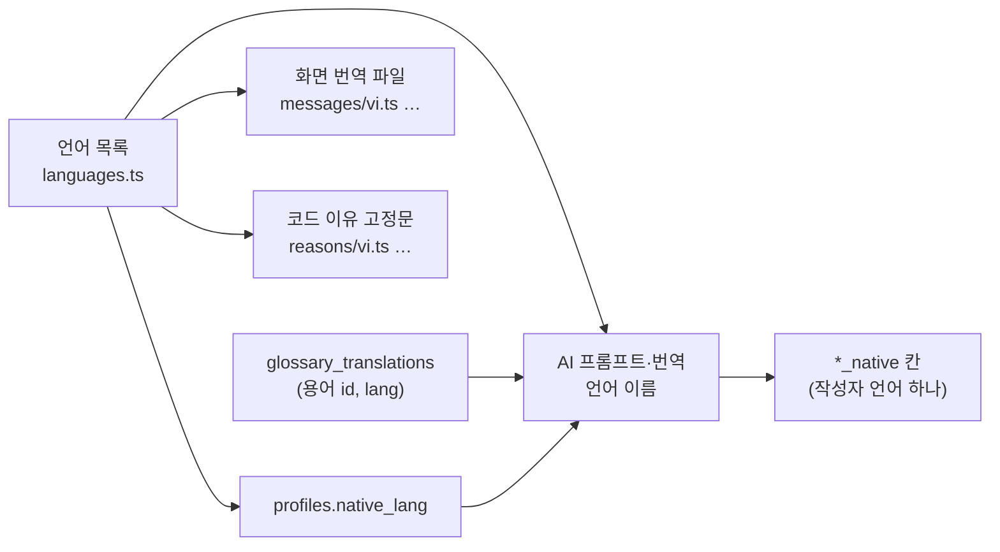

# 케어브릿지 다국어 확장 구조 v2.0.0

2026-11-03 · @2dion 요청, Claude 정리 · 상태: **제안** (공통 계약은 아직 바꾸지 않음) · 단계 0 완료(PR #257, 이슈 #255) · 단계 2 완료(이슈 #259, 결정 [용어번역표](../결정/2026-11-03-용어번역표.md))

## 이 문서는 왜 있나

- **목적:** 베트남어 다음 언어(예: 영어·중국어·네팔어·크메르어)를 넣을 때 무엇을 어떤 순서로 바꾸는지 정합니다.
- **배경:** MVP는 작성자 모국어를 `vi` 하나로 만들었습니다. 기록 칸은 '모국어' 칸이지만, 화면 문구·용어 번역·AI 이유 번역·코드 타입은 베트남어로 박혀 있습니다.[1][2]
- **근거:** `main-codyssey`(ee107f9) 코드·마이그레이션·`data/`와 데이터 구조 v2.1.0, 화면 v2.1.0, AI 규칙 v2.0.2, 결정 기록을 읽은 결과입니다.
- **사유:** 언어를 하나 더할 때마다 화면 30여 개 파일과 DB를 손으로 고치면 빠뜨리기 쉽습니다. 먼저 '언어 목록 하나 + 언어별 번역 파일·표' 구조로 바꿔 두면, 이후 언어 추가는 데이터 추가가 됩니다.

이 문서는 설계 제안입니다. 아래 '단계 1' 이후를 실제로 할 때는 AGENTS.md대로 이슈와 결정 기록을 먼저 쓰고, 데이터 구조 '공통 계약' 절을 고칩니다.

## 바꾸지 않는 것

- **최종 기록은 한국어**(원칙 8). 모국어는 아래에 붙는 번역이고, 인쇄·PDF는 한국어만입니다.[3]
- **병기 원칙:** 내 말은 그대로, 남이 쓴 내용은 병기, 화면 틀은 한국어.[4] 언어가 늘어도 '한국어 + 작성자 모국어 하나'의 두 줄입니다. 세 언어 이상을 한 화면에 함께 보이지 않습니다.
- **듣기(TTS)는 한국어만.** 한국어 학습·생활 적응이 목적이라 언어를 늘려도 바꾸지 않습니다(기획안 결정 5 '한국어 문장마다 듣기', 코드 `speak()`는 `ko-KR`).[5]
- **녹음 하나는 한 언어.** 섞은 말은 받아쓰기가 빠뜨리거나 틀리게 옮깁니다(10/30 QA 확인).[6]
- 승인 조건·권한·상태 변화는 언어와 상관없이 코드가 지킵니다.

## 지금 구조 점검

### 1. 이미 언어와 상관없는 곳 (그대로 씀)

| 곳 | 이유 |
| --- | --- |
| `record_items.value_native`, `reason_native` | '모국어' 칸이라 어느 언어든 담음 |
| `records.return_reason_native`, `helper_messages.answer_native` | 같음 |
| `value_ko` 중심 검증·승인·인쇄 | 한국어만 봄 |
| `list_org_staff()`의 `native_lang` | 코드 값만 돌려줌 |

### 2. 베트남어로 박힌 곳 (언어를 더하면 바꿔야 함)

| 영역 | 곳 | 지금 | 문제 |
| --- | --- | --- | --- |
| DB | `profiles.native_lang` (init 마이그레이션) | `check (native_lang in ('ko','vi'))` | 새 코드를 넣을 수 없음 |
| DB | `glossary.term_vi`, `search_glossary()` 결과 | 베트남어 칸 하나 | 언어마다 칸이 늘어남 |
| 코드 타입 | `web/lib/auth/signup.ts` `NativeLang` | `"ko" \| "vi"` | 다른 파일 7곳은 이 타입 대신 `"ko" \| "vi"`를 따로 적음 → **단계 0에서 해결**(`NATIVE_LANGS`에서 만듦) |
| 코드 (주의) | `agent-run.ts`, `draft-repository.ts`, `return-translation-supabase.ts`, `support-check-supabase.ts`, `helper/ask-supabase.ts`, `real/map.ts`, `real/load.ts` | `native_lang === "ko" ? "ko" : "vi"` | 새 언어 사용자가 **조용히 베트남어 번역**을 받음 → **단계 0에서 해결**(`parseNativeLang`) |
| AI | `web/lib/ai/translate.ts` `LANG_NAME` | `{ vi: "베트남어" }` | 번역 대상 언어 이름표 |
| AI | `validate-draft.ts` `REASONS_VI` | 코드 이유 9개 + 서버 이유의 베트남어 고정문 | 언어별 고정문이 없음 |
| AI | `helper/ask.ts` 프롬프트, `run-agent.ts` 자동 멈춤 이유 | "vi에는 베트남어 번역" | 언어 이름이 문장에 박힘 |
| API | `POST /api/helper/ask` 출력 | `ko`, `vi` | 칸 이름이 언어 이름 |
| 화면 | 작성자·계정 화면 33개 파일 | 베트남어 문장 약 235곳 직접 작성, `className="vi"` | 번역 파일이 없음. `lang` 속성도 없음 |
| 화면 | `web/lib/bilingual.ts` `SHOW_FRAME_VI` | 베트남어 이름 | 이름만 바꾸면 됨 |
| 데이터 | `data/glossary/terms-v0.3.csv`, 용어집 v2.0.0 '베트남어' 칸 | 베트남어 열 | 언어별 열이나 파일 필요 |
| 문서 | AI 규칙 '용어 검색' 설명 | "고정 베트남어 번역" | 언어 중립 문장으로 |

받아쓰기(`web/lib/stt/transcribe.ts`)는 `language`를 보내지 않아(자동 감지) 코드 변경은 없지만, 언어마다 받아쓰기 품질은 따로 확인해야 합니다.

## 목표 구조

**그림: 언어 정보가 흐르는 길** 그림은 아래 글을 옮긴 것입니다. 그림과 글이 다르면 글이 기준입니다.

### 1. 언어 목록 하나 (코드)

`web/lib/i18n/languages.ts` 한 곳에 언어를 적고, 다른 곳은 여기서만 읽습니다.

| 칸 | 예 (vi) | 쓰는 곳 |
| --- | --- | --- |
| `code` | `vi` (ISO 639-1) | DB 값, 번역 파일 이름 |
| `nameKo` / `nameNative` | 베트남어 / Tiếng Việt | 언어 선택, AI 프롬프트 |
| `enabled` | true | 가입·언어 선택에 보일지 |
| `sttChecked` | true | 받아쓰기 품질 확인을 마쳤는지 |
| `font` | 기본 | 글꼴이 따로 필요한지 |

- `NativeLang` 타입은 이 목록에서 만듭니다. 따로 적은 `"ko" | "vi"`는 모두 이 타입으로 바꿉니다.
- `parseNativeLang(value)`가 모르는 값을 **베트남어로 바꾸지 않고** `ko`(번역 없음)로 둡니다. 번역이 틀린 언어로 나오는 것보다 한국어만 보이는 편이 안전합니다.
- DB는 지금처럼 `check` 제약을 두고, 언어를 더할 때 마이그레이션으로 목록을 고칩니다. 언어 표(`languages`)는 관리 화면이 생길 때까지 만들지 않습니다.

### 2. 기록 칸 (DB)

- `*_native` 칸은 그대로 씁니다. 작성자 한 명은 모국어 하나만 씁니다.
- **추가 제안:** `records.native_lang`(기록을 만든 때 작성자 언어)을 둡니다. 작성자가 언어를 바꾸면 옛 기록의 번역이 어느 언어인지 알 수 없기 때문입니다. 언어가 다르면 화면은 번역 줄을 숨기고, 다시 번역은 열 때 서버가 합니다(되돌림 사유 번역과 같은 방식).[7]

### 3. 용어 번역 (DB·데이터)

- 새 표 `glossary_translations(glossary_id, lang, term, reviewed)`로 언어별 고정 번역을 둡니다. `term_vi`는 옮긴 뒤 한동안 함께 두고 나중에 지웁니다.
- `search_glossary(expression, max_results, lang)`은 `term_native`를 돌려줍니다. 그 언어 번역이 없으면 빈값이고, AI는 교재 용어(한국어)만 쓰고 번역을 짐작하지 않습니다.
- 원본 CSV는 언어마다 열을 늘리지 않고 `data/glossary/translations-<lang>.csv`(`term_id,term,reviewed`)로 나눕니다. 데이터 담당이 언어별로 따로 채우고 검수할 수 있습니다.

### 4. AI

- 프롬프트의 언어 이름은 언어 목록의 `nameKo`에서 넣습니다(`translate.ts`, Agent, 도우미, 항목 추가).
- `REASONS_VI` → `REASONS_NATIVE[lang]`(`web/lib/agent/reasons/<lang>.ts`). 그 언어 고정문이 없으면 `reason_native`는 빈값이고 화면은 한국어 이유만 보입니다.
- 도우미 답 칸 `vi` → `native`. 바꾸는 동안 서버는 두 칸을 함께 보냅니다.
- 번역 검수자가 없는 언어는 AI 규칙의 역번역 자체 검증을 언어마다 다시 합니다.[8]

### 5. 화면 (i18n)

- 문구를 `web/lib/i18n/messages/<lang>.ts`로 뺍니다. 키는 화면 번호와 뜻으로 짓습니다(예: `w2.sendError.network`). 한국어는 지금처럼 화면 코드에 둡니다(화면 틀은 한국어가 기준).
- 병기 줄은 `<Native id="…" />` 하나로 그립니다. 작성자 언어 파일에 그 키가 없으면 줄을 숨깁니다. 이 컴포넌트가 `lang` 속성을 붙여 화면 읽기 프로그램과 글꼴이 맞게 동작하게 합니다.
- `className="vi"`는 `className="native"`, `SHOW_FRAME_VI`는 `SHOW_FRAME_NATIVE`로 바꿉니다.
- 언어 선택(W0·W5·A2)은 화면 v2.1.0 '추후 적용' 그대로 두고, 언어가 둘 이상 켜질 때 엽니다.[9]
- 데모 데이터(`web/lib/demo/`)의 `vi` 칸도 같은 이름으로 맞춥니다.

### 6. 받아쓰기·글꼴

- 언어마다 합성 음성으로 받아쓰기를 시험하고, 통과해야 `sttChecked = true`로 둡니다. 통과 전에는 그 언어로 '쓰기'만 안내합니다.
- 라틴 문자 언어(영어·인도네시아어·필리핀어·우즈베크어)는 지금 글꼴로 됩니다. 네팔어(데바나가리)·크메르어·미얀마어·태국어는 Noto 글꼴을 그 언어에서만 불러옵니다.

## 단계

| 단계 | 할 일 | 동작 변화 | 크기 |
| --- | --- | --- | --- |
| 0 (**완료**, #257) | 7곳의 `=== "ko" ? "ko" : "vi"`를 `parseNativeLang`으로, `"ko" \| "vi"`를 `NativeLang`으로 | 없음 (vi만 있음) | 파일 10개 안팎, 작음 |
| 1 (구조) | 언어 목록, 화면 번역 파일·`<Native>`, `REASONS_NATIVE`, 도우미 `native` 칸 | 없음 (vi만 있음) | 화면 33개 파일, 이슈로 나눔 |
| 2 (**완료**, #259) | `glossary_translations`, `search_glossary(lang)`, `records.native_lang`, `REASONS_NATIVE`, 언어 목록 `languages.ts`, 도우미 `native` 칸(`vi`와 함께) | 없음 | 마이그레이션 + 공통 계약(데이터 구조 v2.3.0) |
| 3 (언어 추가) | 아래 '언어 하나 더하기' 목록 | 새 언어 켜짐 | 언어마다 |

단계 0~2는 베트남어만 있는 지금 동작을 바꾸지 않으므로, 기존 테스트가 그대로 통과해야 합니다.

## 언어 하나 더하기 (단계 3 확인 목록)

1. **팀장:** 언어와 우선순위를 정하고 결정 기록을 씁니다.
2. **BE:** `languages.ts`에 줄을 더하고(`enabled: false`), `profiles.native_lang` 제약을 마이그레이션으로 고칩니다.
3. **FE:** `messages/<lang>.ts`를 채웁니다. 빠진 키는 줄이 숨으니 화면이 깨지지 않습니다.
4. **BE:** `reasons/<lang>.ts` 고정문을 채웁니다.
5. **데이터:** `translations-<lang>.csv`를 채워 시드로 넣습니다.
6. **QA:** 합성 음성 받아쓰기, 역번역 검증, 글꼴·줄바꿈 확인. 통과하면 `sttChecked`와 `enabled`를 켭니다.
7. **문서:** 데이터 구조 `native_lang` 값 목록, 용어집, AI 규칙의 언어 줄을 고칩니다.

## 참고 자료

1. [데이터 구조 v2.1.0](../보관/설계/2026-11-03-데이터구조-v2.1.0.md): `profiles.native_lang`, `record_items`, `glossary`, `helper_messages`, 공통 계약 `POST /api/helper/ask`.
2. [화면 v2.1.0](../보관/설계/2026-11-03-화면-v2.1.0.md): 병기 모드, '추후 적용' 표.
3. AGENTS.md '바꾸지 않는 원칙' 8.
4. [병기 모드 우선 결정](../결정/2026-10-25-병기모드우선.md), [화면틀병기 결정](../결정/2026-10-27-화면틀병기.md).
5. [기획안 v2.0.0](../기획/기획-v2.0.0.md) 결정 5. [기술 선택 v2.0.0](기술선택-v2.0.0.md) §8은 아직 '한국어·베트남어'라고 적혀 있어 이 문서와 다릅니다.
6. [녹음 하나는 한 언어 결정](../결정/2026-10-30-녹음한언어.md), 이슈 #187.
7. [되돌린 사유 번역 결정](../결정/2026-10-28-되돌림사유번역.md).
8. [AI 규칙 v2.0.2](ai규칙-v2.0.2.md) 번역 검증.
9. 화면 v2.1.0 '추후 적용' W0·W5·A2 언어 선택.
