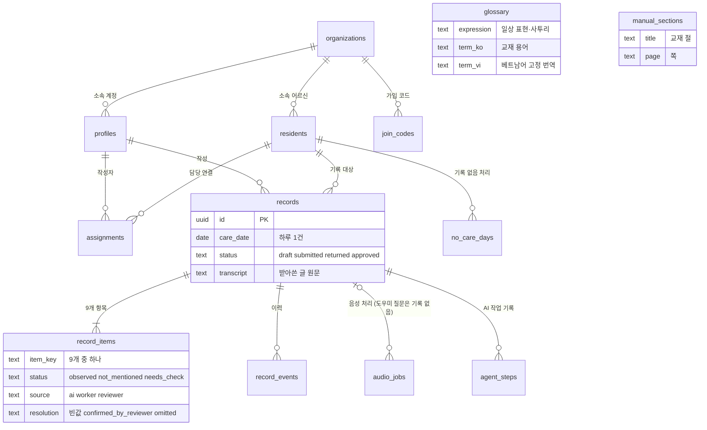
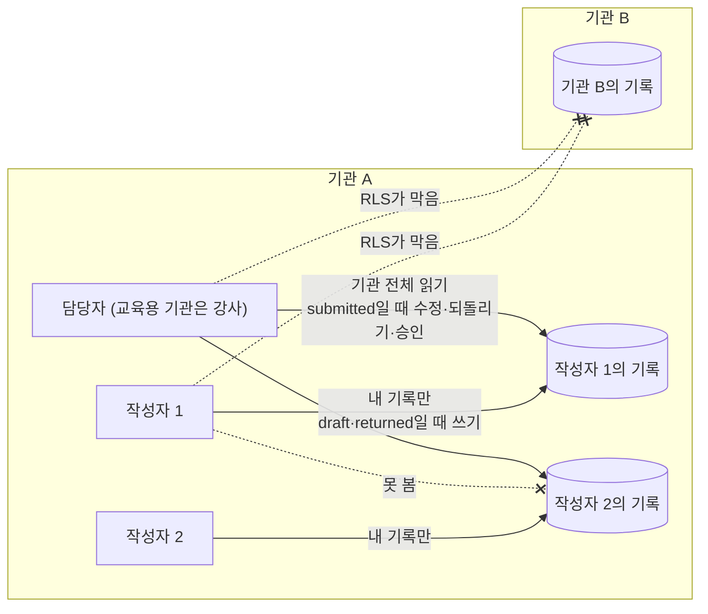

# 케어브릿지 데이터 구조 v1.6.3

2026-10-28 · @2dion (v1.6.2: 2026-10-27, v1.6.1: 2026-10-27, v1.6: 2026-10-26, v1.5.1: 2026-10-26, v1.5: 2026-10-25, v1.4: 2026-10-25, v1.3: 2026-10-25, v1.2: 2026-10-21, v1.1: 2026-10-18)

## 이 문서는 왜 있나

- **목적:** 모든 기록에 근거와 이력이 남고, 기관끼리 데이터가 섞이지 않게 합니다.[1][2]
- **배경:** 외부 피드백으로 Agent가 필수가 됐고, 10/18 결정으로 승인 차단 규칙이 생겼습니다. 이것을 담을 칸과, 팀이 함께 쓸 API 약속이 필요합니다.[3][4]
- **근거:** 데이터 구조 v1.0, 기술 선택 v1.0(Supabase 행 단위 권한), 표준교재 별지 서식이 뒷받침합니다.[5][1][6]
- **사유:** v1.0 표 10개는 그대로 두고, 칸과 표 1개만 보탭니다. 승인 조건·권한·상태 변화는 AI가 아니라 코드와 DB가 지킵니다.[3][7]
- **v1.2 사유:** 용어 검색이 쓸 표가 없었고, 녹음 업로드가 Vercel 요청 크기 제한(4.5MB)에 걸렸습니다. 10/21 결정 기록 2건(용어표, 녹음업로드)을 반영합니다.[18][19]
- **v1.3 사유:** 로그인·회원가입 화면이 생겼는데, 가입한 계정의 기관(org_id)과 역할(role)을 정할 곳이 없었습니다. 10/25 결정 기록(로그인가입)을 반영합니다.[22]
- **v1.4 사유:** 교육용 기관의 강사만 [코멘트 보내기]로 끝나는 따로 된 흐름이라, 교육생이 되돌려 받아 고치는 연습을 못 하고 화면·서버도 두 갈래였습니다. 강사도 담당자와 같은 흐름을 쓰기로 했습니다(10/25 결정 기록 강사흐름통일).[24]
- **v1.5 사유:** 작성자가 그날 기록을 쓰지 못하면 어느 화면에도 남지 않았고, 재가 방문 요일과 담당 시작일이 없어 '기록이 있어야 하는 날'을 계산할 수 없었습니다. 10/25 결정 기록(못쓴기록)을 반영합니다.[25]
- **v1.6 사유:** 7일이 지난 임시 저장이 '못 쓴 기록'에서 빠져 잊힌 채 남을 수 있었고, 늦게 만든 기록만 표시해서 늦게 보낸 기록은 담당자가 알 수 없었습니다. 10/26 결정 기록(기록함기간)을 반영합니다.[27]
- **v1.6.1 사유:** 늦게 보낸 기록을 누가 계산하는지 정해지지 않았고, 공개 키로 DB를 직접 부르면 이력·AI 작업 기록·처리 상태를 꾸밀 수 있었습니다(QA 10/27 실제 DB 대조). 10/27 결정 기록 2건(늦게보낸기록계산, 권한정리)을 반영합니다.[28][29]
- **v1.6.2 사유:** 병기 원칙은 ‘확인 필요’ 이유를 모국어로도 보이게 했지만 번역을 둘 칸이 없었습니다. 10/27 결정 기록(확인필요이유병기)을 반영합니다.[30]
- **v1.6.3 사유:** 10/28 서버 API 10개를 실제로 만들면서 공통 계약의 입출력·응답 코드·권한 경계를 구현에 맞춰 정했습니다. 10/28 결정 기록 7건(기한지난빈기록, 기록계약보강, 기록안함사유, 되돌림사유한국어, 항목하나저장, api응답코드, 되돌림사유번역)을 반영합니다.[32][33][34][35][36][37][38]

## v1.6.2에서 바뀐 점 (v1.6.3)

| 무엇 | 바뀐 내용 | 사유 |
| --- | --- | --- |
| 공통 계약 | DB 함수 `list_overdue_records()`(8~30일 전 빈 날, 담당자·강사만). `no_care_days` 넣기는 담당자·강사만 30일 전까지 | 기한지난빈기록 결정[32] |
| [기록 안 함] | `status = needs_check` 유지 + `resolution = omitted`, 사유는 `record_items.resolution_note` 칸 1개(PATCH 입력·응답에 포함) | 기록계약보강 결정[38], 기록안함사유 결정[33] |
| 권한 규칙 | profiles는 자기 행만 직접 읽기, 담당자 명단은 `list_org_staff()`. 제출 조건을 DB도 검사. 사람 출처를 ai로 되돌리기 금지 | 기록계약보강 결정[38] |
| 서버 전용 저장 | AI 초안은 `save_record_ai_draft`, 항목 하나의 재번역·AI 항목 보태기는 `save_ai_item`(기준 글이 다르면 `stale_item`) | 기록계약보강 결정[38], 항목하나저장 결정[35] |
| 공통 계약 | '응답 코드와 오류 키' 절 추가 | api응답코드 결정[36] |
| 공통 계약 | `/return`은 한국어 사유만 저장(번역 안 함, `return_reason_native` 비움) | 되돌림사유한국어 결정[34] |
| API 1개 추가 | `POST /api/records/:id/return/translate`(작성자가 되돌아온 기록을 열 때 서버가 번역을 채움), 서버 전용 DB 함수 `save_return_reason_native`. API 10개 → 11개 | 되돌림사유번역 결정[37] |
| 그대로 | 표 13개·칸·상태 값 | |

v1.6.2 원본(10/28 변경 전)은 [보관](../보관/설계/2026-10-28-데이터구조-v1.6.3.md)에 있습니다.

## v1.6.1에서 바뀐 점 (v1.6.2)

| 무엇 | 바뀐 내용 | 사유 |
| --- | --- | --- |
| record_items | `reason_native`(이유의 모국어 번역) 칸 1개. AI 이유는 Agent가, 코드 이유는 서버 코드가 함께 씀 | 확인필요이유병기 결정[30] |
| 공통 계약 | 항목을 돌려주는 응답에 `reason_native` 포함 | 같은 결정[30] |
| records.status 설명 | 화면 이름을 임시 저장 / 전송 완료 / 수정 필요 / 승인 완료로. 값은 그대로 | 상태이름 결정[31] |
| 그대로 | 표 13개·상태 값·API 10개 | |

v1.6.1 원본은 [보관](../보관/설계/2026-10-27-데이터구조-v1.6.1.md)에 있습니다.

## v1.6에서 바뀐 점 (v1.6.1)

| 무엇 | 바뀐 내용 | 사유 |
| --- | --- | --- |
| 공통 계약 | DB 함수 `record_late_submit(p_record_id)` 한 줄. 늦게 보낸 날 수(`late_days`)를 DB가 계산 | 늦게보낸기록계산 결정[28] |
| 권한 규칙 | `agent_steps` 넣기·`audio_jobs` 상태 바꾸기는 서버(service_role)만, `record_events`는 DB 트리거만. 되돌린 사유는 담당자만, 원문은 작성자만, `source = reviewer`는 DB가 채움 | 권한정리 결정[29] |
| 수정 이력 | 항목·원문·서식 칸·방문 시간이 바뀌면 DB 트리거가 바뀐 칸만 남김. API는 이력을 쓰지 않음(PATCH 규칙) | 권한정리 결정[29] |
| 그대로 | 표 13개·칸·상태 값·API 10개 | |

## v1.5.1에서 바뀐 점 (v1.6)

| 무엇 | 바뀐 내용 | 사유 |
| --- | --- | --- |
| 못 쓴 기록 | `draft`는 날짜 제한 없이 보냄 전까지 계속 나옴. `missing`은 지난 7일 그대로. 함수 이름·입출력은 그대로 | 기록함기간 결정[27] |
| 늦게 쓴 기록 → 늦게 보낸 기록 | `created_at` 대신 처음 보낸 날(`record_events` 첫 `submitted`)의 한국 날짜와 `care_date`로 가림. 칸 추가 없음 | 기록함기간 결정[27] |
| 임시 저장 | 7일이 지나도 잠그지 않음(이어 쓰기·보내기 가능). 기록 만들기는 오늘~7일 전 그대로. 새 상태 값 없음 | 기록함기간 결정[27] |

## v1.5에서 바뀐 점 (v1.5.1)

| 무엇 | 바뀐 내용 | 사유 |
| --- | --- | --- |
| 범위 표시 | 도우미 음성 질문, 가입 코드 잠시 거절 '여유 시' → '추후 적용'. 표·API·상태 값은 그대로 | 추후적용 결정[26] |

## v1.4에서 바뀐 점 (v1.5)

| 무엇 | 바뀐 내용 | 사유 |
| --- | --- | --- |
| assignments | `visit_days`(재가 방문 요일), `start_date`(담당 시작일) 추가. `schedule`은 표시용 그대로 | 못쓴기록 결정[25] |
| records | 담당 연결 하나에 하루 1건(unique). `care_date`는 오늘~7일 전, 만든 뒤 바꾸지 않음. 날짜는 한국 시간 | 못쓴기록 결정[25] |
| no_care_days (새 표) | 돌봄이 없던 날(입원·외박·방문 취소·기타)과 사유. 표 12개 → 13개 | 못쓴기록 결정[25] |
| 못 쓴 기록 (새 절) | DB 함수 `list_missed_records`가 지난 7일의 빠진 기록을 계산. 새 상태 값 없음 | 못쓴기록 결정[25] |
| 늦게 쓴 기록 | 칸을 더하지 않고 `created_at`의 한국 날짜와 `care_date`로 가림 | 못쓴기록 결정[25] |

## v1.3에서 바뀐 점 (v1.4)

| 무엇 | 바뀐 내용 | 사유 |
| --- | --- | --- |
| 강사 검토 흐름 | 강사도 담당자와 똑같이 항목 수정, [확인함]/[기록 안 함], [되돌리기], [승인]. 교육용 기관만의 갈래 없음 | 강사흐름통일 결정[24] |
| records.status | commented(코멘트 받음) 뺌. 5개 → 4개(draft / submitted / returned / approved) | 강사흐름통일 결정[24] |
| comments 표 | 뺌. 표 13개 → 12개. 강사의 가르침은 되돌린 사유와 항목 수정 이력(record_events)으로 남김 | 강사흐름통일 결정[24] |
| API | `POST /api/records/:id/comment` 뺌. API 11개 → 10개 | 강사흐름통일 결정[24] |
| 연습 구분 | 상태 값이 아니라 `organizations.is_training`으로만. 인쇄에 ‘연습용’, 승인 통계는 교육용 기관을 뺌 | 강사흐름통일 결정[24] |

## v1.2에서 바뀐 점 (v1.3)

| 무엇 | 바뀐 내용 | 사유 |
| --- | --- | --- |
| 계정 방식 | Supabase Auth 이메일·비밀번호 하나만. 소셜 로그인·전화번호 로그인 없음 | 2dion 10/25, 로그인가입 결정[22] |
| join_codes (새 표) | 가입 코드(기관·역할별). 표 12개 → 13개 | 로그인가입 결정[22] |
| API 1개 추가 | `POST /api/auth/signup`. API 10개 → 11개. 가입은 한 화면에서 한 번에 보내므로 코드만 먼저 확인하는 API는 두지 않음. 로그인·로그아웃은 Supabase 클라이언트를 바로 씀 | 로그인가입 결정, 2dion 10/25[22] |
| 로그인 설정 | Supabase 직접 가입(Allow new users to sign up) 끔. 계정은 서버가 가입 코드를 확인한 뒤에만 만듦 | 로그인가입 결정[22] |

## v1.1에서 바뀐 점 (v1.2)

| 무엇 | 바뀐 내용 | 사유 |
| --- | --- | --- |
| glossary (새 표) | 용어 목록. 표 11개 → 12개. 기관 공통, 읽기만 | 용어표 결정[18] |
| 서식 기준 데이터 | 표를 만들지 않고 서버 코드 안 고정값(JSON) | 용어표 결정[18] |
| 녹음 업로드 | `POST /api/records/:id/audio/upload-url` 추가. `/audio` 입력이 음성 파일에서 storage_path로 | 녹음업로드 결정[19] |
| audio 버킷 | 비공개 Storage 버킷, 10MB, webm·mp4, 작성자만 접근 | 녹음업로드 결정[19] |
| resolution 재확인 | 되돌린 기록에서 작성자가 고친 항목은 resolution을 비워 담당자가 다시 확인 | 되돌림재확인 결정[20] |
| support detail 칸 이름 | `detail.checks`, `detail.minutes` 키 6개(제12호) | 재가분칸·실명목록 결정[21] |

## v1.0에서 바뀐 점 (v1.1)

| 무엇 | 바뀐 내용 | 사유 |
| --- | --- | --- |
| records.status | commented(코멘트 받음) 추가. 교육용 기관만 씀. 상태 변화 목록도 고침 | A3, approved와 섞지 않음[3] |
| record_items.resolution | 담당자가 남은 ‘확인 필요’를 정한 결과. [확인함] = confirmed_by_reviewer, [기록 안 함] = omitted | 10/18 결정 1, A2[4] |
| 승인 서버 검사 | 정하지 않은 ‘확인 필요’가 있으면 서버가 승인을 거절 | 10/18 결정 1[4] |
| 재번역·확인 풀림 | value_ko가 바뀌면 그 항목만 다시 번역. 작성자 아닌 사람이 고치면 confirmed가 풀림. 이력에 남김 | A5[3] |
| agent_steps (새 표) | Agent 도구 호출마다 한 줄 | A1[3] |
| 서식 칸 대응 | verified(검증됨) / provisional(잠정) 값. 잠정이면 R2(검토 화면)·인쇄에 표시 | A6[3] |
| 법정 서식 원문 반영 | 제16호·제12호 모두 검증됨. 대응표를 원문 칸으로 고침: 제12호 배변 2칸(stool_accidents, urine_accidents), 지원 시간 구조, cognition_trend는 제12호만, 제16호 영역별 특이사항 4칸·영역별 서명, 1장 7일/3일 | 10/17 법정 서식 정리[15][16][17] |
| 덮어쓰기 | source가 ai가 아니면(worker, reviewer) AI가 덮어쓰지 않음 | A7[3] |
| 공통 계약 (새 절) | API 경로·입출력, 상태 값 목록, 도구 입출력 | A10[3] |

## 요약과 표 목록

**왜:** 어떤 표가 어느 화면에 쓰이는지 먼저 맞춥니다.

Supabase(Postgres)에 표 13개를 둡니다.[1][8][18][22][24][25] 모든 표에 `org_id`(기관)가 있고, DB 권한 규칙으로 “내 기관 데이터만” 보이게 합니다(manual_sections, glossary만 예외). 교육용 기관은 표를 따로 만들지 않고 `organizations.is_training` 표시 하나로 구분합니다.[9][10]

| 표 | 담는 것 | 쓰는 화면 |
| --- | --- | --- |
| organizations | 기관(일반/교육용) | R4(어르신·작성자, 설정) |
| profiles | 계정(작성자/담당자), 언어·글자 크기 | A1(로그인)·A2(회원가입), W0(사용 안내), W5(내 정보), R4(어르신·작성자, 설정) |
| residents | 어르신(가명, 시설/재가) | W1(오늘), R4(어르신·작성자, 설정) |
| assignments | 작성자-어르신 담당 연결, 방문 요일·담당 시작일(v1.5) | W1(오늘), W4(기록함), R4(어르신·작성자, 설정) |
| records | 기록 1건(날짜, 상태, 받아쓴 글) | W1(오늘)~W4(기록함), R1(검토 대기)~R3(승인한 기록) |
| record_items | 기록의 9개 항목 | W3(기록 초안 확인), R2(검토 화면) |
| record_events | 이력(누가 언제 무엇을) | R2(검토 화면), R3(승인한 기록) |
| audio_jobs | 음성 처리 상태(음성 파일은 글자로 바뀐 뒤 삭제) | W2(음성 메모), W3(기록 초안 확인) ‘정리 중’ |
| manual_sections | 교재 상황 대처 매뉴얼(절 단위) | W6(도우미) |
| agent_steps (v1.1) | Agent 도구 호출 기록 | R2(검토 화면) ‘AI 작업 기록’ |
| glossary (v1.2) | 용어 목록(일상 표현 → 교재 용어, 베트남어 고정 번역) | Agent 용어 검색, W3(기록 초안 확인) ‘용어 뜻 보기’ |
| join_codes (v1.3) | 가입 코드(기관·역할별) | A2(회원가입), R4(어르신·작성자, 설정) |
| no_care_days (v1.5) | 돌봄이 없던 날과 사유 | W4(기록함) ‘못 쓴 기록’, R1(검토 대기) |

**그림: 표가 어떻게 이어지나** 그림은 위 내용을 옮긴 것입니다. 그림과 글이 다르면 글이 기준입니다.

선을 줄이려고 `org_id`는 기관과 바로 이어진 표만 그렸습니다. 실제로는 glossary·manual_sections를 뺀 모든 표에 `org_id`가 있습니다. glossary·manual_sections는 모든 기관이 함께 읽는 표라 다른 표와 잇지 않았습니다.

음성 파일은 표가 아니라 Storage 비공개 버킷 `audio`에 잠시 둡니다(아래 audio_jobs).[19] 서식 기준(별지 제16호·제12호 칸·선택지)은 표를 두지 않고 서버 코드 안 고정값(JSON)으로 둡니다. 원본은 `참고자료/도메인/서식/법정/` 정리 문서입니다.[15][18]

W6(도우미) 대화는 MVP에서 저장하지 않고 화면에만 둡니다. 개인정보가 담길 수 있고, 기록과 도우미는 별개이기 때문입니다.[2]

## 표별 칸

**왜:** BE와 FE가 같은 칸 이름과 뜻으로 일하게 합니다.

모든 표에 `id`(uuid)와 `created_at`이 있습니다. manual_sections·glossary를 뺀 모든 표에 `org_id`도 있습니다(아래 표에 안 적었어도). 하위 표의 `org_id`는 DB가 기록·어르신에서 채웁니다(10/21 마이그레이션). 아래에는 그 밖의 칸만 씁니다.

### organizations (기관)

**왜:** 기관마다 데이터를 나누고, 교육용인지 표시합니다.

| 칸 | 형식 | 뜻 |
| --- | --- | --- |
| name | text | 기관 이름 |
| is_training | boolean | 교육용 기관이면 true. 만들 때 정하고 바꾸지 않음[9] |

### profiles (계정)

**왜:** 누가 작성자·담당자인지와 사람별 설정을 둡니다.

| 칸 | 형식 | 뜻 |
| --- | --- | --- |
| id | uuid | Supabase 로그인 계정 id와 같음. 로그인은 이메일·비밀번호만(v1.3) |
| org_id | uuid | 소속 기관 (한 계정 = 한 기관) |
| role | worker / reviewer | 작성자 / 담당자. 교육용 기관에서는 교육생 / 강사로 보임 |
| name | text | 이름 |
| native_lang | text | 모국어 코드. MVP는 vi(베트남어) 하나, 한국어만 쓰면 ko |
| font_size | 1 / 2 / 3 | W5(내 정보) 글자 크기 |
| onboarded | boolean | W0(사용 안내)를 봤는지 |

- **만드는 곳 (v1.3):** profiles는 화면에서 바로 만들지 않습니다. `POST /api/auth/signup`이 가입 코드를 확인하고, 서버가 Supabase 계정과 profiles 1행을 함께 만듭니다. org_id·role은 가입 코드에서 오고, 가입한 사람이 고를 수 없습니다.[22]
- 데모 계정 4개는 지금처럼 대시보드에서 만들고 `seed.sql`이 profiles를 넣습니다.

### residents (어르신)

**왜:** 급여 종류에 따라 서식(별지 제16호 / 제12호)이 정해지기 때문입니다.

| 칸 | 형식 | 뜻 |
| --- | --- | --- |
| org_id | uuid | 기관 |
| alias | text | 가명 (예: 김○○ 어르신) |
| care_type | facility / home | 시설급여 / 재가 방문요양. 서식(별지 제16호 / 제12호)을 정함[6] |
| is_synthetic | boolean | 합성 사례이면 true (데모·교육용은 모두 true) |

### assignments (담당 연결)

**왜:** 작성자가 자기 담당 어르신만 보게 합니다.

| 칸 | 형식 | 뜻 |
| --- | --- | --- |
| worker_id | uuid | 작성자 |
| resident_id | uuid | 어르신 |
| schedule | text | 방문·돌봄 시간 표시용 (예: “평일 14:00~17:00”). 계산에 쓰지 않음 |
| visit_days (v1.5) | smallint[] | 재가 방문 요일. 1(월)~7(일). 급여제공계획서의 ‘횟수’를 옮긴 값. 시설은 비움(매일)[25] |
| start_date (v1.5) | date | 담당 시작일. 이날부터 기록이 있어야 함. 기본값은 만든 날(한국 날짜)[25] |

- **v1.5:** 담당자가 R4(어르신·작성자, 설정)에서 정합니다. 재가인데 `visit_days`가 비었으면 그 담당 연결은 못 쓴 기록 계산에서 뺍니다(매일로 치지 않음). 매주 같은 요일 방문만 담고, 격주나 한 주만 바뀐 일정은 [이 날 기록 없음]으로 처리합니다.[25]

### records (기록)

**왜:** 기록 1건의 상태와 원문을 한곳에 둡니다. 원문이 모든 항목의 근거입니다.

| 칸 | 형식 | 뜻 |
| --- | --- | --- |
| org_id, resident_id, worker_id | uuid | 기관, 어르신, 작성자 |
| care_date | date | 돌봄 날짜. 한국 날짜. 오늘~7일 전만, 만든 뒤 바꾸지 않음(v1.5)[25] |
| form_type | 16 / 12 | 어르신 care_type에서 정해져 기록에 고정 |
| status | draft / submitted / returned / approved | 화면 이름: 임시 저장 / 전송 완료 / 수정 필요 / 승인 완료(v1.6.2, 상태이름 결정[31]). 교육용 기관도 같음(v1.4에서 commented 뺌)[24] |
| transcript | text | 받아쓴 글 원문 (여러 번 녹음하면 이어 붙임) |
| transcript_ko | text | 원문의 한국어 번역 (R2(검토 화면) 왼쪽) |
| visit_start, visit_end | time | 재가 방문 시작·종료 (별지 제12호)[6] |
| form_fields | jsonb | 서식에만 있는 칸 (아래 ‘서식 칸 대응’) |
| return_reason, return_reason_native | text | 되돌린 사유와 모국어 번역 |
| submitted_at, approved_at | timestamptz | 보낸 시각, 승인 시각 |
| approved_by | uuid | 승인한 담당자 |

- **하루 1건 (v1.5):** `(worker_id, resident_id, care_date)`는 겹치지 않습니다(unique). 같은 날 두 번째 기록을 만들면 거절하고, 화면은 이미 있는 기록을 엽니다. 한 어르신을 여러 작성자가 맡는 기관(교대 근무)에서 기록을 어떻게 나눌지는 ⚠️ 확인 필요입니다. MVP 데모는 어르신 1명에 작성자 1명입니다.[25]
- **날짜 (v1.5):** ‘오늘’은 Asia/Seoul 기준입니다. DB 기본값은 `current_date`(UTC, 오전 9시 전에는 어제)가 아니라 `(now() at time zone 'Asia/Seoul')::date`를 씁니다. 화면이 날짜를 보내지 않으면 오늘입니다.[25]
- **늦게 보낸 기록 (v1.6):** 처음 보낸 날(`record_events`에서 이 기록의 첫 `submitted` 줄의 한국 날짜)이 `care_date`보다 늦으면 늦게 보낸 기록입니다. 되돌린 뒤 다시 보낸 날은 보지 않습니다. 따로 칸을 두지 않고 계산합니다. R2(검토 화면)·R3(승인한 기록)에 ‘늦게 보낸 기록(n일 뒤)’을 표시하고, 승인은 막지 않습니다. v1.5의 ‘늦게 쓴 기록’(`created_at` 기준)을 넓힌 것입니다.[25][27]
- **임시 저장 기한 (v1.6):** 기록 만들기는 오늘~7일 전만 되지만, 이미 만든 draft는 날짜와 상관없이 작성자가 고치고 보낼 수 있습니다. 잠그지 않습니다.[27]

### no_care_days (기록 없음 처리, v1.5)

**왜:** 입원·외박·방문 취소처럼 돌봄 자체가 없던 날을 ‘못 쓴 기록’에서 빼고, 왜 기록이 없는지 남깁니다.[25]

| 칸 | 형식 | 뜻 |
| --- | --- | --- |
| resident_id | uuid | 어르신 |
| care_date | date | 돌봄이 없던 날 (오늘~7일 전) |
| reason | hospital / overnight / visit_cancelled / other | 입원 / 하루 종일 외박 / 방문 취소 / 기타 |
| note | text | 기타일 때 사유(필수), 나머지는 비워도 됨 |
| created_by | uuid | 처리한 사람(작성자 또는 담당자) |

- `(resident_id, care_date)`는 겹치지 않습니다. 어르신 단위라 담당 작성자가 여럿이어도 한 번만 남깁니다.
- 그날 기록이 이미 있으면(임시 저장 포함) 만들 수 없습니다. 임시 저장을 버리는 기능은 MVP에 없습니다 ⚠️ 확인 필요.
- 시설에서 하루 중 일부만 외박·외출했으면 이 표가 아니라 기록을 쓰고 ① 방문 시점에 시간을 적습니다(별지 제16호 ‘맺음’).[17]
- 잘못 남긴 것은 담당자만 지웁니다.

### record_items (9개 항목)

**왜:** 항목마다 내용·근거·상태·누가 썼는지를 따로 남겨, 승인 조건을 항목 단위로 검사합니다.

기록 1건에 항상 9행이 만들어집니다(빈 항목도 ‘언급 없음’으로).

| 칸 | 형식 | 뜻 |
| --- | --- | --- |
| record_id | uuid | 기록 |
| item_key | 아래 9개 중 하나 | visit_time, support, meal, sleep, discomfort, medication, cognition, notes, next_check |
| value_ko | text | 한국어 내용 (최종 기록) |
| value_native | text | 모국어 번역 (W3(기록 초안 확인) 아래쪽). value_ko가 바뀌면 다시 번역 |
| status | observed / not_mentioned / needs_check | 관찰 / 언급 없음 / 확인 필요 |
| evidence | text | 근거가 된 원문 문장 (없으면 빈칸) |
| reason | text | ‘확인 필요’인 이유 (예: 사투리 ‘걸신진다’ 뜻 짐작, “자동 정리 중단”) |
| reason_native (v1.6.2) | text | reason의 모국어 번역 (W3(기록 초안 확인) 이유 아래). AI 이유는 Agent가, 코드 이유는 서버 코드가 함께 씀. reason이 바뀌면 다시 씀[30] |
| source | ai / worker / reviewer | 마지막으로 쓴 사람. ai가 아니면 AI가 덮어쓰지 않음[3] |
| confirmed | boolean | 작성자가 [맞아요] 또는 고침. 작성자가 아닌 사람이 고치면 false로 풀림 |
| resolution (v1.1) | (빈값) / confirmed_by_reviewer / omitted | 담당자가 남은 ‘확인 필요’를 정한 결과. R2(검토 화면) [확인함] / [기록 안 함]. 되돌린 뒤 작성자가 고치면 비워짐[4][20] |
| resolution_note (10/28) | text | [기록 안 함] 사유. omitted일 때만 있고 비면 거절(`note_required`). 담당자·강사만 씀. resolution이 바뀌면 DB가 비움. 작성자에게 번역하지 않음[33] |
| detail | jsonb | 항목별 추가 값 (예: support의 지원별 분, cognition의 호전/유지/악화) |

**[확인함] / [기록 안 함]을 누르면**[4]

- **[확인함]:** value_ko는 그대로. resolution = confirmed_by_reviewer.
- **[기록 안 함] (10/28):** value_ko·value_native를 비우고 **status = needs_check를 유지**, resolution = omitted로 둡니다. 사유는 `resolution_note`에 저장하고(비면 거절), 이력 트리거가 `resolved` 줄에 함께 남깁니다.[33] 다시 정하기는 resolution과 사유를 비웁니다. [기록 계약 보강](../결정/2026-10-28-기록계약보강.md).
- 둘 다 record_events에 `resolved` 한 줄(누가, 언제, 전후 값)을 남깁니다.
- **되돌린 뒤 (v1.2):** 기록이 returned일 때 작성자가 value_ko·status·detail을 바꾸면(음성 항목 보태기 포함) 서버가 그 항목의 resolution을 비웁니다. 고치지 않은 항목은 그대로 둡니다. 그래서 고친 ‘확인 필요’ 항목은 담당자가 다시 골라야 승인됩니다.[20]

**재번역과 확인 풀림 (A5)**[3]

- value_ko가 바뀌면(작성자든 담당자든) 그 항목만 다시 번역(④ 짧은 번역)해 value_native를 바꿉니다.[11]
- **저장하는 길 (10/28):** 사람이 고친 value_ko는 요청한 사람의 권한으로 저장하고(트리거가 옛 번역을 비움), 서버가 번역한 value_native는 서버 전용 `save_ai_item(…, 'translation', …)`으로 저장합니다. W3 음성 항목 보태기로 Agent가 다시 쓴 항목 1개는 `save_ai_item(…, 'item', …)`(작성자만, source = worker, confirmed = false)입니다. 기준 글이 그사이 바뀌었으면 `stale_item`으로 거절해 옛 번역이 새 글을 덮지 않습니다.[35]
- 작성자가 아닌 사람이 고치면 confirmed = false가 됩니다.
- 바뀐 내용(value_ko, value_native, confirmed의 전후)은 이력에 남깁니다. 이력은 record_events 표 하나에 모읍니다.
- **수정 이력은 DB가 남김 (10/27):** 항목이 바뀌면 DB 트리거가 바뀐 칸만 before/after에 넣어 한 줄을 남깁니다. 담당자가 resolution을 바꾸면 `resolved`, source = ai면 `ai_filled`, 그 밖은 `edited`. 번역(value_native·reason_native) 변경도 남깁니다(10/28). 출처·근거·이유·번역은 클라이언트가 직접 쓰지 않습니다. DB가 실제 사용자 내용 수정에 따라 worker/reviewer를 정하며 사람 출처를 ai로 되돌리는 것은 금지합니다.[29]

### record_events (이력)

**왜:** 누가 언제 무엇을 바꿨는지 남겨, 기록의 책임을 밝힙니다.

| 칸 | 형식 | 뜻 |
| --- | --- | --- |
| record_id, actor_id | uuid | 기록, 한 사람 |
| type | created / ai_filled / edited / submitted / returned / approved / resolved | 무엇을 했는지. resolved는 v1.1([확인함]/[기록 안 함]) |
| item_key | text | 항목을 고쳤으면 그 항목 |
| before, after | jsonb | 고치기 전과 후 (R2(검토 화면) 수정 전후, R3(승인한 기록) 4단계 이력, [기록 안 함] 사유) |

- **쓰는 곳 (10/27):** 화면도 서버도 직접 넣지 않고 DB 트리거만 씁니다. 상태 변화, 항목 수정, 원문·서식 칸·방문 시간 수정(`edited`, item_key 빈값)이 모두 자동으로 남습니다.[29]

### audio_jobs (음성 처리)

**왜:** 처리 중·실패를 화면에 보여 주고, 같은 음성을 두 번 보내지 않게 합니다.

| 칸 | 형식 | 뜻 |
| --- | --- | --- |
| record_id | uuid | 기록 (도우미 질문 helper일 때만 비움) |
| worker_id | uuid | 올린 작성자 (10/21 마이그레이션). 권한 확인용 |
| target | record / item / helper | 전체 기록 메모인지, 항목 보태기인지, 도우미 질문인지 |
| item_key | text | 항목 보태기(target = item)일 때 그 항목 (10/21 마이그레이션) |
| storage_path | text | 임시 음성 파일 위치 `audio` 버킷의 `{org_id}/{record_id}/{uuid}.{webm\|mp4}`. 서버가 정함. 받아쓰기가 끝나면(성공·실패 모두) 파일 삭제, 칸도 비움[12][19] |
| status | uploaded / transcribing / filling / done / failed | W2(음성 메모) 처리 중 표시. filling은 v1.1에서 Agent가 정리하는 중(W3(기록 초안 확인) ‘정리 중’) |
| error | text | 실패 이유 |

- **쓰는 곳 (10/27):** 만들기는 작성자 권한, 처리 상태·경로 바꾸기는 서버가 service_role로 합니다.[29]

**녹음 버킷 `audio` (v1.2):** 비공개, 파일 하나 최대 10MB, `audio/webm`·`audio/mp4`만. 화면은 서버가 준 1회용 업로드 주소로 바로 올립니다(Vercel을 거치지 않음). 1시간 넘게 남은 파일은 주기 정리가 Storage API로 지웁니다(SQL로 지우면 파일이 남음).[19]

### manual_sections (교재 매뉴얼)

**왜:** W6(도우미)가 교재에 있는 내용만, 출처와 함께 답하게 합니다.

| 칸 | 형식 | 뜻 |
| --- | --- | --- |
| chapter, title | text | 장·절 제목 |
| page | text | 교재 쪽 (W6(도우미) 출처 표시) |
| body | text | 본문 텍스트 (이미지 제외)[13] |
| search | tsvector | 검색용 (body에서 자동 생성) |

이 표는 모든 기관이 함께 읽어서 `org_id`가 없습니다.

### glossary (용어 목록, v1.2)

**왜:** Agent가 사투리·일상 표현을 교재 용어와 정해진 베트남어 번역으로만 바꾸게 하고, W3(기록 초안 확인)에서 용어 뜻을 보여 줍니다.[18]

| 칸 | 형식 | 뜻 |
| --- | --- | --- |
| id | uuid | 기본 키 |
| expression | text | 일상 표현·사투리 그대로 (예: "밥을 반 먹었어요", "걸신진다") |
| aliases | text[] | 같은 뜻의 다른 표현 (없으면 빈 목록) |
| term_ko | text | 교재 공식 기록 용어 (예: "식사량 1/2 섭취") |
| term_vi | text | 베트남어 고정 번역 |
| plain_ko | text | 쉬운 한국어 풀이 (W3 ‘용어 뜻 보기’). 비워도 됨 |
| chapter, page | text | 교재 장·쪽 |

- 이 표는 모든 기관이 함께 읽어서 `org_id`가 없습니다.
- search_terms는 `expression`·`aliases`·`term_ko`에서 부분 일치(pg_trgm 또는 ILIKE)로 찾습니다. tsvector는 한국어 조사를 나누지 못해 쓰지 않습니다.
- 원본은 저장소의 용어 CSV(데이터 담당)이고, 시드로 넣습니다. 대시보드에서 직접 고치지 않습니다.

### join_codes (가입 코드, v1.3)

**왜:** 가입한 사람이 어느 기관의 작성자·담당자인지를 본인이 고르지 않고, 기관이 나눠 준 코드로 정합니다. 기관 분리(RLS)가 org_id에 달려 있기 때문입니다.[22]

| 칸 | 형식 | 뜻 |
| --- | --- | --- |
| org_id | uuid | 이 코드로 가입하면 들어갈 기관 |
| role | worker / reviewer | 이 코드로 가입하면 받을 역할. 교육용 기관에서는 교육생 / 강사 |
| code | text | 가입 코드. 대문자·숫자 8자 이상 무작위, 모든 기관에서 겹치지 않음(unique). 헷갈리는 글자(0·O, 1·I) 빼기 |
| active | boolean | false면 이 코드로 가입할 수 없음(코드가 새면 끄고 새로 만듦) |

- 한 기관에 역할마다 코드 1개를 기본으로 둡니다(작성자용, 담당자용).
- 화면에서 만들거나 고치지 않습니다. 팀장이 SQL Editor에서 넣고, 저장소가 공개라 코드 값은 `seed.sql`에 두지 않습니다(데모 비밀번호와 같은 방식).
- 담당자는 R4(어르신·작성자, 설정)에서 자기 기관 코드를 읽기만 합니다.
- 가입 코드를 몇 번 썼는지는 세지 않습니다(MVP). 가입한 계정은 profiles에서 봅니다.

### agent_steps (Agent 작업 기록, v1.1)

**왜:** AI가 어떤 도구를 왜 썼는지 남겨, 담당자가 확인하고 팀이 비용·시간을 잽니다.[3]

도구 호출마다 한 줄을 남깁니다. R2(검토 화면)의 접힌 ‘AI 작업 기록’이 이 표를 씁니다.

| 칸 | 형식 | 뜻 |
| --- | --- | --- |
| org_id, record_id | uuid | 기관, 기록 |
| step_no | int | 순서 (1부터) |
| tool | get_form_spec / search_terms / validate_draft / submit_draft | 부른 도구 |
| input_summary | text | 입력 요약 |
| result_summary | text | 결과 요약 |
| reason | text | 이 도구를 고른 이유 한 줄 (도구 입력의 `why`) |
| duration_ms | int | 걸린 시간 |
| tokens | int | 쓴 토큰 수 |

- 품질 확인 표에 건당 시간·비용을 같이 잴 때 이 표를 씁니다.[3]
- 칸 이름은 명세 A1의 ‘순서, 도구, 입력 요약, 결과 요약, 고른 이유, 걸린 시간, 토큰’을 옮긴 첫 안입니다.

## 기록 상태 변화

**왜:** 상태는 정해진 길로만 바뀌어야 승인본이 몰래 바뀌지 않습니다.

`records.status`는 아래 길로만 바뀝니다. 서버가 이 표에 없는 변경을 거절하고, 바뀔 때마다 `record_events`에 한 줄을 남깁니다. 상태 변화는 AI가 아니라 코드가 맡습니다.[3]

| 지금 | 누가 | 무엇을 하면 | 다음 |
| --- | --- | --- | --- |
| (없음) | 작성자 | W1(오늘)에서 어르신을 고르고 녹음 시작, 또는 W4(기록함) ‘못 쓴 기록’에서 날짜를 골라 시작(v1.5) | draft |
| draft | 작성자 | W3(기록 초안 확인) [담당자에게 보내기] | submitted |
| submitted | 담당자 | R2(검토 화면) [되돌리기] (사유 필수) | returned |
| submitted | 담당자 | R2(검토 화면) [승인]. 정하지 않은 ‘확인 필요’가 0개일 때만 | approved |
| returned | 작성자 | W3(기록 초안 확인)에서 고친 뒤 [보내기] | submitted |
| approved | — | 변경 불가 (읽기·인쇄만) | — |

**그림: 기록 상태가 바뀌는 길** 그림은 위 내용을 옮긴 것입니다. 그림과 글이 다르면 글이 기준입니다.

**교육용 기관 (v1.4):** 강사도 위 표의 ‘담당자’ 줄을 그대로 따릅니다(수정·되돌리기·승인). v1.1의 commented(코멘트 받음)는 뺐습니다. 연습 기록은 상태가 아니라 기관의 `is_training`으로 가립니다. 인쇄·PDF에는 ‘연습용’을 찍고, 승인 통계에서는 교육용 기관을 뺍니다.[24][9]

**승인 서버 검사:** [승인] 요청이 오면 서버가 다시 봅니다. ① 상태가 submitted ② 요청한 사람이 같은 기관의 reviewer(교육용 기관이면 강사) ③ status = needs_check 이고 resolution이 빈 항목이 0개. 하나라도 어긋나면 거절하고 남은 항목을 돌려줍니다. 화면의 꺼진 [승인]만 믿지 않습니다.[4]

## 못 쓴 기록 (v1.5)

**왜:** 쓰지 않은 기록은 행이 없어 목록에 나오지 않습니다. 그래서 ‘기록이 있어야 하는 날’과 실제 기록을 비교해 빠진 날을 보여 줍니다.[25]

- **기록이 있어야 하는 날:** 담당 연결마다 `start_date`부터, 시설은 매일, 재가는 `visit_days`에 든 요일. 단, 그 어르신의 `no_care_days`에 있는 날은 뺍니다.
- **못 쓴 기록:** 그 가운데 오늘을 뺀 지난 날에서 ① 지난 7일(어제~7일 전) 안에 그 작성자의 기록이 없거나(`missing`) ② draft에 머문 것(`draft`, 날짜 제한 없음, v1.6)입니다. 7일이 지난 빈 날은 더 쓸 수 없어 넣지 않고, draft는 보낼 때까지 넣습니다.[27] 보냄·되돌아옴·승인됨은 넣지 않습니다(되돌아옴은 이미 W1 띠와 W4 탭에 나옴).
- **계산하는 곳:** DB 함수 `list_missed_records(p_days int default 7)`. `p_days`는 `missing`에만 씁니다(v1.6). 부른 사람의 권한(RLS, security invoker)으로 돌아 작성자는 자기 것만, 담당자·강사는 같은 기관 전체를 받습니다. 결과 한 줄은 worker_id, resident_id, care_date, kind(`missing` / `draft`), record_id(draft일 때).
- **기한 지난 빈 기록 (10/28):** 7일이 지나 작성자가 더 쓸 수 없는 빈 날은 담당자·강사에게만 30일까지 보입니다. DB 함수 `list_overdue_records()`가 8~30일 전 중 기록이 있어야 하는 날인데 그 작성자의 기록도 `no_care_days`도 없는 날을 계산합니다. 결과 한 줄은 worker_id, resident_id, care_date. 작성자가 부르면 0줄입니다. 담당자는 이 날을 `no_care_days`로 정리할 수 있습니다(아래 권한 규칙).[32]
- **새 상태 값은 만들지 않습니다.** 예정 기록을 미리 만드는 주기 작업도 두지 않습니다.
- **알림:** 앱 안에서만 보여 줍니다(W1(오늘) 띠, W4(기록함) 탭, R1(검토 대기) 한 줄). 푸시·문자·메일은 MVP 뒤입니다.

## 권한 규칙 (기관 분리)

**왜:** 화면 코드가 실수해도 다른 기관·다른 작성자의 기록이 나가지 않게 합니다.

Supabase 행 단위 권한(RLS)으로 DB 안에서 강제합니다.[1]

| 표 | 작성자 (교육생) | 담당자 (교육용 기관은 강사, v1.4) |
| --- | --- | --- |
| residents | 내가 담당인 어르신만 읽기 | 같은 기관 전체 읽기·쓰기 |
| records, record_items | 내 기록만. draft·returned일 때만 쓰기. 되돌린 사유와 source = reviewer는 못 씀(10/27) | 같은 기관 전체. submitted일 때만 수정·되돌리기·승인. 원문(transcript·transcript_ko)은 못 고침(10/27) |
| record_events | 내 기록 것 읽기. 쓰기 없음(DB 트리거만, 10/27) | 같은 기관 전체 읽기. 쓰기 없음(10/27) |
| agent_steps (v1.1) | (화면에 없음, 읽지 않음) | 같은 기관 전체 읽기 |
| manual_sections, glossary | 읽기 | 읽기 |
| join_codes (v1.3) | 접근 안 함 | 같은 기관 것 읽기만 |
| no_care_days (v1.5) | 내가 담당인 어르신 것 읽기·만들기(오늘~7일 전) | 같은 기관 전체 읽기·만들기·지우기. 만들기는 오늘~30일 전(10/28) |
| assignments | 내 담당 연결 읽기 | 같은 기관 전체 읽기·쓰기(방문 요일·담당 시작일 포함) |
| profiles | 내 행 읽기, 언어·글자 크기·onboarded만 고치기 | 내 행 직접 읽기. 기관 업무 명단은 list_org_staff()로 id·name·role만 읽기(10/28) |
| Storage `audio` 버킷 (v1.2) | 내 기록(draft·returned) 경로에만 올리기·읽기·지우기 | 접근 안 함 |

**그림: 누가 무엇을 볼 수 있나 (RLS)** 그림은 위 내용을 옮긴 것입니다. 그림과 글이 다르면 글이 기준입니다.

- 어느 경우든 `org_id`가 내 계정의 `org_id`와 같아야 합니다.
- ‘담당자’와 ‘강사’는 같은 role(reviewer)이고 권한도 같습니다(v1.4). 화면에 보이는 이름만 기관의 `is_training`에 따라 바뀝니다.[24]
- AI 호출(STT, Claude)은 서버에서만 하고, 일반 기록은 요청한 사람의 권한으로 DB에 씁니다. 검증된 AI 초안 저장은 서버 전용 save_record_ai_draft RPC, 항목 하나의 재번역·AI 항목 보태기는 서버 전용 save_ai_item RPC로 처리합니다(10/28).[35] 이 RPC가 작성자·기관·상태·원문 일치를 검사하고 사람 수정 항목을 건너뜁니다. agent_steps는 서버가 Agent를 돌릴 때만 씁니다.[1] 예외: 남은 녹음 파일 주기 정리는 로그인한 사람 없이 돌아 service_role을 씁니다(키는 서버 환경 변수에만).[19]
- **서버·DB만 쓰는 것 (10/27):** agent_steps 넣기와 audio_jobs 상태·경로 바꾸기는 서버가 service_role로 합니다. record_events는 DB 트리거만 씁니다. 공개 키로 직접 불러 AI 작업 기록·이력·처리 상태를 꾸밀 수 없게 하기 위해서입니다.[29]
- approved 기록은 누구도 고칠 수 없습니다.
- **가입 (v1.3):** 로그인 전 사람은 어떤 표도 읽지 못합니다. 가입 코드 확인과 계정 만들기는 서버 API가 service_role로 합니다(키는 서버 환경 변수에만). 그래서 join_codes·profiles에 로그인 전 사람을 위한 RLS 정책은 두지 않습니다.[22]

## 서식 칸 대응

**왜:** AI가 칸을 채우는 기준과 인쇄 모양을 한 표로 맞추고, 원문 대조가 안 된 서식이 생기면 드러냅니다.

R2(검토 화면)의 ‘공식 기록지 칸 안내’, R3(승인한 기록)의 인쇄 화면, Agent 도구 ① 서식 기준 조회(get_form_spec)가 이 표(form_field_map)를 씁니다.[3] 두 서식 모두 10/17 법정 서식 정리의 원문 기준으로 맞췄습니다. 별지 제16호는 2019.9.27판이 현행이고,[17] 별지 제12호는 2025.12.12판입니다(2026년 표준교재 p.340과 같은 판).[16][6] 원문 확보와 정리는 Data(데이터 담당)가 했습니다.[15]

**verified (v1.1)**[3]

| 서식 | verified | 화면·인쇄 표시 |
| --- | --- | --- |
| 별지 제16호 (시설) | verified (검증됨). 2019.9.27판이 현행 | 없음 |
| 별지 제12호 (재가) | verified (검증됨). 2025.12.12판 원문 확보(10/17, 데이터 담당) | 없음 |

잠정(provisional)인 서식이 생기면 R2(검토 화면)와 인쇄·PDF에 “잠정 서식”을 표시합니다. 지금은 두 서식 모두 검증됨이라 표시가 없습니다.[3]

| 항목 (item_key) | 별지 제16호 (시설, 2019.9.27판) | 별지 제12호 (재가, 2025.12.12판) | 저장 위치 |
| --- | --- | --- | --- |
| ① 방문 시점 (visit_time) | 월/일, 맺음의 입·퇴소·외박·외출 시간 | 일정관리 시작·종료시간, 총시간(분) | records.visit_start·visit_end, form_fields.total_minutes |
| ② 제공 지원 (support) | 신체활동지원 체크(세면 등, 목욕, 체위변경, 화장실, 이동, 산책/외출), 인지관리 및 의사소통 체크 | 신체활동지원 6개 체크 + 제공시간(분), 인지활동지원 2줄(인지자극활동, 일상생활 함께하기, 각 분), 인지관리지원(분), 정서지원(분), 가사 및 일상생활지원 2개 체크 + 제공시간(분) | detail: 지원 칩 목록, 영역별 분(아래 ‘support detail 시간 구조’) |
| ③ 식사 (meal) | 신체활동지원 > 식사 종류·섭취량(1 / 1/2이상 / 1/2미만) | 신체활동지원 > 식사 도움(체크), 변화상태 > 식사기능. 섭취량 칸 없음 → 특이사항 | detail: 섭취량 / form_fields.meal_trend |
| ④ 수면 (sleep) | 신체활동지원 특이사항 | 특이사항 | value_ko |
| ⑤ 불편감 표현 (discomfort) | 신체활동지원 특이사항 | 변화상태 > 신체기능, 특이사항 | value_ko / form_fields.body_trend |
| ⑥ 복약 관찰 (medication) | 건강 및 간호관리 > 건강관리의 투약관리. 그 서비스를 제공한 종사자가 그 영역에 서명. 요양보호사는 본 것만 신체활동지원 특이사항에 | 앞쪽 칸 없음 → 특이사항 | value_ko |
| ⑦ 인지 변화 (cognition) | 인지관리 및 의사소통 특이사항 (호전·유지·악화 칸 없음) | 변화상태 > 인지기능 호전/유지/악화 | detail.trend → form_fields.cognition_trend (제12호만)[12] |
| ⑧ 특이사항 (notes) | 영역별 특이사항 4칸(신체활동지원 / 인지관리 및 의사소통 / 건강 및 간호관리 / 기능회복훈련) 중 해당 영역, 칸마다 복사 | 특이사항 1칸(확인 사항과 조치사항) | value_ko. ⚠️ 제16호 영역 나눔의 저장 방식은 확인 필요 |
| ⑨ 다음 확인사항 (next_check) | 칸 없음 (기관 내부 메모) | 칸 없음 (기관 내부 메모) | value_ko |
| (배변, 항목 밖) | 신체활동지원 > 화장실이용하기 = 소변·대변 총 횟수(기저귀 사용 시 교환 횟수) | 배변변화 > 대변 실수 횟수, 소변 실수 횟수 (2칸, 기저귀 사용 시 교환 횟수) | 제16호: support detail.toilet_count ⚠️ 칸 이름 첫 안 / 제12호: form_fields.stool_accidents, urine_accidents |

**form_fields (재가 제12호 전용):** total_minutes(총시간, 분), body_trend·meal_trend·cognition_trend(신체·식사·인지기능 변화상태, 각각 improved / same / worse), stool_accidents·urine_accidents(대변·소변 실수 횟수 2칸, 기저귀 사용 시 교환 횟수). cognition_trend는 제12호에만 있고, 제16호의 인지 변화는 인지관리 및 의사소통 특이사항에 씁니다. AI가 항목에서 채우고, 담당자가 R2(검토 화면)에서 확인합니다.[6][14][16]

- **support detail 시간 구조:** 제12호는 신체활동지원·가사 및 일상생활지원 = 체크 + 영역 합계(분), 인지활동지원 2줄(인지자극활동, 일상생활 함께하기)·인지관리지원·정서지원 = 줄마다 분. 제16호는 체크만(분 칸은 건강 및 간호관리의 건강관리·간호관리에만 있음).[16][17]
- **support detail 칸 이름 (v1.2):** 체크는 `detail.checks`(목록), 제12호 분은 `detail.minutes`에 키 6개만: `physical`(신체활동지원 합계), `cognitive_stimulation`(인지자극활동), `daily_living_together`(일상생활 함께하기), `cognitive_management`(인지관리지원), `emotional`(정서지원), `housework`(가사 및 일상생활지원 합계). 값은 정수(분), 제공하지 않으면 빼거나 0. 제16호는 `minutes`를 쓰지 않습니다. 기록 검증은 이 합이 방문 시간 이하인지 봅니다.[21]
- **서명란 (인쇄):** 제12호 = 장기요양요원 + 수급자 또는 보호자(서명할 수 없으면 장기요양요원이 사유 기재). 제16호 = 영역마다 그 서비스를 제공한 작성자 서명, 수급자·보호자 서명란 없음.[16][17]
- **1장 단위:** 원문 1장은 제12호 7일, 제16호 3일입니다. 케어브릿지 기록 1건은 1일입니다. 인쇄는 묶지 않고 기록 1건(하루)을 1장으로 합니다(10/18 팀 결정).[16][17]

## 공통 계약

**왜:** BE와 FE가 같은 경로·값·도구 이름으로 따로 만들어도 맞물리게 합니다.[3]

> **첫 합의안 — BE(백엔드 담당)·FE(프론트엔드 담당)가 구현 전에 확인.** 경로와 칸 이름은 이 문서의 표를 따릅니다. 바꾸면 이 절을 먼저 고칩니다.[7]

`/api/auth/*`(v1.3)를 뺀 모든 API는 로그인한 사람의 권한(RLS)으로 동작합니다. 권한이 없으면 거절(403), 지금 상태에서 할 수 없는 일이면 거절(409)하고 이유를 돌려줍니다. 응답 코드와 오류 키는 아래 '응답 코드와 오류 키' 절에 있습니다(10/28).[36]

### API 경로

**왜:** 화면의 버튼 하나가 어느 경로를 부르는지 정합니다.

| 방법·경로 | 누가 (화면) | 입력 | 출력 | 담당 |
| --- | --- | --- | --- | --- |
| POST /api/records/:id/audio/upload-url (v1.2) | 작성자 (W2(음성 메모), W3(기록 초안 확인) 항목 보태기) | target(record / item), item_key(항목 보태기일 때), mime_type(audio/webm / audio/mp4) | 1회용 업로드 주소(2시간), storage_path | BE 구현, FE 호출 |
| POST /api/records/:id/audio | 작성자 (업로드가 끝난 뒤) | storage_path, target, item_key | audio_job id, status | BE 구현, FE 호출 |
| POST /api/records/:id/agent-run | 서버 (받아쓰기 끝나면 자동), 작성자 ([다시 시도], [글로 쓰기] 뒤) | (글로 쓰기면) 글 | 끝난 이유(초안 반환 / 자동 정리 중단 / 실패), 9개 항목, form_fields | BE 구현(QA QA 담당 보조), FE 호출 |
| PATCH /api/records/:id/items/:key | 작성자 (W3(기록 초안 확인)), 담당자 (R2(검토 화면)) | value_ko, status, detail, confirmed([맞아요]), resolution + resolution_note([확인함]/[기록 안 함] 사유) 중 바꿀 것 | 바뀐 항목 1행(다시 번역된 value_native, reason_native, confirmed, resolution_note 포함) | BE 구현, FE 호출 |
| POST /api/records/:id/items/:key (10/29) | 작성자 (W3(기록 초안 확인) 항목 고치기 [수정 내용 적용]) | text(글로 쓴 고칠 내용, 한국어·모국어 어느 쪽이든, 1000자까지) | 그 항목 1행. 음성 항목 보태기와 같은 ③ 한 번 호출 → 서버 검사 → `save_ai_item(item)`이라 value_ko는 한국어 기록체, value_native는 모국어, status·reason도 새로 정함(source = worker, confirmed = false). [이슈 #118](https://github.com/2dion/CareBridge/issues/118) | BE 구현, FE 호출 |
| POST /api/records/:id/submit | 작성자 (W3(기록 초안 확인)) | 없음 | status = submitted, submitted_at | BE 구현, FE 호출 |
| POST /api/records/:id/approve | 담당자 (R2(검토 화면)) | 없음 | 성공: status = approved, approved_at. 실패: 정하지 않은 ‘확인 필요’ 항목 목록 | BE 구현, FE 호출 |
| POST /api/records/:id/return | 담당자 (R2(검토 화면)) | reason(사유, 필수, 한국어) | status = returned, return_reason (10/28)[34] | BE 구현, FE 호출 |
| POST /api/records/:id/return/translate (10/28) | 작성자 (W3·W4를 열 때, 되돌아온 기록) | 없음 | status, return_reason, return_reason_native(작성자 모국어 번역). 이미 번역됐거나 작성자가 한국어면 번역하지 않음[37] | BE 구현, FE 호출 |
| POST /api/helper/ask | 작성자 (W6(도우미)) | 질문 글 | 답(한국어, 모국어), 출처(장·절·쪽), 교재에서 찾았는지 | BE 구현, FE 호출 |
| GET /api/records/:id/print | 담당자·강사 (R3(승인한 기록)) | 없음 | 인쇄용 기록(9개 항목, form_type, form_fields, verified, is_training) | BE 구현(인쇄 데이터), FE 인쇄 CSS |
| POST /api/auth/signup (v1.3) | 로그인 전 사람 (A2(회원가입) [가입하기]) | code, email, password, name, native_lang(ko / vi. 담당자 코드면 서버가 ko로 저장) | 성공: 201 user_id, role, org_name, is_training. 실패: 404 `invalid_code`, 409 `email_taken`, 400 `weak_password`·`invalid_email` | BE 구현, FE 호출 |

- **PATCH 규칙:** draft·returned면 작성자만, submitted면 담당자만 고칩니다. value_ko가 바뀌면 그 항목만 다시 번역합니다. 작성자가 아닌 사람이 고치면 confirmed = false. returned에서 작성자가 고치면 그 항목의 resolution을 비웁니다.[20] 모두 record_events에 남깁니다.[3] 이력은 DB 트리거가 남기므로 API는 따로 쓰지 않습니다(10/27).[29]
- **되돌림·번역 (10/27 확정):** `/return`의 `reason`은 고른 항목 이름을 `[식사, 복약 관찰] 사유`처럼 포함한 문자열입니다. 별도 `return_items` 칸은 두지 않습니다. 담당자는 한국어로만 보내고, `/return`은 이 문자열을 `return_reason`에 저장하며 번역하지 않습니다(`return_reason_native`는 비움). 작성자 모국어 번역은 작성자가 되돌아온 기록을 열 때 `/return/translate`가 작성자 언어로 번역해 서버 전용 `save_return_reason_native`로 채웁니다(10/28).[34][37] PATCH에서 담당자가 바꾼 `value_ko`도 재번역한 `value_native`로 저장·반환합니다. Mock 빈칸은 번역 완료가 아닙니다. [상충점 결정](../결정/2026-10-27-피그마상충점.md).
- **R2 검토 수 (10/27 확정):** ‘확인 필요 N · 처리 완료 M’은 기존 항목의 `status`·`resolution`으로 셉니다. N은 미처리 `needs_check`, M은 처리된 `needs_check`. 검증 내부 숫자 응답을 새로 추가하지 않습니다.
- **인쇄 구현 (10/27 결정, 10/28 반영):** 참고자료 법정 원문 PDF의 첫 날짜 열에 기존 값을 채웁니다. 제16호 자유 서술 notes는 담당자가 인쇄 때 넣을 영역을 고르며, 이 선택은 DB·API에 저장하지 않습니다. 원문의 칸·서명란·뒤쪽을 유지하고 긴 글은 같은 원문에 이어 씁니다. 요양보호사 복약 관찰은 신체활동지원 특이사항에만 넣고 간호 행위를 추정하지 않습니다.
- **submit 조건 (10/28):** DB도 항목이 9개이며 모두 confirmed 또는 source = worker인지 검사합니다. API에서도 같은 조건을 확인합니다. ‘확인 필요’가 남아도 보낼 수 있습니다.[9]
- **approve 조건:** 위 ‘승인 서버 검사’ 세 가지.[4]
- **기록 만들기 (v1.5):** API를 따로 두지 않고 화면이 Supabase로 records에 바로 넣습니다(RLS: 작성자, 내 담당 어르신, status = draft). 넣을 수 있는 칸은 resident_id, care_date, visit_start, visit_end입니다. care_date가 오늘보다 뒤이거나 7일 전보다 앞이면, 또는 같은 날 기록이 이미 있으면 DB가 거절합니다(화면은 이미 있는 기록을 엶). 기록 없음 처리한 날이면 거절합니다. care_date는 만든 뒤 바꿀 수 없습니다.[25]
- **못 쓴 기록 (v1.5):** 화면은 Supabase RPC로 `list_missed_records`를 부릅니다. [이 날 기록 없음]은 no_care_days에 바로 넣습니다.[25]
- **기한 지난 빈 기록 (10/28):** R1은 Supabase RPC로 `list_overdue_records()`(입력 없음)를 부릅니다. [기록 없음으로 정리]는 담당자가 no_care_days에 바로 넣습니다(reason, note). 정리한 날은 no_care_days를 `care_date` 8~30일 전으로 읽어 보여 줍니다. 범위 밖 날짜는 DB가 `care_date_out_of_range`로 거절합니다.[32]
- **늦게 보낸 기록 (10/27):** 화면은 Supabase RPC로 `record_late_submit(p_record_id)`를 부릅니다. 결과는 `record_id`, `care_date`, `first_submitted_on`(처음 보낸 한국 날짜), `late_days`(늦지 않았으면 0, 안 보냈으면 빈값)이고, `late_days`가 1 이상이면 ‘늦게 보낸 기록(n일 뒤)’입니다. 부른 사람의 권한으로 돕니다.[28]
- **print:** approved 기록만. verified가 provisional이면 화면이 “잠정 서식”을, is_training이면 ‘연습용’을 찍습니다.[3]
- **녹음 올리기 (v1.2):** upload-url은 기록이 draft·returned이고 내가 작성자일 때만 줍니다. 형식이 다르면 415. 화면은 받은 주소로 Storage에 바로 올리고(contentType은 `audio/webm` 또는 `audio/mp4`로 맞춤), 크기·형식 오류는 이 업로드 단계에서 납니다. `/audio`는 경로가 이 기록 것인지 확인한 뒤 같은 요청 안에서 받아쓰기하고 파일을 지웁니다.[19]
- **도우미:** 답은 저장하지 않습니다.[2] 음성 질문은 추후 적용입니다.[3][26]
- **가입 (v1.3):** `/api/auth/*`는 로그인 없이 부릅니다. signup은 서버에서 ① 코드가 있고 active인지 ② 이메일 형식·비밀번호 8자 이상을 본 뒤, service_role로 Supabase 계정을 이메일 확인된 상태로 만들고(확인 메일 없음) profiles 1행을 넣습니다. profiles를 넣다 실패하면 방금 만든 계정을 지워 반쪽 계정을 남기지 않습니다. 성공하면 화면이 같은 이메일·비밀번호로 로그인합니다.[22]
- **로그인·로그아웃 (v1.3):** API를 새로 두지 않고 Supabase 클라이언트의 `signInWithPassword`, `signOut`을 씁니다. 세션은 쿠키(`@supabase/ssr`)에 두고, 로그인하지 않은 사람이 A1(로그인)·A2(회원가입) 밖의 화면을 열면 A1(로그인)으로 보냅니다. 비밀번호 찾기 메일은 MVP에서 보내지 않습니다(Supabase 기본 메일은 팀원 주소에만, 시간당 몇 통만 보냄).[22][23]
- 가입 API는 로그인 없이 열려 있어 코드 맞히기를 막아야 합니다. 첫 안은 코드 길이(8자 이상 무작위)로 막고, 같은 주소에서 짧은 시간에 여러 번 틀리면 잠시 거절하는 것은 추후 적용입니다 ⚠️ 구현 전 확인 필요.
- 목록·상세·처리 상태 읽기는 Supabase에서 RLS로 바로 읽는 것을 첫 안으로 둡니다 ⚠️ 구현 전 확인 필요.

### 서버 저장·검사와 프로필 조회 (10/28)

- saveValidatedDraft(userClient, serverClient, recordId, draft)는 작성자 인증·원문 조회·서버 이름 검사·초안 검증·저장·사용자 RLS 재조회를 연결하고 reason_native를 보존합니다.
- save_record_ai_draft(record_id, worker_id, expected_transcript, draft)는 service_role 전용입니다. 작성자·기관·상태·현재 원문이 다르면 거절하고 사람 수정 항목은 건너뜁니다.
- record_blocked_names(record_id, worker_id)는 service_role만 실행하며 검사할 기록의 기관 이름만 반환합니다.
- list_org_staff()는 담당자·강사에게 같은 기관 id/name/role만 반환합니다. 다른 사람의 개인 설정은 포함하지 않습니다.
- 위 RPC는 내부 저장·조회 계약입니다. 서버 API는 10/28에 모두 구현했고(PR #63·#75·#77·#79·#80·#81, 되돌린 사유 번역 `/return/translate`로 11개), 화면 연결은 PR #83에서 했습니다. 되돌린 사유 번역 저장은 서버 전용 `save_return_reason_native(record_id, worker_id, expected_reason, native)`입니다(10/28).[37]

### 응답 코드와 오류 키 (10/28)

**왜:** 화면이 같은 키로 안내 문구를 고르고, QA가 기대 응답을 맞추게 합니다. [결정](../결정/2026-10-28-api응답코드.md)[36]

오류 응답은 `{ "error": "<키>" }`이고, 더 줄 것이 있으면 칸을 덧붙입니다. DB 트리거 오류 키(supabase/README.md)와 같은 글자를 씁니다.

| 코드 | 뜻 | 키 |
| --- | --- | --- |
| 400 | 입력 형식 오류 | `invalid_input`(바꿀 칸이 없거나 형식이 틀림), `invalid_item`(항목 이름이 9개에 없음), `return_reason_required`, `note_required`, `no_transcript`(원문 없이 agent-run), `value_ko_not_korean`(PATCH의 value_ko에 글자는 있는데 한글이 없음, 10/29) |
| 401 | 로그인 안 함 | `not_signed_in` |
| 403 | 권한 없음 | `reviewer_only`(담당자·강사만), `not_record_worker`(그 기록의 작성자만. 담당자의 [맞아요]·도우미 질문도 여기), `invalid_storage_path`(이 기록의 녹음 경로가 아님) |
| 404 | 볼 수 없는 기록(RLS) | `record_not_found` |
| 409 | 지금 상태에서 못 함 | `invalid_transition`, `record_locked`, `unconfirmed_items`(+`items`), `unresolved_needs_check`(+`items`), `not_approved`(print는 approved만), `duplicate_audio`(같은 `storage_path` 두 번), `human_value_protected`, `stale_reason`(되돌린 사유가 그사이 바뀜), `stale_item`(항목 다시 쓰기 중 value_ko가 그사이 바뀜, 10/29) |
| 415 | 녹음 형식이 webm·mp4가 아님 | `unsupported_media_type` |
| 422 | 받아쓴 글이 비어 있음 | `empty_transcript` |
| 502 | 외부 AI·받아쓰기 실패(한 번 다시 한 뒤) | `stt_failed`, `fill_failed`(항목 보태기·글로 고치기), `agent_failed`(+`end_reason: "failed"`), `helper_failed`, `translation_failed`(되돌린 사유 번역), `update_failed` |
| 503 | 키 없음(`USE_MOCK_AI`가 `false`가 아님). 가짜 결과를 만들지 않음 | `ai_not_configured`, `cron_not_configured` |

성공 응답 가운데 200이 아닌 것:

| API | 코드 | 뜻 |
| --- | --- | --- |
| `POST /api/auth/signup` | 201 | 계정과 profiles를 만듦 |
| `POST /api/records/:id/audio` (`target = record`) | 202 | 받아쓰기는 끝났고(`transcript` 포함) Agent는 응답 뒤에 돎. `status = filling`. 화면은 `audio_jobs.status`가 `done`·`failed`가 될 때까지 RLS로 읽음 |

- `/audio`는 받아쓰기가 성공하든 실패하든 응답 전에 파일을 지우고 `storage_path`를 비웁니다. 실패 응답에도 `id`(audio_job)·`status = failed`가 들어 있습니다.
- `agent-run`의 `end_reason`은 `draft_returned`(초안 반환) / `auto_stopped`(자동 정리 중단) / `failed`(실패)입니다.
- 번역(`value_native`)이 실패해도 항목 수정은 저장되고 번역 칸만 빈칸입니다. 빈칸은 번역 완료가 아닙니다.

### 상태 값 목록

**왜:** 같은 값을 어디서나 같은 글자로 씁니다.

| 칸 | 값 |
| --- | --- |
| records.status | draft / submitted / returned / approved |
| records.form_type | 16 / 12 |
| residents.care_type | facility / home |
| profiles.role | worker / reviewer |
| join_codes.role (v1.3) | worker / reviewer |
| profiles.native_lang | ko / vi |
| assignments.visit_days (v1.5) | 1~7 (월~일) 목록 |
| no_care_days.reason (v1.5) | hospital / overnight / visit_cancelled / other |
| 못 쓴 기록 kind (v1.5) | missing / draft |
| 가입 오류 (v1.3) | invalid_code / email_taken / weak_password / invalid_email |
| record_items.item_key | visit_time / support / meal / sleep / discomfort / medication / cognition / notes / next_check |
| record_items.status | observed / not_mentioned / needs_check |
| record_items.source | ai / worker / reviewer |
| record_items.resolution | (빈값) / confirmed_by_reviewer / omitted |
| record_events.type | created / ai_filled / edited / submitted / returned / approved / resolved |
| audio_jobs.target | record / item / helper |
| audio_jobs.status | uploaded / transcribing / filling / done / failed |
| agent_steps.tool | get_form_spec / search_terms / validate_draft / submit_draft |
| 서식 verified | verified / provisional |
| form_fields 변화 | improved / same / worse |

### Agent 도구 입출력

**왜:** Claude가 부르는 도구와 서버가 실행하는 코드가 같은 이름을 쓰게 합니다.[4][11]

| 도구 | 하는 일 | 입력 | 출력 |
| --- | --- | --- | --- |
| ① get_form_spec (서식 기준 조회) | 급여 종류로 별지 제16호 또는 제12호의 칸·선택지·작성 기준을 가져옴 | care_type (facility / home), why | 칸 목록(제16호는 영역별 특이사항 4칸, 제12호는 배변 실수 2칸 포함), 선택지(예: 섭취량 전량 / 1/2 이상 / 1/2 미만), verified |
| ② search_terms (용어 검색) | 사투리·일상 표현·애매한 말을 교재 공식 용어와 고정 번역으로 찾음 | expression(받아쓴 글의 표현 그대로), why | 후보 용어(glossary의 term_ko, term_vi, chapter, page). 못 찾으면 빈 결과 |
| ③ validate_draft (기록 검증) | 서버 코드 검사(AI 판단 아님) | draft(transcript_ko, items 9개, form_fields), why | 통과 여부, 문제 목록 |
| ④ submit_draft (초안 반환) | 9개 항목과 form_fields를 저장하고 끝냄. 저장 직전에 기록 검증을 한 번 더 | draft(transcript_ko, items 9개, form_fields), why | 저장 결과, ‘확인 필요’로 낮춘 항목 목록 |

- **validate_draft가 보는 것:** 9개 항목·JSON 형식, evidence가 원문에 있는지, 관찰인데 근거 없음, 언급 없음인데 내용 있음, 재가 제공시간 합 ≤ 방문 시간, 실명.[3]
- **멈춤 규칙:** Claude 응답 최대 4번. 같은 도구에 같은 입력은 한 번만(서버가 막고 앞 결과를 돌려줌). 4번 안에 초안 반환이 없으면 서버가 마지막 초안을 검증해 저장하고, 못 정한 항목은 ‘확인 필요’ + reason “자동 정리 중단”. 도구가 실패하면 한 번 다시, 또 실패하면 v1.0 예외 처리와 같음.[3]
- 모든 도구 입력의 `why`(부르는 이유 한 줄)는 agent_steps.reason에 남습니다. draft 모양은 v1.0 항목 채우기 JSON과 같습니다.[11]
- 도구 호출마다 agent_steps에 한 줄을 남깁니다.
- 출력의 세부 칸 이름은 AI 규칙 v1.1과 함께 BE(백엔드 담당)가 정합니다 ⚠️ 구현 전 확인 필요.

## 참고 자료

1. [케어브릿지 기술 선택 v1.0 (보관)](https://claude.ai/artifact/G26TE6WzfpmypGiJ4R8jjz): Supabase 행 단위 권한, 서버에서만 AI 호출.
2. [케어브릿지 기획안 v0.5](https://claude.ai/artifact/CkkvXkgi5bw4ekLAsUJpWj) ‘항목과 공식 기록지 칸’ 절, 기록과 도우미 분리.
3. [외부 피드백 검토와 v1.1 수정 계획](https://claude.ai/code/artifact/bb7b4d75-9da2-41aa-be68-1ce50e5be073): 받아들일 점 A1(Agent·agent_steps·도구), A3(commented), A5(재번역), A6(verified/provisional), A7(덮어쓰기), A8(최소 구현 범위), A10(공통 계약).
4. 2dion, 10/18 팀 결정: ① ‘확인 필요’가 남은 기록은 승인을 막음([확인함]/[기록 안 함], 서버 재검사) ② Agent 도구 4개 ③ 기능 추가 마감 10/23 ④ 역할별 담당.
5. [케어브릿지 데이터 구조 v1.0 (보관)](https://claude.ai/artifact/2J69iH56iQQR3sD4f7os7j).
6. 2026년 요양보호사 양성 표준교재 수록 별지 제12호(p.340, 2025.12.12판으로 법령 원문과 같은 판).
7. v1.1 변경 명세(공유 폴더 design/v1.1/v1.1-변경-명세.md): 문서 공통 형식, 역할별 담당.
8. [케어브릿지 기술 선택 v1.1](https://claude.ai/code/artifact/7c8d6c5e-c4ce-4eb9-8c85-e7fcffdcf8fc).
9. [케어브릿지 화면 설계 v1.0 (보관)](https://claude.ai/artifact/1NLrKhNXUm6PWfTRgbJXHV) ‘교육용 기관에서 달라지는 점’과 [화면 설계 v1.3](https://claude.ai/code/artifact/eb2d58dc-8af3-4c8a-b889-1210175604e5).
10. 2dion, 10/16 v0.5 문서 코멘트: 교육용 기관 계정 완전 분리.
11. [케어브릿지 AI 규칙 v1.1](https://claude.ai/code/artifact/d60977bb-04d7-4a38-bedd-8539f892d504): 기록 검토 준비 Agent, ④ 짧은 번역, 서버 검사.
12. 2dion, 10/16 프로젝트 스레드 답변: 9번째 항목 ‘인지 변화’, 기분은 따로 두지 않음. 기획안 v0.5 결정 4(글자로 바뀐 뒤 음성 삭제).
13. 2dion, 10/16 프로젝트 스레드 답변: 교재는 공개 자료라 텍스트 사용 가능, 이미지는 확인 필요.
14. 2dion, 10/16 v0.5 코멘트: “MVP에서 시설급여와 재가급여를 모두 만족시켜야 한다”.
15. 데이터 담당, 10/17 법정 서식 정리: `참고자료/도메인/서식/법정/README.md` (국가법령정보센터 확인. 별지 제12호 2025.12.12판·제16호 2019.9.27판 원문 확보, 특이사항 글자 수 제한 없음, 팀 문서와 달라지는 점).
16. 데이터 담당, 10/17 별지 제12호(방문요양) 정리: `참고자료/도메인/서식/법정/별지12호-방문요양.md` (칸 구성, 케어브릿지 9개 항목 대응, 배변 실수 2칸, 1장 = 7일).
17. 데이터 담당, 10/17 별지 제16호(시설급여) 정리: `참고자료/도메인/서식/법정/별지16호-시설급여.md` (영역별 특이사항 4칸·작성자 서명, 화장실 총 횟수, 1장 = 3일).
18. [용어 목록은 glossary 표에 두고, 칸 이름을 정함](../결정/2026-10-21-용어표.md): 백엔드 담당 제안, 2dion 10/21 승인.
19. [녹음은 1회용 업로드 주소로 Storage에 바로 올림](../결정/2026-10-21-녹음업로드.md): 백엔드 담당 제안, 2dion 10/21 승인.
20. [되돌린 기록에서 작성자가 고친 항목은 담당자가 다시 확인](../결정/2026-10-21-되돌림재확인.md): 2dion 10/21.
21. [재가 지원별 분 칸 이름과 실명 검사 목록](../결정/2026-10-21-재가분칸-실명목록.md): 2dion 10/21.
22. [계정은 Supabase 이메일 로그인 하나로, 가입은 기관 가입 코드로](../결정/2026-10-25-로그인가입.md): 2dion 10/25.
23. Supabase 공식 문서 [Send emails with custom SMTP](https://supabase.com/docs/guides/auth/auth-smtp): 기본 메일 서버는 프로젝트 팀원 주소에만 보내고, 시간당 보내는 수가 제한됨(10/25 확인).
24. [강사도 담당자와 같은 검토 흐름(수정·되돌리기·승인)을 쓴다](../결정/2026-10-25-강사흐름통일.md): 2dion 10/25.
25. [못 쓴 기록은 기록함에 보이고, 앱 안에서 알린다](../결정/2026-10-25-못쓴기록.md): 2dion 10/25.
26. [MVP 밖 내용은 '추후 적용' 한 가지로 표시](../결정/2026-10-26-추후적용.md): 2dion 10/26.
27. [달력은 W1에서 빼고 기록함 기간 거르기로, 임시 저장은 잠그지 않는다](../결정/2026-10-26-기록함기간.md): 팀장·기획 10/26.
28. [늦게 보낸 기록은 DB 함수가 계산해 화면에 준다](../결정/2026-10-27-늦게보낸기록계산.md): BE 10/27.
29. [이력·AI 작업 기록·처리 상태는 서버와 DB만 쓰고, 수정 이력은 DB가 자동으로 남긴다](../결정/2026-10-27-권한정리.md): BE 제안, 2dion 10/27 승인.
30. [‘확인 필요’ 이유도 모국어 번역을 함께 저장하고 보여 준다](../결정/2026-10-27-확인필요이유병기.md): 2dion 10/27.
31. [기록 상태 이름을 작성 전·임시 저장·전송 완료·수정 필요·승인 완료로 바꾼다](../결정/2026-10-27-상태이름.md): 2dion 10/27.
32. [7일이 지난 빈 기록은 담당자 R1에 30일까지 보이고, 담당자가 기록 없음으로 정리한다](../결정/2026-10-28-기한지난빈기록.md): EUN 10/28.
33. [[기록 안 함] 사유는 record_items.resolution_note 칸에 저장한다](../결정/2026-10-28-기록안함사유.md): 2dion 10/28.
34. [되돌리기 API는 한국어 사유만 저장하고, 모국어 번역은 작성자 화면 쪽에서 한다](../결정/2026-10-28-되돌림사유한국어.md): 백엔드 담당 10/28.
35. [항목 하나의 재번역과 AI 항목 보태기는 서버 전용 save_ai_item으로 저장한다](../결정/2026-10-28-항목하나저장.md): 2dion 10/28.
36. [서버 API의 응답 코드와 오류 키를 공통 계약에 적는다](../결정/2026-10-28-api응답코드.md): 백엔드 담당 10/28.
37. [되돌린 사유의 모국어 번역은 작성자가 기록을 열 때 서버가 채운다](../결정/2026-10-28-되돌림사유번역.md): 백엔드 담당 10/28.
38. [이유 번역·검토 상태·제출 검사·작성 출처·프로필 조회 분리](../결정/2026-10-28-기록계약보강.md): 10/28.
