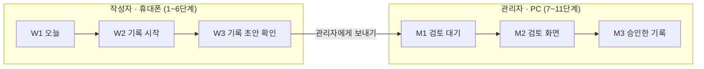

# 시나리오 1 시연 대본 v1.0 (시설 기록 한 건, 별지 제16호)

> [!NOTE]
> **10/29 용어 통일:** 이름만 [용어집 v1.0](용어집-v1.0.md)에 맞췄습니다(담당자 → 관리자, R → M 화면 번호, 기록함 → 기록, 음성 메모 → 녹음·W2 기록 시작, 보내기 → 전송). 동작·공통 계약은 그대로입니다. 결정 [2026-10-29-용어통일](../결정/2026-10-29-용어통일.md).

> [!NOTE]
> **10/30 한 녹음 한 언어:** 섞어 말하면 받아쓰기가 베트남어 문장을 빼거나 틀린 한국어로 적어서(배포본 확인), 처음 녹음은 **한국어만 말하는 시연 음성 `voice-1`**로 바꿨습니다. 4장 '말할 문장'과 5장 2단계를 고쳤고, 실제 모드의 기대 화면은 [`data/demo/voices.md`](../../data/demo/voices.md) '음성 1'을 따릅니다. 결정 [2026-10-30-녹음한언어](../결정/2026-10-30-녹음한언어.md)(유효, #187).

| 문서 | 작성 | 작성일 | 시연 | 기대 화면 기준 | AI |
| --- | --- | --- | --- | --- | --- |
| 시연 대본 · v1.0 | 기획 담당 | 2026-10-21 | 10/22(목) 16:00 멘토링 | 합성 사례 S-F01 | Mock (미리 만든 응답) |

- **목적:** 시연하는 사람이 그대로 따라 하게 하고, 백엔드·데이터·프론트가 Mock 응답과 화면을 이 대본에 맞추게 합니다.
- **읽는 법:** 1부는 시연하는 사람용, 2부는 개발 담당용(접혀 있음)입니다. 답이 필요한 질문은 맨 끝 [8. 남은 확인](#8-남은-확인)에 모았습니다.
- **근거:** [시연-일정 v1.1](시연-일정-v1.1.md) 시나리오 1(11단계), [s-f01.md](../../data/cases/s-f01.md)·[s-f01.json](../../data/cases/s-f01.json)(데이터 담당, 시나리오 1 정답), [화면 v1.3](화면-v1.3.1.md), [AI 규칙 v1.1.1](ai규칙-v1.1.4.md) '상태 판정 기준', [seed.sql](../../supabase/seed.sql)(데모 계정).
- **위치:** 시연-일정 v1.1의 시나리오 1을 채우는 대본입니다. 기대 화면과 준비 목록까지 담아 길어져서 따로 두고, 시연-일정에서 이 문서로 연결합니다.

> [!NOTE]
> **기대 화면은 기존에 작성된 s-f01을 기준으로 작성했습니다.** 둘이 다르면 s-f01을 따릅니다.
> s-f01은 AI 규칙 v1.1.1에 맞춰 작성됐고, QA 기록 검증 코드로 확인을 마쳤습니다. 백엔드 Mock 응답도 s-f01을 그대로 쓰므로, 대본이 같은 기준을 써야 시연 화면과 대본이 어긋나지 않습니다.

---

# 1부. 시연 진행표

시연하는 사람용입니다. 무엇을 누르고 무엇을 말할지만 적었습니다.

## 1. 한눈에 보기

**이 시연으로 보여 줄 것 4가지** (시연-일정 v1.1 '보여 주는 것')

1. 말 한 번으로 기록 초안이 나온다.
2. AI가 지어내지 않고, 모호한 것은 '확인 필요'로 물어본다.
3. '확인 필요'가 남으면 관리자가 승인할 수 없다(서버도 다시 검사).
4. AI가 왜 그렇게 했는지 기록으로 보인다.

**등장인물** (모두 가상 인물)

| 인물 | 설명 |
| --- | --- |
| 마이 | 베트남 출신 요양보호사. 한국어로 일하고, 말이 막히면 베트남어가 섞임 |
| 김○○ 어르신 | 요양원 어르신. 와상, 복약 대상 |
| 박 사회복지사 | 기록을 검토하고 승인하는 관리자 |

**전체 시간:** 약 6분 (오프닝·클로징 포함, 질문 시간 별도). 리허설에서 다시 잽니다.

## 2. 역할

| 역할 | 기기 | 맡을 사람 |
| --- | --- | --- |
| 요양보호사 '마이' (작성자) | 휴대폰 | **기획 담당** |
| 관리자 '박 사회복지사' | PC | 멘토링 참가자 명단 확정 후 배정 |
| 설명 (화면 옆에서 말함) | — | 멘토링 참가자 명단 확정 후 배정 |

인원이 적으면 설명하는 사람이 PC 관리자를 겸합니다.

## 3. 시연 전 준비

**10/21 (오늘)**

- [ ] 역할 확정 (멘토링 참가자 명단 확정 후)
- [ ] 마이 역: 베트남어 문장 발음 연습 (파파고·구글 번역 🔊로 듣고 따라 하기)
- [ ] Supabase 프로젝트 열어 두기 (무료 요금제 일시 중지 방지, 시연-일정 v1.1 '시연 준비물')

**10/22 오전 (리허설)**

- [ ] QA 담당 리허설에서 5절 진행표대로 끝까지 돌리고 단계별 시간 재기
- [ ] 2부 '나오면 안 되는 것'이 화면에 없는지 확인
- [ ] 백업 캡처 6장 찍기 (6절 표의 화면)
- [ ] 리허설 뒤 데모 데이터 초기화 (백엔드)

> [!WARNING]
> **리허설 뒤 데모 데이터를 꼭 초기화하세요.** 승인한 기록은 잠겨서 다시 쓸 수 없습니다. 초기화하지 않으면 본 시연 때 W1 카드가 '승인 완료'으로 떠서 1단계부터 막힙니다. ([8. 남은 확인](#8-남은-확인) 4번)

**시연 직전 (16시 전)**

- [ ] 휴대폰: 배포 주소에 작성자 계정 `worker@carebridge.test`(마이)로 로그인
- [ ] PC: 관리자 계정 `reviewer@carebridge.test`(박 사회복지사)로 로그인
- [ ] 비밀번호는 팀 비공개라 이 문서에 적지 않음. 백엔드 담당에게 받기
- [ ] 휴대폰 W1에서 김○○ 카드가 '작성 전'인지 확인
- [ ] 휴대폰 마이크 권한 허용, 소리 켜기 (5단계 🔊 듣기)
- [ ] 화면 위에 MOCK 띠가 보이는지 확인
- [ ] 온라인 멘토링이면 휴대폰 화면을 보여 줄 방법(화면 공유·미러링) 준비
- [ ] 백업 캡처 6장을 PC에서 바로 열 수 있게 두기

## 4. 말할 문장

**처음 녹음 (2단계)** — 시연 음성 `voice-1.mp3`(한국어만, 약 61초)를 다른 기기(노트북·휴대폰 스피커)로 틀어 W2 녹음에 들려줍니다. 음성 파일은 데이터 담당 공유 폴더(디스코드 게시판)에 있습니다. 대본은 아래와 같습니다(`data/demo/voices.md` '음성 1').

> 오늘은 아침 일곱 시부터 오후 네 시까지 근무하면서 어르신을 돌봐 드렸어요. 아침에 세수해 드리고 옷을 갈아입혀 드렸어요. 두 시간마다 자세를 바꿔 드렸고, 기저귀는 세 번 갈아 드렸어요. 점심은 죽으로 조금 드셨어요. 어젯밤에는 두 번 깨셨고, 아침에 피곤하다고 하셨어요. 점심 드시고 약 드시는 것 확인했어요. 오늘은 저를 알아보시고 웃으면서 인사하셨어요. 엉덩이 쪽이 조금 빨개요. 내일 아침에 엉덩이 피부를 다시 봐야 할 것 같아요. 오늘 기록은 여기까지입니다.

- **한 녹음에는 한 언어만** 씁니다(10/30). 한국어와 베트남어를 섞지 않습니다. 베트남어로 말하는 모습은 시나리오 3(`voice-3`, 베트남어만)에서 보입니다.
- 끝 문장 "오늘 기록은 여기까지입니다."는 일부러 넣었습니다. 없으면 받아쓰기가 말하지 않은 문장을 지어낼 수 있습니다(`voices.md`).

**말로 보탤 문장 (5단계, 식사 카드에서)** — **한국어로 말합니다.**

> 죽 반 안 되게 드셨어요.

> [!IMPORTANT]
> 보탤 문장은 바꾸지 않습니다. 기대 화면의 근거 문장이 이 문장 글자 그대로입니다.

## 5. 진행표

시간은 시작부터 누적입니다(추정, 리허설에서 고침). '말할 것'은 따로 표시가 없으면 **설명**하는 사람이 말합니다.

| 시간 | 단계 | 누가 | 화면 | 할 것 | 말할 것 |
| --- | --- | --- | --- | --- | --- |
| `0:00` | **오프닝** | 설명 | — | — | "요양보호사 기록 한 건을 녹음부터 승인까지 보여 드리겠습니다. 베트남 출신 요양보호사 마이 씨가 휴대폰으로 기록을 남기고, 박 사회복지사가 PC에서 검토합니다. **오늘 AI 부분은 미리 만든 응답(Mock)으로 동작합니다.**" |
| `0:30` | 1 | 마이 | W1(오늘) | 김○○ 카드 누르기 | "요양보호사가 오늘 담당 어르신을 고릅니다." |
| `0:40` | 2 | 마이 | W2(기록 시작) | [시작] → 다른 기기로 `voice-1` 틀기 → 끝나면 [정지] | 녹음 전: "글 대신 말로 남깁니다. 한국어나 모국어 중 하나로 말하면 됩니다." |
| `1:20` | 3 | — | W3(기록 초안 확인) | '정리 중' 기다리기 | "뒤에서 AI가 서식과 용어를 찾아 초안을 만듭니다." |
| `1:35` | 4 | 마이 | W3 | 9개 카드 천천히 내려 보기. 식사·불편감 표현이 '확인 필요'(주황)인지 확인 | "AI는 확실한 것만 '관찰'로 쓰고, 모호한 '조금'과 피부 이상은 '확인 필요'로 남깁니다. 말하지 않은 건 빈칸으로 둡니다." |
| `2:05` | 5 | 마이 | W3 | 식사 카드 → 말로 보태기 → 보탤 문장 말하기 → 🔊 누르기 | "모호한 부분은 말로 보태면 '죽, 1/2 미만'으로 바뀝니다. 한국어 문장은 들어서 확인합니다." |
| `2:35` | 6 | 마이 | W3 | 불편감 표현은 그대로 두고 나머지 [맞아요] → [관리자에게 전송] | "피부 문제는 작성자가 판단하지 않고 관리자에게 넘깁니다." |
| `2:55` | **전환** | 설명 | — | 시선을 PC로 | "이제 관리자 PC로 넘어가겠습니다." |
| `3:05` | 7 | 관리자 | M1 → M2 | M1에서 1건 누르기 → M2에서 항목 몇 개 누르기 | "관리자는 항목을 누르면 왼쪽 원문에서 근거 문장을 바로 봅니다." |
| `3:35` | 8 | 관리자 | M2(검토 화면) | "확인 필요 1개 남음"과 잠긴 [승인] 보여 주기 → 불편감 표현 [확인함] → [승인]이 켜지는 것 보여 주기 | "'확인 필요'가 남아 있으면 승인이 잠깁니다. 관리자가 직접 보고 확인해야 열립니다. 화면을 우회해도 서버가 다시 막습니다." |
| `4:05` | 9 | 관리자 | M2 | 맨 아래 'AI 작업 기록' 펼치기 | "AI가 어떤 도구를 왜 썼는지 한 줄씩 남습니다." |
| `4:35` | 10 | 관리자 | M2 | 특이사항 [복사] → [승인] | "특이사항은 스마트장기요양 앱에 붙여 넣을 수 있게 복사합니다." |
| `4:55` | 11 | 관리자 | M3(승인한 기록) | 이력 보여 주기 → [인쇄·PDF] | "작성 → 전송 → 검토 → 승인 이력이 남고, 별지 제16호 모양으로 인쇄합니다." |
| `5:25` | **클로징** | 설명 | — | — | "정리하면, 말 한 번으로 초안이 나오고, AI는 모호한 것을 지어내지 않고 물어봅니다. 확인이 남으면 승인이 막히고, AI가 한 일은 기록으로 남습니다. 최종 기록은 한국어이고, 작성자는 모국어로 함께 볼 수 있습니다." |
| `6:00` | **끝** | | | | |

## 6. 막혔을 때

> [!TIP]
> 설명하는 사람이 **"지금은 미리 찍어 둔 화면으로 이어서 보여 드리겠습니다."** 라고 말하고, 해당 캡처를 열어 다음 단계로 넘어갑니다.

| 막힌 단계 | 열 캡처 | 이어서 할 단계 |
| --- | --- | --- |
| 2 (녹음 안 됨) | ① W2 녹음 중 | 3 |
| 3~4 ('정리 중'에서 안 넘어감) | ② W3 처음 초안 | 5 |
| 5 (보태기 안 됨) | ③ W3 식사 수정 뒤 | 6 |
| 6~8 (보내기·승인 화면 문제) | ④ M2 승인 잠김 | 9 |
| 9 (작업 기록 안 보임) | ⑤ M2 AI 작업 기록 | 10 |
| 10~11 (승인·인쇄 안 됨) | ⑥ M3 인쇄 화면 | 클로징 |

---

# 2부. 개발 기준

백엔드·데이터·프론트용입니다. Mock 응답과 화면이 맞춰야 할 기준입니다.

## 7. 기대 화면 (s-f01 기준)

백엔드 담당은 Mock 응답으로 `s-f01.json`의 `draft`를 그대로 돌려줍니다. 프론트엔드 담당은 API 전 가짜 데이터로 같은 파일을 씁니다.

> [!NOTE]
> **10/30:** 아래 표는 Mock(s-f01) 기준이라 수면 근거에 옛 베트남어 문장이 남아 있습니다. **실제 모드에서 `voice-1`을 쓰는 시연은 [`data/demo/voices.md`](../../data/demo/voices.md) '음성 1' 기대 결과를 따릅니다**(확인 필요 2개: 식사, 불편감 표현 · 나머지 7개 관찰). 5단계 보태기와 8단계 '확인 필요 1개 남음'은 두 기준이 같습니다.

<b>4단계: 처음 초안</b> (확인 필요 2 · 언급 없음 3 · 관찰 4)

| # | 항목 | 상태 | 한국어 기록 (AI 정리) | 근거 문장 (원문 그대로) | 확인 필요 이유 / 메모 |
| --- | --- | --- | --- | --- | --- |
| 1 | 방문 시점 | 언급 없음 | — | — | 말에 방문 시점이 없음. 기록 날짜는 W1에서 따로 저장됨 |
| 2 | 제공 지원 | 관찰 | 세면 도움, 체위변경(2시간마다) | 아침에 세수해 드리고 두 시간마다 자세 바꿨어요. | |
| 3 | 식사 | **확인 필요** | 점심 섭취, 섭취량 확인 필요("조금") | 점심은 조금 드셨어요. | "조금"은 제16호 섭취량(1 / 1/2이상 / 1/2미만) 중 하나로 정할 수 없음. 식사 종류도 말하지 않음 |
| 4 | 수면 | 관찰 | 밤에 잘 못 주무심 | Bà ngủ không ngon. | 근거는 받아쓴 원문 그대로라 베트남어 문장 |
| 5 | 불편감 표현 | **확인 필요** | 엉덩이 쪽 피부가 조금 붉어 보임 (발적 관찰) | 엉덩이 쪽이 조금 빨개요. | 피부 이상 신호(AI 규칙 '확인 필요' 4번: 건강·안전 신호). 관리자 확인과 간호인력 보고 필요. W3에 "관리자에게 바로 알리세요" 표시 |
| 6 | 복약 관찰 | 관찰 | 약 드신 것 확인함 | 약은 드셨어요. | 요양보호사가 본 것만. 투약관리 칸(건강 및 간호관리)은 체크하지 않음 |
| 7 | 인지 변화 | 언급 없음 | — | — | |
| 8 | 특이사항 | 관찰 | 점심 섭취량 확인 필요("조금"). 밤에 잘 못 주무심. 약 드신 것 확인함. 엉덩이 쪽 피부가 조금 붉어 보임(관리자 확인 필요). | 점심은 조금 드셨어요. Bà ngủ không ngon. 약은 드셨어요. 엉덩이 쪽이 조금 빨개요. | 근거는 원문에 이어진 한 구간 |
| 9 | 다음 확인사항 | 언급 없음 | — | — | 작성자가 다음에 볼 것을 말하지 않음 |

<b>5단계 뒤:</b> 식사 카드에 "죽 반 안 되게 드셨어요."를 보탬

| 항목 | 상태 | 한국어 기록 | 서식 칸 (detail) |
| --- | --- | --- | --- |
| 식사 | 확인 필요 → **관찰** | 점심 죽 1/2 미만 드심. | 식사 종류 = 죽, 섭취량 = 1/2 미만 |
| 특이사항 | 관찰 | 점심 죽 1/2 미만 드심. 밤에 잘 못 주무심. 약 드신 것 확인함. 엉덩이 쪽 피부가 조금 붉어 보임(관리자 확인 필요). | |

<b>8단계:</b> M2에서 보이는 것

- 남은 확인 필요는 **불편감 표현 1개**: [승인] 잠김, "확인 필요 1개 남음"
- 관리자가 불편감 표현에 [확인함](내용 유지) → [승인] 열림

<b>나오면 안 되는 것</b> (s-f01 오답 목록, 목표 0개)

리허설 때 화면에 아래가 보이면 Mock이나 화면이 틀린 것입니다.

| 항목 | 나오면 안 되는 것 | 이유 |
| --- | --- | --- |
| 방문 시점 | 관찰 + 날짜·근무 내용, 시작·종료 시각 | 말하지 않음. 기록 날짜는 따로 저장됨 |
| 식사 | (보태기 전) 섭취량 1/2미만 또는 1/2이상, 식사 종류 죽 | "조금"만 말함. 고르면 지어낸 값 |
| 불편감 표현 | 욕창, 욕창 1단계, 피부염 | 진단 금지. '붉어 보임(발적 관찰)'만 |
| 불편감 표현 | 관찰 | 피부 이상은 건강·안전 신호라 확인 필요 |
| 수면 | 불면증, 수면장애 | 진단명 |
| 복약 관찰 | 약 이름·용량, 투약관리 체크 | 말하지 않았고 간호 영역 |
| 인지 변화 | 유지 / 호전 / 악화 | 말하지 않음. 제16호엔 칸도 없음 |
| 제공 지원 | 구강청결·옷 갈아입기·기저귀 교환·화장실 횟수 | 말하지 않음 |
| 다음 확인사항 | 내일 엉덩이 피부 확인 등 | 작성자가 말하지 않음 |

<b>9단계:</b> AI 작업 기록 (4줄)

s-f01에는 작업 기록이 없어, 시연-일정 v1.1 9단계 순서에 s-f01이 쓴 용어(T11)를 맞췄습니다.

| 순서 | 도구 | 고른 이유 | 결과 |
| --- | --- | --- | --- |
| 1 | 서식 기준 조회 | 시설 어르신이라 어느 서식인지 확인 | 별지 제16호, 검증됨 |
| 2 | 용어 검색 | '조금'이 섭취량 선택지 중 무엇인지 확인 | T11 '섭취량 확인 필요' |
| 3 | 기록 검증 | 근거 문장이 원문에 있는지 확인 | 통과 |
| 4 | 초안 반환 | 초안 저장 | 9개 항목 저장 |

## 8. 남은 확인

> [!CAUTION]
> 시연 전에 답이 필요한 질문입니다. 10/21 PR #19(DB·데모 데이터)까지 보고 정리했습니다.

**백엔드 담당**

| # | 질문 | 왜 필요한가 | 제안 | 지금 상태 |
| --- | --- | --- | --- | --- |
| 1 | 식사 섭취량을 `detail.intake`에 어떤 값으로 저장하나요? | 5단계 뒤 식사 카드에 '1/2 미만'이 떠야 하는데, 화면·Mock·s-f01이 같은 값을 써야 함 | `full`(전량) / `half_or_more`(1/2 이상) / `under_half`(1/2 미만). s-f01과 AI 규칙 예시가 이미 이 이름을 씀 | `detail`이 자유 형식이라 DB에서는 정하지 않음 |
| 2 | 5단계에서 식사 카드에 말로 보탠 글("죽 반 안 되게 드셨어요.")이 `records.transcript` 끝에 붙나요? | 검증 코드는 근거 문장이 받아쓴 원문에 있는지 봄. 안 붙으면 보탠 뒤 식사 근거를 못 찾아 '확인 필요'로 다시 떨어짐 | 붙인다. 또는 검증 코드가 항목 보태기 글(audio_jobs target = item)도 원문으로 보게 함 | 항목 보태기 녹음은 받을 수 있게 됨. 붙이는지는 내일 API에서 정할 부분 |
| 3 | 9단계 'AI 작업 기록'에 Mock으로 넣을 4줄을 7절 표대로 써도 되나요? | 시연에서 펼쳐 보여 주는 장면이라 화면에 실제 글이 있어야 함 | 7절 '9단계: AI 작업 기록' 표의 도구·고른 이유·결과를 `agent_steps`의 tool·reason·result_summary에 그대로 | 표 구조는 PR #19에 생김. 넣을 글은 미정 |
| 4 | 리허설 뒤 데모 데이터를 어떻게 처음 상태로 되돌리나요? | 승인한 기록은 DB가 잠가서(`record_locked`) 다시 쓸 수 없음. 리허설 기록이 남으면 본 시연 때 W1 카드가 '승인 완료'으로 떠서 1단계부터 막힘 | 리허설 뒤 백엔드가 김○○의 그날 기록을 지우는 방법을 준비. 시연 직전 W1 카드가 '작성 전'인지 함께 확인 | 미정 |

**프론트엔드 담당**

| # | 질문 | 왜 필요한가 | 제안 | 지금 상태 |
| --- | --- | --- | --- | --- |
| 5 | W3에서 '확인 필요' 항목(불편감 표현)에 [맞아요]를 안 눌러도 [관리자에게 전송]이 눌리나요? | 6단계에서 불편감 표현은 그대로 두고 보냄. 화면 설계 W3의 보내기 조건은 "모든 항목에 [맞아요]를 누르거나 고친 뒤"라 버튼이 막힐 수 있음 | '확인 필요' 항목은 [맞아요] 없이도 보낼 수 있게. 화면 설계에도 "'확인 필요'가 남아 있어도 보낼 수는 있다"고 되어 있음 | 서버는 막지 않음(PR #19). 화면에서 막을지만 정하면 됨 |
