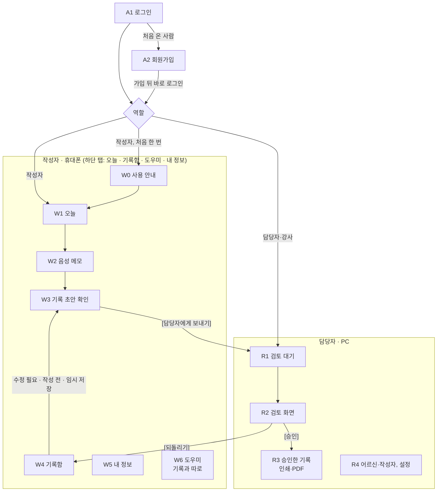
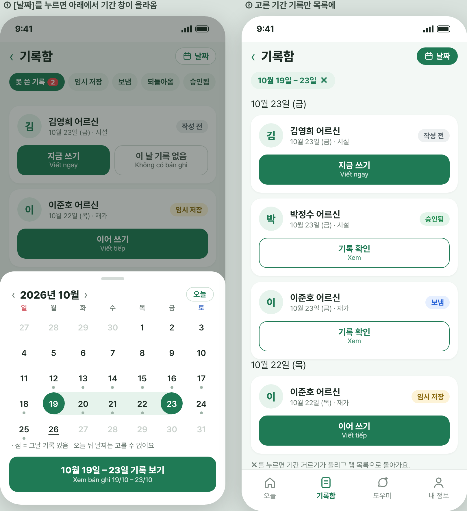

# 케어브릿지 화면 설계 v1.3

2026-10-26 · @2dion (v1.2.1·v1.2: 2026-10-26, v1.1: 2026-10-18)

## 이 문서는 왜 있나

- **목적:** 외국인 작성자의 인지 부담을 줄여, 스스로 돌봄 기록을 남기게 합니다.[1][2]
- **배경:** 외부 피드백으로 Agent가 필수가 됐고, 1주 MVP 뒤 테스트를 해야 합니다. 10/18 팀 결정(승인 차단, 도구 4개, 10/23 기능 마감)을 화면에 옮겨야 합니다.[3][4]
- **근거:** 화면 설계 v1.0, 멘토링 회의록, 2dion 10/16 댓글, 표준교재 별지 서식이 뒷받침합니다.[5][6][1][7]
- **사유:** 화면 ID와 흐름은 v1.0 그대로 두고, 바뀐 곳만 고칩니다. 승인 조건 같은 중요한 규칙은 화면과 서버가 같이 지킵니다.[8][4]

## v1.0에서 바뀐 점

| 무엇 | 바뀐 내용 | 사유 |
| --- | --- | --- |
| R2(검토 화면) 승인 | ‘확인 필요’가 남은 항목마다 [확인함] 또는 [기록 안 함]을 골라야 [승인]이 눌림. 남은 항목이 0개가 될 때까지 [승인]은 꺼져 있음 | 10/18 결정 1, A2[4][3] |
| R2(검토 화면) AI 작업 기록 | 접힌 ‘AI 작업 기록’ 추가(쓴 도구, 고른 이유) | A1 Agent 도입[3] |
| 잠정 서식 표시 | 서식 대응이 잠정(provisional)이면 R2(검토 화면)와 인쇄·PDF에 “잠정 서식” 표시. 지금은 별지 제16호·제12호 모두 검증됨 | A6[3][21] |
| 법정 서식 원문 반영 | 재가(별지 제12호) 제공시간 칸을 영역 합계/줄마다 분으로, 배변 실수 2칸. 시설(별지 제16호) 특이사항 영역별 4칸. R3(승인한 기록) 인쇄 서명란 | 10/17 법정 서식 정리[21][22][23] |
| W3(기록 초안 확인) | Agent가 일하는 동안 ‘정리 중’ 표시 | A1, B5[3] |
| 교육용 기관 | 강사 코멘트 뒤 상태는 ‘코멘트 받음’(commented). 승인(approved)과 섞지 않음 | A3[3] |
| 만드는 순서 | 10/23 기능 마감. 기능마다 최소 구현 범위. 밀리면 R2(검토 화면) 1장으로 줄여도 수정·되돌리기·승인 유지 | 10/18 결정 3, A4, A8[4][3] |
| 화면마다 ‘왜’ | 화면마다 그 화면이 왜 있는지 한 줄 | 문서 공통 형식[8] |
| 항목 표시 순서 (10/24) | W3(기록 초안 확인)·R2(검토 화면)은 상태별로 묶어 '확인 필요'를 맨 위에, 묶음 안에서는 별지 제12호·제16호 공통 순서. 항목 번호와 item_key는 그대로 | 10/22 멘토링, 2dion 10/24 |
| R2(검토 화면) 요약 띠·미리보기 (10/24) | 맨 위 한 줄에 누가 어느 항목을 고쳤는지와 검사 결과. 재가 시간 확인, 서식 [미리보기], 되돌림 이력(추후 적용) | 10/22 멘토링 결정 7, 2dion 10/24 |
| 병기 모드 하나 (10/25) | MVP 작성자 화면은 '한국어+베트남어' 병기 모드만. W0·W5·A2의 언어 선택은 추후 적용. 표·API 그대로 | 2dion 10/25, 병기모드우선 결정[26] |
| 병기 원칙 (10/25) | ‘작성자 화면 모든 안내·항목 병기’ → ‘내 말은 그대로, 남이 쓴 내용은 병기, 화면 틀은 한국어’(공통 규칙). W2 녹음 안내는 한국어만 | 2dion 10/25, 10/22 멘토링 ‘한국어 중심, 모국어 보조’ |
| 고칠 때 입력 언어 (10/25) | W3(기록 초안 확인)에서 항목을 다시 말하거나 쓸 때 한국어·모국어 모두 받음. 서버가 한국어 기록체로 다시 쓰고 재번역. 모국어 줄은 직접 고치지 않음 | 2dion 10/25 |
| 교육용 강사 흐름 (10/25) | 강사도 담당자와 같은 R2(수정·[확인함]/[기록 안 함]·[되돌리기]·[승인]). ‘코멘트 받음’(commented) 상태와 [코멘트 보내기]를 뺌. 위 ‘교육용 기관’ 줄을 대체 | 2dion 10/25, 강사흐름통일 결정[27] |
| A1(로그인)·A2(회원가입) (10/25) | 이메일·비밀번호 로그인, 가입 코드로 회원가입. W5(내 정보)·담당자 메뉴에 로그아웃, R4(어르신·작성자, 설정)에 가입 코드 보기 | FE 요청, 2dion 10/25, 로그인가입 결정[24] |
| 못 쓴 기록 (10/25) | W4(기록함)에 ‘못 쓴 기록’ 탭과 [이 날 기록 없음], W1(오늘) 맨 위 알림 띠, R1(검토 대기) 한 줄, R2(검토 화면) ‘늦게 쓴 기록’, R4(어르신·작성자, 설정) 방문 요일·담당 시작일. 알림은 앱 안에서만 | 2dion 10/25, 못쓴기록 결정[28] |
| 추후 적용 절 (10/26) | MVP 밖 화면 내용 11가지를 ‘추후 적용’ 절 한곳에 모음. ‘여유 시’·‘준비 중’·‘MVP에 없음’으로 섞여 있던 표시를 ‘추후 적용’ 하나로 통일. 새로 W1 달력(한 달 달력, 날짜마다 점 하나로 할 일 있음·못 쓰고 지남·모두 끝남·방문 예정, 그날 어르신별 줄과 버튼) 추가. 새 표·API·상태 값 없음. 이 줄부터 v1.2 | 2dion 10/26, 추후적용 결정[29] |
| W1(오늘) 병기 (v1.2.1, 10/26) | 날짜는 한국어만(베트남어 줄 뺌). 카드 버튼, 되돌아옴·못 쓴 기록 띠, 카드 안내 줄은 병기. 병기 원칙 ③의 W1 예외 | 팀장·기획 10/26, 오늘화면병기 결정[30] |
| 기록함 기간 거르기 (v1.3, 10/26) | W1 [달력]과 ‘W1 달력’ 절을 없앰. W4(기록함) 머리에 [날짜], 아래 모달 달력에서 두 번 눌러 기간 고르기(스카이스캐너식), 거른 목록은 날짜 머리줄. 보내지 않은 임시 저장은 날짜 제한 없이 ‘못 쓴 기록’에 남음. R2 ‘늦게 쓴 기록’ → 처음 보낸 날 기준 ‘늦게 보낸 기록’. 새 표·API·상태 값 없음 | 팀장·기획 10/26, 기록함기간 결정[31] |
| 제목·버튼 병기 (10/27) | 작성자 화면(W0~W6)의 화면 제목과 버튼을 피그마 ‘개발 v1.0’대로 병기. 배지·탭·이름·날짜·항목 이름은 한국어만, 담당자 화면은 한국어만. 문장만 고쳐 버전 유지 | 2dion 10/27, 화면틀병기 결정[33] |
| 상태 이름 (10/27) | 화면에 보이는 기록 상태를 작성 전 / 임시 저장 / 전송 완료 / 수정 필요 / 승인 완료로. W4 탭 ‘못 쓴 기록’ → ‘작성 전’, W1 띠 ‘수정 필요 기록’. 값(`records.status`)은 그대로 | 2dion 10/27, 상태이름 결정[34] |
| 알림 표시 정리 (10/28) | W1 종 버튼을 두지 않음. W4 탭 숫자는 ‘작성 전’에만(하단 탭 ‘기록함’에는 없음). R1 메뉴 ‘검토 대기’ 숫자, 다시 보낸 기록에 ↻ 아이콘. 새 표·API·상태 값 없음 | EUN 10/28, 알림표시 결정[35] |
| 기한 지난 빈 기록 (10/28) | R1에 ‘기한 지난 빈 기록’ 상자(8~30일 전 빈 날), 담당자가 [기록 없음으로 정리]. 작성자 화면은 그대로 | EUN 10/28, 기한지난빈기록 결정[36] |

## 범위

**왜:** 개발자가 이 문서만 보고 화면을 만들 수 있게 합니다.

이 문서는 기획안의 ‘메뉴와 화면’을 화면별로 풀어 씁니다.[2][9][10] 화면 ID는 v0.5·v1.0과 같고, 항상 이름을 함께 씁니다. 기술은 기술 선택 v1.1(반응형 웹앱 하나)을 따릅니다.[11] 저장되는 칸과 API는 데이터 구조 v1.1을, AI 동작은 AI 규칙 v1.1.1을 봅니다.[12][13]

**v0.5에서 v1.0으로 바뀐 점 (10/16 결정, 그대로 유효)**

| 바뀐 것 | 내용 | 근거 |
| --- | --- | --- |
| 기록 항목 8개 → 9개 | ‘인지 변화’ 추가(기억·날짜·사람 헷갈림 → 호전/유지/악화). 기분은 따로 두지 않음 | [14][7] |
| W6(도우미) | 여유 시 → **MVP 포함** | [14] |
| R3(승인한 기록) 인쇄·PDF | 여유 시 → **MVP 포함** | [14] |
| 특이사항 200자 | 글자 수 표시 + 넘으면 경고만(입력은 막지 않음) | [14] |
| W2(음성 메모) | 시작·끝은 버튼으로 직접, 1회 최대 5분(5분에 자동 정지, 남은 시간 표시, 10/19 결정) | [15] |
| 서식 | 시설급여(별지 제16호)와 재가 방문요양(별지 제12호)을 모두 지원 | [16][7] |
| 교육생 연습 | 켜고 끄는 교육 모드 없이 ‘교육용 기관’ 계정으로 분리 | [17] |

**9개 항목 (화면에 나오는 순서):** ① 방문 시점 ② 제공 지원 ③ 식사 ④ 수면 ⑤ 불편감 표현 ⑥ 복약 관찰 ⑦ 인지 변화 ⑧ 특이사항 ⑨ 다음 확인사항. 항목마다 상태는 ‘관찰’ / ‘언급 없음’ / ‘확인 필요’ 중 하나입니다.[2]

## 화면 흐름

**왜:** 작성자와 담당자가 어디서 어디로 가는지 한눈에 맞춥니다.

- **작성자 4단계:** W1(오늘) → W2(음성 메모) → W3(기록 초안 확인, 처음엔 ‘정리 중’) → [담당자에게 보내기].
- **담당자 3단계:** R1(검토 대기) → R2(검토 화면) → [승인] → R3(승인한 기록).
- **되돌리기 1갈래:** R2(검토 화면) [되돌리기] → W4(기록함)의 ‘수정 필요’ → W3(기록 초안 확인).
- **들어가기 (10/25):** A1(로그인) → 작성자면 W0(사용 안내, 처음 한 번)·W1(오늘), 담당자·강사면 R1(검토 대기). 처음 온 사람은 A1(로그인) [회원가입] → A2(회원가입) → 가입 뒤 바로 로그인.[24]

**그림: 어느 화면에서 어디로 가나** 그림은 위 내용을 옮긴 것입니다. 그림과 글이 다르면 글이 기준입니다.

담당자가 되돌리면 작성자의 W4(기록함)에 ‘수정 필요’로 뜨고, 누르면 W3(기록 초안 확인)이 사유를 맨 위에 둔 채 다시 열립니다.[2] W6(도우미)는 기록 흐름과 따로, 하단 탭에서 언제든 엽니다.

## 모든 화면 공통 규칙

**왜:** 어느 화면에서든 같은 방식으로 보이고 움직여야 작성자가 헷갈리지 않습니다.

| 규칙 | 내용 |
| --- | --- |
| 병기 원칙 (10/25) | "내 말은 그대로, 남이 쓴 내용은 병기, 화면 틀은 한국어." MVP 작성자 화면은 이 병기 모드 하나만 만들고, '한국어만' 모드는 추후 적용(병기모드우선 결정[26]). 병기할 때는 한국어를 먼저, 그 아래 작은 글씨로 모국어(베트남어). 최종 기록은 항상 한국어[2][6] |
| ① 내가 말하거나 쓴 것 → 병기 안 함 | 받아쓴 원문, ‘내가 한 말’(근거 문장), 입력창과 녹음·글쓰기 화면(W2) |
| ② 남이 쓰고, 내가 읽고 판단·행동할 내용 → 병기 | AI 초안 항목 내용, ‘확인 필요’ 이유, 담당자·강사 되돌림 사유, W6(도우미) 답변, 막혔을 때 안내(마이크 권한·오류) |
| ③ 매일 반복해 보는 화면 틀 → 한국어만 | 하단 탭, 화면 제목, 버튼, 상태 배지, 이름·날짜·시간. 쓰면서 한국어를 익히는 ‘보조 바퀴’ 부분(10/22 멘토링). 예외: 언어를 아직 모르거나 처음 보는 곳(A1(로그인)·A2(회원가입), W0(사용 안내))은 병기. W1(오늘)의 카드 버튼·띠·카드 안내 줄도 병기(날짜는 한국어만, 10/26[30]). **작성자 화면(W0~W6)의 화면 제목과 버튼은 피그마 ‘개발 v1.0’대로 병기(10/27[33]).** 상태 배지·하단 탭·이름·날짜·항목 이름은 그대로 한국어만 |
| 듣기 버튼 | 한국어 문장 옆마다 🔊. 누르면 브라우저 음성으로 읽어 줌[18][6] |
| 기기와 화면 크기 | 기기를 정해 두지 않음. 모든 화면이 휴대폰 세로(너비 360px부터)와 PC 가로(1280px 기준)에서 다 열림. 작성자가 PC로 쓰거나 담당자가 휴대폰으로 검토해도 됨. 기본 배치만 작성자=휴대폰, 담당자=PC 기준으로 먼저 만듦[1] |
| 글은 적게, 그림으로 | 한 화면에 할 일 하나. 긴 설명 대신 아이콘+짧은 말(예: 🎤 말하기, ✏️ 쓰기, ✅ 맞아요). 안내 문장은 한 줄, 더 필요하면 눌러서 펼침[1] |
| 문화 차이로 헷갈리지 않게 | 나라마다 뜻이 다른 손짓·색 아이콘(👍, 👌, 빨강=좋음 등)은 쓰지 않음. 날짜는 ‘10월 16일’, 시간은 ‘오후 3:00’처럼 글자로 함께. 아이콘에는 항상 글자 이름을 붙임. 베트남어 팀 자체 검증 때 같이 확인[1] |
| 누르기 쉬운 버튼 | 작성자 화면 버튼은 손가락으로 누를 수 있는 크기(높이 48px 이상), 글자 크기는 W5(내 정보)에서 3단계 |
| 항목 상태 배지 | 관찰(초록) / 언급 없음(회색) / 확인 필요(주황). 색만으로 구분하지 않고 글자도 함께 |
| AI 초안 표시 | AI가 채운 내용에는 ‘AI 초안’ 표시. 작성자가 [맞아요]를 누르거나 고치면 사라짐[2] |
| 시설·재가 차이 | 어르신 정보의 ‘급여 종류’로 정해짐. 재가(별지 제12호)면 W3(기록 초안 확인)·R2(검토 화면)에 방문 시작·종료 시간, 제공시간(분) 칸(신체활동·가사 지원은 영역 합계, 인지활동 2줄·인지관리·정서 지원은 줄마다), 배변 실수 2칸이 더 나옴[16][7][22] |
| 잠정 서식 표시 (v1.1) | 서식 대응이 ‘잠정’(provisional)이면 R2(검토 화면)와 인쇄·PDF에 “잠정 서식”. 지금은 별지 제16호·제12호 모두 검증됨(10/17)[3][12][21] |
| 처리 중·오류 | AI 처리 중에는 단계 표시(“글자로 바꾸는 중 → 정리 중”). 실패하면 [다시 시도]와 ‘글로 쓰기’를 보여 주고, 쓰던 내용은 임시 저장[18][13] |
| 개인정보 | 어르신은 가명으로 표시. 데모는 합성 데이터만 사용[2] |

## 계정 화면 (10/25)

**왜:** 기관마다 데이터를 나누는 규칙(RLS)은 로그인한 계정의 기관·역할로 동작합니다. 그래서 누가 어느 기관의 작성자·담당자인지를 로그인으로 먼저 정합니다.[24]

계정은 Supabase의 이메일·비밀번호 하나로만 만듭니다(소셜 로그인 없음). 두 화면은 작성자와 담당자가 함께 쓰므로, 작성자 화면 규칙(한국어 위·모국어 아래, 🔊, 버튼 48px)을 따르고 휴대폰과 PC 모두 가운데 카드 하나로 둡니다. 로그인 전에는 그 사람의 언어를 모르니 한국어 아래에 베트남어를 늘 함께 보입니다.[24]

### A1(로그인)

**왜:** 가입한 사람이 이메일과 비밀번호만으로 자기 화면에 들어가게 합니다.

- **보이는 것:** 케어브릿지 이름과 한 줄 소개, 이메일 칸, 비밀번호 칸(👁 보기 켜고 끄기), [로그인], 아래에 [회원가입]과 [비밀번호를 잊었어요].
- **할 수 있는 것:** [로그인] → 성공하면 역할에 따라 이동합니다. 작성자는 W0(사용 안내)를 아직 안 봤으면 W0, 봤으면 W1(오늘). 담당자·강사는 R1(검토 대기). 교육용 기관이면 들어가자마자 ‘연습용 · 합성 사례’ 띠가 보입니다.
- **비밀번호를 잊었어요:** 메일을 보내지 않고 “담당자에게 비밀번호를 다시 정해 달라고 요청하세요” 한 줄만 펼칩니다. 메일 보내기는 추후 적용.[24]
- **로그인 유지:** 한 번 로그인하면 로그아웃할 때까지 유지합니다. 로그인하지 않은 채 다른 화면 주소를 열면 A1(로그인)으로 오고, 로그인 뒤 원래 가려던 화면으로 갑니다.
- **막는 곳:** 작성자가 R 화면 주소를, 담당자가 W 화면 주소를 열면 자기 첫 화면으로 보냅니다. 진짜 막는 것은 서버와 RLS이고, 화면은 길 안내만 합니다.
- **예외:**
  - 이메일이나 비밀번호가 틀림 → “이메일 또는 비밀번호가 맞지 않습니다.” 어느 쪽이 틀렸는지는 알려 주지 않습니다.
  - 계정은 있는데 profiles가 없음(대시보드에서 계정만 만든 경우) → “계정 준비가 끝나지 않았습니다. 담당자에게 문의하세요.” 후 로그아웃.
  - 네트워크 끊김 → “인터넷 연결을 확인하세요” + [다시 시도]. 쓴 이메일은 지우지 않습니다.

### A2(회원가입)

**왜:** 교육생·작성자가 스스로 계정을 만들되, 기관과 역할은 기관이 나눠 준 가입 코드로 정해 다른 기관에 들어가지 못하게 합니다.[24]

- **한 화면 (10/25):** 단계를 나누지 않고 한 화면에서 모든 칸을 채운 뒤 [가입하기]를 한 번 누릅니다. FE 부담을 줄이기 위해서입니다(2dion 10/25).
- **칸 (위에서부터):** ① 가입 코드(안내 “담당자(교육원은 강사)에게 받은 코드”, 대문자로 바꿔 받고 띄어쓰기는 지움) ② 이름(화면에 보일 이름, 별명도 됨) ③ 이메일 ④ 비밀번호(8자 이상, 👁 보기) ⑤ 비밀번호 다시 쓰기 ⑥ 모국어(한국어만 / 한국어+베트남어, 기본 한국어+베트남어). 담당자 코드로 가입하면 ⑥은 무시하고 한국어로 저장합니다. **MVP는 병기 모드 하나라 ⑥을 숨기고 작성자·교육생 코드면 `vi`를 보냅니다(10/25, 병기모드우선 결정[26]).**
- **동의:** “AI 결과는 초안이며 담당자가 승인합니다”, “어르신·가족 실명을 쓰지 않습니다” 두 줄을 읽고 체크 하나. 펼치면 AI 사용 원칙·개인정보 안내(W5(내 정보)와 같은 글).
- **[가입하기]:** 모든 칸이 맞고 동의를 체크해야 켜집니다. 누르면 계정을 만들고 바로 로그인해 A1(로그인)과 같은 갈래로 갑니다. 들어간 첫 화면 위에 “데모 요양센터 · 작성자로 가입했습니다” 알림을 한 번 띄워 기관·역할을 확인시킵니다. 작성자는 W0(사용 안내)부터 봅니다. 확인 메일은 보내지 않습니다.
- **예외:**
  - 코드가 틀리거나 꺼짐 → ① 가입 코드 칸 아래에 “가입 코드가 맞지 않습니다. 담당자에게 다시 확인하세요.” 다른 칸은 그대로 둡니다.
  - 이미 가입한 이메일 → “이미 가입한 이메일입니다.” + [로그인하러 가기].
  - 비밀번호 8자 미만이거나 두 칸이 다름 → 그 칸 아래에 바로 표시(누르기 전에).
  - 가입 중 오류 → 쓴 내용(비밀번호 빼고)을 두고 [다시 시도].
- **저장:** profiles 1행(이름, 모국어, 기관·역할은 코드에서). 이메일·비밀번호는 Supabase 로그인 계정에만 있습니다(데이터 구조 v1.5).[25]

### 로그아웃과 가입 코드 보기

- **로그아웃:** 작성자는 W5(내 정보) 맨 아래 [로그아웃], 담당자는 왼쪽 메뉴 맨 아래 [로그아웃]. 누르면 A1(로그인)으로 갑니다. 공용 PC를 쓰는 기관이 있어 담당자 화면은 메뉴에 늘 보입니다.
- **가입 코드 보기:** 담당자·강사는 R4(어르신·작성자, 설정) ‘설정’에서 자기 기관의 작성자용 코드를 보고 [복사]합니다(읽기만, 만들기·끄기는 팀장이 DB에서). 담당자용 코드는 화면에 보이지 않습니다.
- **개발 환경:** Supabase 설정이 없는 Mock 개발 환경에서는 A1(로그인) 대신 지금의 작성자·담당자 전환 버튼을 그대로 씁니다. 배포 주소에서는 전환 버튼을 빼고 로그인으로만 들어갑니다.

## 작성자 화면 (휴대폰)

**왜:** 작성자가 말로 남기고, 확인만 해서 기록을 끝내게 합니다.

### W0(사용 안내)

**왜:** 처음 쓰는 사람이 세 단계만 알면 되게 합니다.

- **보이는 것:** 첫 실행 때 3장(① 말로 메모 남기기 ② 빈 칸 채우기 ③ 담당자가 승인하면 끝), 언어 선택(한국어만 / 한국어+베트남어). MVP는 병기 모드 하나라 언어 선택은 빼고 추후 적용합니다(10/25[26]).[2]
- **할 수 있는 것:** [다음] [건너뛰기]. W5(내 정보)에서 다시 볼 수 있음.
- **저장:** 언어, 안내를 봤는지.

### W1(오늘)

**왜:** 오늘 누구 기록을 써야 하는지 바로 보이게 합니다.

- **보이는 것:** 오늘 날짜, 담당 어르신 카드(가명, 시설/재가, 방문·돌봄 시간, 상태 배지: 작성 전 / 임시 저장 / 전송 완료 / 수정 필요 / 승인 완료, 상태이름 결정[34]). 수정 필요 기록이 있으면 맨 위에 주황 띠 “수정 필요 기록 1건”.[2]
- **할 수 있는 것:** 카드를 누르면 상태에 따라 W2(음성 메모) 또는 W3(기록 초안 확인)으로.
- **오늘 카드 (10/25):** 오늘이 ‘기록이 있어야 하는 날’인 어르신만 보입니다. 시설은 매일, 재가는 방문 요일에만 나옵니다. 날짜는 한국 시간입니다.[28]
- **못 쓴 기록 띠 (10/25):** 지난 7일에 기록이 없는 날이나 보내지 않은 임시 저장(날짜 제한 없음, v1.3)이 있으면 맨 위에 띠 “지난 기록 2건을 아직 못 썼어요”. 수정 필요 주황 띠와 겹치면 수정 필요 띠를 위에 둡니다. 누르면 W4(기록함) ‘작성 전’ 탭.[28]
- **병기 (10/26):** 날짜는 한국어만. 카드 버튼([기록 시작하기]·[기록 보기] 등), 수정 필요·작성 전 띠, 카드 안내 줄(“오늘 방문 예정” 등)은 한국어 아래 베트남어를 작게 씁니다. 상태 배지·하단 탭은 한국어만.[30]
- **종 버튼 없음 (10/28):** 머리에 종(알림) 버튼을 두지 않습니다. 수정 필요 기록은 위 주황 띠가 알리고, 띠를 누르면 W4(기록함) ‘수정 필요’ 탭으로 갑니다.[35]
- **빈 상태:** “오늘 담당 어르신이 없습니다. 담당자에게 문의하세요.”
- **[달력] 없음 (v1.3):** W1에는 달력을 두지 않습니다. 날짜로 찾기는 W4(기록함) 기간 거르기 하나로 모읍니다.[31]

### W2(음성 메모)

**왜:** 글을 쓰기 어려운 작성자가 말로 먼저 남기게 합니다.

- **보이는 것:** 어르신 이름, 돌봄 날짜(오늘이 아니면 “10월 23일 기록”처럼 크게, 10/25[28]), 큰 [시작] 버튼, 녹음 안내 문구(“오늘 도운 일, 식사, 수면, 달라진 점을 편하게 말해 주세요”, 한국어만. 내가 말하는 화면이라 병기 원칙 ①, 10/25). 녹음 중에는 타이머와 빨간 표시, [정지] [다시 시도], 오른쪽 위 [나가기](녹음을 버리고 나감, 10/27 녹음화면버튼 결정).[15]
- **할 수 있는 것:** [시작] → [정지] → 자동으로 처리 시작. 녹음 중 남은 시간을 보여 주고, 5분이 되면 자동으로 멈춘 뒤 같은 처리를 시작함(10/19 결정). 말하기와 글로 쓰기는 기록 시작 화면에서 하나만 고르고, 녹음 화면에서 글쓰기로 바꾸는 길은 두지 않음(마이크를 못 쓸 때와 처리 실패 때만 [글로 쓰기], 10/27 녹음화면버튼 결정).
- **다음 화면:** 받아쓰기가 끝나면 W3(기록 초안 확인)으로 넘어가 ‘정리 중’을 봄.[3]
- **예외:** 마이크 권한 거부 → 권한 켜는 방법 안내 + [글로 쓰기]. 네트워크 끊김 → 녹음은 탭 메모리에만 두고(기기 저장 X) “인터넷 연결을 확인하세요” + [다시 보내기]. 보내지 못한 녹음이 있으면 탭 닫기 경고. 글자로 바뀐 뒤 음성은 삭제.[2][32]

### W3(기록 초안 확인) — 핵심 화면

**왜:** 작성자가 AI 초안을 자기 말과 맞춰 보고, 빈 곳만 채우게 합니다.

- **정리 중 (v1.1, 10/27 위치 확인):** `/records/[id]`(W3)의 첫 상태입니다. 서버의 ‘기록 검토 준비 Agent’가 초안을 만드는 동안 9개 카드 대신 피그마의 캐릭터·진행 막대·단계를 보여 주고, 끝나면 같은 주소에서 카드를 채웁니다. 제목은 ‘정리 중’. 음성은 음성 인식·내용 정리·결과 준비 3단계, 글은 음성 인식을 뺀 2단계입니다. 다시 열어도 W3에서 이어 봅니다.[3][13]
- **정리가 멈췄을 때:** Agent가 정해진 횟수(Claude 응답 최대 4번) 안에 끝내지 못하면, 못 정한 항목은 ‘확인 필요’로 나오고 이유는 “자동 정리 중단”입니다. 처리가 실패하면 같은 W3 자리에 [다시 시도]와 [글로 쓰기]를 보여 줍니다. [다시 시도]는 원문·입력 방법을 보존해 같은 W3에서 재처리하며, 끝나면 화면 이동 없이 카드를 채웁니다. [글로 쓰기]는 실패 시 허용하는 대체 입력 경로입니다.[3][13]
- **보이는 것:** 9개 항목 카드. 접힌 상태는 두 줄(한국어 요약 + 모국어) + 상태 배지 + [맞아요] [달라요]. 펼치면 ‘내가 한 말’(근거 문장)과 용어 뜻. 되돌아온 기록이면 담당자 사유가 맨 위.[2]
- **할 수 있는 것:** 빈 항목(언급 없음)을 누르면 말하기·쓰기와 예시 문장. [달라요] → 그 항목만 다시 말하거나 고침. 다시 말하거나 쓸 때는 한국어·모국어 어느 쪽이든 되고, 서버가 그 항목만 한국어 기록체로 다시 써서(③ 항목 보태기) 모국어 줄도 다시 번역합니다(10/25). 모국어 줄만 따로 고치는 칸은 없습니다. 사투리·일상 표현은 짐작 뜻을 보여 주고 ‘확인 필요’. [임시 저장] [담당자에게 보내기].
- **고친 항목의 번역 (v1.1):** 한국어 내용이 바뀌면 그 항목만 다시 번역해 모국어 줄을 바꿉니다. 담당자가 고친 항목은 작성자 확인이 풀려, 되돌아온 기록에서 다시 [맞아요]를 받습니다.[3][12]
- **특이사항:** 글자 수 표시(예: 182/200), 200자를 넘으면 주황 경고만(보내기는 가능).[14] 원문 서식에는 글자 수 제한이 없음(10/17 법정 서식 정리).[21] 경고는 유지합니다(10/18 팀 결정).
- **재가(별지 제12호):** ① 방문 시점에 시작·종료 시간, ② 제공 지원에 제공시간(분) 칸: 신체활동지원·가사 및 일상생활지원은 영역 합계, 인지활동지원 2줄(인지자극활동, 일상생활 함께하기)·인지관리지원·정서지원은 줄마다. 배변변화는 대변·소변 실수 횟수 2칸.[7][22]
- **항목 순서 (10/24):** ‘확인 필요’ 항목을 맨 위에, 그다음 아직 [맞아요]를 누르지 않은 항목, 끝난 항목(맞아요·고침)은 아래에 둡니다. 묶음 안에서는 기본 순서(방문 시점 → 제공 지원 → 식사 → 수면 → 불편감 → 인지 변화 → 복약 관찰 → 특이사항 → 다음 확인사항)를 따릅니다. 끝난 카드는 카드 전체를 완료 색으로 바꿔, 안 끝난 카드를 색으로 바로 찾게 합니다(회색은 쓰지 않음, 상태 배지 색과 겹치지 않게). 10/22 멘토링 피드백입니다.
- **보내기 조건:** 모든 항목에 [맞아요]를 누르거나 고친 뒤. ‘확인 필요’가 남아 있어도 보낼 수는 있고, R2(검토 화면)에 그대로 표시됩니다. 남은 ‘확인 필요’는 담당자가 R2(검토 화면)에서 하나씩 정합니다.[4]

### W4(기록함)

**왜:** 보낸 기록과 되돌아온 기록, 아직 못 쓴 기록을 작성자가 다시 찾게 합니다.

- **보이는 것:** 상태별 탭(작성 전 / 임시 저장 / 전송 완료 / 수정 필요 / 승인 완료, 상태이름 결정[34]), 날짜·어르신. 되돌아온 기록은 사유(한국어 + 번역).[2]
- **할 수 있는 것:** 누르면 W3(기록 초안 확인). 승인된 기록은 읽기만.
- **되돌림·수정 이력 (추후 적용, 10/25):** 승인된 기록 상세 아래에 읽기 전용으로 둡니다. 되돌린 때마다 그때 사유, 고친 항목의 고치기 전·후, [기록 안 함] 사유를 시간 순서로 보여 줍니다. 데이터는 record_events에 이미 남으니 새 표는 없습니다. 교육생은 강사가 무엇을 왜 고쳤는지 여기서 다시 봅니다. 지난 사유는 한국어로만 보입니다(번역은 마지막 사유만 남음).[27]
- **작성 전 탭 (10/25, 예전 이름 ‘못 쓴 기록’):** 기록이 있어야 했는데 ① 지난 7일(어제~7일 전)에 기록이 없거나 ② 임시 저장에 머문 날(날짜 제한 없음, v1.3)을 최신 날짜가 위로 보여 줍니다. 개수는 W1 띠 숫자와 같습니다.[31] 줄마다 날짜, 어르신, ‘작성 전’ 또는 ‘임시 저장’. 개수는 탭 이름 옆에 숫자로.[28] 숫자는 이 탭에만 붙이고, 하단 탭 ‘기록함’ 아이콘에는 수정 필요 숫자를 붙이지 않습니다(기록함은 전체 기록을 보는 곳, 10/28).[35]
  - **[지금 쓰기]:** 그 날짜로 기록 시작 화면(날짜 표시 + [음성으로 기록]/[글로 쓰기])을 엽니다(임시 저장이면 W3(기록 초안 확인)). 말하기·글쓰기는 여기서 하나만 고릅니다(10/27 팀장, 녹음화면버튼 결정). 돌봄 날짜보다 늦게 보낸 기록은 담당자 화면에 ‘늦게 보낸 기록’으로 보인다고 한 줄 알려 줍니다.
  - **[이 날 기록 없음]:** 돌봄이 없던 날이면 사유(입원 / 하루 종일 외박 / 방문 취소 / 기타)를 고릅니다. 기타는 글로 사유를 씁니다. 고르면 목록에서 빠지고 담당자가 볼 수 있게 남습니다. 시설에서 하루 중 일부만 외박·외출했으면 이 버튼 대신 기록을 쓰고 ① 방문 시점에 적습니다(별지 제16호 ‘맺음’).
  - **7일이 지나면:** 기록이 없는 날은 목록에서 빠지고 더는 쓸 수 없습니다. 담당자에게 알리라는 안내를 한 줄 둡니다. 그날은 담당자 R1 ‘기한 지난 빈 기록’에 30일까지 남습니다(10/28).[36] 임시 저장은 잠그지 않아 보낼 때까지 남습니다(v1.3).[31]
  - **빈 상태:** “작성 전 기록이 없습니다.”
- **기간 거르기 (v1.3, 10/26):** 머리 오른쪽에 [날짜] 버튼 하나를 둡니다.[31]
  - **모달:** 누르면 아래에서 모달이 올라옵니다. 달 이동(‹ 2026년 10월 ›)과 [오늘], 한 달 달력(일~토), 아래 버튼만 있습니다. 제목, 시작·끝 칸, 빠른 선택은 두지 않습니다.
  - **고르기:** 처음 누른 날이 시작, 다음 누른 날이 끝이고, 그 사이를 띠로 칠합니다. 한 번만 누르거나 같은 날을 두 번 누르면 하루입니다. 끝을 고른 뒤 다시 누르면 새 시작이 됩니다.
  - **날짜 칸:** 기록이 있는 날은 숫자 아래 작은 점(범례 “점 = 그날 기록 있음”). 오늘은 밑줄, 오늘 뒤는 흐리게 두고 고를 수 없습니다.
  - **아래 버튼:** “10월 19일 – 23일 기록 보기”(하루면 “10월 23일 기록 보기”). 누르면 모달이 닫히고 목록이 걸러집니다. 모달을 끌어내리거나 바깥을 누르면 그냥 닫힙니다.
  - **거른 뒤:** 머리 아래에 “10월 19일 – 23일 ✕”. 상태 탭은 숨기고 그 기간의 기록을 상태와 상관없이 모두 보입니다. 날짜 머리줄(“10월 23일 (금)”)로 나누고 최신 날짜가 위입니다. ‘작성 전’ 줄에는 [지금 쓰기]만 두고 [이 날 기록 없음]은 ‘작성 전’ 탭에만 둡니다. ✕를 누르면 탭 목록으로 돌아갑니다.
  - **만들기:** 달력은 라이브러리의 기간 고르기(예: react-day-picker)를 씁니다. 어떤 것을 쓸지는 FE 담당이 정합니다. 새 API는 없고, 기록 목록 읽기에 `care_date` 범위 조건만 더합니다.
  - **병기:** 달 이름·요일·날짜·범례·[날짜]·[오늘]은 화면 틀이라 한국어만. 아래 버튼과 카드 버튼은 병기(W1 카드와 같은 규칙).

### W5(내 정보)

**왜:** 언어·글자 크기처럼 사람마다 다른 설정을 한곳에 둡니다.

- 언어(추후 적용. MVP는 병기 모드 하나, 10/25[26]), 글자 크기(3단계), 내 단어장(추후 적용), 사용 안내 다시 보기, AI 사용 원칙·개인정보 안내, 로그아웃(누르면 A1(로그인), 10/25).[2][24]

### W6(도우미) — MVP 포함

**왜:** 일하다 막힐 때 교재 근거로 바로 답을 얻게 합니다. 기록과는 따로 둡니다.

- **보이는 것:** 채팅 화면, 상단 고정 고지 “건강·안전 문제는 담당자에게 먼저 보고하세요”, 답변 아래 교재 장·쪽 출처.[2][14]
- **할 수 있는 것:** 글로 질문(음성 질문은 추후 적용, 시작·정지 버튼). 상황 대처법, 사투리·일상 표현 뜻 묻기. 답변은 한국어 위, 모국어 아래, 🔊 듣기.[3]
- **하지 않는 것:** 기록을 대신 쓰거나 고치지 않음(기록과 도우미는 별개). 교재에 없는 내용은 “교재에서 찾지 못했어요, 담당자에게 물어보세요”.[10]

## 담당자 화면 (PC)

**왜:** 담당자가 근거를 보며 고치고, 남은 의문을 모두 정한 뒤에만 승인하게 합니다.

담당자 화면은 한국어만 씁니다. 왼쪽에 메뉴(R1~R4), 오른쪽에 내용을 두는 PC 배치입니다.[2]

### R1(검토 대기)

**왜:** 손이 많이 갈 기록부터 보게 합니다.

- **보이는 것:** 표(어르신, 시설/재가, 작성자, 방문·돌봄 시간, 확인 필요 개수, 받은 시각). 확인 필요가 많은 기록이 위로.[2]
- **할 수 있는 것:** 작성자·날짜·급여 종류 필터. 행을 누르면 R2(검토 화면).
- **메뉴 숫자 (10/28):** 왼쪽 메뉴 ‘검토 대기’ 옆에 보낸 기록(`submitted`) 수. R1 표와 같은 수이고, 0이면 숨깁니다.[35]
- **다시 보낸 기록 (10/28):** 되돌린 뒤 작성자가 고쳐 다시 보낸 기록은 어르신 이름 옆에 ↻ 아이콘. 마우스를 올리면 “다시 보낸 기록”. 이런 기록이 표에 있으면 표 위에 “다시 보낸 기록: 되돌린 뒤 작성자가 고쳐서 다시 보냈어요.” 한 줄. `record_events`에 `returned`가 있는 보낸 기록이면 붙입니다.[35]
- **기한 지난 빈 기록 (10/28):** 못 쓴 기록 상자 아래에 연한 빨강 상자 “기한 지난 빈 기록 3건 · 정리 1건 (8~30일 전)”. 7일이 지나 작성자가 더는 쓸 수 없는 빈 날입니다. 줄마다 날짜·어르신·작성자와 빨간 ‘빈 날 · 기한 지남’, [기록 없음으로 정리]. 누르면 작은 창에서 작성자 [이 날 기록 없음]과 같은 사유(입원 / 하루 종일 외박 / 방문 취소 / 기타)를 고르고 메모를 남깁니다(기타는 메모 필수). 정리한 줄은 “기록 없음 · 입원 · 박 사회복지사 정리”와 [처리 지우기]로 30일까지 남습니다. 0건이면 상자를 숨깁니다. 작성자에게는 알리지 않습니다.[36]
- **못 쓴 기록 한 줄 (10/25):** 표 위에 “지난 7일 작성 전 기록 5건 · 기록 없음 처리 2건”. 누르면 작성자·날짜·어르신 목록(기록 없음 처리는 사유와 누가 했는지)이 펼쳐집니다. 담당자는 잘못 남긴 기록 없음 처리를 지울 수 있습니다. 화면 밖 알림(푸시·문자)은 추후 적용입니다.[28]
- **빈 상태:** “검토할 기록이 없습니다.”

### R2(검토 화면) — 핵심 화면

**왜:** 원문 근거와 AI 초안을 나란히 보고, 담당자가 책임지고 승인하게 합니다.

- **왼쪽:** 작성자가 말한 원문(받아쓴 글 그대로)과 한국어 번역. 오른쪽 항목을 누르면 그 항목의 근거 문장이 왼쪽에서 강조됨.[2]
- **오른쪽:** 9개 항목 편집 칸, 상태 배지, ‘확인 필요’ 체크. 항목마다 ‘공식 기록지 칸’ 안내(시설이면 별지 제16호, 재가면 별지 제12호 칸 이름).[16][7]
- **늦게 보낸 기록 (10/25, v1.3):** 처음 보낸 날(한국 날짜)이 돌봄 날짜보다 늦으면 맨 위 요약 띠에 ‘늦게 보낸 기록 · 2일 뒤’를 보입니다. 늦게 만든 기록도 여기에 듭니다(v1.2.1의 ‘늦게 쓴 기록’을 넓힘).[31] 승인을 막지는 않습니다. R3(승인한 기록) 상세 이력에도 남습니다.[28]
- **잠정 서식 표시 (v1.1):** 서식 대응이 잠정(provisional)인 기록이면 ‘공식 기록지 칸’ 안내 위에 “잠정 서식”. 지금은 별지 제16호·제12호 모두 검증됨이라 나오지 않음.[3][21]
- **특이사항:** 글자 수 표시, 200자 넘으면 경고만, [복사] 버튼(스마트장기요양 앱에 붙여 넣기용).[14] 시설(별지 제16호)은 원문 특이사항이 영역별 4칸(신체활동지원 / 인지관리 및 의사소통 / 건강 및 간호관리 / 기능회복훈련)이라, 칸 안내와 [복사]도 영역별로.[23] 원문 서식에는 글자 수 제한이 없음(10/17 법정 서식 정리).[21] 경고는 유지합니다(10/18 팀 결정).
- **할 수 있는 것:** 항목 직접 수정(수정 전후가 이력에 남음. 한국어가 바뀌면 그 항목만 다시 번역), [되돌리기](사유 필수, 작성자에게는 번역돼서 보임), [승인].[3]
- **남은 ‘확인 필요’ 정하기 (v1.1):** ‘확인 필요’ 항목마다 버튼 두 개가 있습니다.[4]
  - **[확인함]:** 내용은 그대로 두고, 담당자가 확인했다고 남깁니다.
  - **[기록 안 함]:** 내용을 비우고 ‘언급 없음’으로 바꿉니다. 사유를 적고, 이력에 남깁니다.
- **승인 조건 (v1.1):** 정하지 않은 ‘확인 필요’가 하나라도 있으면 [승인]은 꺼져 있고, 옆에 “확인 필요 2개 남음”처럼 개수를 보여 줍니다. 0개가 되면 [승인]이 켜집니다. 서버도 승인 요청 때 다시 검사합니다(화면만 믿지 않음).[4][12]
- **요약 띠 (10/27 확정):** 누가 어느 항목을 바꿨는지 모아 보여 줍니다. 예: “작성자 수정: 식사, 수면 · 담당자 수정: 특이사항 · AI 그대로 6개”(`source`). 검토 수는 **‘확인 필요 N · 처리 완료 M’**입니다. N은 미처리 `needs_check`, M은 [확인함]·[기록 안 함]을 고른 `needs_check` 수이며, 다시 열면 N으로 돌아갑니다. 검증 내부의 ‘근거 못 찾음·설명 의심’ 숫자는 표시하지 않습니다. [상충점 결정](../결정/2026-10-27-피그마상충점.md)을 따릅니다.
- **되돌림 사유 (10/27 확정):** ‘다시 볼 항목’ 칩은 고른 이름을 `[식사, 복약 관찰] 사유`처럼 문자열 앞에 붙입니다. 담당자는 한국어로만 보내고, API는 번역하지 않습니다. 작성자에게 보일 모국어 번역은 작성자가 W3·W4를 열 때 `POST /api/records/:id/return/translate`가 채웁니다(10/28, [되돌림사유한국어](../결정/2026-10-28-되돌림사유한국어.md)·[되돌림사유번역](../결정/2026-10-28-되돌림사유번역.md) 결정). 별도 `return_items` 칸이나 작성자 항목별 표시를 만들지 않습니다.
- **항목 순서 (10/24):** 정하지 않은 ‘확인 필요’ → 고친 항목 → 관찰 → 언급 없음 순으로 묶고, 묶음 안에서는 기본 순서(방문 시점 → 제공 지원 → 식사 → 수면 → 불편감 → 인지 변화 → 복약 관찰 → 특이사항 → 다음 확인사항)를 따릅니다. 별지 제12호·제16호 모두 인지가 투약보다 앞이라 화면에서는 인지 변화를 복약 관찰 앞에 둡니다. 담당자가 [확인함]이나 [기록 안 함]을 고르면 그 항목은 제자리로 갑니다. 기획안 항목 번호와 item_key는 바꾸지 않습니다.
- **재가 시간 확인 (10/24):** 별지 제12호 기록이면 방문 시작·종료와 제공시간 합계를 나란히 보여 줍니다. 합계가 방문 시간보다 길면 기록 검증(검사 5)이 이미 ‘제공 지원’을 ‘확인 필요’로 만들므로, 담당자가 [확인함]이나 [기록 안 함]을 고르기 전에는 승인되지 않습니다. 이 칸은 왜 ‘확인 필요’인지 숫자로 바로 보여 주는 역할입니다(AI 규칙 v1.1.1 검사 5, 시연 시나리오 2).
- **서식 미리보기 (10/27):** [미리보기]는 R3과 같은 법정 원문 PDF에 기록을 채워 봅니다. 승인 전 기록에는 ‘승인 전’ 표시를 넣습니다. 빈 원문은 별도 버튼으로 봅니다.
- **되돌림 이력 (10/24, 추후 적용):** 다시 올라온 기록이면 지난 되돌림 사유와 그 뒤 고친 항목을 맨 위에 보여 줍니다.
- **AI 작업 기록 (v1.1):** 맨 아래 접힌 칸. 펼치면 Agent가 부른 도구를 순서대로 보여 줍니다(순서, 도구, 고른 이유 한 줄, 결과 요약). 왜 이 도구를 썼는지 담당자가 볼 수 있습니다.[3][12]

### R3(승인한 기록)

**왜:** 승인본과 그 이력을 남기고, 종이 서식으로 옮기기 쉽게 합니다.

- **보이는 것:** 승인된 기록 목록과 상세. 상세에는 4단계 이력(작성 → 전송 → 검토·수정 → 승인, 각각 누가·언제).[2]
- **할 수 있는 것:** [인쇄·PDF](MVP 포함)는 **법정 원문 PDF에 기록을 채웁니다**(10/27 팀장 결정, 별도 HTML 양식 재구성을 대체). `참고자료/도메인/서식/법정/원문/`의 제16호(2019.09.27)·제12호(2025.12.12)를 사용하고 제16호 3일·제12호 7일 열·서명란·뒤쪽 유의사항을 유지합니다. 기록은 첫 날짜 열에 채우며, 긴 글은 같은 원문을 복제해 이어 씁니다. 제16호 자유 서술 notes는 담당자가 넣을 영역을 고릅니다(인쇄 때만 쓰며 저장 칸·API 신설 없음). 네 영역 밖에 새 특이사항 칸을 만들지 않습니다. 없는 정보·서명은 비우고, 합성 사례·승인 전 표시를 구분합니다. [빈 원문 보기]는 별도입니다. [가족과 공유]는 추후 적용으로 잠긴 버튼입니다. [상충점 결정](../결정/2026-10-27-피그마상충점.md).

### R4(어르신·작성자, 설정)

**왜:** 데모와 교육에 필요한 어르신·작성자를 담당자가 직접 준비하게 합니다.

- **어르신:** 가명, 급여 종류(시설/재가), 담당 작성자 연결. 데모용 간단 목록으로 추가·수정.[2]
- **담당 연결 (10/25):** 담당 시작일(기본 오늘), 재가면 방문 요일(월~일 체크, 급여제공계획서의 횟수대로)과 표시용 방문 시간. 재가인데 방문 요일을 비우면 “방문 요일을 정해야 작성 전 기록을 알려 줄 수 있어요” 경고.[28]
- **작성자:** 이름, 모국어. 새 작성자는 가입 코드로 직접 가입합니다(10/25, 초대 링크 대신).[24]
- **설정:** 기관 정보(교육용 기관 여부는 읽기만), 작성자용 가입 코드(읽기만, [복사], 10/25), AI 사용 원칙.

## 교육용 기관에서 달라지는 점

**왜:** 교육생 연습을 실제 기록과 섞지 않고 같은 화면으로 하게 합니다.

화면은 같은 것을 쓰고, 기관에 ‘교육용’ 표시가 있을 때만 아래가 달라집니다. 켜고 끄는 스위치는 없습니다.[17] 10/25부터 강사도 담당자와 같은 흐름(수정·되돌리기·승인)을 씁니다. 교육생은 되돌려 받은 기록을 고쳐 다시 보내며 연습합니다. 연습 기록은 상태가 아니라 기관의 교육용 표시로 가르고, 승인 통계에서 빼고 인쇄에 ‘연습용’을 찍습니다.[27]

| 화면 | 일반 기관 | 교육용 기관 |
| --- | --- | --- |
| 모든 화면 | 표시 없음 | 상단에 ‘연습용 · 합성 사례’ 띠 |
| A2(회원가입) | 작성자용 코드 → 작성자 | 교육생용 코드 → 교육생. 강사가 R4(어르신·작성자, 설정)에서 코드를 보여 줌 |
| W1(오늘) | 담당 어르신 | 합성 어르신 사례 |
| W2(음성 메모)~W4(기록함) | 그대로 | 그대로(교육생이 같은 흐름을 연습). 되돌아오면 사유를 보고 고쳐 다시 보냄 |
| R1(검토 대기) 못 쓴 기록 (10/25) | 작성자별 | 교육생별 개수. 규칙은 같음[28] |
| R2(검토 화면) | 담당자가 수정·되돌리기·승인 | 강사가 같은 버튼으로 수정·되돌리기·승인. 화면 이름만 ‘강사’[27] |
| R3(승인한 기록) | 승인본 | 승인한 연습 기록. 인쇄·PDF에 ‘연습용’ 표시 |
| R4(어르신·작성자, 설정) | 어르신·작성자 | 합성 사례·교육생 목록 |

## 만드는 순서

**왜:** 10/23 기능 마감 안에 시연에 꼭 필요한 흐름부터 끝냅니다.[4]

기능 추가는 **10/23에 마감**합니다. 10/24~30은 테스트·측정·제출물만 합니다. 공모전 접수는 10/31, 파이널 제출은 11/8입니다.[4] 화면은 FE(프론트엔드 담당), 표·API·Agent 서버 반복·인쇄 데이터는 BE(백엔드 담당)가 맡습니다.[8] 자세한 일정과 테스트 계획은 ‘시연 시나리오와 일정 v1.1’에서 정합니다.[20]

1. **10/17~21:** W2(음성 메모) → W3(기록 초안 확인, ‘정리 중’ 포함) → R2(검토 화면, 승인 차단·AI 작업 기록 포함). 합성 사례 1건(시설)으로 끝까지 돌아가게.
2. **10/22 멘토링까지:** W1(오늘), R1(검토 대기), R3(승인한 기록) 목록 붙이기. 휴대폰·PC 브라우저로 시연.[6]
3. **10/23 기능 마감까지:** 되돌리기 갈래, 재가(별지 제12호) 칸, W6(도우미), R3(승인한 기록) 인쇄·PDF, W0(사용 안내)·W5(내 정보), R4(어르신·작성자, 설정), 교육용 기관. 아래 ‘최소 구현 범위’까지만.
4. **10/24~30:** 새 기능 없음. 테스트·측정·제출물만.
5. **10/31 공모전 접수 → 11/8 파이널 제출:** 발표·제출물 다듬기.

**최소 구현 범위 (10/23까지 이만큼은 반드시)**[3]

| 기능 | 최소 구현 범위 | 추후 적용 |
| --- | --- | --- |
| W6(도우미) | 교재 절 검색 + 답 + 출처만 | 음성 질문 |
| 교육용 기관 | 계정 분리 + ‘연습용’ 띠·인쇄 표시만(검토 흐름은 일반 기관과 같음, 10/25) | — |
| R3(승인한 기록) 인쇄·PDF | 법정 원문 PDF에 기록 채우기·내려받기·인쇄. notes 영역 선택·긴 글 이어쓰기 | 별도 디자인 양식 생성 없음 |
| W5(내 정보) 내 단어장 | — | 내 단어장 전체 |
| W4(기록함) 되돌림·수정 이력 | — | 승인 완료 상세에 읽기 전용(10/25) |

MVP 밖 내용 전체 목록은 아래 ‘추후 적용’ 절에 모읍니다.

**일정이 밀릴 때:** 담당자 화면은 R2(검토 화면) 1장으로 줄여도 됩니다. 그래도 R2(검토 화면)의 **수정·되돌리기·승인은 유지**합니다.[3]

## 추후 적용 (MVP 밖)

**왜:** MVP에서 뺀 화면 내용이 화면마다 흩어져 있어, 무엇이 빠졌고 MVP에서는 어떻게 보이는지 한곳에서 찾게 합니다(2dion 10/26).

- **W1 달력 (v1.3):** v1.2에서 정한 W1 한 달 달력은 없앴습니다. 그 내용은 `문서/보관/설계/2026-10-26-화면-v1.2.1.md`에 있습니다.[31]
- **분류는 둘:** 화면 내용은 ‘MVP’ 아니면 ‘추후 적용’입니다. 예전의 ‘여유 시’(10/23까지 시간이 남으면), ‘준비 중’(잠긴 버튼), ‘MVP에 없음’은 모두 ‘추후 적용’으로 합칩니다(2dion 10/26). 기능 마감(10/23)이 지나 ‘여유 시’로 남은 것도 추후 적용입니다.
- **적용할 때:** 표·API·공통 계약을 바꾸는 것은 `문서/결정/`에 결정 기록을 먼저 씁니다.

| 화면 | 추후 적용할 내용 | MVP에서는 | 예전 표시 | 근거 |
| --- | --- | --- | --- | --- |
| W4(기록함) | 어르신 고르기 | 기간 거르기만 | 새로 정함 | 기록함기간 결정[31] |
| W4(기록함) | 기간 모달의 시작·끝 칸과 빠른 선택(지난 7일·이번 달 등), 아래로 내리면 더 불러오기 | 달력에서 두 번 눌러 고르기, 목록은 한 번에 | 새로 정함 (10/26 ‘W1 달력’을 대체) | 기록함기간 결정[31] |
| W0(사용 안내)·W5(내 정보)·A2(회원가입) | 언어 선택, ‘한국어만’ 모드 | 병기 모드 하나, 작성자·교육생은 `vi` | 여유 시 | 병기모드우선 결정[26] |
| W5(내 정보) | 내 단어장 | 메뉴에 없음 | 여유 시 | [3] |
| W4(기록함) | 승인된 기록의 되돌림·수정 이력 | 없음(데이터는 `record_events`에 남음) | 여유 시 | 강사흐름통일 결정[27] |
| R2(검토 화면) | 다시 올라온 기록의 지난 되돌림 이력 | 없음 | 여유 시 | 2dion 10/24 |
| W6(도우미) | 음성 질문 | 글로 질문만 | 여유 시 | [3] |
| R3(승인한 기록) | [가족과 공유] | 잠긴 버튼, 누르면 “준비 중” | 준비 중 | [2] |
| W1·W4·R1 | 화면 밖 알림(푸시·문자) | 앱 안 띠·한 줄만 | MVP에 없음 | 못쓴기록 결정[28] |
| A1(로그인) | 비밀번호 찾기 메일 | “담당자에게 요청하세요” 한 줄 | (MVP)라고만 적힘 | [24] |
| W3(기록 초안 확인) | 지난 기록 불러오기 | 없음. 화면은 정하지 않음 | 기획안 기능표 ‘여유 시’ (화면 설계엔 없었음) | 기획안 v1.1 |
| R2(검토 화면) | 어르신별 변화 감지(지난 승인 기록과 달라진 점을 ‘확인 필요’로) | 없음 | 기획안 ‘다음 기능 (MVP 이후)’ (화면 설계엔 없었음) | 기획안 v1.1, 2dion 10/22 |

## 참고 자료

1. 2dion, 10/16 기획안 v0.5 댓글: 사용자별 기기를 유연하게, UX는 글을 줄이고 아이콘으로 직관적으로, 국가·문화 차이로 인한 혼동 방지.
2. [케어브릿지 기획안 v0.5](https://claude.ai/artifact/CkkvXkgi5bw4ekLAsUJpWj) ‘메뉴와 화면’, ‘데모 흐름’, ‘일정 제안’ 절, 결정 4.
3. [외부 피드백 검토와 v1.1 수정 계획](https://claude.ai/code/artifact/bb7b4d75-9da2-41aa-be68-1ce50e5be073): 받아들일 점 A1(기록 검토 준비 Agent), A3(교육용 commented), A4(R2 1장 대체), A5(재번역), A6(서식 잠정 표시), A8(최소 구현 범위), B5(비용·지연).
4. 2dion, 10/18 팀 결정: ① ‘확인 필요’가 남은 기록은 승인을 막음([확인함]/[기록 안 함], 서버 재검사) ② Agent 도구 4개 ③ 기능 추가 마감 10/23, 10/31 접수, 11/8 파이널 제출 ④ 역할별 담당.
5. [케어브릿지 화면 설계 v1.0 (보관)](https://claude.ai/artifact/1NLrKhNXUm6PWfTRgbJXHV).
6. 10/15 멘토링 회의록(멘토 교수): 한국어-모국어 병기, 듣기(TTS)·STT, 다음 주 보이는 화면.
7. 2026년 요양보호사 양성 표준교재 수록 별지 제16호(시설), 별지 제12호(방문요양, p.340, 2025.12.12판으로 법령 원문과 같은 판).
8. v1.1 변경 명세(공유 폴더 design/v1.1/v1.1-변경-명세.md): 문서 공통 형식, 역할별 담당.
9. [케어브릿지 기획안 v1.1](https://claude.ai/code/artifact/ae9bf73f-83b0-414b-9646-79c1f83b12de).
10. 기획 담당, 2026-10-16 기능·화면 구성 PDF(공유 폴더 planning/2026-10-16_기획 담당_기능화면구성.pdf): 기록과 AI 도우미는 별개.
11. [케어브릿지 기술 선택 v1.1](https://claude.ai/code/artifact/7c8d6c5e-c4ce-4eb9-8c85-e7fcffdcf8fc).
12. [케어브릿지 데이터 구조 v1.1](https://claude.ai/code/artifact/1c84aaa0-d650-4f59-8ec7-9572acf9b1cb): records.status, record_items.resolution, agent_steps, 서식 칸 대응(verified/provisional), 공통 계약.
13. [케어브릿지 AI 규칙 v1.1.1](https://claude.ai/code/artifact/d60977bb-04d7-4a38-bedd-8539f892d504): 기록 검토 준비 Agent, 멈춤 규칙, 예외 처리.
14. 2dion, 10/16 프로젝트 스레드 답변: W6·인쇄/PDF MVP 포함, 9번째 항목 ‘인지 변화’, 특이사항 200자는 경고만.
15. 2dion, 10/16 v0.5 문서 코멘트: “일단은 음성 녹음 시작과 끝을 수동으로 버튼 눌러서 확인하도록 하자”.
16. 2dion, 10/16 v0.5 문서 코멘트: “MVP에서 시설급여와 재가급여를 모두 만족시켜야 한다”.
17. 2dion, 10/16 v0.5 문서 코멘트: 교육용 기관 계정으로 완전히 분리, “이 방향으로 가자”.
18. [케어브릿지 기술 선택 v1.0 (보관)](https://claude.ai/artifact/G26TE6WzfpmypGiJ4R8jjz).
19. 최소구조설계 v0.2: 강사는 코멘트만, 수정하지 않음(T1~T6).
20. [케어브릿지 시연 시나리오와 일정 v1.1](https://claude.ai/code/artifact/ada334bc-6605-4582-9e99-d69f5686d330): 일정, 테스트 계획.
21. 데이터 담당, 10/17 법정 서식 정리: `참고자료/도메인/서식/법정/README.md` (국가법령정보센터 확인. 별지 제12호 2025.12.12판·제16호 2019.9.27판 원문 확보, 특이사항 글자 수 제한 없음, 팀 문서와 달라지는 점).
22. 데이터 담당, 10/17 별지 제12호(방문요양) 정리: `참고자료/도메인/서식/법정/별지12호-방문요양.md` (칸 구성, 케어브릿지 9개 항목 대응, 배변 실수 2칸, 1장 = 7일).
23. 데이터 담당, 10/17 별지 제16호(시설급여) 정리: `참고자료/도메인/서식/법정/별지16호-시설급여.md` (영역별 특이사항 4칸·작성자 서명, 화장실 총 횟수, 1장 = 3일).
24. [계정은 Supabase 이메일 로그인 하나로, 가입은 기관 가입 코드로](../결정/2026-10-25-로그인가입.md): FE 요청, 2dion 10/25(“Supabase의 계정 관리(이메일)로만 계정을 운영”).
25. [데이터 구조 v1.6.2](데이터구조-v1.6.2.md) profiles, join_codes, 공통 계약 `/api/auth/signup`.
26. [MVP 작성자 화면은 '한국어+베트남어' 병기 한 모드만](../결정/2026-10-25-병기모드우선.md): 2dion 10/25, 공모전 일정.
27. [강사도 담당자와 같은 검토 흐름을 쓴다](../결정/2026-10-25-강사흐름통일.md): 2dion 10/25.
28. [못 쓴 기록은 기록함에 보이고, 앱 안에서 알린다](../결정/2026-10-25-못쓴기록.md): 2dion 10/25.
29. [MVP 밖 내용은 '추후 적용' 한 가지로 표시](../결정/2026-10-26-추후적용.md): 2dion 10/26.
30. [W1(오늘)은 버튼·띠·카드 안내를 병기하고, 날짜는 한국어만](../결정/2026-10-26-오늘화면병기.md): 팀장·기획 10/26.
31. [달력은 W1에서 빼고 기록함 기간 거르기로, 임시 저장은 잠그지 않는다](../결정/2026-10-26-기록함기간.md): 팀장·기획 10/26.
32. [연결이 끊기면 녹음은 탭 메모리에만 두고, Storage에 남은 파일은 1시간 정리로 지운다](../결정/2026-10-27-녹음임시보관.md): 2dion 10/27.
33. [작성자 화면의 제목·버튼도 피그마 ‘개발 v1.0’대로 베트남어를 함께 쓴다](../결정/2026-10-27-화면틀병기.md): 2dion 10/27.
34. [기록 상태 이름을 작성 전·임시 저장·전송 완료·수정 필요·승인 완료로 바꾼다](../결정/2026-10-27-상태이름.md): 2dion 10/27.
35. [W1 종 버튼을 빼고, R1에 다시 보낸 기록 아이콘과 검토 대기 숫자를 둔다](../결정/2026-10-28-알림표시.md): EUN 10/28.
36. [7일이 지난 빈 기록은 담당자 R1에 30일까지 보이고, 담당자가 기록 없음으로 정리한다](../결정/2026-10-28-기한지난빈기록.md): EUN 10/28.

## 10/28 기록 계약 보강

[기록 계약 보강](../결정/2026-10-28-기록계약보강.md)에 따라 기록 안 함은 needs_check + omitted로 통일합니다. 이유 번역은 검증·저장·재조회에서 보존하고, 작성 출처는 서버·DB가 실제 작업으로 결정합니다. 개인 정보·담당자 업무 명단·서버 이름 검사를 분리합니다. 전체 화면·서비스 용어 정리는 별도 후속 작업입니다.
