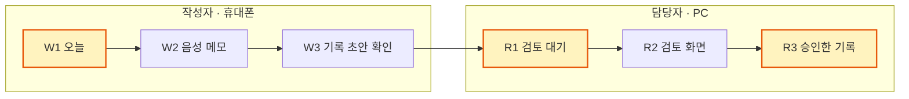

# 화면 문구 v1.0 — W1·R1·R3

| 문서 | 작성 | 작성일 | 대상 화면 | 받는 사람 | 상태 |
| --- | --- | --- | --- | --- | --- |
| 화면 문구 정의 | 기획 담당 | 2026-10-21 | W1(오늘), R1(검토 대기), R3(승인한 기록) | 프론트엔드 담당 | 의견 받는 중 |

> [!NOTE]
> **이 문서는 화면에 들어갈 글자만 정합니다.** 배치와 동작은 [화면 설계 v1.1]을 따릅니다.
> 10/22 멘토링 시연(시나리오 1)에 나오는 화면 중, 문구가 비어 있던 W1·R1·R3를 채웠습니다.

## 한눈에 보기

색칠한 3개 화면이 이 문서의 범위입니다. W2·W3·R2 문구는 [화면 설계 v1.1]과 [시연 대본 v1.0]에 이미 있습니다.

| 무엇 | 개수 | 어디 |
| --- | --- | --- |
| 새로 지은 문구 (의견 주세요) | 11개 + W1 베트남어 | [새로 지은 문구](#새로-지은-문구) |
| 프론트엔드·백엔드 담당에게 묻는 것 | 5개 | [물을 것](#물을-것) |
| 시연 뒤 바꿀지 정할 말 | 6개 | [나중에 바꿀 후보](#나중에-바꿀-후보) |

**문구를 정한 원칙**

1. **이미 정해진 말은 그대로.** 화면 설계·기획안·대본에 있는 말은 바꾸지 않았습니다. 바꾸고 싶은 말은 [나중에 바꿀 후보](#나중에-바꿀-후보)에 적었습니다.
2. **현장에서 쓰는 말 중 쉬운 쪽.** 서식 → 교재 → 현장 업무 → 쉬운 일상어 순서로 골랐습니다.
3. **짧게, 정중하게.** 한 줄, "-습니다 / -하세요"체.
4. **같은 것은 같은 이름으로.** 예: W1 배지 '보냄' = W4 탭 '보냄'.
5. **작성자 화면만 베트남어.** R1·R3는 한국어만. 작성자 화면은 [화면 설계 v1.1] 병기 원칙(10/25)을 따릅니다: 내 말은 그대로, 남이 쓴 내용은 병기, 화면 틀(탭·제목·날짜·배지·버튼)은 한국어만.

**표 읽는 법:** 각 표의 **출처** 칸은 그 문구를 가져온 문서입니다. 문서 이름을 누르면 GitHub의 그 문서로 갑니다. **새로 지음**은 어느 문서에도 없어 이번에 새로 지은 문구입니다.

---

## 새로 지은 문구

의견이 있으면 이 표를 보고 알려 주세요. 나머지 문구는 기존 문서에 의해 이미 정해진 표현입니다.

| 화면 | 위치 | 문구 |
| --- | --- | --- |
| W1 | 안내 한 줄 | 카드를 눌러 기록을 시작하세요. |
| W1 | 주황 띠 | 되돌아온 기록 1건 |
| R1 | 건수 | 검토 대기 1건 |
| R1 | 정렬 표시 | '확인 필요' 칸 이름 옆에 ▼ (문구 없음) |
| R1 | 정렬 표시의 화면 읽기용 이름 | 확인 필요 많은 기록부터 정렬됨 |
| R1 | 필터 버튼 | 필터 지우기 |
| R3 | 목록 표 칸 | 어르신 / 급여 종류 / 작성자 / 기록 날짜 / 승인한 사람 / 승인 시각 |
| R3 | 목록 빈 상태 | 승인한 기록이 없습니다. |
| R3 | 이력 제목 | 기록 이력 |
| R3 | 단계마다 누가·언제 | 마이 · 10월 22일 오후 4:01 |
| R3 | AI가 한 일의 '누가' | AI 초안 · 10월 22일 오후 4:00 |
| W1 | 베트남어 줄 전부 | [W1 베트남어](#w1-베트남어) |

---

## 공통 — 모든 화면

| 위치 | 한국어 | 언제 | 출처 |
| --- | --- | --- | --- |
| 화면 맨 위 띠 | MOCK · AI·받아쓰기는 가짜 응답입니다 | AI가 Mock 모드일 때. 인쇄에는 안 나옴 | 코드 [mock-badge.tsx] |
| 화면 맨 위 띠 | 연습용 · 합성 사례 | 교육용 기관 계정일 때 | [화면 설계 v1.1] '교육용 기관에서 달라지는 점' |

> [!IMPORTANT]
> **상태 배지는 색만으로 구분하지 않고 글자를 함께 씁니다.** ([화면 설계 v1.1] 공통 규칙, W3C 웹 접근성 1.4.1)

---

## W1(오늘)

`작성자` `휴대폰` `병기: 안내 한 줄·주황 띠·빈 상태만`

| 위치 | 한국어 | 출처 |
| --- | --- | --- |
| 하단 탭 | 오늘 / 기록함 / 도우미 / 내 정보 | [기획안 v1.1.1] '메뉴와 화면' |
| 화면 제목 | 오늘 | [기획안 v1.1.1] '메뉴와 화면' (하단 탭 이름) |
| 날짜 | 10월 22일 (목) | [화면 설계 v1.1] 공통 규칙 (날짜는 글자로) |
| 안내 한 줄 | 카드를 눌러 기록을 시작하세요. | **새로 지음** |
| 카드: 이름 | 김○○ 어르신 | [화면 설계 v1.1] W1 (가명) |
| 카드: 급여 종류 | 시설 / 재가 | [화면 설계 v1.1] W1 |
| 카드: 시간 이름 | 시설은 "돌봄 시간", 재가는 "방문 시간" | [화면 설계 v1.1] W1 ("방문·돌봄 시간") |
| 카드: 시간 값 | 매일 오전 7:00 ~ 오후 4:00 | [화면 설계 v1.1] 공통 규칙 (시간은 글자로), [데모 데이터] |
| 상태 배지 | 작성 전 / 임시 저장 / 보냄 / 되돌아옴 / 승인됨 | [화면 설계 v1.1] W1 |
| 주황 띠 (되돌아온 기록이 있을 때) | 되돌아온 기록 1건 | 띠가 있다는 것만 [화면 설계 v1.1] W1, 문구는 **새로 지음** |
| 빈 상태 | 오늘 담당 어르신이 없습니다. 담당자에게 문의하세요. | [화면 설계 v1.1] W1 |

### W1 베트남어

> [!NOTE]
> **병기 원칙(10/25) 적용:** W1에서 베트남어를 꼭 넣을 줄은 **안내 한 줄, 주황 띠, 빈 상태** 세 개입니다. 하단 탭·화면 제목·날짜·급여 종류·시간·상태 배지는 화면 틀이라 한국어만 둡니다. 아래 표의 나머지 줄은 번역 참고용으로 남깁니다.

> [!WARNING]
> **AI 초안, 원어민 검수 전입니다.** 다른 AI(ChatGPT)에 한 번 검수를 맡겨 고쳤습니다([AI 규칙 v1.1] 팀 자체 검증). 역번역은 베트남어를 다시 한국어로 옮긴 뜻입니다.

| 위치 | 베트남어 | 역번역 |
| --- | --- | --- |
| 하단 탭 | Hôm nay / Nhật ký / Hỗ trợ / Cá nhân | 오늘 / 기록 / 도움 / 내 정보 |
| 화면 제목 | Hôm nay | 오늘 |
| 날짜 | Thứ Năm, ngày 22 tháng 10 | 목요일, 10월 22일 |
| 안내 한 줄 | Nhấn vào thẻ để bắt đầu ghi chép. | 카드를 눌러 기록을 시작하세요. |
| 카드: 이름 | (번역하지 않음) | — |
| 카드: 급여 종류 | Tại cơ sở / Tại nhà | 시설에서 / 집에서 |
| 카드: 시간 이름 | Giờ chăm sóc / Giờ chăm sóc tại nhà | 돌봄 시간 / 재가 돌봄 시간 |
| 카드: 시간 값 | Hằng ngày, từ 7:00 sáng đến 4:00 chiều | 매일 오전 7시부터 오후 4시까지 |
| 상태 배지 | Chưa ghi / Đã lưu tạm / Đã gửi / Bị trả lại / Đã duyệt | 아직 안 씀 / 임시 저장함 / 보냄 / 돌려받음 / 승인됨 |
| 주황 띠 | 1 hồ sơ bị trả lại | 돌려받은 기록 1건 |
| 빈 상태 | Hôm nay bạn chưa có người cao tuổi được phân công chăm sóc. Vui lòng hỏi nhân viên phụ trách. | 오늘 배정된 담당 어르신이 없습니다. 담당 직원에게 문의해 주세요. |

> [!TIP]
> **프론트엔드 담당 참고**
> - **시간 값:** 담당 시간은 DB에 `매일 07:00~16:00`처럼 글자 그대로 저장됩니다([데모 데이터]의 `assignments.schedule`). "오전 7:00 ~ 오후 4:00"으로 바꿔 보여 주면 좋고, 어려우면 저장된 글자를 그대로 보여 줘도 시연에는 지장이 없습니다.
> - **베트남어 길이:** 번역하면 글이 30%, 언어에 따라 두 배까지 길어집니다([Material Design 다국어 원칙]). 카드·탭·배지는 칸 폭을 고정하지 말고 두 줄까지 허용해 주세요.
> - **번역 메모:** '담당자'는 "nhân viên phụ trách(담당 직원)", '방문 시간'은 "Giờ chăm sóc tại nhà(재가 돌봄 시간)"로 옮겼습니다. "người quản lý(관리자)", "đến thăm(사적인 방문)"으로 오해될 수 있다는 검수 의견을 따랐습니다.

---

## R1(검토 대기)

`담당자` `PC` `한국어만`

| 위치 | 한국어 | 출처 |
| --- | --- | --- |
| 왼쪽 메뉴 | 검토 대기 / 승인한 기록 / 어르신·작성자 / 설정 | [기획안 v1.1.1] '메뉴와 화면' |
| 화면 제목 | 검토 대기 | [기획안 v1.1.1] '메뉴와 화면' (메뉴 이름) |
| 건수 | 검토 대기 1건 | **새로 지음** |
| 정렬 표시 | 문구 없음. '확인 필요' 칸 이름 옆에 ▼ (확인 필요가 많은 기록이 위로) | 정렬 규칙은 [화면 설계 v1.1] R1, 표시 방식은 **새로 지음** |
| 정렬 표시의 화면 읽기용 이름 | 확인 필요 많은 기록부터 정렬됨 | **새로 지음** (눈에 보이지 않고 화면 읽기 프로그램만 읽음) |
| 표 칸 | 어르신 / 급여 종류 / 작성자 / 방문·돌봄 시간 / 확인 필요 / 받은 시각 | [화면 설계 v1.1] R1 |
| 칸 값: 급여 종류 | 시설 / 재가 | [화면 설계 v1.1] R1 |
| 칸 값: 방문·돌봄 시간 | 재가: 방문 시작~종료 (예: 오후 2:00 ~ 오후 5:00) 시설: 담당 시간 (예: 매일 오전 7:00 ~ 오후 4:00) | [화면 설계 v1.1] R1, [DB 설계] |
| 칸 값: 확인 필요 | 1개 | [시연 대본 v1.0] 8단계 ("확인 필요 1개 남음") |
| 칸 값: 받은 시각 | 10월 22일 오후 4:03 | [화면 설계 v1.1] 공통 규칙 (날짜·시간은 글자로) |
| 필터 | 작성자 / 날짜 / 급여 종류 | [화면 설계 v1.1] R1 |
| 필터 버튼 | 필터 지우기 | **새로 지음** |
| 빈 상태 | 검토할 기록이 없습니다. | [화면 설계 v1.1] R1 |

> [!TIP]
> **참고**
> - **시설 기록의 시간:** 방문 시작·종료 시간은 재가 기록에만 있습니다([DB 설계]의 `records.visit_start·visit_end`). 시설 기록은 담당 시간을 보여 주는 안입니다.
> - **정렬 ▼:** 글자 없는 아이콘이라 화면 읽기 프로그램용 이름을 붙입니다([화면 설계 v1.1] 공통 규칙 "아이콘에는 항상 글자 이름"). 화살표 모양과 구현 방법은 프론트엔드 담당이 정합니다.

---

## R3(승인한 기록)

`담당자` `PC` `한국어만`

**목록**

| 위치 | 한국어 | 출처 |
| --- | --- | --- |
| 화면 제목 | 승인한 기록 | [기획안 v1.1.1] '메뉴와 화면' (메뉴 이름) |
| 표 칸 | 어르신 / 급여 종류 / 작성자 / 기록 날짜 / 승인한 사람 / 승인 시각 | **새로 지음** (R1 표와 같은 말. 값은 [DB 설계]에 있음) |
| 빈 상태 | 승인한 기록이 없습니다. | **새로 지음** (R1 빈 상태와 같은 꼴) |

**상세**

| 위치 | 한국어 | 출처 |
| --- | --- | --- |
| 이력 제목 | 기록 이력 | **새로 지음** |
| 이력 단계 | 작성 → 보냄 → 검토·수정 → 승인 | [화면 설계 v1.1] R3 |
| 단계마다 누가·언제 | 마이 · 10월 22일 오후 4:01 | 누가·언제를 쓴다는 것은 [화면 설계 v1.1] R3, 모양은 **새로 지음** |
| AI가 한 일의 '누가' | AI 초안 · 10월 22일 오후 4:00 | **새로 지음** ([DB 설계]에서 행위자가 비어 있는 이력 = 시스템) |
| 버튼 | [인쇄·PDF] | [화면 설계 v1.1] R3 |
| 버튼 (잠김) | [가족과 공유] | [화면 설계 v1.1] R3 |
| [가족과 공유]를 누르면 | 승인 후, 고른 내용만 공유하는 기능입니다. 준비 중 | [화면 설계 v1.1] R3 |

**인쇄 화면 (시설, 별지 제16호)**

| 위치 | 한국어 | 출처 |
| --- | --- | --- |
| 서식 제목 | 장기요양급여 제공기록지(시설급여/단기보호) | [별지 제16호 원문] |
| 표시 | 공식 기록지 아님 | [화면 설계 v1.1] R3 |
| 서명란 | 작성자 성명(서명) — 영역마다 | [별지 제16호 원문] (수급자·보호자 서명란 없음) |

> [!TIP]
> **참고**
> - **되돌린 기록의 이력:** 위 이력 4단계(작성 → 보냄 → 검토·수정 → 승인)는 담당자가 한 번에 승인한 경우입니다. 담당자가 기록을 되돌리고 작성자가 고쳐 다시 보낸 경우, 이력에 '되돌림' 단계와 사유를 보여 줄지는 아직 정하지 않았습니다. 되돌리기를 보여 주는 시나리오 2를 만들 때 정합니다. 10/22 시연(시나리오 1)은 한 번에 승인하므로 해당 없습니다.
> - **교육용 기관 (10/25):** 강사도 담당자와 같은 흐름이라 배지와 R3 문구가 같습니다. '코멘트 받음' 배지는 뺐습니다. 교육용 기관의 R3는 강사가 승인한 연습 기록이고, 목록·인쇄에 '연습용' 표시만 더합니다(결정 기록 `문서/결정/2026-10-25-강사흐름통일.md`).

---

## 질문사항

**프론트엔드 담당**

- [ ] 화면 제목을 메뉴 이름과 같게 써도 되는지 (화면 위에 메뉴 이름이 이미 보이면 제목을 빼도 됨)
- [ ] W1 시간 값을 "오전 7:00 ~ 오후 4:00"으로 바꿔 보여 줄 수 있는지
- [ ] 카드·탭·배지가 베트남어로 길어져도 넘치지 않는지
- [ ] 재가 인쇄 서식 제목(별지 제12호)은 시나리오 2 화면을 만들 때 데이터 담당 서식 정리 문서에서 가져와도 되는지

**백엔드 담당**

- [ ] R1 '방문·돌봄 시간' 칸에서 시설 기록은 담당 시간(`assignments.schedule`)을 보여 줘도 되는지

---

## 나중에 바꿀 후보

10/22 멘토링 뒤 팀원들과 논의 후 정합니다. 이미 정해진 말이라 바꾸려면 [화면 설계 v1.1]·[시연 대본 v1.0]·[s-f01]을 함께 고쳐야 합니다(코드 문구는 코드).

| # | 지금 | 후보 | 왜 |
| --- | --- | --- | --- |
| 1 | 시설 / 재가 | 시설급여 / 방문요양 | 법정 서식의 말. 현장 프로그램([케어포])도 이렇게 나눔 |
| 2 | [확인함] / [기록 안 함] | [확인 완료] / [기록에서 빼기] | 버튼만 보고 결과를 알 수 있게 |
| 3 | W1 주황 띠 "되돌아온 기록 1건" | 고쳐서 다시 보낼 기록 1건 / 보완 필요 기록 1건 / 수정 필요 기록 1건 | 작성자가 무엇을 해야 하는지 드러나게 |
| 4 | 상태 배지 "되돌아옴" (W1 카드, W4 탭) | 3번을 정한 뒤 함께 검토 | 띠와 배지가 같은 상태를 두 이름으로 부르지 않게 |
| 5 | W1 "방문 시간" (재가) | 재가 돌봄 시간 | 베트남어 번역과 뜻을 맞추기 |
| 6 | MOCK 띠 "MOCK · AI·받아쓰기는 가짜 응답입니다" | MOCK · AI와 받아쓰기는 미리 만든 응답으로 동작합니다 / MOCK · AI 결과는 미리 만든 응답입니다 / MOCK · 미리 만든 응답으로 시연 중 | 문장이 어색하고, 대본 오프닝("미리 만든 응답")과 말을 맞추기 |

<b>후보별 자세한 이유</b>

**3·4. "되돌아온 기록", "되돌아옴"**
- "되돌아온"은 무슨 일이 있었는지만 말하고, 작성자가 무엇을 해야 하는지는 말하지 않아 모호합니다.
- 띠 문장만 바꾸면 화면 설계는 그대로 둘 수 있습니다.
- "보완 필요"·"수정 필요"는 '확인 필요'와 꼴이 같아 헷갈릴 수 있습니다.
- **ChatGPT 검수 의견:** 베트남어 "Bị trả lại"는 반송·반려 느낌이 강해 배지에는 "Cần sửa(수정 필요)"가, 띠에는 "1 bản ghi cần sửa(수정할 기록 1건)"가 더 분명하다고 함. 한국어 배지·띠와 뜻이 어긋나지 않게 **한국어를 먼저 정한 뒤** 베트남어를 함께 바꿉니다. 이때 '기록'은 하단 탭과 같은 "nhật ký"로 맞춥니다(예: "1 nhật ký cần sửa").

**5. "방문 시간"**
- 베트남어 검수에서 '방문'을 직역("đến thăm")하면 사적인 방문처럼 들린다는 의견이 나와 "chăm sóc tại nhà(재가 돌봄)"로 옮겼습니다. 지금은 이 줄만 한국어와 베트남어 뜻이 조금 다릅니다.

**6. MOCK 띠**
- "AI·받아쓰기는 가짜 응답"은 AI 자체가 응답이라는 말이 되어 주어와 서술어가 맞지 않습니다.
- "가짜"는 시연에서 불리하게 들립니다.

---

<b>참고한 기준과 사례</b>

| 구분 | 자료 | 이 문서에 반영한 것 |
| --- | --- | --- |
| 쉬운 말 | [GOV.UK — Writing for user interfaces](https://www.gov.uk/service-manual/design/writing-for-user-interfaces), [A to Z style guide](https://guidance.publishing.service.gov.uk/writing-to-gov-uk-standards/style-guides/a-to-z-style-guide/) | 쉬운 말, 중요한 것을 먼저, 한 줄 문구 |
| 공공언어 | [공공언어 관련 자료(행정안전부 PDF)](https://dams.pa.go.kr/dams/DOCUMENT/2023/11/30/DOC/SRC/0A04202311301611096041877011783.pdf) | 낯선 한자어·외래어를 피함 |
| 접근성 | [W3C — Understanding SC 1.4.1 Use of Color](https://www.w3.org/WAI/WCAG21/Understanding/use-of-color.html) | 상태를 색과 글자로 함께 표시 |
| 다국어 | [Material Design 다국어 원칙] | 베트남어 줄의 길이 여유 |
| 국내 사례 | [스마트장기요양(건강보험공단)](https://apps.apple.com/kr/app/%EC%8A%A4%EB%A7%88%ED%8A%B8%EC%9E%A5%EA%B8%B0%EC%9A%94%EC%96%91/id6745545595), [케어포] | 현장에서 쓰는 말(급여제공기록지, 수급자, 시설급여, 방문요양). 앱 소개 기준이라 실제 화면 문구는 확인 전 |
| 해외 사례 | [카나믹 다국어 개호기록(일본, 인포마트 자료)](https://www2.infomart.co.jp/web/jp/images/upload/207/140120180402403035_5900965.pdf) | 현지어와 외국어를 나란히 표시. "한국어 위·베트남어 아래"와 같은 접근 |

**저장소 문서:** [화면 설계 v1.1], [기획안 v1.1.1], [별지 제16호 원문], [시연 대본 v1.0], [용어 목록], [AI 규칙 v1.1], [s-f01], [mock-badge.tsx], [DB 설계], [데모 데이터]

[화면 설계 v1.1]: https://github.com/2dion/CareBridge/blob/main/%EB%AC%B8%EC%84%9C/%EC%84%A4%EA%B3%84/%ED%99%94%EB%A9%B4-v1.1.md
[기획안 v1.1.1]: https://github.com/2dion/CareBridge/blob/main/%EB%AC%B8%EC%84%9C/%EA%B8%B0%ED%9A%8D/%EA%B8%B0%ED%9A%8D-v1.1.1.md
[별지 제16호 원문]: https://github.com/2dion/CareBridge/blob/main/%EC%B0%B8%EA%B3%A0%EC%9E%90%EB%A3%8C/%EB%8F%84%EB%A9%94%EC%9D%B8/%EC%84%9C%EC%8B%9D/%EB%B2%95%EC%A0%95/%EB%B3%84%EC%A7%8016%ED%98%B8-%EC%8B%9C%EC%84%A4%EA%B8%89%EC%97%AC.md
[시연 대본 v1.0]: https://github.com/2dion/CareBridge/blob/main/%EB%AC%B8%EC%84%9C/%EC%84%A4%EA%B3%84/%EC%8B%9C%EC%97%B0%EB%8C%80%EB%B3%B8-%EC%8B%9C%EB%82%98%EB%A6%AC%EC%98%A41-v1.0.md
[mock-badge.tsx]: https://github.com/2dion/CareBridge/blob/main/web/components/mock-badge.tsx
[데모 데이터]: https://github.com/2dion/CareBridge/blob/main/supabase/seed.sql
[DB 설계]: https://github.com/2dion/CareBridge/blob/main/supabase/migrations/20261021000000_init.sql
[용어 목록]: https://github.com/2dion/CareBridge/blob/main/data/glossary/terms-v0.2.csv
[AI 규칙 v1.1]: https://github.com/2dion/CareBridge/blob/main/%EB%AC%B8%EC%84%9C/%EC%84%A4%EA%B3%84/ai%EA%B7%9C%EC%B9%99-v1.1.md
[s-f01]: https://github.com/2dion/CareBridge/blob/main/data/cases/s-f01.md
[Material Design 다국어 원칙]: https://material.io/blog/localization-principles-techniques
[케어포]: https://apps.apple.com/kr/app/%EC%BC%80%EC%96%B4%ED%8F%AC/id1220736809
